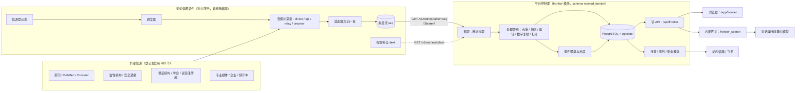
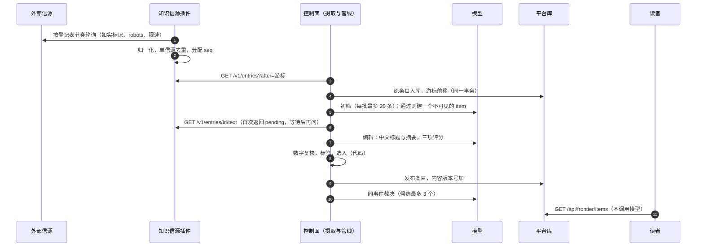
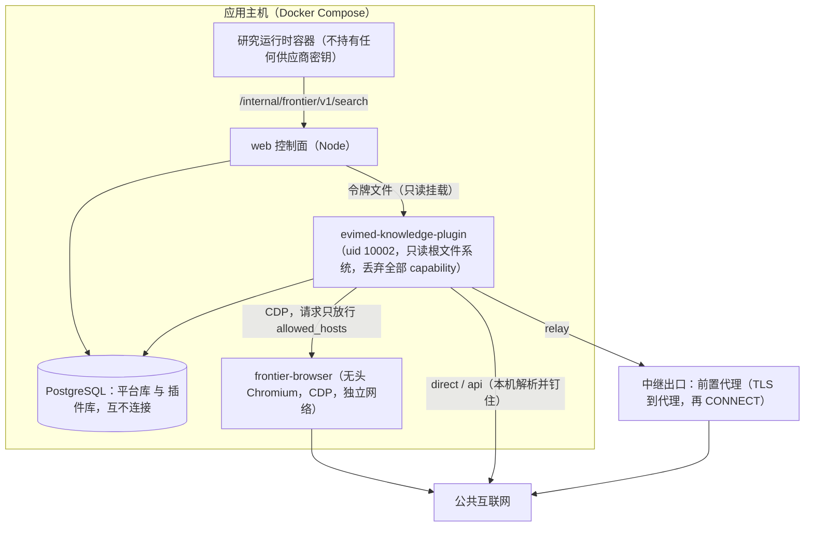
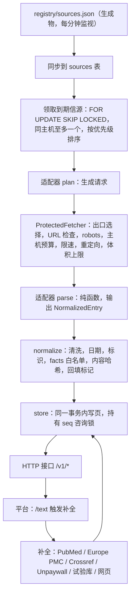
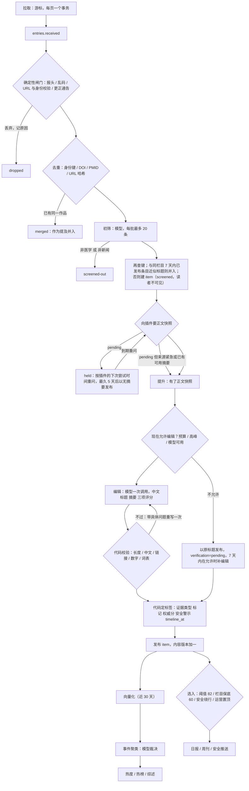
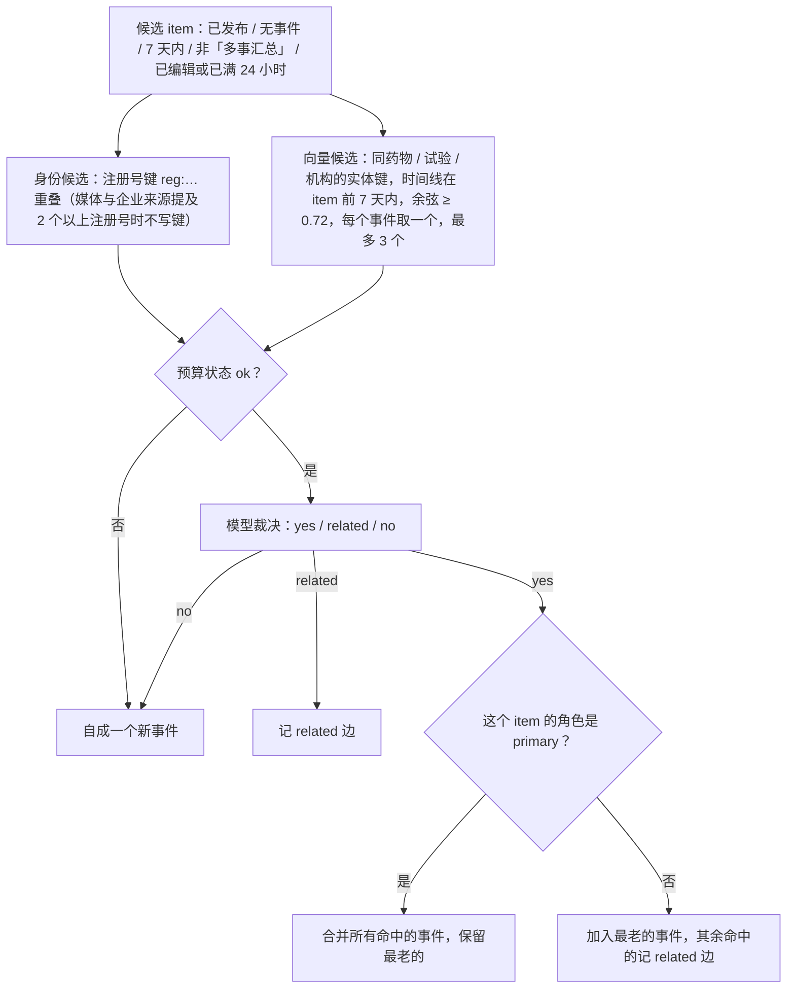
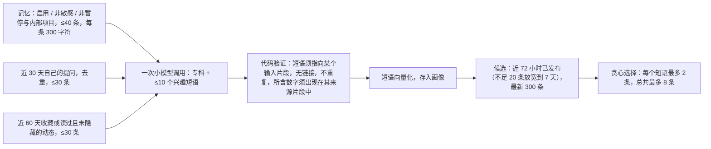

# EviMed「前沿动态」技术方案

**医学知识信源的采集、筛选、编辑与个性化分发**

| 项目 | 内容 |
|:--|:--|
| 文档版本 | 1.0（公开版） |
| 实现快照 | 2026-10-03 |
| 适用代码 | `项目代码/knowledge-plugin/`（知识信源插件）· `OpenScience/apps/server/src/frontier*.mjs`、`knowledgePluginClient.mjs`（控制面模块）· `OpenScience/apps/web/src/**/frontier*`（网页）· `OpenScience/packages/domain/src/frontierVocabulary.mjs`（词表与常量）· `OpenScience/packages/contracts/knowledge-plugin/`（接口契约） |
| 状态 | 模块默认关闭（`OPEN_SCIENCE_FRONTIER_ENABLED`）；开启后可按账号放开（`AUDIENCE`、`PREVIEW_USERS`） |
| 许可证 | 以仓库中各目录的 `LICENSE` 为准，见第 13 章 |

> **怎么读这份文档。** 想知道"这是什么、为什么这样做"，读第 0、1、2 章。想自己部署或二次开发，读第 3、4、12 章。想复核数字和结论是否可信，读第 9、10 章：主要数字都标了出处，样本小的地方写明了，样本小的地方写明了。第 11 章列出已知的局限，不回避。

---

## 目录

0. 摘要
1. 背景、目标与设计原则
2. 总体架构
3. 知识信源插件
4. 平台处理管线：从原始条目到一条可读的动态
5. 阅读、个性化与分发
6. 网页前端
7. 可靠性、安全与隐私
8. 运维与可观测
9. 评测与质量保证
10. 实测数据
11. 与最初方案的差异、已知局限与路线图
12. 自建与二次开发
13. 开源说明：许可证、第三方内容与采集礼仪
- 附录 A 词表　附录 B 配置项　附录 C 接口契约要点　附录 D 数据库表　附录 E 术语

---

## 0. 摘要

**问题。** 医生、临床药师和医学研究者每天最先想知道的是"今天有什么我该知道的"：一项新的试验结果、一份改了的指南、一条药监局的警示、一次召回、一个撤稿。这些信息分散在几百个期刊、监管机构、循证机构和专业媒体里，重复、混杂，证据强弱不明，而且漏看一条安全警示的代价与漏看一篇论文不同。

**做法。** 「前沿动态」是 EviMed Science 里的一个栏目：平台每天替读者读几百个医学信源，只留下值得看的十几到三十条，每条标明**谁说的、证据有多硬**，点开就是原文；同一件事的多方报道合成一个事件，按"有多少家独立机构在报"排热度；安全警示不看热度、发布即置顶；每天早晨出日报，每周出周刊；登录读者零设置地得到"与我相关"；对话里的模型也能查这个库。

**架构一句话。** 一个**独立的知识信源插件**负责"从外部世界到一条规范化条目"的全部脏活（登记表、调度、四个出口、九种读法、归一化、单信源去重、按需补全、健康），平台控制面里的 `frontier` 模块只通过**一份 HTTP 契约、按游标拉取**，再做"筛、编、核、聚、排、推"。读者读到的是平台自己库里已经加工好的内容：**读路径不调用生成模型、不发跨境请求、不读原站、不为每个用户重算内容**（例外只有两个：读者第一次打开一条文献类动态的详情时，英文摘要被翻译一次并共享；带关键词的检索会为查询词做一次嵌入，失败则退回关键词）。

**设计上最想让读者带走的六点。**

1. **确定性的事归代码，语言判断归模型。** 条目身份、来源类型与权威、安全警示判定、标签、选入规则、数字核对，都是代码；证据类型先由代码确定（注册库与 FDA 条目按身份键，安全通报源与企业来源按登记表，文献按 PubMed 文献类型），都没有依据时才用模型的判断；只有"是不是医学新闻""属于哪一栏""中文标题与摘要怎么写""影响/新颖/相关各几分""两条是不是同一件事"交给模型（专科与实体名也由模型给出），并且模型的每个输出都要过代码校验。此外事件综述、日报的"AI 一分钟"、摘要译文与读者画像也由模型写，同样过代码校验。
2. **模型写出的每个数字都要在原文里找得到。** 中文摘要里的数字，经过规范化后必须逐个出现在喂给模型的那段原文里（标识符里的数字、"一项"这类冠词、"数十"这类约数除外，见 4.8 节），找不到就让模型带着具体问题重写一次，再不行就只发标题。这条规则是代码，不是提示词。
3. **热度按独立机构计，不按讨论量计。** 一件事被多少家**独立机构**报道（同一机构的多个渠道只算一次），按来源权威加权、按报道时间指数衰减（半衰期 36 小时）。同一件事的论文、官方通告、媒体报道与社论由模型裁决是否合并；历史上出现过的五类误并，现在分别由代码在裁决前排除（"多事汇总"文章、报道里提及的多个注册号）、由代码在裁决后执行（只有一手来源才能把两个事件桥在一起），或交给模型（模板化通告写进了裁决提示词；"不同作品"没有专门规则，由模型看着双方的 DOI/PMID 逐对判断），见 4.11 节。
4. **安全警示是单独的通道。** 一类召回、监管机构的安全通报，不看分数与热度，直接选入、置顶；只推给**主动关注**了相关药物、专科或事件的读者；推送前一刻再核一次资格。
5. **个性化只重排，不重写。** 内容为所有人写一份；"与我相关"读读者自己的记忆、提问和收藏，经一次小模型调用抽取兴趣短语，再用向量与关键词在候选里重排；每个短语最多占两条，总共最多八条；不建独立设置页。
6. **失败时保留部分结果。** 模型预算用尽，已过初筛且已有正文快照的条目照常发布、只带原标题，尚未初筛的等到次日；供应商余额耗尽，等待而不消耗重试次数；插件宕机，读者照常读平台库里已有的内容，就绪检查只给警告不变红；日报缺了，保留前一期、不向读者报错。

**规模（实现快照）。** 信源登记表 720 行、启用 492 个（直连 422、中继 45、无头浏览器 23、资料检索接口 2）；八个栏目、六类来源、十类证据类型、二十一个专科；插件契约 v1.2.0；平台库 `evimed_frontier` 22 张表（外加条件表 `item_vectors`，以及证据专区的 10 张表）、插件库 8 张表；服务端每日模型预算默认 10 元；选入目标是工作日 15–30 条，阈值 82 的回放估计约 14–29 条。

**状态与边界。** 这是一个已实现、已在受控范围内运行、并经过由未参与构建的 AI 代理做过只读验收的模块（第 9、10 章），不是设想。它**不是**文献检索引擎、**不是**临床决策工具：栏目里的每一条都是"线索"，要引用请读原文（对话里的 `frontier_search` 工具也被明确要求引用原文而不是本栏目）。

---

## 1. 背景、目标与设计原则

### 1.1 要解决的问题

EviMed Science 的每个入口原本都要求用户**先有问题**：打开对话提问、选一个科研工具、往知识库放资料。但医生和研究者每天最先发生的事是浏览"今天有什么新东西"，他们现在靠七八个公众号、几封期刊邮件和同行的转发完成这件事，信息重复、来源混杂、看完就散。这个栏目补上这个入口，并把它接到平台已有的能力上：看到一条新证据，可以带着它开一个研究对话、存进知识库、整理成证据卡片，或者关注它的药物、专科和事件。

三类读者各自得到的：

| 读者 | 每天打开它，得到什么 |
|:--|:--|
| 临床医生 | 本专科改变实践的新证据与新指南，两三句中文讲清；药物安全警示不会漏 |
| 临床药师 | 说明书修订、召回、药物警戒信号、医保与集采、超说明书用药证据 |
| 医学研究者 | 方向相关的新论文与预印本、方法学进展、撤稿、基金指南、可用于科研的 AI 工具 |

### 1.2 目标与非目标

**目标**

| 编号 | 目标 | 怎么衡量 |
|:--|:--|:--|
| G1 | 覆盖：医学期刊、监管与安全通报、循证机构与学会、试验注册库、专业媒体 | 登记表行数、启用数、按类型与出口的分布；信源健康比例 |
| G2 | 精选：工作日 15–30 条值得看的，而不是全部 | 每日选入数；各栏目至少有候选 |
| G3 | 每条标明来源与证据强弱 | 来源类型、证据类型、来源权威由代码给出，可核对 |
| G4 | 数字可信 | 摘要里的数字逐个能在原文找到；首轮通过率与"只发标题"比例有告警 |
| G5 | 同一件事合并为一个事件，热度可解释 | 误并率（独立验收抽检）；热度公式公开并显示在页面上 |
| G6 | 安全警示不漏、不滥推 | 判定规则在代码里（对非安全通报源的监管机构，依据编辑给出的证据类型与栏目）；推送只给主动关注者；每条每人至多一次 |
| G7 | 读路径稳定快速 | 读路径四个"永不"（5.3 节）；列表 304 缓存；接口 p95 告警线 0.3 秒 |
| G8 | 可关、可拆、可复用 | 模块默认关；插件可被任何遵守契约的消费者使用 |

**非目标**

- **不做文献检索引擎。** 它不回答"某个问题的证据是什么"；那是平台里证据综合等能力的事。这里的搜索只在"已入库的动态"里找线索。
- **不做临床决策支持。** 栏目内容是线索，不构成证据；对话工具的描述和返回里直接写明（英文原文见 5.9 节）：结果是线索不是证据，请读原文并引用原文，不要引用本栏目。
- **不转载全文。** 只存标题、来源提供的摘要或网页正文节选（上限见 3.9）、结构化事实与链接；读者看到的最多是来源提供的摘要及其中文翻译；付费全文不取，PDF 不解析（开放获取的 PDF 只在读者主动"存入知识库"时取回）。
- **不做社交媒体与社区内容。** 不依赖 X 等账号流；信源主体是期刊、监管机构、循证机构和专业媒体。
- **不求实时。** 登记表允许的轮询间隔下限是 300 秒，实际启用的信源最短 30 分钟，并在各自的下限与上限之间自适应（下限 30 分钟到 7 天，多数上限 2–72 小时）；热点榜每 10 分钟重算。
- **不为每个用户生成内容。** 内容管线全平台只跑一份，成本与用户数无关；只有"与我相关"的画像随用户计：画像满一天或其输入（收藏、提问、记忆）变化时重算，每轮最多 5 人、每人一次小模型调用。

### 1.3 设计原则

这些原则不是口号，每一条在后文都有对应的机制或测试。

| # | 原则 | 在本系统里的体现 |
|:--|:--|:--|
| P1 | **确定性归代码，语言判断归模型** | 身份键、权威分、安全警示、标签、选入、数字核对、格式修正都是代码，证据类型先由代码（身份键、登记表、PubMed 文献类型）决定；模型只做筛选判断、栏目与专科、中文改写、打分、同事件裁决、摘要与画像（第 4 章） |
| P2 | **读路径不依赖任何上游** | 无生成模型调用、无跨境请求、无读原站、无按用户重算内容；例外是读者第一次打开一条文献类动态的详情时翻译摘要一次，以及关键词检索对查询词做一次嵌入（5.3 节） |
| P3 | **一条窄契约，单向拉取** | 插件不调用平台、不存用户数据、不做内容生成；动态的采集全部由插件完成，平台自己只在证据专区复核原文和读者"存入知识库"取开放获取 PDF 时直接向信源或原站请求；契约在同一主版本内只增不改 |
| P4 | **失败保留部分结果** | 预算耗尽→已过初筛且有正文快照的只发原标题、其余等次日；供应商余额耗尽→等待不耗重试；插件宕机→读平台库；日报缺失→保留上一期 |
| P5 | **每个限额有理由、有计数器，并尽量有配置键** | 预算、并发、阈值、节拍、时区等有配置键，指标族与告警线对应（第 8 章、附录 B）；少数经验常量（每信源每日选入上限、栏目保底分、聚类余弦阈值、热榜独家分数线）目前写死在代码里，列在 11.2 节 |
| P6 | **数字是被核对的产物** | 摘要里的数字必须在原文里（4.8 节）；热度数字由公开公式算出，页面里解释公式 |
| P7 | **诚实采集** | 如实的爬虫标识（含联系方式；浏览器出口用 Chrome 字串并附同一标识）、页面类请求遵守 robots.txt、按主机限速（部分主机，多为 API，另设日上限）、不识别验证码（3.4、13.3 节） |
| P8 | **模块可关、可拆、故障隔离** | 关闭时 `/api/frontier/*` 一律回 404（错误码 `frontier_not_enabled`）、不返回任何内容；状态码与不存在的路径相同，错误码不同（后者为 `not_found`）；一个循环失败不影响另一个；就绪检查只对内部不变量变红 |
| P9 | **每次事故变成评测用例，不是关键词** | `evals/frontier-editing` 把生产事故回放进真实编辑器（第 9 章） |
| P10 | **可删除的脚手架要标明** | 数字核对与编辑校验都在注释里写明"哪种模型能力出现后可以删除" |

---

## 2. 总体架构

### 2.1 三层与两条边界



**边界一：外部世界 ↔ 插件。** 动态的采集所需的全部对外请求都由插件发出，走受保护的采集层。平台自己只在两处直接向信源或原站请求：证据专区复核原文（Europe PMC、ClinicalTrials.gov 及来源链接，经平台的网页读取通道，直连时钉住 DNS，配置了境外节点时被拒或超时会经该节点回退），和读者主动"存入知识库"时取开放获取的 PDF（走钉住 DNS 的网页传输）。除此之外，平台还会经模型网关调用模型、调用嵌入服务、向 IM 渠道投递通知、把证据专区读到的 PDF 交给文档解析服务，以及在需要时经渲染浏览器绘制页面。

**边界二：插件 ↔ 平台。** 唯一的联系是一份 OpenAPI 契约（当前 v1.2.0）和一个 Bearer 令牌。平台拉取，插件从不回调；插件不存任何用户数据，也不做任何生成内容的模型调用。两边各自有数据库，同一个 PostgreSQL 实例里的两个库，**互不连接**。

这样切的好处是：信源和字段可以一批一批加，平台不发版就能用上（契约同一主版本内只增不改，平台忽略未知字段）；插件可以由另一个团队维护、以另一个节奏发布；采集侧的事故不会变成对外部站点的重复请求。

### 2.2 组件一览

| 组件 | 技术 | 位置 | 持有的状态 | 职责 |
|:--|:--|:--|:--|:--|
| 知识信源插件 | Python 3.12，FastAPI + 调度器同进程，psycopg3 | `项目代码/knowledge-plugin/` | 插件库 `evimed_knowledge`（8 张表） | 登记表、调度、四个出口、九种读法、归一化、单信源去重、按需补全、信源健康、契约接口 |
| 接口契约 | OpenAPI 3.1 | `OpenScience/packages/contracts/knowledge-plugin/` | — | 两侧共同遵守的唯一接口；含重放测试与录制夹具 |
| 摄取与管线 | Node 22（无需构建的 `.mjs`） | `frontierIngest/Pipeline/Editor/Numbers.mjs` | 平台库 `evimed_frontier` | 拉取游标、去重、补全等待、初筛、编辑、数字核对、标签、选入 |
| 事件与热度 | 同上 | `frontierEvents.mjs` | 同上 | 事件聚类、热度、热点榜、周/月榜、事件综述 |
| 服务与读模型 | 同上 | `frontierService/Routes/Persistence.mjs` | 同上 | `/api/frontier/*`、检索、阅读状态、关注与屏蔽 |
| 个性化 | 同上 | `frontierProfiles.mjs` | `user_profiles` | 画像抽取、"与我相关"重排 |
| 日报/周刊/推送 | 同上 | `frontierDaily/Weekly/Notifications.mjs` | `dailies`、`weeklies` | 定时出刊、安全警示推送 |
| 内部网关与工具 | Node + Python MCP | `frontierGateway.mjs`、`runtime/mcp/evimed-research/frontier_search.py` | — | 给对话运行时里的模型查询动态 |
| 证据专区 | 同上 | `evidenceZone*.mjs`、`evidenceEditorial.mjs` | `evidence_*`（10 张表） | 在动态之上的、带来源的"证据卡片"层（5.10 节） |
| 网页 | React + TypeScript + Vite | `apps/web/src/**/frontier*` | 浏览器历史状态 | 页面、筛选、卡片、事件页、简报、关注 |
| 词表与常量 | 纯 ESM 包 | `packages/domain/src/frontierVocabulary.mjs` | — | 栏目、专科、证据类型、标记、热度常量；前后端共用，页面上的"热度怎么算"由同一份常量生成 |

### 2.3 一条条目的一生



从"原站出现"到"读者看到"的时延由三段组成：插件轮询间隔（在信源的下限与上限之间自适应，下限 30 分钟到 7 天不等）、补全等待（首次要正文时返回 `pending`，平台在插件的下次尝试之后约 5 分钟再问，插件落后时等待逐次加倍，每次不超过 12 小时，最长 5 天；紧急来源和已有可用摘要的条目不等，先提升）、模型处理（分钟级）。需要尽快到达的来源（安全通报、监管机构、权威期刊）在领取队列里优先，并且预算吃紧时仍被编辑。

### 2.4 部署拓扑



要点：

- 插件容器**不发布端口**，只有控制面通过内部网络访问它；令牌是一个由两个容器共同可读的文件（同组只读），轮换是写文件，不是重启。
- 无头浏览器在自己的内部网络里，插件通过 CDP 驱动它（它还与控制面共享一个"网页渲染"内部网络，供 `web_read` 渲染使用，那条路径不经插件的主机白名单，由平台的网页读取通道逐次校验）；浏览器每个渲染一个独立上下文，**页面发出的每个请求**都要过插件的主机白名单，不在名单里的一律中止。
- 研究运行时（对话里的模型所在容器）**不持有密钥**，它只能通过控制面的内部网关查询，网关用运行时令牌识别账号与项目。
- 部署叠加文件只在 `.env` 里设置了插件镜像时才被加入；插件不存在时，其余平台不受影响。

### 2.5 技术栈与依赖

| 层 | 依赖 | 说明 |
|:--|:--|:--|
| 数据库 | PostgreSQL；可选 `pgvector`（≥0.5 才有 HNSW，≥0.7 用 `halfvec`，≥0.8 用迭代扫描）与 `pg_trgm` | 没有扩展时自动降级：无向量腿、无三元组腿，检索只剩关键词，功能不报错 |
| 模型 | DeepSeek（默认 `deepseek-flash`，可配置为网关认证过的其他模型），经平台的模型网关，用途标记 `frontier` | 温度 0、JSON 输出、显式 `max_tokens`；预算先预留后结算 |
| 向量 | 平台钉住的嵌入模型（当前为 1024 维的 DashScope 嵌入） | 向量宽度变了，旧列被清空重建；嵌入模型变了，旧模型的向量不再被查询使用（按 `model_key` 过滤），不同模型的向量不可比 |
| 插件 | `fastapi`、`uvicorn`、`httpx`、`psycopg`/`psycopg-pool`、`pydantic`、`feedparser`、`selectolax`、`playwright`（仅作 CDP 客户端，镜像里不含浏览器） | Python ≥ 3.12 |
| 前端 | React、TypeScript、Vite；设计令牌包 | 页面按路由懒加载 |

---

## 3. 知识信源插件

### 3.1 定位与边界

插件是介于外部世界与 EviMed 平台之间的**一个独立服务**，只负责"知识类"信源：期刊、PubMed 与 Europe PMC 流、监管机构、试验注册库、学会与循证机构、媒体、AI 资讯。它拥有的全部东西是：

- 信源登记表；
- 调度；
- 受保护的采集（四个出口）；
- 解析（九种读法）；
- 规范化与单信源去重；
- 按需补全；
- 信源健康。

它**不做**的事同样重要，并写在契约的规则里：

| 不做 | 为什么 |
|:--|:--|
| 不回调平台 | 平台拉取；插件的任何故障都不会变成对平台的请求风暴 |
| 不存用户数据 | 插件库里没有账号、没有阅读行为 |
| 不做生成内容的模型调用 | 内容的"写"在平台一侧，插件只搬运和规范化（`/v1/health.model_calls_24h` 恒为 0） |
| 不跨信源合并 | 它只给出 `identity_key`，跨信源合并是平台的事（契约规则 3） |
| 不解析 PDF、不取付费全文 | `oa_pdf_url` 只是一个指针 |

### 3.2 进程模型与启动

一个进程，两个部分：HTTP 接口（FastAPI）与爬取循环（调度器），同在 `python -m knowledge_plugin serve`（镜像默认命令）。

启动顺序（`__main__.py`）：

1. 读取登记表文件（`KNOWLEDGE_PLUGIN_REGISTRY`，默认 `registry/sources.json`）；
2. 打开连接池，应用 `schema.sql`（每次启动都跑，幂等，在咨询锁 `evimed-knowledge-v1` 下一个事务里），把登记表同步进 `sources`；
3. 构造主机预算 `HostBudget`，并恢复上次进程留下的主机暂停；
4. 构造受保护抓取器 `ProtectedFetcher`；
5. 没配联系邮箱则告警；
6. 若 `KNOWLEDGE_PLUGIN_CRAWL≠0`，启动爬取循环。设为 `0` 时只提供已存储的流。

爬取循环（同一进程内，各自独立，任何一次迭代失败都不会让循环退出）：

| 循环 | 频率 | 做什么 |
|:--|:--|:--|
| 轮询 | 每 `TICK_S`（默认 5 秒） | 领取到期的信源并读取 |
| 补全 | 每 `TICK_S` | 处理 `/text` 请求排队的补全 |
| 维护 | 每 3600 秒（启动后 60 秒首次） | 保留期清理、重算 `entries_7d` |
| 健康复核 | 每 3600 秒（启动后 120 秒首次） | 对所有启用且未被占用的信源重新套用健康规则 |
| 登记表监视 | 每 60 秒 | 文件修改时间变化则重新同步；新文件无效则保留旧登记表 |

机密只通过**文件路径**传入并在使用时读取（缓存键为 inode、mtime、大小），轮换密钥不用重启；文件缺失、为空都等同于"未配置"。联系邮箱可以是文件或直接的值，文件优先，不出现在日志与 `repr` 里。

命令行：`serve`（默认）、`migrate`（只应用表结构）、`check-registry [path]`（不连数据库，校验登记表以及每个启用行的适配器配置，有问题则退出码 1）；独立入口 `python -m knowledge_plugin.probe --egress {direct,api,relay,browser,all}`（对启用信源按各自出口读一次，什么也不写，每个信源输出一行 JSON，用于生产环境验证那些只能从特定网络位置工作的出口）。

镜像：`python:3.12-slim`，用户与组 `10002:10002`，字节码在构建时编译（运行期不写磁盘），仅复制运行需要的登记表文件，`HEALTHCHECK` 请求 `/v1/health` 且状态为 `ok` 或 `degraded` 才算通过；Playwright 只是 CDP 客户端，镜像里不含浏览器。



### 3.3 信源登记表

#### 3.3.1 文件与生成

| 文件 | 作用 |
|:--|:--|
| `registry/sources.json` | **运行时登记表**，由工具生成，是镜像里唯一带的登记表。顶层 `registry_version`、`skipped`（被跳过的行及原因计数）、`probe_sha256`、`sources[]` |
| `registry/probe-sources.json` | 研究与探测用的原始清单（753 行），记录每个端点的读法、出口、梯队和周产量，其中 155 行带实测记录 |
| `registry/overrides.json` | 手工维护的覆盖（355 个信源，另有一条 `_about` 注释）：字段覆盖生成值，`config` 逐键合并，下划线开头的键是注释；未知 id 使构建失败 |
| `registry/extra-sources.json` | 不在探测清单里的额外行（目前 2 行，都走资料检索接口） |
| `registry/research/` | 启用决定的证据：中继验收探测、信源扩展的取样记录 |

构建器 `tools/build_registry.py` 是**确定性**的：同样的输入产出逐字节相同的文件，`--check` 在已提交文件与生成结果不一致时失败（一项测试跑它）。它做的事：词表映射（如 `news`→`mixed`）；跳过无出口、需登录/付费、邮件订阅类的行；由类别推出 `source_type`、`authority`（媒体上限 3、企业上限 2、预印本上限 2）、`safety_feed`、`owner_entity` 与 `allowed_hosts`；按下表算出节奏；把 URL 改写成日期模板；决定是否启用；最后让适配器自己的 `validate_config` 再过一遍，不通过就禁用并写下原因（显式写了 `enabled` 的覆盖行在构建时跳过这一遍，但 `check-registry` 会校验它们）。

#### 3.3.2 一行登记表的字段

必填：`id`（`^[A-Za-z0-9][A-Za-z0-9._-]{0,119}$`）、`name`、`lane`、`source_type`、`access`、`egress`、`owner_entity`、`launch_tier`、`authority`（1–5）、`safety_feed`、`enabled`、`config`、`poll_floor_s`、`poll_ceiling_s`（须满足 300 ≤ floor ≤ ceiling ≤ 604800）。选填：`homepage`、`language`、`region`、`disabled_reason`、`category`。**未知字段一律拒绝**，词表必须与契约枚举相等（一项测试守着）。

`owner_entity` 的含义是**运营该信源的机构**，不是某个订阅源；平台数"独立机构"时按它去重，同一机构的多个渠道只算一家。

对启用行的额外检查：必须有 `config.url` 或 `urls`；URL 必须是 http(s) 模板，模板字段只能是 `{since, until, now, today, issn, cursor, lookback_days}`，日期格式必须 URL 安全，**字面日期写进 URL 会使构建失败**（否则登记表会随时间悄悄过期）；`access` 与 `egress` 必须是已实现的；列表类读法必须有 `selectors.item`（或 `mode=script-json` 加 `script_var` 与 `fields`）。

#### 3.3.3 当前登记表

720 行，启用 492，停用 228；独立运营机构 387 个（启用的 240 个）。

| 维度 | 启用行的分布 |
|:--|:--|
| 来源类型 | 期刊 190 · 监管 100 · 媒体 86 · 循证机构与学会 65 · 企业 33 · 预印本 18 |
| 栏目（登记表级，含 `mixed`） | 临床证据 175 · AI 65 · 审批监管 53 · 科研与基金 44 · 研发产业 40 · 药物安全 37 · 指南共识 33 · 待定 28 · 公共卫生 17 |
| 读法 | Crossref ISSN 154 · 列表页 137 · RSS 129 · 开放 JSON API 23 · PubMed 检索 21 · 浏览器渲染列表 13 · Atom 10 · Europe PMC 3 · 资料检索接口 2 |
| 出口 | direct 422 · relay 45 · browser 23 · api 2 |
| 梯队 | P0 262 · P1 186 · P2 44 |
| 语言 | 英 400 · 中 88 · 多语 3 · 日 1 |
| 来源权威（1–5） | 5：93 · 4：141 · 3：164 · 2：94；其中安全通报源 16 个 |
| 轮询下限 | 3600 秒 123 · 10800 秒 188 · 1800 秒 77 · 86400 秒 65 · 21600 秒 34 · 7200 秒 4 · 604800 秒 1 |

停用行的主要原因（`disabled_reason`）：缺列表页选择器 99、WeChat 桥在本版未构建 28、梯队 P2 暂不上线 24、列表页需渲染而暂不可用 13、探测遇 403 共 7、产品方排除 6、没有可用的公开条目列表 6。**被产品方永久排除的行，即使运维此前手动启用过（`operator_enabled`）也会被强制保持停用**（有测试）。

#### 3.3.4 轮询节奏的类别

| 类别 | `poll_floor_s` | `poll_ceiling_s` |
|:--|:--|:--|
| 安全通报源，以及审批监管、药物安全、公共卫生栏目的监管机构 | 1800 | 下限的 4 倍 |
| 媒体、AI、企业 | 3600 | 6 倍 |
| 期刊与 API | 10800 | 6 倍 |
| 试验注册库、预印本、基金方 | 21600 | 6 倍 |
| 学会、指南机构、HTA 机构、会议 | 86400 | 3 倍 |

上限最多 604800 秒（7 天）。

#### 3.3.5 启用规则

构建器的 `decide_enabled`：走中继的信源**仅当通过了中继验收探测**才启用；其余行里 P0 全部启用，P1 只启用有选择器的列表页和资料检索接口扫描，P2 不启用。这条规则的目的是：宁可少，不可让没验证过的出口进入生产。**但它不是当前登记表启用情况的全部原因**：`overrides.json` 里显式写了 `enabled` 的行会绕过它（当前启用的 492 行中，256 行是 P0 按规则启用，22 行是 P1 按规则启用，25 行是通过中继验收探测的 P2，其余 189 行是手工覆盖启用的，多为 2026-09-29/30 信源扩展中逐个实测可读的 P1/P2 行）。

### 3.4 受保护的采集

插件所有对外请求都走 `ProtectedFetcher`（`fetch.py`）。它的设计目标是：**一个坏的登记行、一个被劫持的重定向、一个恶意站点，都不能让插件去访问内网地址，也不能让它泄露凭据。**

#### 3.4.1 四个出口

| 出口 | 机制 | 用于 |
|:--|:--|:--|
| `direct`、`api` | 同一条代码路径。**本机解析域名**，要求**全部答案**都是公网地址（`ip.is_global` 且非组播；IPv4 映射的 IPv6 先解开；6to4 与 Teredo 拒绝），然后连到**已验证的那个 IP**，`Host` 与 TLS 的 SNI 仍用域名，证书照常按域名校验。每个主机一个 httpx 客户端（最多 2 连接，保活 30 秒，LRU 64 个），`trust_env=False`、不自动跟随重定向，每次响应后清 cookie | 绝大多数期刊、API、RSS |
| `relay` | 与一个前置代理建立 TLS（Basic 认证），再 CONNECT，再与目标建立 TLS。代理 URL 应为 `https:`（代码也接受 `http:`，注释说明供测试使用）、不含用户信息/路径/查询，凭据文件为 `user:password` 且无空白。DNS 由代理一侧解析；本地只拒绝 IP 字面量的私有目标与 `localhost`。整体期限 = 主机超时 + 10 秒连接 | 部署位置直连不通、但经另一网络位置可读的站点 |
| `browser` | Playwright 通过 CDP 连到旁路的无头 Chromium。**每次渲染一个新的上下文**（禁用 service worker、拒绝下载、语言 zh-CN），渲染完即关闭，并发为 1。**页面发出的每一个请求**都过 `request_allowed`：data/blob/about 放行；网络 URL 必须是 http(s)/ws(s)、主机不能是私有 IP 字面量或 `localhost`、且必须匹配该信源的 `allowed_hosts`（含子域名）；其余一律以 `blockedbyclient` 中止。等待目标为 `config.wait_for` 或 `selectors.item`；整体期限默认 60 秒（10–300），导航 45 秒，选择器 25 秒，空闲 8 秒；遇到脚本质询页会自己重载时最多重新抓取 3 次 | 需要渲染或要过脚本质询的页面，以及对某些 HTTP 客户端特征返回 403、却对真实浏览器放行的开放 API 与订阅源（此时浏览器出口原样返回该 API 或订阅源自己的字节） |
| `bridge` | 公众号桥，**本版未构建** | — |

出口未配置、缺密钥，或节点/浏览器暂时不可达，都是**部署的缺口，不是信源的故障**：这些信源被延后（对应错误细节 `egress_unavailable`、`edge_proxy_unreachable`、`browser_unreachable`、`evimed_api_key_unconfigured` 等），**不计失败、不改变健康**。`/v1/health` 对未配置的出口给 `unconfigured`，对配置了但不可达的给 `degraded` 或 `down`。

#### 3.4.2 请求策略（direct / api / relay 出口；浏览器出口的差异见末条）

- 只允许 `http`/`https`，不含用户信息，方法只有 `GET`、`POST`、`HEAD`；
- 信源的 `allowed_hosts` **只约束第一跳**；重定向由插件手工跟随，**最多 5 跳**，每一跳都重新做 URL 检查、DNS 检查、robots 检查与预算占位；301/302/303 变成无 body 的 GET；跨主机时丢弃凭据类查询参数与条件头；
- 适配器给出的 `host`、`user-agent`、`authorization`、`proxy-authorization`、`cookie` 头一律丢弃；
- 身份：`User-Agent: EviMedBot/1.0 (+<项目网址>; knowledge-source monitor; mailto:<联系邮箱>)`，没配联系邮箱则省略 mailto；**HTTP 请求不伪装成浏览器，也不识别验证码**（浏览器出口见末条）；
- 逐主机凭据在发出前注入，在返回的 `final_url` 里剥掉（NCBI 的 tool/email/api_key、openFDA 的 api_key、Unpaywall 与 OpenAlex 的邮箱）；日志里的 URL 不带查询串；
- 体积上限 16 MiB：声明的 `Content-Length` 超限直接拒绝；流式读取时**按解码后的大小**中止；请求超时默认 35 秒（5–120），连接 10 秒；
- 抓取器自己**不重试**；瞬时失败由调度器重发（3.8 节）；只有 direct/api 出口（同一代码路径）在连接错误时会再试第二个已解析地址；
- **浏览器出口的差异**：它的 User-Agent 由 Chromium 主版本号拼成一个 Linux 桌面 Chrome 字串（不含 HeadlessChrome），末尾附 `EviMedBot/1.0 (…)` 标识，目的是正常执行页面脚本；重定向由浏览器自己跟随，`allowed_hosts` 约束页面发出的**每一个**请求而不只是第一跳；16 MiB 的体积上限在渲染完成后检查。

#### 3.4.3 robots.txt

- 只对**页面类**请求生效；开放 API 的请求标为 `api=True`，按提供方公布的规则使用，不查 robots（例如 NCBI E-utilities 的 robots.txt 是 `Disallow: /`）；
- 产品标识 `evimedbot`，找不到就用 `*`；最长匹配优先，`Allow` 平局优先，支持 `*` 与 `$`；`/robots.txt` 自身总是允许；
- 4xx 视为全部允许；2xx 解析（最多 512 KiB）；**5xx 或无应答视为全部禁止**，缓存 600 秒；成功缓存 3600 秒；同源并发请求只发一次；一个把 HTML 当 robots.txt 返回的站点按"软 404"处理；
- robots.txt 经由与页面相同的出口取；`Crawl-delay` 计入该主机的间隔（上限 3600 秒）；
- 被拒的结果记为 `robots-denied`，细节 `robots_disallow` 或 `robots_unreachable`。登记表里有 4 个信源因 robots.txt 禁止而停用（其中 2 个是 2026-09-22 实际轮询时全部被 robots 拒绝之后停用的），另有 8 个在探测阶段就因 robots 禁止或不可达而没有启用。

#### 3.4.4 逐主机限速与日上限

限速与上限**按主机**而不是按信源计：同一主机并发为 1，有最小间隔与日上限。默认规则是间隔 1.5 秒、无日上限；特定主机有自己的规则：

| 主机 | 最小间隔 | 日上限 |
|:--|:--|:--|
| Crossref API | 1.2 秒 | 3000 |
| NCBI E-utilities | 0.4 秒（有密钥 0.15） | 2000 |
| Europe PMC（EBI） | 1.0 秒 | 1500 |
| openFDA | 1.0 秒 | 300（有密钥 800） |
| ClinicalTrials.gov | 1.5 秒 | 500 |
| Federal Register | 1.5 秒 | 200 |
| medRxiv / bioRxiv API | 2.0 秒，超时 120 秒 | 300 |
| arXiv export | 3.0 秒 | 100 |
| WHO、EMA、GOV.UK | 1.5 秒 | 各 300 |
| Unpaywall | 1.0 秒 | 2000 |

日计数按 UTC 日持久化在 `host_counters`，占位在 SQL 里原子完成。需要等待超过 60 秒的请求直接以 `host-budget/host_busy` 拒绝；日上限用完是 `host-budget/daily_cap`，下次重试时间定在 UTC 午夜。**收到 429，或带 `Retry-After` 的 503，整个主机暂停**（默认 600 秒，最长 6 小时），暂停写进 `host_state`，重启不丢。`host-budget` 是中性结果：不算信源的失败。

#### 3.4.5 质询检测

强标记（Cloudflare、瑞数、Incapsula、阿里云 WAF、火山 WAF、DataDome）总是判为质询页；弱标记（Cloudflare "Just a moment"、Akamai、PerimeterX、`security check` 等）仅在非 200 响应或页面可见字符少于 1500 时才算。202/412 的小页面是 `script_page_<status>`。**空壳 HTML**（可见字符少于 300）要到解析之后才判，由调度器完成。浏览器出口会在页面通过质询后打 `x-evimed-render` 标，抓取器据此不把已通过的页面再判成质询。

#### 3.4.6 诚实标识的实测效果

经中继读取 67 个候选信源：用**如实的爬虫标识**时 59 个可读（88%），而伪装成浏览器 UA 时只有 43 个（2026-09-22 的验收探测，样本小，仅供参考）；另有 33 个原计划走中继或读不到的信源，改用如实标识后可以从部署主机直连，其中包括 FDA 官网全部 14 个栏目。这也是 P7"诚实采集"不只是姿态的一个数据点。

### 3.5 适配器

适配器协议很小：`plan(source, state, now) → [RequestSpec]`（生成请求）加纯函数 `parse(result, source, now) → ParseOutput`（条目、下一页、游标、备注），外加 `validate_config`。`parse` 是纯函数，所以每个适配器都能用录制的响应重放测试。

| 适配器 | 读什么 | 要点 |
|:--|:--|:--|
| `feed`（RSS、Atom） | feedparser | 外部键为 `guid` 或链接；DOI 来自 `prism:doi`、`dc:identifier`、链接或 guid；PMID 来自 `pubmed:<n>` 的 guid 或 PubMed 链接；arXiv 去版本号，键为 `arxiv:<id>`、DOI 为 `10.48550/arxiv.<id>`；`max_items` 默认 500；全文订阅源的内容比摘要长时取内容（上限 20,000 字符）；"No abstract"占位与等于标题的摘要视为无摘要 |
| `html_list`（列表页、浏览器列表） | CSS 选择器（`@attr` 取属性），三种模式：html、script-cdata、script-json | `link_template`/`title_template`/`summary_template` 支持无链接的表格行；链接不在 `link_hosts`/`allowed_hosts` 内则丢弃；主选择器取不到条目时按序试最多 3 个 `selector_fallbacks`，**仅当备选选出的条目都有日期才接受**，并记 `html_list_recovered_selector=N`；"没选到条目""没取到日期"进入漂移检测 |
| `json_api` | 16 个"家族"：openFDA（执法、短缺、药品批准、不良事件）、ClinicalTrials.gov、Crossref works、WHO OData、bioRxiv/medRxiv、Federal Register、arXiv、OpenAlex、MedHELM、PREPARE 注册库、STAR 评级、FDA 咨询委员会日历、QuoteMedia 新闻 | 事件级身份提示：试验 `reg:<NCT>:<事件>:<日期>`，FDA `fda:<申请号>:<补充号>`；ClinicalTrials.gov 用 `fields=` 避开联系人姓名与电话；上游给的"下一页"链接只在同源时才跟 |
| `eutils`（PubMed 检索） | `esearch`（usehistory）后 `efetch` 倒着分页 | 日期类型须为 edat/pdat/mdat/crdt/mhda；PubMed 回的 `querytranslation` 必须带日期标签，否则报 `eutils_window_not_applied`；发表日期取电子日期，否则 Entrez 日期，除非印刷日期比它早 60 天以上 |
| `europepmc` | REST 检索，`cursorMark` 翻页 | 200 但无 `hitCount` 视为失败（2 秒后重试）；窗口用 FIRST_IDATE 而不是 FIRST_PDATE |
| `crossref` | `/journals/{issn}/works`，`from-created-date` 过滤，满页则继续翻 | 带 `update-to` 的条目被标 `is_correction_notice`。适配器自己把 `new_version`、`new_edition` 排除在"通告"之外，但**归一化层目前对任何非空 `update_to` 都打这个标记**，这是一处缺陷（见 11.2 节） |
| `evimed_api` | 资料检索接口的 POST 扫描（注册库 ChiCTR 与中文指南） | 密钥由抓取器注入，适配器拒绝配置里出现凭据；只收"新"窗口内的条目 |

字符集解码：先用声明的字符集，再 BOM、XML/meta 声明，最后依次试 UTF-8 与 GB18030（GB2312/GBK 按 GB18030 读）。

### 3.6 规范化：从原始记录到一条条目

规范化（`normalize.py`）把每个适配器的输出变成统一的条目。这是插件里最该被复用的部分。

**字段。** `NormalizedEntry`：`external_key`、`url`、`title`、`summary`、`published_at`、`date_precision`（`instant`/`day`/`inferred`）、`language`、`doi`、`pmid`、`registry_ids`、`lane_hint`、`facts`、`defects`、`identity_hint`。规范化后增加：`entry_id`、`canonical_url`、`identity_key`、`content_sha256` 等。

**身份。**

- `entry_id = <source_id>:<sha256(external_key)[:32]>`；各适配器在构造条目时已把 `external_key` 截到 512 字符（规范化层另有改用 `sha256:<哈希>` 的兜底，对现有适配器不会触发）；
- `identity_key` 的阶梯：`doi:<doi>` ＞ `pmid:<pmid>` ＞ 适配器给的提示（`wx:…` / `reg:<id>:<事件>:<日期>` / `fda:<申请>:<补充>`，用封闭正则校验，格式坏的忽略）＞ `url:<sha256(规范化 URL)>`；
- 标识抽取：DOI 正则 `10.\d{4,9}/…`（小写、去尾部标点、≤300 字符）；PMID 为 1–10 位数字且非 0；注册号（NCT、ChiCTR、ISRCTN、PREPARE）从标题与摘要里抽并复核；条目没有链接时由 DOI/PMID/NCT 推导一个并标 `link-derived`。

**内容哈希。** `content_sha256` 是下列字段规范化 JSON 的哈希：`canonical_url`、`identity_key`、`doi`、`pmid`、`registry_ids`、`title`、`summary`、`language`、`lane_hint`、适配器给的**原始** `published_at`、`date_precision`、`facts`、排序后的 `defects`。它**不含** `url`、`external_key`、`first_seen_at`，也不含规范化推断出来的日期。所以一条没有日期或日期在未来的条目，每次轮询哈希都相同，不会一次轮询就产生一个新版本。

**日期。** 无日期：`published_at=first_seen_at`，精度 `inferred`，缺陷 `no-date`。任何晚于 `first_seen_at` 的时间：夹到 `first_seen_at`，`inferred`，缺陷 `future-date`（按天的日期只有晚于 UTC+14 的"今天"才算未来）。支持的日期写法包括 ISO、斜杠、`YYYYMMDD`、美式 `MM/DD/YYYY`、RFC 822、中文 `YYYY年M月D日`、页面内嵌日期，或显式格式；只有日期没有时间的按 00:00Z、精度 `day`；无时区的按 `config.timezone` 或按地区（中国大陆、港台、日韩、新加坡）取时区，否则 UTC。

**清洗。** 文本做 NFC，去控制字符与零宽字符，合并空白；标记清洗最多反转义 3 轮、处理 JATS、去 `script/style/svg/iframe` 等、清掉"破碎标签"垃圾；截断标记（中英文封闭列表）标 `truncated-summary`；适配器构造条目时已把超过 1000 字符的标题截断并加省略号、不标缺陷；规范化层对仍超长的标题会截断并标 `oversize-truncated`，对现有适配器不会触发；刊物报头用**整题精确匹配的封闭表**识别，更正/撤稿通告用**封闭的题首短语表**（后接冒号、`to`/`in`/`on`、`for … et al` 或题尾）识别，都**只标记不丢弃**，丢不丢交给平台。

**事实白名单（契约规则 4）。** `facts` 只能含：`crossref_type`、`update_to`（≤20 项）、`author_count`、`journal`、`issn`、`trial_phase`、`trial_status`、`trial_event`（registered / results-posted / terminated / suspended / updated）、`sponsor`、`recall_class`、`fda_application`、`fda_supplement`、`wx_biz`、`wx_author`、`wx_original`、`is_correction_notice`、`is_masthead`；字符串截到 500。

**缺陷词表。** `no-date`、`future-date`、`truncated-summary`、`short-summary`（<80 字符）、`no-summary`、`encoding`（标题或摘要里有 U+FFFD）、`link-derived`、`oversize-truncated`。

**作者与机构。** 条目里**不存作者姓名**，只存 `author_count`；补全接口返回 `authors_short`（前三位加"et al."）；机构国家取单位字符串最后一个逗号分隔的词，查一张 113 个写法（对应 78 个国家/地区代码）的封闭表映射到 ISO 3166-1 alpha-2，**不认识的丢弃，从不猜**。

**回填。** 一个信源**首次接触**时，早于 7 天的条目标 `backfill=true`，默认列表里不出现；无日期的算旧，未来日期算新；被"复活"的条目永不算回填。这条规则让新增一个信源不会一下子淹没下游，也不让下游为历史存量付模型费。

### 3.7 存储与游标

#### 3.7.1 表

插件库 `evimed_knowledge` 的 8 张表（字段详见附录 D）：`sources`（登记表与运行状态）、`fetches`（抓取日志）、`entries`（条目流）、`entry_texts`（补全文本）、`seen_keys`（单信源去重记忆）、`host_counters`、`host_state`、`meta`。

#### 3.7.2 `seq` 怎么分配——游标语义的核心

`entries.seq` 是 PostgreSQL 的 `GENERATED ALWAYS AS IDENTITY`，**严格递增，但不保证连续**。要让"消费者在 `after=N` 处续读时不会漏掉稍后才提交的小号"，插件做了三件事：

1. 每一页在**一个事务**里写入，并持有咨询锁 `evimed-knowledge-seq` 直到提交，使**提交顺序等于 seq 顺序**；
2. 内容没变（`content_sha256` 相同）：不写 `entries`，只更新 `seen_keys.last_seen_at`；
3. 内容变了：**同一个 `entry_id` 原位更新**，`revision = revision + 1` 且 `seq = DEFAULT`（得到新 seq），`delivered_at` 重置（保留期重新计）。**只保留最新版本**——落后超过一个版本的消费者只会看到最新的那一版。

被清理但仍被记得的键：相同哈希是空操作；哈希变了就作为"复活"条目重新插入，`revision = seen_keys.revision + 1`（平台按 `(entry_id, revision)` 去重，所以版本号不能回到 1）。同一页里同一个 `external_key` 只取第一次出现。若平台已经要过这条的正文，修订会把补全重新排队。

#### 3.7.3 保留期

| 数据 | 规则 |
|:--|:--|
| `fetches` | 14 天 |
| `entries` | 写入流（或最近一次修订）后 30 天；平台索取过正文的 90 天——不论平台是否已经读取过它。删除时写 `meta.purged_through_seq`，清单里暴露 `oldest_seq_available` |
| `entry_texts` | 随 `entries` 级联 |
| `seen_keys` | 自 `last_seen_at` 起 400 天 |
| `host_counters` | 30 天 |
| `host_state` | 暂停结束一天后 |
| `sources`、`meta` | 保留；登记表里消失的信源只标 `retired_at`，不删除 |

消费者落后到被清理的区间时，平台会从清单读到 `oldest_seq_available` 并把游标跳到 `oldest−1`，同时记录缺口（4.2 节）。

### 3.8 调度与信源健康

**队列就是 `sources` 表本身。** 每个 tick 领取最多 `CONCURRENCY − 在途` 个信源：`FOR UPDATE SKIP LOCKED`，租约默认 600 秒；条件是启用、未退役、`next_poll_at ≤ now`、未被占用；**同一主机一次只读一个**；按优先级排（0 安全通报与监管，1 期刊/预印本/API，2 媒体与企业，3 其余），再按 `next_poll_at`。长轮询每 20 个请求续租；崩溃的轮询释放租约，10 分钟后重试。

**节奏。**

- 常规轮询落在其间隔内一个**由 id 哈希决定的固定相位**上（`phase = int(sha256(id)[:12],16) % interval`），下一个时间点是第一个 `t ≥ now + interval/2` 且 `t ≡ phase`——是确定性分散，不是随机抖动；
- 自适应间隔：出现任何新条目就回到下限；连续 3 次成功轮询且无新条目则间隔乘 1.5，直至上限；回填、修订、未变化的条目都不算"新"；
- `config.incremental` 的信源每 24 小时用 `last_ok_at=None` 重读一次完整回看窗口；`full_walk_every_s` 可配置周期性的深度遍历，失败的遍历 24 小时内不重试；
- 条件请求：存下的 `ETag`/`Last-Modified` 只在第一个请求、且 URL 与上次相同、且不是全量扫描时发送；304，或同一简单 GET 的响应体哈希与上次相同，记为 `not-modified`，不再解析。

**失败与重发。**

- 瞬时失败（超时、除 501/505 外且无 `Retry-After` 的 5xx、连接/代理/传输类错误）由调度器**重发最多 2 次**，延迟 `min(3·2^(n−1), 20) × (0.5+抖动)` 秒；重发不占 `max_pages`；成功的轮询在 `fetches.error_detail` 里记 `retried:<原因>`，重发的请求都计入 `fetches.requests`；
- 计划的第一个请求失败则整次轮询失败；后续请求失败只记一条备注，轮询仍算成功；零条目记为 `empty`（算成功）；
- 失败累计 `consecutive_failures`，`failing_since` 记第一次失败；下次轮询在 `min(base × 2^(n−1), 21600 秒)` 之后，其中 `base = min(max(300, floor), 1800)`，`Retry-After` 可以拉长（至多 6 小时）。

**健康状态**恰好六个：`new`、`healthy`、`degraded`、`unreadable`、`drifted`、`disabled`。规则按序套用（`policy.health_state`）：

1. 未启用 → `disabled`；
2. `failing_since` 已超过 3 天 → `unreadable`；
3. 漂移：仅对 RSS/Atom/列表页/浏览器列表——曾有过非空轮询且连续 ≥2 次零条目，**或**曾有过带日期条目且连续 ≥2 次全无日期 → `drifted`；
4. 从未成功过：没在失败为 `new`，否则 `degraded`；
5. 正在失败 → `degraded`；
6. 过去 24 小时内至少 2 个**失败片段**，且成功/（成功+片段）<0.8 → `degraded`（抖动）；
7. 否则 `healthy`（**恢复了就立刻是健康的**）。

一串连续失败算**一个**片段；插件自己拒绝的轮询（`host-budget`、中性的 `blocked`）既不算成功也不算失败。每小时对所有启用的信源重新套用一遍。这套规则是 2026-09-28 重写的：此前按轮询次数算 24 小时成功率（低于 80% 即降级），而退避重试比正常轮询密得多，一次上游故障就能让已经恢复的信源挂一整天 `degraded`；重写后，对 12,016 次轮询的回放把启用信源的平均健康度从 0.970 提到 0.988。

`/v1/health` 的 `last_ok_fetch_at` 是 `fetches` 里 ok/not-modified/empty 的最大时间；`rate_limited_1h` 是过去一小时收到 429 最多的主机（进程内存，重启清零）。

### 3.9 按需补全（`/text`）

补全**不阻塞**。平台对一条条目要正文时：

- 已 `available` → 立即返回并记 `text_requested_at`；
- `unavailable` → 返回 `unavailable`，不再尝试；
- `pending` 且已排期 → 返回 `pending` 与 `next_attempt_at`；
- 否则排队（`next_attempt_at = now`）并返回 `pending`，工作循环一个 tick 内接手。

`POST /v1/entries/{id}/refresh` 对已存在的条目返回 202（未知条目 404），重置尝试次数并重新排队。

**`pending` 的语义。** 重试延迟取 `retry_after_s`（默认 6 小时），夹在 15 分钟到 12 小时之间；文章尚未被 PubMed 收录时 12 小时、瞬时失败 1 小时；截止期 = `max(first_seen_at + 5 天, text_requested_at + 1 天)`，过了就变 `unavailable`。**期刊类**条目（读法为期刊类，或带 DOI/PMID）的"正文规则"：只有摘要或节选出现才算 `available`，在此之前一直 `pending`，最多 5 天，之后 `unavailable`。理由是实测里 77% 的 0–1 天龄文章还没进 PubMed，而且文本到达时插件不提升版本号。

**提供者**（全部走受保护抓取器，API 类标 `api=True`）：

| 提供者 | 贡献 |
|:--|:--|
| PubMed | 按 PMID（每次 efetch ≤200）或先按 DOI 检索（每批 ≤40，结果按它携带的 DOI 重新对号，因为 `[doi]` 检索会多返回）：摘要、文献类型、MeSH、刊名、`authors_short`、机构国家 |
| Europe PMC | 摘要的第二条路（每查询 ≤20 个 DOI）；预印本与正式发表版的互链 → `published_version_doi`、`preprint_of_doi` |
| Crossref | 出版方存的 JATS 摘要，仅当 PubMed 与 Europe PMC 都没给、且不是预印本时 |
| Unpaywall | `open_access`（gold/green/bronze/closed/unknown；hybrid 归 gold）与 `oa_pdf_url`（只给指针，不取 PDF） |
| 试验库 | 按 NCT：阶段、状态、入组、申办方；详细描述（否则简要摘要）作为正文；字段范围避开联系人信息 |
| 网页 | 新闻、监管机构、学会的网页主文；质询页、robots 拒绝、PDF、404 都是终态（`unavailable`），超时、5xx、429 与插件自己的预算是瞬时 |
| 资料检索接口 | 影响因子与核心期刊标记（按完全折叠后的题名或同刊名匹配）；安全通告里以封闭写法点名某药的，附说明书节选（≤2000 字符）；仅在配置了该接口的密钥时运行 |

条目分四类（`article`、`trial`、`record`、`page`）：`record` 指 openFDA、MedHELM、PREPARE、STAR 与资料检索接口这类"记录本身就是正文"的，不抓取，直接 `unavailable`。

**存什么、给什么（涉及版权，所以写清）。**

- **条目流里**：`summary` 按来源给的原样，清掉标记后截到 20,000 字符。它可能是 PubMed/Europe PMC/Crossref 摘要、出版方订阅源的摘录，对全文订阅源也可能是整条的正文（上限 20,000）。
- **索取后**：`entry_texts.abstract`（完整摘要，≤20,000）；`entry_texts.body_excerpt`（网页主文，≤12,000，在段落或句子结尾处截断）；`text_kind='full'` 只指"订阅源自己给的、不少于 1,500 字符的整条正文"，**不是取回的文章**。
- **不做**：不解析 PDF，不取付费全文；只有平台索取过的条目才会抓网页（设计预期约 30%）。
- 增强对象（`enrichment`）经过白名单与大小限制：列表 ≤50 项、每项 ≤200 字符，字符串 ≤2000。
- 读者在平台上最多读到：标题、平台自己写的中文摘要、来源提供的**摘要**（及其中文翻译）、链接；**不向读者提供网页正文节选或全文**（5.2 节）。网页正文节选只用来喂给编辑模型。

### 3.10 HTTP 契约

契约文件 `knowledge-plugin-openapi.yaml`（OpenAPI 3.1，`info.version 1.2.0`，591 行），在插件目录与 `OpenScience/packages/contracts/knowledge-plugin/` 各有一份，**由测试保证逐字节相同**。

**契约规则**（文件头）：

1. 同一主版本内只增不改；
2. `seq` 是游标；内容变化时，同一 `entry_id` 以更高的 `revision` 和新 `seq` 重新送达；
3. 只做单信源去重，外加身份阶梯；
4. 只放白名单字段；
5. 首次见到的旧条目标 `backfill:true`；
6. 插件不调用平台；
7. 保留期：30/90/14/400 天；
8. 模型使用声明。

**版本史。** 1.0.0（初版）→ 1.1.0（`EntryText.enrichment.affiliation_countries`）→ 1.2.0（`Health.last_ok_fetch_at`、`Health.rate_limited_1h`）。平台用"同主版本且次版本不低于 `MIN_CONTRACT`（默认 1.0）"判断兼容：不兼容时**不抛错、不拉取**，每次轮询重读清单直到恢复；健康应答里的 `contract` 不再兼容时，平台会立即重读清单（`compatible` 是平台客户端按 `MIN_CONTRACT` 算出来的，不是插件字段）。

**端点。**

| 端点 | 说明 |
|:--|:--|
| `GET /v1/health`（**无需令牌**） | `status`（ok/degraded/down）、`contract`、`uptime_s`、各出口状态（ok/degraded/down/unconfigured）、`model_calls_24h`、各健康状态的信源计数、`rate_limited_1h`、`last_fetch_at`、`last_ok_fetch_at`、`last_new_entry_at`、`latest_seq`、`backlog`（到期信源数、待补全数、最久到期秒数） |
| `GET /v1/manifest` | 插件名/版本/构建/启动时间、契约版本、能力（stream、text、refresh、lookups）、实际使用的词表、信源计数（按栏目/梯队/出口）、实际有值的可选字段、限额（单页最多 500 条、文本最多 20,000 字符等）、`oldest_seq_available` |
| `GET /v1/sources`、`/v1/sources/{id}` | 过滤 `lane`/`tier`/`health`/`egress`/`include_retired`；按 `id` 键集分页（`limit` 1–1000，默认 500）；每个信源带当前有效的 `cadence_s` |
| `GET /v1/entries?after=<seq>` | **`after` 必填**（缺失或非整数 → 400 `invalid_cursor`）；`limit` 1–500（默认 200）；可选 `lane`、`source_id`、`include_backfill`；按 `seq` 升序；返回 `entries`、`next_after`、`has_more`、`server_time`；`after` 低于 `oldest_seq_available` 时仍从最早保留的开始答，缺口由消费者从清单检测 |
| `GET /v1/entries/{id}` | 最新版本 |
| `GET /v1/entries/{id}/text`、`POST …/refresh` | 见 3.9 节 |
| `GET /v1/lookups`、`POST /v1/lookups/{capability}` | 为查询类能力预留；本版返回空列表与 501 `capability_unavailable` |

**认证与错误。** `Authorization: Bearer <令牌>`，与 `KNOWLEDGE_PLUGIN_TOKEN_FILE` 做常量时间比较，文件变化即重读；**没配令牌时所有需认证请求都被拒（失败即关闭）**，401 带 `WWW-Authenticate: Bearer`。错误体统一为 `{code, message, retryable, details?}`，实际发出的码有 `unauthorized`、`not_found`、`invalid_cursor`、`invalid_params`、`capability_unavailable`、`internal`。响应由 pydantic 模型严格序列化（`extra="forbid"`），`facts` 与 `enrichment` 在序列化时再过一遍白名单。FastAPI 自带的文档 URL 关闭。

**没有的：** 插件这一侧没有 ETag/条件 GET、没有幂等键、没有限流（`GET` 天然幂等；这些在平台一侧做，插件不对公网开放）。

**平台一侧的契约消费者**（`knowledgePluginClient.mjs`）值得单独说，因为它体现"形状违规按条隔离"：

- 契约内容按**条**校验，坏的那一条被跳过并计数，**那一页仍然让游标前进**——一条坏记录绝不能堵住它后面的流；
- `next_after` 只能向前：若一页的 `next_after` 落后于请求的 `after`，视为非法响应，而不是跟着它陷入死循环；
- 位于页的 `seq` 窗口之外的行被丢弃（`seq_out_of_page`）；
- 令牌是只读的 0600/0440 单行文件（常规文件、非链接、≤8 KiB），**每次调用时读取**；`/v1/health` 不发凭据；错误里永不回显令牌或响应体；
- 网络失败或 502/503/504 时 0.5 秒后重试一次；响应体 ≤8 MiB；登记表翻页最多 50 页，游标不前进则报错。

### 3.11 配置、部署与测试

环境变量（前缀 `KNOWLEDGE_PLUGIN_`，完整表见附录 B）：

| 变量 | 默认 | 含义 |
|:--|:--|:--|
| `DATABASE_URL`（必填）、`DATABASE_PASSWORD_FILE` | — | 插件自己的库；密码走文件 |
| `TOKEN_FILE` | 未设 → 所有认证请求被拒 | 平台与插件共享的令牌文件 |
| `CONTACT_EMAIL_FILE` / `CONTACT_EMAIL` | 未设 | 写进 UA 与 NCBI/Unpaywall/OpenAlex 查询参数 |
| `NCBI_KEY_FILE`、`OPENFDA_KEY_FILE` | 未设 | 可选密钥，影响限速与日上限 |
| `EVIMED_API_KEY_FILE` | 未设 | 资料检索接口的密钥；未设则相关信源被延后（每小时重试，不计失败），补全时不附加影响因子、核心期刊标记与说明书节选 |
| `EDGE_PROXY_URL`、`EDGE_PROXY_CREDENTIALS_FILE` | 未设 | 中继出口，两个都要才算配置好 |
| `BROWSER_CDP_URL`、`BROWSER_TIMEOUT_S` | 未设 / 60 | 浏览器出口 |
| `CRAWL` | 1 | `0` 只服务已存储的流 |
| `CONCURRENCY`、`TEXT_CONCURRENCY`、`TICK_S`、`LEASE_S`、`DB_POOL_MAX`、`REQUEST_TIMEOUT_S` | 4、2、5、600、8、35 | 并发与节拍（`TEXT_CONCURRENCY` 本版只有开/关的意义，见附录 B.2） |

**测试。** 约 300 个测试函数（参数化展开后 900 多项）：契约测试用 jsonschema 对着 YAML 校验进程内的真实应答，并含"非空洞"检查；抓取层用模拟传输与假解析器验证钉扎、SNI、重定向、上限、质询、凭据；中继用本地 TLS CONNECT 代理装置；浏览器测试起真实 Chromium（没有则跳过）；调度器与存储测试需要一个真实 PostgreSQL（没有则跳过）；每个适配器各有重放测试；补全有按提供者的测试。**夹具由 `tests/fixtures/record.py` 从真实上游录制**，请求间隔 ≥1.5 秒（arXiv 3 秒、medRxiv 2 秒），用诚实标识，每个用例目录带 `provenance.json`（URL、状态、头、哈希、所用登记行与录制时间）；含联系人的字段（如 PREPARE）在夹具里被替换并记录原哈希。夹具的第三方内容问题，以及 2026-09-29/30 信源扩展页面捕获没有逐例 provenance、也没有脱敏这一例外，见第 13 章。

### 3.12 如何新增一个信源或适配器

**新增一个信源（读法已有）。**

1. 把新行写进 `registry/probe-sources.json`（研究清单）或 `registry/extra-sources.json`（不在探测清单里的额外行）；需要改字段（选择器、节奏、`enabled` 等）时在 `registry/overrides.json` 里按 id 覆盖——它**不能新增信源**，未知 id 会使构建失败。写清 `access`、`egress`、`config`（URL 模板、`selectors`、`allowed_hosts`、回看窗口等）；
2. `python tools/build_registry.py` 重新生成 `registry/sources.json`（`--check` 用于 CI）；
3. `python -m knowledge_plugin check-registry` 校验词表、URL 模板与适配器配置；
4. 用 `python -m knowledge_plugin.probe --source <id>` 在目标网络位置读一次（不写库）；
5. 录制夹具并写重放测试，再启用。

**新增一个适配器。** 实现 `plan`、`parse`（纯函数）、`validate_config`，在 `adapters/__init__.py` 里注册，把读法名加进已实现集合；解析出的字段只能放进契约的白名单，需要新字段就升一个次版本（只增不改），并在契约、模型、序列化白名单与测试四处同步。

**新增一个出口。** 在 `IMPLEMENTED_EGRESSES` 里登记并实现 `_exchange_*`；未配置时必须落到中性的 `egress_unavailable`，而不是把信源标为失败。

---

## 4. 平台处理管线：从原始条目到一条可读的动态

### 4.1 总览

插件给出的是"规范化的原始条目"。平台要把它变成"读者愿意点开的一条动态"，中间有十五步左右。把它们按**谁来决定**分开，是这一章的主线：确定性的事（身份、权威、安全警示、标签、选入、数字，以及能由身份键、登记表和 PubMed 文献类型确定的证据类型）由代码决定，语言判断（是不是医学新闻、哪一栏、中文怎么写、几分、是不是同一件事）由模型给出、再由代码校验。



每个模型调用的共同约束（`frontierEditor.mjs`）：

| 约束 | 值 |
|:--|:--|
| 模型 | `OPEN_SCIENCE_FRONTIER_MODEL`，默认 `deepseek-flash`，必须是网关认证过的模型 |
| 采样 | `temperature: 0`；除证据专区的卡片写作外一律关闭思考；`response_format: json_object` |
| 上限 | **每次调用显式给 `max_tokens`**。不给的话网关会按 65,536 个输出 token 预留，约 0.52 元，而一次调用实际只花约 0.004 元 |
| 完整性 | `finish_reason` 不是 `stop` 就判失败（`frontier_model_incomplete`） |
| 计费 | 用途标记 `frontier`，记在一个内部运营项目名下；绕过账号的日/周限额（`limits: {daily:0, weekly:0}`），受本模块自己的日预算约束 |
| 输入留痕 | 编辑调用的**确切输入文本及其 SHA-256** 存进 `item_texts.model_input`/`model_input_sha256`，事后可复核"模型当时看到了什么" |

| 调用 | 输入 | 输出 | `max_tokens` | 超时 |
|:--|:--|:--|:--|:--|
| 初筛 `screen` | ≤20 条的 `{id, title, source, excerpt, lanes}` | `{"items":[{id, medical, news, lane, specialties, language, digest}]}` | 3000 | 60 秒 |
| 编辑 `edit` | 一条的标注文本（≤6000 字符） | 中文标题与摘要、栏目、专科、证据类型、实体、三项评分、标记 | 1500 | 45 秒 |
| 同事件裁决 `judgeSameEvent` | `{new, earlier[≤3]}` | 每对一个 `yes` / `related` / `no` | 300 | 45 秒 |
| 事件综述、日报"AI 一分钟"、中文摘要、读者画像 | 各自的输入 | 各自的 JSON | 各自设定 | — |

### 4.2 拉取与游标（`frontierIngest.mjs`）

- **节拍。** 清单与登记表每小时镜像一次；条目流每 `OPEN_SCIENCE_KNOWLEDGE_PLUGIN_POLL_MS`（默认 60 秒，范围 5 秒–1 小时）拉一次。一次拉取最多 20 页、每页 500 条，`hasMore` 为假就停。
- **游标与幂等。** 游标是平台库 `meta.plugin_cursor` 一行。**每一页是一个事务**：对游标行 `SELECT … FOR UPDATE`，若存的值已经不是这页请求时用的值（别的实例先到了），整页丢弃并计一次 `cursorConflicts`；条目 `INSERT … ON CONFLICT (plugin_entry_id, revision) DO NOTHING`；游标只向前（`nextAfter > stored` 才更新）。重复送达因此无害。
- **清理缺口。** 插件在条目写入流 30 天后（被索取过正文的 90 天）清理它们。若 `oldest_seq_available > cursor+1`，游标跳到 `oldest−1` 并计缺口的条目数（仅当 `cursor > 0` 时，全新部署不报缺口）。
- **契约兼容。** 同主版本且次版本不低于 `MIN_CONTRACT`；不兼容时不拉取、不抛错，状态为 `incompatible`，每次轮询重读清单直到恢复。
- **健康。** 每次拉取先调 `/v1/health`，记 `latest_seq`、状态、各出口、积压、`rate_limited_1h`、`model_calls_24h`；健康调用失败不算拉取失败。
- **退避。** 失败后等待 `min(15 分钟, pollMs × 2^min(失败次数−1, 10))`，或插件给的 `Retry-After`（取较大者）；客户端自己对网络失败和 502/503/504 先重试一次（0.5 秒后）。状态词：`ok | degraded | unreachable | incompatible | unconfigured`。
- **登记表镜像。** 在咨询锁下把插件的每个字段写进 `sources`，**保留平台自己的 `enabled` 与 `selected_30d`**；只有在清单完整（无被跳过的行且行数>0）时才把缺席的信源标为退役；已知信源改名或换主页会提升内容版本。词表外的值回退并计数：栏目→`mixed`，类型→`media`，健康→原样存储、读出时当 `degraded`。一个条目指向未知信源时，重新镜像一次，仍未知就建占位信源（名称=id、`mixed`、`media`、健康 `degraded`），**不丢条目**。
- **逐条再核。** `facts` 逐键白名单加类型规则；`date_precision` 词表外 → `inferred`；未知缺陷丢弃并计数；非 http(s) 的 `url` → `dropped`（`url_scheme_invalid`）；身份键不匹配 `^(doi|pmid|wx|reg|fda|url):\S` → `dropped`（`identity_key_invalid`）；其余按 `backfill` 标记进入 `backfill` 或 `received`。

### 4.3 条目与 item 的状态

平台有两个层次：**条目**（`entries`，插件送来的原始记录，每个 `(plugin_entry_id, revision)` 一行）与 **item**（`items`，读者看到的动态，一个作品一行）。

| 层 | 状态 | 含义 |
|:--|:--|:--|
| entry | `received` | 已入库，等待处理 |
| | `held` | 等待补全的正文（带 `hold_until`）；等预算、等供应商恢复、等在途重复的条目保持 `received`，也只是设 `hold_until`，不算一次尝试 |
| | `merged` | 与已有 item 是同一作品，作为"提及"并入 |
| | `screened-out` | 初筛判为非医学或非新闻 |
| | `promoted` | 正文阶段结束，交由 item 编辑与发布 |
| | `dropped` | 确定性闸门丢弃（带原因） |
| | `failed` | 第 3 次尝试仍失败（`FRONTIER_MAX_ATTEMPTS = 3`） |
| | `backfill` | 插件标为回填，**永不处理** |
| item | `screened` → `scored` → `published` | 已初筛 / 已编辑打分 / 已发布 |
| | `withdrawn` | 运营撤回；撤稿只给条目打"已撤稿"标记，条目保持已发布 |
| | `failed` | 失败 |

处理用 `FOR UPDATE SKIP LOCKED` 加租约领取（默认 10 分钟，最短 1 分钟）；**租约过期算一次尝试**；领取顺序是安全通报源、监管机构、来源权威高者优先。

### 4.4 确定性闸门与去重

在初筛的模型调用之前，代码先做下面前三件事；第 4 件（近似标题去重）要等初筛之后、建 item 时才做：

1. **丢弃。** 刊物报头（`facts.is_masthead`，或标题在 47 个固定标题里按规范化后精确匹配）；带 `encoding` 缺陷且标题含 U+FFFD。
2. **更正与撤稿通告不作为动态发布。** 它们被链接到目标条目（`item_links` 的 `retraction`、`correction`、`expression-of-concern`、`withdrawal`），**目标条目被打上相应标记**（已撤稿、已更正、关注声明），通告本身 `dropped`；`preprint-of` 链接来自补全信息（Europe PMC）里预印本与正式发表版的互链；`new-version` 链接来自 Crossref `update-to` 的 `new_version`，同样经通告路径记录后丢弃该条目，不给目标打标记（在事件层记为 `supersedes`）。
3. **跨信源去重键**：`identity_key`，加上 `doi:`、`pmid:`、`url:<sha256(规范化URL)>`；当身份是 `reg:` 或 `fda:` 时只用它自己，避免同一个注册号的不同事件被并掉。命中 `published`/`withdrawn` 的 item → 并入为提及；命中在途的 item → 等 10 分钟；命中 `failed` 的 item → 接手。每个键由咨询锁串行化。
4. **近似标题去重**：同栏目、7 天内已发布的 item，`pg_trgm` 相似度 ≥ 0.85；没有 `pg_trgm` 时退化为最近 2000 条的标题精确相等；规范化后短于 24 字符的标题不参与。

### 4.5 补全等待

条目通过初筛、建了 item 之后，平台向插件要它的正文快照；首次的答案总是 `pending`（插件此刻才开始补全）。平台不能立刻往下走，否则会拿着没有摘要的条目去编辑；但也不能死等：此前每次 `pending` 一律等 12 小时，结果 553 条已筛选的条目因此被卡了 12 小时、1,812 条没有摘要。现在的规则（`frontierTextPendingHold`）是按插件自己给的"下次尝试时间"重问：

- 没有 `next_attempt_at`：等 12 小时；
- 下次尝试在将来：等到那之后再加 5 分钟；
- 下次尝试已过期（插件落后）：等"插件落后了多久"那么长，所以**每问一次等待翻倍**；
- 结果夹在 [5 分钟, 12 小时] 之间；插件报错则等 15 分钟；
- **从 `first_seen_at` 起 5 天后，无论如何发布**，并打 `no-abstract` 标记；
- 判定：`available` 或 `unavailable` → 提升（再过编辑闸门后发布）；否则，已有正文快照（已提升）、或紧急来源、或已有可用摘要（≥80 字符且无截断/过短/无摘要缺陷）→ 先提升（随后编辑并发布）并继续等（`promote-hold`）；其余 → 继续等。

### 4.6 初筛

初筛是第一个模型调用，一批最多 20 条，问的是每条的六件事：是不是医学（`medical`）、是不是新闻（`news`）、归哪一栏（`lane`）、关联哪些专科（`specialties`，最多 3 个）、语言（`language`）、是不是"多事汇总"（`digest`，一篇文章讲了好几件事）。

**代码对应答的校验**（`validateScreen`）：条数必须相同；每个 id 必须出现且不重复；`medical`/`news` 必须是布尔；栏目必须在该条目**允许的栏目**内（信源自己的栏目，`mixed` 的信源可任选八个）；专科必须在词表内（**一个词表外的专科就使整个答案作废**）；语言必须匹配 `^([a-z]{2,3}|und)$`。

**重试。** 整批先再问一次（除非失败码是"终局"的：预算超限、编辑器不可用、供应商欠费）；再逐条问（除非终局、供应商状态/传输类失败或该批只有一条）。这条分层来自 2026-09-23 的一次 402 事故：当时每批发了 22 次调用。对每条在管线里的处理：预算拒绝 → 等到当天结束；402 → 等 30 分钟（不算尝试）；确认的供应商中断 → 等 5 分钟；其余算一次尝试。

**保留规则**：`medical && (news || 来源是安全通报源)`；否则 `screened-out`，原因 `not-news` 或 `not-medical`。保留的条目变成状态 `screened` 的 item，写入栏目、专科、语言（标题是中文则 `zh`）；`digest` 判断变成标记 `digest`。

### 4.7 编辑：一次调用完成翻译、导读与打分

#### 4.7.1 何时编辑

`frontierEditDecision` 的逻辑（按序）：

1. 编辑器不可用或供应商暂停 → 不编辑；
2. 预算 `exhausted` → 不编辑；
3. **紧急来源**（安全通报源、监管机构、来源权威为 5 的期刊）→ 编辑；
4. 预算 `throttled` → 非紧急不编辑；
5. 开了 `OFFPEAK` 且当前处于供应商高峰时段（按平台计费模块对供应商峰谷价的设定：工作日 UTC 01–04 与 06–10 全价，其余时段半价）→ 非紧急不编辑；
6. 否则编辑。

没被编辑的 item **以只有标题的形式发布**（`verification: pending`），之后每轮最多补 8 条（7 天内）。

#### 4.7.2 喂给模型的输入

`buildModelInput` 生成带标签的行，依次为：允许的栏目；证据类型（仅当由代码确定，标"照填"）；中文信源与否；术语表行（手工维护的与生成的候选分开）；来源（机构显示名与类型）；发布日期（日期为推断则省略）；期刊；文献类型；试验信息；标题（截 1000）；摘要；正文节选（只在还有 200 字符以上空间时）。没有任何文本时写"正文：无"。总长 ≤ 6000 字符。

#### 4.7.3 模型输出与校验

输出 JSON：`title_zh`、`summary_zh`、`lane`、`specialties`、`evidence_type`、`entities{drugs, trials, orgs, diseases}`、`scores{impact, novelty, relevance}`、`flags`。

提示词里的规则（**这一段所列的只在提示里，没有代码强制**）：只写来源里有的事实；不增删药物的盐、酯、剂型，没把握就保留原名；意向性治疗（ITT）的主要结果要带置信区间并写明分析集；发表状态只在来源写明时才说；研究方案的目的不是结果；不用感叹号和营销语、不写"本文""据悉"；`title_zh` ≤40 字、陈述句；`summary_zh` 2–3 句、≤120 字，输入写"正文：无"时留空；摘要的**最后一句要说这件事对实践或研究意味着什么**；仅当来源明确是公司发布且未发表的初步结果时才给 `press-release` 标记。另有三条在提示里和代码里**同时**存在：不得含链接（`verifyEdit` 校验）、阿拉伯数字照抄（数字复核校验）、中文来源的标题照抄（代码直接复制原标题，不采用模型给的）。

代码校验（`verifyEdit`）：

| 检查 | 规则 |
|:--|:--|
| 长度 | 标题 ≤60、摘要 ≤140、每类实体 ≤5 个、每个名 ≤60（按码点） |
| 链接 | 不得含链接 |
| 中文 | 至少 2 个汉字，且汉字占字母的比例 ≥0.3；标题为中文的条目直接复制原标题，不检查 |
| 数字 | 标题（非中文来源）与摘要里的每个数字必须能在输入中找到（4.8 节） |
| 词表 | 栏目必须在允许集合内；专科是数组；`evidence_type` 在词表内（除非代码已固定）；实体是四个字符串数组；分数是整数；标记是 `FRONTIER_ITEM_FLAGS` 的子集 |
| 格式小错 | 在**代码里**改正而不是退回：从围栏或前后文字里抽出 JSON；词表外的专科滤掉并截到 3 个；实体去重并截到每类 5 个（多出的静默截断，不算失败）；越界分数夹到量程；模型给出的、词表内但不归它管的标记（`press-release` 以外）静默丢弃，词表外的标记则使校验失败（初筛不做这些修正：词表外专科使整批作废，只把语言码转小写）。起作用的是"词表外专科滤掉""实体截到 5 个""分数夹到量程"三项，它们把 40 条生产输入回放的"全部校验首轮通过率"从 82.5%（33/40）提到 92.5%（37/40，2026-09-22） |

#### 4.7.4 重试阶梯与降级

调用失败先再试一次（预算或未配置类除外）；全无答案则 `pending`。校验不过则**重写一次**：把上一次的 JSON 作为助手回合放回去，再追加一个用户回合，列出**具体问题**；重写通过标 `repaired`，否则降级为 `title-only`：丢弃摘要，三项评分置空，标题只在它自己通过时才保留。`verification` 的值：`pending`、`passed`、`repaired`、`title-only`。**两种"只有标题"要分清**：`pending` 是还没被编辑（预算、供应商高峰或模型不可用），读者看到的只有来源的原标题，7 天窗口内在允许时补编辑（补编辑连续三次无应答则不再补）；`title-only` 是编辑校验没通过，或补编辑三次都没得到答案后的降级，摘要和评分被丢弃。只有后者计入 `FrontierTitleOnlyHigh` 告警。

> **发布不以校验通过为前提。** `pending` 和 `title-only` 的 item 照样发布，只是不会被选入精选（安全警示除外）。安全警示因此不会因为模型预算或校验而从信息流里消失；但日报和安全推送只收已核验且有中文摘要的条目（见 11.2 节）。

### 4.8 数字复核（`frontierNumbers.mjs`）

**规则。** 声称里的每个数字，在**规范化记法之后**，必须等于喂给模型的那段文本里的某个数字，**不允许四舍五入**（"近五成"对 48.7% 不通过）。数值用 `abs(value).toPrecision(12)` 比较，所以符号被忽略；两个数字之间的连字符一律读作范围而不是负号。

**两侧同样应用的规范化。** 全角数字与符号（％ ． ＋ － ～ ＜ ＞ ＝）；柳叶刀的上点小数 `0·85`→`0.85`；全角逗号或细空格作千分位；上标拆开（`10⁻⁸` 读作 10 和 8），下标转换；罗马数字字符 Ⅰ–Ⅻ 转换。

**阿拉伯数字。** 裸小数 `P = .03` 在 `\s=<>≤≥(（:：~` 之后读取；单位：`%`（同时给出分数÷100 作备选）、`‰`、`成`（十分之几）、`倍`/`×`/`fold`/`times`（后者仅原文侧）、中文量级（万亿/千万/百万/十万/万/亿/千/百）、英文量级（thousand/million/billion/trillion/bn/mn，仅原文侧）、货币符号后的 k/m/b；原文带量级时同时提供原始数字（"1.2 million"含 1.2）；范围共享右侧单位（分隔符 `- – — ~ 至 到 －`）；`a/b` 既可匹配比值（分数或百分数），也可匹配两个部分。p 值与置信区间没有特殊处理——每个端点是独立的数。

**只在声称一侧生效的规则。** 数字与拉丁字母粘在一起的视为名称、不检查（GLP-1、HbA1c、NCT…），除非这些字母是单位后缀；原文一侧则数遍所有数字串。

**中文数量。** 只认封闭形式：百分之 X、X 分之 Y、X 成、X 倍、以万/亿结尾的数、数词后跟 60 个量词/单位之一、第 X，以及固定词"翻两番/翻一番/翻番/翻倍/一半/半数/过半"。"一"+量词是冠词，不检查；模糊标记（数/几/上/好/成 在数词前，多/余/来/几 在数词后）跳过；读者无法换算的形式必须在原文里**逐字出现**。

**只在原文一侧的英文数量。** 0–99 的数词、序数、倍数词（twice、doubled、tenfold…）、分数（one-third、a quarter）、紧邻数字的月份名、`phase/stage/grade/class/type/…` 之后的罗马数字 I–XII。

**单位是被观察，不是被强制。** 只在另一个单位下才匹配的数字会通过，并记入 `unitMismatches`。

**结果与后果。** `checkNumbers` 返回 `{ok, checked, missing[{field, raw}], unitMismatches[{field, raw}]}`。编辑：重写一次并点名那个数字，仍不过则 `title-only`；事件综述、日报"AI 一分钟"、中文摘要：重写一次，不过就**丢弃新的、保留旧的**；画像短语：单条丢弃。

**指标与告警。** `open_science_frontier_edit_number_check_total{outcome=first-pass|first-fail}`、`edit_first_pass_failures_total{field}`、`edit_calls_total{call|rewrite}`、`verification_today{outcome}`；首轮通过率目标 ≥90%；告警 `FrontierFirstPassLow`（首轮失败>15% 且样本>20，持续 1 小时）、`FrontierTitleOnlyHigh`（`title-only` 占比>5%，样本>20）。

**诚实说明局限**：单位不强制；粘在字母上的数字不查，因此恰好等于某个标识数字的数会漏过；数字复核的源码注释写的是"当编辑模型为它写下的每个数字给出原文片段、复核变成片段比对时可以删除"，编辑模块的注释写的是"供应商提供强制枚举的结构化输出与数字的引用模式后，校验可缩减为长度与文字检查"（原则 P10）。

### 4.9 谁来定哪个标签

| 字段 | 决定者 | 怎么定 |
|:--|:--|:--|
| 来源类型、栏目（信源级）、来源权威 | 登记表（代码） | 不由任何模型判断 |
| 证据类型 | **代码优先** | `reg:` 身份 → `other`；`fda:` → 监管决定；安全通报源 → 安全通告；企业 → 企业新闻稿（依据均为 `registry`）。否则按 **PubMed 文献类型**映射（依据 `pubmed-types`，也能把信件、评论、社论降级（单独的 "Letter" 类型要等模型读过文章之后才起决定作用））。再否则才用模型的选择（依据 `model`）。PubMed 类型只在约 9% 的期刊文章发表当时就有，所以多数期刊文章在发表当下仍要靠模型判断 |
| 栏目、专科 | 模型（初筛、编辑），代码校验词表 | 在允许栏目内；专科 ≤3 |
| 标记 | **代码**（模型只可建议 `press-release`；`digest` 来自初筛模型的判断） | `preprint`（来源类型）；`press-release`（企业来源且无 DOI/PMID，或模型标）；`no-abstract`；`date-inferred`；`china`（来源地区为 CN，或机构国家含 CN）；`registry-unpublished`（`reg:` 身份、有试验事件且不是 `results-posted`）；`data-updated`；`published-version`；撤稿/更正/关注声明（由 `item_links` 得出）；`digest`（来自初筛） |
| 权威分（0–30） | 代码 | `round(30 × 权威/5 × 证据系数 × (预印本 0.6))`；证据系数：指南、监管决定、安全通告、RCT、系统评价 = 1；观察性研究 0.8；真实世界 0.75；其他 0.6；综述观点与企业新闻稿 0.5 |
| 影响（0–30）、新颖（0–20）、相关（0–20） | 模型 | 总分 0–100 = 权威 + 影响 + 新颖 + 相关 |
| 安全警示 | **代码** | 有 `facts.recall_class`：仅当来源是安全通报源或监管机构、且为 **Class I** 才算；否则安全通报源的条目一律算；否则监管机构的条目，在编辑把它类型定为"安全通告"**并且**归入"药物安全"栏时才算 |
| `timeline_at`（时间线时间） | 代码 | 发布被看见的时刻；若来源自己的日期比它早 72 小时以上，用来源日期 |

### 4.10 评分、选入与保底

**选入规则**（`items.selected_rule` ∈ `threshold` / `lane-floor` / `safety-bypass` / `operator-pin`）：

1. **安全警示一律选入**（`safety-bypass`）；被 PubMed 文献类型降级（信件、评论、社论等）的或已撤稿的从不选入；
2. 其余要求：`verification ∈ {passed, repaired}`、总分 ≥ 阈值（`OPEN_SCIENCE_FRONTIER_SELECT_THRESHOLD`，默认 **82**）、且未超过该来源的**每日上限：3 条，来源权威为 5 的期刊 5 条**；安全绕行与运营置顶不占上限；
3. **选入是黏性的**：之后重新打分不会取消选入；
4. **栏目保底**：每个栏目每天如果一条也没选上，从该栏目前 5 名里（已校验、未撤稿、未降级）挑最好的，要求总分 ≥ **60**。

**阈值怎么校准。** 目标是工作日选入 15–30 条。最初是 70，首日分布出来后调到 75（2026-09-22），之后在 09-23 到 09-26 四个工作日选入 29/56/50/37 条；对 2,259 条回放，阈值 75 得 22/46/43/32，80 得 15/26/30/22，82 得 12/22/24/20，生产实际比回放多约 19%（选入是黏性的：重新编辑压低分数也不取消；且栏目保底在每个有发布或重新打分的轮次末尾都会跑），于是代码默认值定为 82（2026-09-28；已在运行的部署要手工把环境变量同步过去），估计工作日约 14–29 条；周末与平静日会低于 15，**日报从不凑数**。这是一个小样本经验校准，不是统计推断——换了信源组合或模型就应该重新校准（第 11 章）。

**分数在页面上怎么显示。** 卡片只显示总分（安全警示不显示分数）；分数带 `high`（≥阈值）、`medium`（≥60）、`low`；四个维度只以 `high/medium/low`（≥2/3 满分、≥1/3 满分、其余）出现，从不显示数字。

### 4.11 事件聚类（`frontierEvents.mjs`）

**为什么要有事件。** 同一件事常有多个报道：论文本身、官方通告、新闻稿、媒体报道、社论。把它们合成一个事件，才能数"有多少家独立机构在报"，才能给出热度，也才能给读者一个汇总页。

**一次重要的设计变更（2026-09-29）。** 最初的设计在共享注册号或余弦相似度 ≥0.82 时自动合并，其余交给模型。2026-09-22 的独立验收抽检全部 25 个多条事件，发现 4 个错并（16%），超出 ≤5% 的线：模板化通告（同一机构连续发布的 EMA 意见、EPAR 修订、中国香港卫生防护中心的病例通报）被高相似度加共享实体，或模型自己的一次 `yes`，并到了一起。2026-09-22 先让同一发布方的高相似对交给模型判；2026-09-29 起**任何一个候选，包括共享注册号的，都要经过模型裁决，只有 `yes` 才合并**。



**候选。**

- 对象：已发布、尚无事件、可见时间在 7 天内、不是 `digest` 标记、已被编辑（或已发布超过 24 小时）、已有向量（或发布超过 30 分钟，或该部署没有向量）；每轮最多 25 条，每 30 秒一轮。
- 身份候选：`reg:<注册号>` 键重叠（含 `reg:<ID>:…` 的裸 ID）。
- 向量候选：共享 `drug:`/`trial:`/`org:` 实体键（**不用** `disease:`，太宽），余弦在 SQL 里精确计算（`1 − (v.embedding <=> own.embedding)`），在时间线最新的 500 个里取，再过阈值 0.72（`FRONTIER_CLUSTER_ASK_COSINE`）、每事件取一个、最多 3 个（`FRONTIER_CLUSTER_ASK_MAX`；身份候选与向量候选共用这 3 个名额，身份候选在前）。向量文本是 `title_zh ?? title_raw` 加换行加 `summary_zh`。

**裁决。** 提示词的判断标准：`yes` = 同一件事（论文、官方通告、媒体报道和相关社论都算）；`related` = 直接的先后或因果关系；`no`；**同一机构发布的、仅药物或病例不同的系列通告判 `no`；拿不准就填 `no`**。输入含双方来源、日期、标题、摘要、身份键、DOI、PMID、注册号、证据类型与来源类型、所在事件的起止日期。无效答案再问一次，仍无效则全部按"不是同一件事"。**只有预算状态为 `ok` 时才裁决**；否则 item 自成一个事件（目前没有事后补聚的路径，见第 11 章）。

**历史上的五类误并规则，现在各在哪一层。**

| 误并原因 | 规则 | 现状 |
|:--|:--|:--|
| 同一发布者的模板化通告 | `samePublisher` | 仍计算，但已无决策读取它；**由裁决提示词里的规则承担** |
| 两个条目各自声明了不同的作品（DOI 不同、PMID 不同） | `otherWork` | 仍计算，但已无决策读取它；现在由模型逐对判断（提示词里没有专门的这一条）；DOI/PMID 的精确去重属于摄取阶段 |
| 一篇讲几个试验的报道被当成这些试验的"本身" | 媒体与企业来源提及 ≥2 个注册号时，这些号**不写聚类键、不用于为它自己找候选**（`FRONTIER_MENTION_SOURCE_TYPES`）；但后来的条目仍可能经注册号把它列为候选，由模型裁决 | **代码强制** |
| 一篇多事汇总的文章成了所有被提及故事的磁铁 | `digest` 标记的条目不入事件、也不当候选 | **代码强制** |
| 一个报道把两个本来无关的事件桥在一起 | 只有一手来源（`primary`）的 item 才会把多个命中的事件**合并**；报道类只加入最老的，其余记 `related` 边 | **代码强制** |

> 这张表本身是一个重要的经验：规则从代码搬到提示词（或反过来）时，注释、测试名和死参数很容易留在旧位置。源码里至今还有几处过时描述（第 11 章）。

**角色。** item 在事件里的角色由 `frontierEventRole` 决定：期刊文章是 `primary`（综述与观点是 `background`）；预印本与监管机构是 `primary`；循证机构仅当证据类型为指南、系统评价、监管决定、安全通告时才是 `primary`，否则是 `report`；其余是 `report`。

**应用。** 在咨询锁 `evimed-frontier-cluster` 下：新事件的 `public_id` 是 16 位十六进制；事件标题取 `title_zh || title_raw`（≤200）；加入时更新 `latest_zh`（最新一条报道的标题），已写的综述标记 `stale`；`related` 的裁决写成 `event_links(relation='related', asserted_by='model')`，来自 `item_links` 的写成 `asserted_by='identifier'`。

**合并事件（"桥"）。** 被吸收事件的成员、别名和边都挪给幸存事件；被吸收事件的 `public_id` 记入 `event_aliases`，它自己得到 `merged_into`、状态 `settled`、热度 0；链条压平到一跳；旧 id 之后读取时返回 **308 重定向**到幸存事件。

**生命周期。** 状态 `developing`，最后一条报道超过 72 小时则 `settled`。`digest_state` ∈ `none | written | stale`；每次修订存入 `event_revisions`。

**事件综述（`digest_zh`）是"挣来的"**：每轮最多写 3 个、每个综述最多读 12 条报道、只在预算 `ok` 时；仅为上了热榜、或持有一手来源且至少 2 条报道的事件写；有新的一手来源进来就重写；写失败 6 小时后重试，且**保留旧综述**。综述也要过数字复核。

**撤销/拆分：** 当前没有操作员界面去拆分一个误并的事件（表结构允许 `operator` 作为 `joined_by`，但没有模块写它）；运营能做的是撤回、置顶、取消置顶某条 item。误并是靠 SQL 修正的（2026-09-22 的四起误并按 SQL 拆回）。

### 4.12 热度、热榜、趋势

**热度。** 事件热度 = 对**每一家独立机构**（`owner_entity`）求和：

> `(该机构的最高权威/5) × 2^(−h/36)`

其中 h 是该机构最近一次报道距今的小时数。再乘以：**1.3**（中英文来源都报道了），**1.5**（含一手材料）。页面上显示的热度 = 热度 × 10 取整。热度公式的常量在领域包里（半衰期 36 小时、×1.3、×1.5、×10、窗口 72 小时、最少 2 家机构、趋势 24 小时每 4 小时一个点且至少 6 小时历史、新 12 小时/升温对比 6 小时前；热榜长度 10、独家分数线 85、跟踪 50 个事件、快照最多算 20 分钟这几个在 `frontierEvents.mjs`），页面上折叠的「热度怎么算」由**同一份常量**生成文字，所以说明不会和榜单自相矛盾。

**热度衡量关注，不衡量证据强弱**；证据强弱看每条的证据类型。

**能上热榜的条件**：72 小时内至少 2 家独立机构；或只有 1 家，但它是监管机构的一手材料、已选入、且总分 ≥ **85**（`FRONTIER_HOT_SOLO_SCORE`）。后一条是后来加的：第一个榜里 10 个事件有 9 个是单家通告，而总分≥85 的在 1,160 条里只有 9 条。

**榜单。** 每 10 分钟重算：对 72 小时内有报道、未被合并的事件，按热度、最近报道、较小 id 排序，取前 **10**。每次存一个快照（排名加前 50 个合格事件的热度）；只有可见排名真正变了才提升 `hot_version`（热点事件的综述重写时也会提升）。榜单读取时附加：显示热度、对比 6 小时前的名次变化、角标（「新」：首条报道在 12 小时内；「升温」：名次或显示热度高于 6 小时前）、24 小时趋势（7 个点，每 4 小时一个，若 6 小时前的快照没记录该事件就不画）。

**周榜和月榜**在读取时算，不存：按窗口内独立机构数排，同数时有一手材料的在前，再看在热榜上到过的最高名次；有资格的条件是窗口内至少 2 家机构或上过热榜；每行带 `period{institutions, reports, hoursOnList, bestRank}`，其中在榜小时数每个快照最多算 20 分钟；周月榜**不显示热度、趋势或角标**。

**事件页的趋势**：72 小时、每小时一点，读取时算，历史不足 6 小时则无。

**已知局限（诚实说明）**：平台没有"信源何时被启用"的历史，所以趋势无法限制在整个期间都被覆盖的信源上；趋势按当前启用的信源计算。

### 4.13 术语表

术语表给编辑模型提供药物、机构、试验的**规范中文名**，同时给出统一的实体键（`drug:/trial:/org:/disease:<规范英文名>`，同义词归到最短的英文名），这些键驱动聚类候选、关注和检索。

- 来源：手工维护的种子（86 条：机构 50、试验 14、疾病 11、方法 8、药物 3；其中 15 条标 `keep:true` 表示保留原文不翻译）加上约 4,000 对 NMPA 药品通用名（`origin=nmpa-drug-list`，运营脚本导入，手工条目永远不被生成条目覆盖）；
- 匹配：拉丁词整词、不区分大小写；全大写缩写只按原样匹配；中文词按子串（≥2 字）；每条最多命中 30 个、按出现顺序；
- 使用：编辑与摘要提示词里**只放该条目自己的标题、摘要、节选里命中的词条**，这样缓存前缀保持稳定；
- 每小时重载；重载失败就沿用旧表。

### 4.14 预算、降级与重试

**日预算。** `OPEN_SCIENCE_FRONTIER_DAILY_BUDGET_CNY`，默认 300（2026-10-22 业主裁定，原为 10；0–10000，0 为不设限），按配置时区（默认 Asia/Shanghai）的自然日计。状态：`ok`；`throttled`（用掉 ≥80%）；`exhausted`（≥100%）。指标 `budget_state` 在读不到预算账本时另给 `unavailable`。

**预留—结算。** 每次调用前按估计成本**预留**，返回后按供应商报告的用量（区分缓存命中与否、峰谷）**结算**；用量报告缺失则标 `uncertain`；失败的调用，被拒绝或从未发出的释放，已发出但丢失的保持 `uncertain`。计入日预算时：已结算的按实际成本，已预留的按预留成本，`uncertain` 的按"预留与估计取小"。

**各状态下的行为。**

| 状态 | 行为 |
|:--|:--|
| `ok` | 正常 |
| `throttled` | 只编辑紧急来源；其余条目照常初筛、以只有原标题的形式发布，之后补编辑；事件裁决与综述暂停（它们只在 `ok` 时运行） |
| `exhausted` | 等待初筛的条目等到次日；已提升的 item 以只有标题的形式发布；欠下的编辑停止；裁决与综述不运行 |
| 供应商欠费（HTTP 402） | 暂停模型调用 30 分钟；条目等待，**不消耗尝试次数**；喂给 `ModelProviderBalanceExhausted` 告警 |
| 其他瞬时中断 | 等 5 分钟 |

**可观测。** 管线计数器 `editSkipped{unavailable, exhausted, throttled, peak}`、`providerRefusedWaits`、`capped`、`selected`、`laneFloor`；指标 `budget_spent_cny`、`budget_limit_cny`、`budget_state`、`pipeline_total{outcome}`；告警 `FrontierBudgetNearLimit`（≥80%）。

### 4.15 版本与变更记录

每个读者可见的变化都在**同一个事务里**提升 `meta.content_version`（发布、重新打分、选入、撤稿标记、提及并入、修订、迟到的正文、中文摘要译文的写入、登记表镜像、事件加入、运营操作含启停信源），因此一个 ETag 不会指向表里并不存在的状态；并在部分情况下写一条 `item_changes`（提及并入、修订、迟到的正文、译文写入、登记表镜像、事件加入、启停信源只提升版本号，不写变更行；`upsert`/`remove`，原因：`published`、`rescored`、`selected`、`retracted`/`corrected`/`expression-of-concern`、`published-version`、`withdrawn`），保留 90 天。`hot_version` 在榜单变化或热点事件综述重写时提升；`daily_version` 在写入一期日报时提升。这三个计数器分别决定列表、热榜和日报的缓存失效。

---

## 5. 阅读、个性化与分发

### 5.1 数据模型

平台库的 schema `evimed_frontier`（`frontierPersistence.mjs`），与产品账本分开。迁移函数 `migrateFrontier` 在咨询锁 `evimed-frontier-v1` 下一个事务里跑完，**每条语句都是幂等的**（`CREATE … IF NOT EXISTS`、`ADD COLUMN IF NOT EXISTS`），结果按数据库与向量维度缓存。**词表（栏目、来源类型、证据类型、专科）不用数据库 CHECK，而是在代码里按领域包校验**，所以新增一个栏目不是一次迁移。读者表通过外键引用账号表并级联删除，账号删除时读者状态一并消失。

| 组 | 表 | 说明 |
|:--|:--|:--|
| 信源与原始条目 | `sources`、`entries` | 登记表镜像；插件送来的原始条目，含租约列与 `state` |
| 动态 | `items`、`item_keys`、`item_texts`、`item_mentions`、`item_links` | 读者看到的 item；去重键；文本与模型输入留痕；并入的提及；撤稿/更正/新版本的链接 |
| 事件 | `events`、`event_aliases`、`event_links`、`event_items`、`event_revisions`、`hot_snapshots` | 事件、旧 id 别名、事件关系边、成员与角色、修订、榜单快照 |
| 出刊 | `dailies`、`weeklies` | 每期的结构化内容与 Markdown |
| 术语与变更 | `glossary`、`item_changes`、`meta` | 术语表；变更日志；内容/热榜/日报版本号与插件游标 |
| 读者 | `user_state`、`user_follows`、`user_profiles`、`user_prefs` | 阅读状态；关注与屏蔽；画像；偏好与版本 |
| 向量（条件表） | `item_vectors` | 仅在装了 pgvector 时存在 |

共 22 张无条件表外加 1 张条件表；证据专区另有 10 张表（5.10 节）。字段与索引见附录 D。几个值得注意的设计：

- **`items` 上的约束与索引**：`public_id`、`lower(doi)`、`identity_key` 各有唯一约束，另有 `md5(canonical_url)` 的普通索引；已发布的部分索引按时间线、选入、栏目、安全、发布时间、可见时间分别建；`specialties`、`entity_keys`、`lexemes`（tsvector）建 GIN。
- **`item_vectors`**：`halfvec(N)`（pgvector ≥0.7）或 `vector(N)`，HNSW 余弦索引。**向量宽度变了，旧列被清空重建**；嵌入模型变了，旧模型的向量不会被批量删除，只是不再被查询使用（每个查询都按 `model_key` 过滤；每个 item 只有一行向量，补嵌入时就地覆盖），流水线只为近 30 天的条目补新模型的向量，更早的需要运行 `pnpm rebuild:frontier-index`。没有 pgvector 时没有这张表，检索自动少一条腿。
- **三个版本计数器** `content_version`、`hot_version`、`daily_version` 在写入的**同一事务**里递增（`bumpFrontierVersion`），ETag 因此不会指向一个表里并不存在的状态。
- **备份**：只有 `item_vectors` 的**行数据**被排除（定义与索引保留；每行约 13 KB，一年后每份归档约 750 MB × 30 份保留），恢复后用 `pnpm rebuild:frontier-index` 重建；流水线自己只重填近 30 天。备份清单把它记为 0 行，恢复演练照常通过，回执里列在 `excludedTableData`。
- **保留**（每小时，每条语句最多 5000 行）：已筛除/丢弃/回填/失败的 `entries` 30 天、`item_changes` 90 天、`hot_snapshots` 90 天。

### 5.2 HTTP 接口

**入口与门控。** 路径前缀 `/api/frontier`。每个请求按序：①模块关闭或无服务 → `404 frontier_not_enabled`（**在任何认证之前**）；②会话认证；③CSRF（GET/HEAD/OPTIONS 无操作）；④读者是否在放开范围内，否则同样的 404。放开范围由 `OPEN_SCIENCE_FRONTIER_ENABLED`（默认关）、`OPEN_SCIENCE_FRONTIER_AUDIENCE`（`all` 或 `operators`）与 `OPEN_SCIENCE_FRONTIER_PREVIEW_USERS` 决定。**关闭与未放开都回 HTTP 404，错误码是 `frontier_not_enabled`**；HTTP 状态与一个从未存在过的地址相同（那种地址的错误码是 `not_found`），客户端靠错误码区分这两种。放开范围另外还受 `OPEN_SCIENCE_OPERATOR_USERS`（运营者名单）影响。

| 方法与路径 | 作用 |
|:--|:--|
| `GET /status` | 版本、插件状态、能力开关；共享应答，缓存 10 秒；记录"读者最近来过" |
| `GET /items` | 列表与检索（下面的查询参数表） |
| `GET /items/:id` | 单条；多返回 `abstract`、`abstractZh`、`enrichment`；未发布或其信源已停用则 404 |
| `POST /items/:id/{star,unstar,hide,unhide,read}` | 阅读状态，空请求体 |
| `POST /items/:id/save-to-library` | 存入读者自己某个项目的知识库（5.5 节） |
| `POST /items/:id/abstract-zh` | 唯一在读路径上调用模型的接口（5.5 节） |
| `GET /for-you` | 与我相关 |
| `GET /hot?window=current\|week\|month` | 热榜 |
| `GET /events/:id` | 事件页；被合并事件的旧 id 返回 **308**（相对 `Location`） |
| `GET /dailies[?limit]`、`/dailies/:YYYY-MM-DD` | 日报；`limit` 1–60，默认 30 |
| `GET /weeklies[?limit]`、`/weeklies/:周一日期` | 周刊 |
| `GET /sources` | 信源列表；运营者看全部，读者只看启用且未退役的；按角色缓存 60 秒 |
| `GET /follows`、`POST /follows`、`DELETE /follows/:id` | 关注与屏蔽（5.5 节） |
| `/zones*`、`GET /evidence` | 证据专区（5.10 节），同一前缀，先于前沿路由分派，受同一放开范围 |
| `POST /ops/items/:id/{withdraw,pin,unpin}`、`POST /ops/sources/:id/enabled` | 运营：撤回（必须写原因，≤500 字符）、置顶、启用/停用信源；仅运营者（否则 403），并写审计 |

**`GET /items` 的查询参数**（未知参数忽略，已知参数取值非法则 400 `frontier_query_invalid`）：

| 参数 | 取值 |
|:--|:--|
| `view` | `selected`（默认）、`all` |
| `by` | `timeline`（默认）、`published` |
| `lane`、`specialty` | 八个栏目之一、二十一个专科之一 |
| `window` | `24h`、`3d`、`7d`、`30d` |
| `q` | ≤200 字符 |
| `starred`、`safety` | `1` / `0` |
| `sort` | `relevance`（默认）、`time` |
| `follow` | `all` 或一个关注 id |
| `cursor`、`limit` | 不透明游标 ≤1000 字符；1–50，默认 30 |

**应答形状。** `{data: …}`，默认 `Cache-Control: no-store`。列表为 `{items[], nextCursor, version, mode: "list"|"keyword"|"hybrid"}`。每个 item 含：标题（中文，退回原文）、摘要、栏目、来源类型、证据类型与依据、专科、标记、实体（药物/试验/机构/疾病）、来源、链接/DOI/PMID/注册号、发布与时间线时间、是否选入与选入规则、安全警示、核验状态、`score`（安全警示为空）与 `scoreBand`、四维度的 `levels`（只有高中低，不给数字）、开放获取、`facts`（≤12）、`alsoReportedBy`（≤5 个机构）与总数、所属事件（仅当事件有多于一条报道）、读者自己的 `state`。

**缓存。** `status`、`items`、`items/:id` 发 **弱 ETag**，`Cache-Control: private, no-cache`、`Vary: Cookie`，匹配 `If-None-Match` 时 **304** 无响应体。列表的 ETag 由 `<内容版本>.<读者状态版本>.<过滤条件哈希>` 组成（带 `window` 时再加一个分钟时钟）。服务器内还有 60 秒的进程内页面缓存（最多 500 项，内容版本变就清掉；收藏过滤、带关注的列表、以及任何有屏蔽关注的读者的列表都不缓存）。列表 ETag 里的过滤条件哈希包含账号和整个查询（含游标与页大小）。每次查询 `SET LOCAL statement_timeout = 5000`。

**游标。** 键集分页，游标是 base64url 的 `{by, view, v, f, t, id}`：`v` 是内容版本，`f` 是过滤条件指纹（含读者键），排序 `(轴 DESC, id DESC)`。检索用偏移游标，偏移 1–10000。游标对应的轴、视图、过滤或内容版本不再匹配则返回 `400 invalid_cursor`，**客户端静默回到第一页**——这是刻意的：页面不是快照。已隐藏的 item 在共享页建好之后才被过滤，所以一页可能比 `limit` 短而 `nextCursor` 仍存在。

**模块关闭或插件宕机时。** 关闭：全部 404、无后台循环、只有一个指标 `open_science_frontier_enabled 0`。插件宕机：读路径不依赖任何上游，`/status.plugin.state` 显示 `ok / degraded / unreachable / incompatible / unconfigured`；就绪检查把后三者当作**绿色上的警告**而不变红；管线、日报、周刊对已存的数据照常工作。

### 5.3 读模型

**读路径的四个"永不"。** 不调用生成模型；不发跨境请求；不读原站；不为每个用户重算内容。有两个明确的例外：读者第一次打开一条文献类动态的详情时，英文摘要会被翻译一次并共享（5.5 节）；带关键词的检索会为查询词调用一次嵌入模型（嵌入不可用则退回关键词，应答 `mode` 保持 `keyword`）。

**精选与全部。** `WHERE state='published' AND 信源启用`；精选再加 `selected`——但**搜索时精选会扩成全部并标出哪些是精选**。时间线轴 `timeline_at` 在发布时一次定下。

**检索**（`#searchRanking`）：三条"腿"各取 50 个候选，用**倒数排名融合**合并（`FRONTIER_RRF_K = 60`）：

1. **关键词**：`lexemes @@ tsquery`，按 `ts_rank`；
2. **三元组**：对标题 `word_similarity`，仅当有 `pg_trgm`；
3. **向量**：与同一嵌入模型的 `item_vectors` 做余弦，仅当有 pgvector 且嵌入服务可用；pgvector ≥0.8 时 `hnsw.iterative_scan = relaxed_order`。

嵌入失败时向量腿被跳过，应答 `mode` 保持 `keyword`。`sort=time` 只对**词匹配到的**结果按时间重排，词一个都没匹配时才让向量腿顶上。`topic` 类关注作为 `follow=<id>` 使用时，会把关注词加到 `q` 前面变成一次搜索。

**事件页。** 返回标题、综述、`latest`（"最新进展"：新报道加入时由代码写成该报道的标题，写综述时由模型改写为一句话）、状态、栏目、最多 3 个专科（按成员统计）、72 小时内的独立机构数（存储值）、全部报道数、热度、`primary` 种类（`official|guideline|paper|null`）、72 小时内的机构数及按类型分布、72 小时每小时一点的趋势（读取时算）、成员 item（一手在前）与最多 20 个相关事件。

**来源列表。** 机构显示名、主页、栏目、类型、读法、出口、梯队、健康及其中文、最后成功时间、近 7 天条数、近 30 天选入数（每小时重算，所以插件宕机时也在更新）。健康词表外的读成 `degraded`，`new` 当作健康。读者面向的网页只显示机构名与"近 30 天精选 N 条"，**不显示健康**；健康留给运营者的工具。

**阅读状态。** `user_state(read_at, starred_at, hidden_at)`；第一次设置的时间用 `coalesce` 保留（再点一次收藏不会挪动它）；取消收藏/取消隐藏置空；没有"标为未读"。每次写入提升该读者的 `state_version`（只让他自己的 ETag 失效），并在提交后通知画像模块（失败不影响动作）。已隐藏的 item 除非 `starred=1` 否则不出现在列表。滚动位置和展开的卡片只存在浏览器里。

### 5.4 与我相关：零设置的个性化

**原则。** 内容为所有人写一份；个性化只做**重排**。读路径不调用模型也不调用嵌入（`frontierProfiles.mjs`）。



**信号。** 记忆里**所有来源类型**（用户陈述、确认、编辑、推断、工具、助手）但必须是启用状态、非 `run_summary`、非敏感、属于读者本人或其未暂停的非内部项目；读者暂停了记忆召回则整个块为 `off`，**不读任何记录**。关注本身不影响与我相关；只有屏蔽参与，且五类（主题、信源、专科、药物、事件）都会把对应候选排除。

**画像构建。** 一次模型调用（`extractProfile`，答案格式不对或调用出错时再问一次，预算耗尽或编辑器不可用则不再问，所以至多两次）给出专科（来自封闭词表）与最多 10 个兴趣短语（2–40 码点）。代码验证每个短语：必须指向某个输入片段、不含链接、不重复、其中数字必须出现在它所指片段里，否则丢弃。短语用与信息流相同的嵌入模型向量化，以 float32 小端 base64 存进 `user_profiles.phrases`；嵌入失败就只存短语不存向量。

**重排**（`rank`）：

- 排除：读者隐藏、收藏或读过的 item；任何事件里含读者隐藏过的 item 的事件；被屏蔽的关注；
- **有向量时**：每个候选与各短语向量算余弦，保留余弦 ≥ **0.4**（`FRONTIER_FOR_YOU_MIN_COSINE`）的对；排序值 = `余弦 + 0.1 × 总分/100`（编辑分只占 10%，`FRONTIER_FOR_YOU_EDITORIAL_SHARE`）；与读者最近 100 次隐藏的任一条余弦 ≥ **0.85** 的候选被剔除（该值在代码里标为"未校准"）；贪心挑选：一条只出现一次，一个短语最多 **2** 条，总共最多 **8** 条；
- **无向量时**（没配嵌入、没有 pgvector、或没有短语向量）：把短语当 tsquery 关键词匹配 `items.lexemes`，按 `ts_rank`，没有下限也没有编辑分占比，应答标 `basis: "tags"`。

结果缓存在 `user_profiles.for_you`，读取时判断超过 6 小时（`FRONTIER_FOR_YOU_TTL_MS`）、或隐藏过东西、或关注/取消关注过，就重算；这一步重排只用 SQL，不调用模型也不调用嵌入。

**理由字符串。** 接口返回 `reason`：`因为你在做：<短语>`（来源记忆的类型是项目事实、分析、决定、后续事项）、`因为你问过：<短语>`（提问）、`因为你关注：<短语>`（其他）。**当前网页不显示这些理由**，而是把条目按兴趣短语分组、以短语作小标题。

**新鲜度与调度。** 画像在以下任一情况"到期"：不存在；超过 1 天（`FRONTIER_PROFILE_TTL_MS`）；`inputs_version > computed_inputs_version`；曾是 `off` 而之后块被打开过。`inputs_version` 在收藏/取消收藏、第一次出现的提问或被删除的对话、以及记忆库发生变化（通过 `memory_mark = 记录数:版本和:最大更新时间` 检测）时提升。后台每 5 分钟一轮，最多刷新 **5** 个画像（每个一次模型调用），优先最近打开过该块的读者，只刷新 14 天内来过的读者，预算不是 `ok` 时跳过，失败的读者 1 小时后重试。

**状态。** `off`（没有记忆库或没有模型密钥，或读者暂停了召回）；`unavailable`（15 分钟内记忆库失败过）；`available` 但为空（还没有可显示的）。理由所依据的记忆被删除、归档或项目被暂停时，那条立即撤下，不等重排；无法确认理由是否仍成立时返回 `unavailable` 而不是未经核实的理由。

**冷启动。** 没有任何记忆、提问或收藏/阅读的读者，画像里记作 `off / no-signal`，接口返回 `available` 且为空；出现一次收藏之后，后台在下一轮（每 5 分钟一轮，每轮最多 5 人，预算须为 `ok`）重算画像，有候选超过余弦阈值或匹配到关键词时，块里才有内容。**不给新读者一个通用榜单**——那是"热榜"的事。

**隐私。** 只读没有敏感标记的启用记忆；推断来的记忆只用于排序，永不被当作事实写入；内部项目与暂停项目、暂停召回的读者都被排除。通知文案里不含任何与个人有关的理由（因为飞书绑定可能是个群）。

### 5.5 关注、屏蔽与读者动作

**关注类型**：`topic`、`specialty`、`drug`、`source`、`event`。键的规则：`specialty` 须在词表内；`event` 须匹配 `^[a-z0-9]{12,32}$`；`source` ≤120 字符且必须存在；`topic`/`drug` 是读者的话，NFKC 规范化、折成一行 ≤120 字符、小写；`drug` 还会规范化为与语言无关的术语表键，**术语表收录这对药名时，中英文药名归并成同一个键**（否则就用规范化后的名字本身做键）。在 `(user_id, kind, key)` 上做 upsert，再关注一次只更新标签和屏蔽标记；每个账号最多 **200** 个；新建/更新关注由咨询锁串行化。

**匹配谓词**：`source` → `primary_source_id = key`；`specialty` → `key = ANY(specialties)`；`drug` → `key = ANY(entity_keys)`；`event` → item 的事件是该 id 或其别名；`topic` → `lexemes @@ tsqueryLiteral(key)`（复用已有的词法索引，不另建分类器）。

**屏蔽（`muted=true`）的效果**：从每个信息流列表和检索腿中排除（因此也从 `frontier_search` 中排除）；从"与我相关"候选中排除并在读取时复查；从该读者的周刊中排除；不参与通知资格。**不**作用于热榜、事件页和日报页。

**关注的效果**：`follow=<id>` / `follow=all` 过滤信息流；有一个未屏蔽的关注就使读者即使最近没来也有资格收到日报/周刊推送；药物、专科、事件三类关注是安全推送的唯一触发条件。

**存入知识库（`save-to-library`）。** 把这一条写进读者**自己某个项目**的 `knowledge-base/frontier/<日期>-<slug>-<id前6位>.pdf|.md`，走与上传相同的路径（内部项目一律拒绝）。若补全文本给出开放获取的 PDF 链接，就通过钉住的 Web 传输取回（每一跳校验、≤5 次重定向、30 秒、≤50 MB、字节必须以 `%PDF-` 开头）；失败则保存一个 Markdown 记录并如实告知。记录包含标题、来源机构、DOI/PMID/注册号、链接、摘要和原文摘要。

**中文摘要（`abstract-zh`）。** 读者第一次点开某条的详情时，若原摘要是英文，由编辑模型翻成中文**一次**，存进 `item_texts.abstract_zh` 供所有人共用。受日预算约束（预算耗尽时拒绝）、同一条并发请求只翻译一次、每个读者每小时最多 30 条新翻译（进程内）；**译文里的每个数字必须出现在原文里**；拒绝或失败时返回原文摘要并说明原因；原文已是中文则原样返回。

### 5.6 日报与周刊

**日报**（`frontierDaily.mjs`）。时区 `OPEN_SCIENCE_FRONTIER_TIMEZONE`（默认 `Asia/Shanghai`），定稿时间 `OPEN_SCIENCE_FRONTIER_DAILY_TIME`（默认 07:30）。D 日这一期覆盖 `[D−1 07:00, D 07:00)`（按 `visible_at`；若定稿时间早于 07:00，窗口随之前移）。时区计算用 `Intl`，不依赖容器的 UTC 时钟。

- **调度。** 每分钟检查；过了定稿时间且 `dailies` 里没有当天一行，就入队一个任务（类型 `frontier-daily`，幂等键 `frontier-daily:<日期>`，最多 3 次尝试，租约 5 分钟，失败 10 分钟后重试）；`dailies` 的行在任务完成事务里 `ON CONFLICT (day) DO NOTHING` 写入，**只有真插入了才提升 `daily_version`**。
- **输入。** 最多 500 条：已发布、信源启用、在窗口内、核验为 `passed/repaired`、有中文摘要，并且是已选入、安全警示或 AI 栏目的。
- **成稿**（`frontierDailyIssue`）：**安全警示**块（已核验且有中文摘要的安全警示，新的在前，最多 10 条）；**头条**（已选入、非安全的 item 中，其事件在最新热榜上排名最高者，否则得分最高者；有多条报道且有综述时用事件综述，否则用 item 的中文摘要）；**分栏**（每个栏目一节，按栏目顺序，选入的 item 去掉头条后按分数、时间、id 排，每节最多 8 条，**没有内容的栏目不显示——平静的一天不凑数**）；**「AI 一分钟」**——唯一专为日报调用模型生成的元素：取 AI 栏目前 ≤12 条，核验通过才存，编辑器不可用或预算耗尽就跳过，失败从不阻塞成刊。
- **冻结与实时。** 存下的 `lead/sections/safety/ai_minute/markdown` 是成刊记录；读取时条目是**实时**加载的，所以被撤回的会消失、撤稿标记会显示，提供给读者的 Markdown 也是按实时条目重渲的。
- **页头数据。** 条数、阅读分钟数（不含空白的字数÷400，至少 1）、前一期/后一期。
- **失败。** 成刊失败会记录并 10 分钟重试，前一期仍是最新；定稿时间加 15 分钟（07:45）仍没有成刊也没有"空日成功"，则 `state.missing`，composer 当天记一次 `frontier_daily_missing`，指标 `open_science_frontier_daily_missing=1`（告警 `FrontierDailyMissing`）；**日报缺失时读者看到前一期，不显示错误**。当天什么也没得发时任务以 `{empty: true}` 完成，不出刊、不推送，安静的一天不是告警。

**周刊**（`frontierWeekly.mjs`）。自然周（周一至周日，同一时区）；周一定稿时间到了才出**上一个完整周**的那一期，只生成和宣布最近一期，旧的排队任务以 `superseded-week` 完成。输入：已发布、信源启用、核验通过、有中文摘要、已选入或安全警示、`visible_at` 在该周内，最多 1000 条；**按事件去重**（一手来源优先，其次分数，再 id）；用同一个成稿函数但**没有 AI 一分钟，没有模型调用**；头条是得分最高的那条的中文摘要。读取时按读者去除其屏蔽、隐藏及未核验的条目。

### 5.7 通知与安全推送

三种推送共用平台已有的收件箱与 IM 渠道（站内始终有，另加部署启用的渠道，目前是飞书），没有新增渠道。

| 推送 | 触发与资格 | 内容 | 频率与幂等 |
|:--|:--|:--|:--|
| 日报 | 每分钟扫描；读者的摘要时间（默认 08:00）已到、开关 `frontier` 与 `notify` 未关、今天没推过、最近 14 天来过**或**有未屏蔽的关注；每次最多 50 人 | 标题「今日前沿 · M月D日 · N 条精选」，正文是头条标题（≤120 字符）加「安全警示 N 条」，动作「查看日报」；**不含任何与读者有关的内容** | 每人每天一次，幂等键与分组键 `frontier-daily:<日期>` |
| 周刊 | 每分钟，按用户 id 顺序每次 `NOTIFY_BATCH` 人（默认 50），在咨询锁下用 `meta` 里的游标；用户满足开关、有未屏蔽关注或 14 天内来过、且这一期至少有一条在其隐藏与屏蔽之后仍存在 | 「医学前沿周刊」 | 每人每周一次；等到读者自己的摘要时间才投递 |
| 相关安全警示 | 每 30 秒扫 `item_changes` 里检查点之后的变更；条目须满足：已发布、信源启用、`safety_alert`、来源类型是监管机构或安全通报源、核验通过且有中文摘要、`published_at` 在近 7 天内且不在未来、日期精度是 `instant` 或 `day`、没有 `date-inferred` 标记；收件人须是**药物、专科或事件**类的未屏蔽关注，且关注创建时间不晚于条目的可见时间；投递前的最终资格检查还要求关注不晚于 `min(可见时间, 发表时间)`，条目未被该读者隐藏或屏蔽 | 标题=条目标题（≤200 字符），正文=「机构 · 发布日期」，动作「查看安全公告」，严重度 `safety` | 每条每人至多一次（幂等键 `frontier-notify:safety:<id>`） |

**安全推送的几个要点。**

- **没有这类关注就没有安全推送**；老旧的、日期推断的、关注晚于发布的，都不触发（有测试）；
- **推送前一刻再核一次资格**（范围、开关、**当前**的关注与屏蔽、隐藏、信源是否仍启用、item 是否仍在发布），不符合就以 `skipped:recipient-no-longer-eligible` 结束；
- **安全严重度的通知忽略静默时段**，立即推给 IM；摘要类（日报与周刊）要等到读者的摘要时间并避开静默时段；其他的只等静默时段结束。站内信箱的条目：安全警示与一般通知立即创建，日报与周刊则等读者的摘要时间到了才创建；静默时段只管 IM；
- **竞态**：每人一个幂等键加 `NOT EXISTS` 复查；扫描持有 `LOCK TABLE item_changes IN SHARE MODE` 与咨询锁，使未提交的序号被等到之后检查点才前移；清理删除先拿同一个咨询锁，并记 `safety_pruned_through`；若检查点落在已清理水位之前（要读的变更已被清理），写一条 `safety_scan_gap` 并跳过，使缺口不会引起一次历史洪水；
- **吞吐的局限**：每个 30 秒的 tick 只处理一条符合条件的 item 的一页收件人（默认 50 人，可配至 200）。

**开关**（设置 → 通知）：`前沿日报`（`frontier`，默认开）、`前沿周刊`（`frontierWeekly`，默认跟随 `frontier`）、`相关安全警示`（`frontierSafety`，默认跟随 `frontier`）；`notify` 关掉则三者都关。

### 5.8 后台循环

一个 `setInterval` 定时器（默认 5 秒，`OPEN_SCIENCE_FRONTIER_POLL_MS`），为了让维护暂停能一次停下所有循环。每个循环**不与自己重叠**；`LEASE_MS`（默认 10 分钟）既是管线认领条目与 item 时行内租约的时长，也是循环"卡住"的判定阈值（运行超过它就报 `stalled`）；认领本身靠 `FOR UPDATE SKIP LOCKED` 与行内租约。每个循环在认领前都检查维护租约，失败按错误码记录。

| 循环 | 节拍 | 做什么 |
|:--|:--|:--|
| `owner` | 直到完成 | 确保存在运营者的内部项目 `evimed-frontier`（用于计费） |
| `mirror` | 启动时一次，之后每小时 | 镜像清单与登记表 |
| `pull` | 默认 60 秒 | 拉取条目流（插件未配置则跳过） |
| `process` | 每个 tick；并发 `PROCESS_CONCURRENCY`（默认 2，1–8）批 | 管线 |
| `compose` | 每个 tick | composer（下表） |
| `evidence` | 每个 tick | 证据专区的编辑流水线 |
| `cleanup` | 每小时 | 保留期删除、重算近 30 天选入数 |

composer 的节拍：聚类 30 秒、热榜 10 分钟、综述 2 分钟、日报 1 分钟、日报推送 1 分钟、画像 5 分钟、周刊 1 分钟、周刊推送 1 分钟、安全扫描 30 秒、通知投递 10 秒；编排顺序是聚类 → 热榜 → 综述一条链，日报 → 推送一条链，周刊/周刊推送/安全/通知一条链，画像并行。一个循环失败被隔离并按错误码上报。

**就绪检查 `frontier`**：读进程内状态，加几次对运营者账号、内部项目的数据库查询和令牌文件的读取；每 30 秒被探测，所以**绝不调用插件**。**红**只给内部不变量被破坏：模块没有组合起来（`frontier_unavailable`）、迁移失败、没有 worker、没有配置运营者或运营者账号与内部项目缺失（`frontier_operator_unavailable`、`frontier_project_missing`）、配置了插件 URL 却读不了令牌文件。插件不可达/不兼容/未配置只是**警告**，检查仍是绿的。

### 5.9 对话工具与内部网关

对话运行时里的模型可以调用 `frontier_search` 来查"最近发生了什么"。设计要点：

- **网关** `POST /internal/frontier/v1/search`，用运行时网关令牌认证——**由令牌而不是请求内容决定账号和项目**。请求体 ≤16 KiB，键限定为 `q, lane, specialty, window, mode, limit`；每账号每项目每分钟 60 次；整个应答 5 秒预算。
- **范围一致**：网关直接调用页面自己的 `listItems(user, …)`，所以工具和页面对"什么已发布、什么被撤回、什么被该读者隐藏或屏蔽、什么对这个账号开放"完全一致。
- **投影**：给模型的只有标题、原题、摘要、理由、来源（名称与类型）、证据类型、发表与可见时间、链接（仅 http/https）、DOI、PMID、注册号（≤10）、标记、是否选入、是否安全警示。**不含读者自己的标记、分数、维度、实体或事件。**
- **关闭时**：模块关闭或该账号不在放开范围，网关返回 503 `frontier_disabled`；更进一步，**工具根本不提供给模型**（把它加入 `EVIMED_DISABLED_TOOLS`），因为（按代码注释的估算）这个工具的模式会为每个根请求多花约 1,400 字符的预填成本，却只能回答 `frontier_disabled`。
- **工具描述**（原文）："Search 前沿动态, EviMed's screened feed of recent medical developments (journal papers, guidelines, regulatory and safety notices, trial and industry news) from the last 24 hours to 30 days. Use it when a question asks what is new or recent; settled knowledge does not need it. Results are leads, not evidence: read the original through the returned DOI or link and cite that, never this feed."
- **结果里的引用引导**：`next_actions` 告诉模型"通过 url/doi/pmid 读原文并引用原文，不要引用本栏目或其综述"；预印本加一句"凡用到预印本都要说『尚未经同行评议』"；撤稿或关注声明的标记加警告"不得用作支持"；仅按词匹配加警告"措辞不同的条目可能被漏掉"；空结果加"空的信息流不等于没有发生"。**结果不带 `sources` 字段**，所以运行的证据账本里只会记录模型随后真正读过的东西。
- **使用方式**：模型自己决定何时调用，没有任何地方强制它调用（"普通问题零工具"原则）。效果评测见第 9 章：4 个"最近进展"类问题都用了工具；对照问题（华法林与维生素 K）在每次运行里都没有调用 `frontier_search`，但调用了 4–13 次其他检索工具——按评测集自己的"零工具调用"期望，它并不达标。

### 5.10 证据专区（一个在动态之上的可选层）

**是什么。** 一个读者可以创建、也可以由 AI 维护的"证据卡片"层。**专区**是一个带标题、描述和背景的区域，里面是**证据卡片**（`knowledge` 或 `academic` 两种）。卡片有标题、摘要、正文、局限、出处、保留的来源（每个来源带标题、URL、摘录、保留的文本、哈希、覆盖范围、核对时间和发表状态）、可选的结构化内容，以及一份"编辑回执"。它与动态的关系很松：共享迁移、同一放开范围、同一个 worker 与日预算（有自己的 `evidence` 循环）；卡片可以链接到一条已发布的动态（`source_item_id`）；"整理为证据卡片"从动态卡片的菜单进入。

**权限与评议。** 任何被放开的读者都能建专区，卡片只能建在**自己的**专区里；只有专区所有者能编辑它、它的卡片和它的自动化；他人可以关注、评论、给专区反馈（只有所有者能看到）、对不是自己写的卡片打 1–5 分并附文字、发起一个研究草稿（它只是交给新对话的一段提示，不存库）。未发布的专区和卡片只对所有者可见；发布一张卡片需要非空正文与至少一个来源。乐观并发用 `expectedRevision`，冲突返回 409。**用户编辑带编辑回执的卡片会把 `editorial.status` 置为 `review-pending` 并清掉 AI 评议者；任何新版本（包括 AI 自己写的）都让既有评分显示 `current:false`。**评论和反馈也会作为"读者问题"交给 AI 编辑。编辑回执和保留来源的元数据**只能由内部操作提供**，不对外开放接口。

**AI 维护流水线**（`evidenceEditorial.mjs`，在 worker 的 `evidence` 循环里）：

1. 每个到期的专区每轮最多排 `max_cards_per_run` 个任务，**交替做"发现"（在已发布动态里找标题或摘要含该专区检索词、来源类型在其设定内的）和"维护"（最久没核对的 AI 卡片重读）**；
2. 通过网页读取器读来源；PubMed、PMC、DOI、NCT 链接分别通过 Europe PMC 和 ClinicalTrials.gov 的接口解析；
3. **新发现的来源带撤稿、更正或关注声明时跳过**（只有能通过 Europe PMC 解析的 PubMed/DOI 来源才查得出来），并保留跳过理由；包括"不相关"在内的跳过，7 天后重新考虑；
4. `evidenceTarget` 判断相关性及是否更新已有卡片；`evidenceCard`（唯一开了思考的调用，`reasoning_effort: low`、16000 tokens、120 秒）**只根据保留的来源**写出中文卡片；
5. 卡片以作者"EviMed 证据编辑 AI"保存并发布；
6. 另一次调用 `evidenceReview` 只给出**发现**（模型给来源、数字、安全、局限、覆盖五类；"发表状态"类发现由代码根据来源状态生成），**不打分，不批准或否决**，空数组的意思是"没找到具体缺陷"，不是临床背书；
7. 任何来源带发表状态通知的，都阻止 `ai-reviewed` 回执，卡片保持 `review-pending` 并附一条发现。

**人工保护。** 卡片内容哈希若已不等于自动化写入时的哈希，就返回 `evidence_revision_conflict`，任务进 `conflict`，不覆盖人写的内容。来源核对每次最多读 8 个来源、轮转，重读失败时，对已有的卡片（且是少数几种可恢复的错误、保留文本的哈希仍匹配）才退回保留文本，并如实标为"保留"而不是"已核对"，**从不悄悄声称是新鲜的**；否则该次尝试失败、稍后再试，总共最多尝试 3 次（供应商中断与预算等待不计入）。账号导出包含其中八张证据表（不含 `evidence_editorial_jobs`、`evidence_zone_meta`）。

> 状态说明：证据专区是 2026-10-01 加入的新层；它目前处于试点阶段，是否对读者放开取决于部署；占位字段 `experts: []`、`claims: []` 目前固定为空。

---

## 6. 网页前端

### 6.1 路由与导航

除登录页和 404 外，React 页面按路由懒加载；前沿相关的页面全部是懒加载的：

| 路径 | 内容 |
|:--|:--|
| `/app/frontier` | 动态主页；同一路径也承载"简报"（`?view=daily`）和"关注"（`?view=following`） |
| `/app/frontier/events/:eventId` | 事件页 |
| `/app/frontier/zones`、`/zones/:zoneId`、`/zones/:zoneId/evidence/:cardId` | 证据专区 |

侧栏的「前沿动态」一行只在 `/api/me` 返回 `features.frontier === true` 时出现；`features` 缺失就当作关。直接输入网址时，模块未开放会看到一句话「前沿动态还没有在这个工作空间开放。」；服务端无论如何都回同一个 404（5.2 节），客户端据此即使在会话中途也能切换到这个状态。

**四个顶层目的地**（`FrontierNavigation`）：**动态**、**证据专区**、**简报**、**关注**。其中动态里有四个视图（精选、热榜、全部、与我相关），简报里有日报与周刊。此前曾是多个标签（2026-09-24 建成五个，之后加了"关注"和"周刊"共七个），2026-10-01 收敛为四个目的地；前沿页的页签和空状态里周刊叫"周报"，通知、设置开关和 Markdown 里叫"周刊"；页面内部的 `PageView` 仍有 7 个取值（selected、hot、daily、all、foryou、following、weekly）。

**URL 就是读者的位置。** 参数 `?view=&q=&lane=&specialty=&window=&starred=&sort=&day=`，外加 `follow`、`week`、`item`；旧的 `?view=hot|daily|all` 地址仍落在原处；切换视图会清掉 q、day、week、window、sort、follow、item。搜索是服务端的，带 300 毫秒防抖并支持输入法（组词期间不查询），最多 200 字符；搜索会把视图扩到"全部"并标出哪些是精选，清空后回到搜索前的视图。

### 6.2 页面元素

- **筛选**：八个栏目中显示"全部"加五个（临床证据、指南共识、药物安全、审批监管、研发产业），其余收进"更多"；专科下拉（21 个）；时间下拉（24 小时/3 天/7 天/30 天，仅在"全部"里出现）；「☆ 收藏」开关；搜索时多一个「按时间」。小于 640 px 时栏目折叠成一个芯片，写明当前选的栏目。
- **安全条**（仅精选视图）：取近 3 天的安全警示，再切到 48 小时内；红条显示数量、最新一条（标题·机构·多久前）和「全部 ›」，展开看其余；**没有内容时不显示；读取失败时显示「无法读取安全警示」和重试按钮，所以读取失败不会被误读为"没有"**（加载中同样什么也不显示）；它不受栏目、专科、收藏过滤影响。
- **当前热点**：热榜前 5 个事件各一行（名次、标题、热度、名次变化「↑2」或「新」），仅在没有搜索和过滤时出现（手机上只显示前 3 个）。**热榜**视图在服务端给出快照时间后才出现当前/本周/本月三个窗口，每行有名次（第一、二名用强调色的深浅两档，第三名用琥珀色，其余灰色，**红色只留给安全警示与撤稿**）、「新」「升温」角标、标题、一行元信息（「N 家机构报道 · 含原始论文 · x 小时前更新」，周月榜写「在榜 N 小时 · 最高第 N 名」）、热度与走势线（96×28 的 SVG、一根 1.5 宽的描边、末点空心圆；历史不足时写「暂无走势」）。折叠的「热度怎么算」渲染领域包里的同一份说明。热度的文案只说上升和首次出现，**从不说下降**。
- **卡片**：左列时间与圆点（选入的用强调色）；头部一行：「安全警示」标签、来源名、一个证据类型标签、标记（已撤稿用红色标签，另有已更正、关注声明、未经同行评议、企业新闻稿·数据未发表）；总分数字加一个按分数带着色的点（安全警示不显示分数）；标题是指向**原文**的链接（新标签页，`rel="noopener noreferrer"`，读过变灰）；摘要三行截断可展开；底部：阅读详情、「另有 N 家报道 ›」（列出其他机构与同事件的全部报道）、最多 3 个 `#标签`（专科最多 2 个，其次疾病）、收藏、「深入研究」、「⋯」菜单。「深入研究」只是打开对话并预填一个草拟的问题，**不会发送**。「⋯」菜单：详情、整理为证据卡片、存入知识库（仅当 `/status` 的 `capabilities.saveToLibrary` 为真）、复制为 Markdown、不感兴趣（隐藏，可撤销）、关注/屏蔽此来源、同事件的全部报道与关注此事件、关注药物（最多 3 个）、关注专科（最多 2 个）。所有动作常驻可见，不依赖悬停。
- **详情抽屉**：来源、发布时间、与中文标题不同时才显示的原标题、卡片事实、原文链接、免费全文；文献类条目的摘要在首次打开时通过 `abstract-zh` 取得，回退到原文摘要或「无摘要」。
- **事件页**：页头（标题、「N 家机构报道 · 更新时间」、首个专科标签、「深入研究」）；概要（综述，没有则写「暂无综述」，**从不编造**，加上「最新」）；按时间的报道列表（一手来源用实心点，每行来源、类型、多久前、原文 ↗）；相关事件（关系词：后续进展、取代了之前的说法、预印本与正式发表、撤稿、更正、相关）；右侧栏始终存在：热度与走势线只在服务端给出热度时才有，机构数与首次报道时间有值才显示，是否含一手材料总是显示。被合并事件的旧地址由客户端跟随 308 并改写 URL；「返回」回到来时的过滤视图。
- **日报与周刊**：日报页头「9月23日 周三」加一行（条数与阅读分钟），复制（服务端成稿的 Markdown）与往期菜单（显示 30 期中的前 14 期）；正文依次是头条、红色的安全警示节、每个非空栏目一节、「AI 一分钟」、前一日/后一日；空状态是「暂无日报」或「今日日报 07:30 发布」。周刊用同一组件，页头是该周的起止日期。
- **与我相关**：最多 8 条，按兴趣短语分组、以短语作小标题；有四种状态：没有数据、记忆暂停、本部署不可用各有一句话，暂不可读则是带重试按钮的错误。
- **关注**：先是"已关注的证据专区"块，再是按关注过滤的信息流；「管理关注」抽屉里可以添加主题、药物、专科，并在表里屏蔽、取消屏蔽、移除；任何关注变化都会发出一个事件让信息流、安全条和与我相关刷新。设置里「通知」下有三个开关（前沿日报、前沿周刊、相关安全警示）。

### 6.3 前端的工程约束

- **阅读位置存在浏览器历史状态里**，不是 localStorage：`{query, pages ≤20, scroll, expanded ≤200}`；从当前热点或热榜的行进入事件页、从日报头条进入事件页、从卡片菜单进入同事件报道或整理为证据卡片时保存；切换到热榜或日报视图、从侧栏离开都不保存；返回时重新取页（得到新鲜的、已认证的内容）再恢复滚动，用 `ResizeObserver` 重试到滚动高度存在为止。
- **更新提示。** 每 120 秒轮询 `/status`（页面不可见时不轮询）；内容版本变了（搜索期间不提示）就在有新内容时显示「有 N 条新的」（30 起写 `N+`），读者点击后才替换列表。过期游标（400）静默回到第一页。刷新失败时保留旧内容并显示「未能刷新」加重试。页大小 30。
- **文案与风格由单元测试和发版闸门分别守着**：页头只有一行、下面没有说明句；不出现内部状态（「已交付」「核对 N 条」「用过 N 次」、token 数、接口名、英文路由错误）；卡片上断言**不存在**「为什么值得看」「评估与核对」「因为你在做」、原题、影响因子、作者、期刊和各维度分数；每一行标题必须从同一条左边线开始；前沿页的控件种类 ≤9、文字颜色 ≤8 种；外链一律 `target="_blank"` 加 `rel="noopener noreferrer"`，脚本协议的链接被丢弃。
- **发版闸门 `ui-walk`** 在发布切换**之后**运行（仅当主机配置了它的环境文件时），在桌面（1512×945）与手机（390×844）两种视口走前沿页（精选/热榜/日报/全部）：横向溢出只在 390 px 检查，控件种类、颜色和左边线预算只在 1512 px 检查，有可见控件没有名称也算失败；失败时新发布保持上线、脚本以非零退出——它是一道报警，不是回滚。后台词黑名单、左边线、控件与颜色预算只由这道闸门检查；页头一行两边都查；卡片上的"不存在"断言、`rel` 与脚本协议链接丢弃由单元测试检查。这道闸门还会走证据专区首页。
- **可访问性**：ESLint `jsx-a11y` 强制；`<nav aria-label>` 与 `aria-current`；展开用 `aria-expanded`，收藏用 `aria-pressed`；日报/周刊在 `role="tabpanel"` 里；错误是 `role="alert"`；走势线 `aria-hidden` 而热度数字是旁边的文本；分数与"精选"有 `sr-only` 文本；证据图是带 `aria-label` 的 `svg role="img"`。（没有引入 axe 类自动检测。）
- **测试**：前沿相关网页测试约 160 个，证据专区约 29 个；服务端 34 个前沿文件约 320 个声明、证据专区 4 个文件约 78 个（其中 3 个集成测试文件 67 个；静态计数，集成测试需要真实 PostgreSQL）；领域包约 21 个。

---

## 7. 可靠性、安全与隐私

### 7.1 故障模式与退化行为

设计目标是：**任何一个上游出了问题，读者看到的最差情形也是"某些内容更新得慢"，而不是报错或错误内容。**

| 出问题的部分 | 读者看到的 | 系统的行为 |
|:--|:--|:--|
| 某个信源宕机、被质询、被限流 | 该信源的内容暂时不更新 | 插件给该信源退避（至多 6 小时），被限流的主机整体暂停并持久化；未配置的出口/密钥是**中性**结果，不计失败；读者界面不显示健康（接口仍会返回） |
| 插件整个宕机 | 已有内容照常；"有 N 条新的"不再出现 | 平台拉取退避（至多 15 分钟）；状态 `unreachable`；就绪检查只给警告；管线、日报、周刊对已存数据照常；告警 `FrontierPluginPullStale`；插件可达但一小时内没有任何成功抓取时，由 `FrontierNoSuccessfulCollection` 告警 |
| 契约版本不兼容 | 同上 | 不拉取、不抛错，每次轮询重读清单直到恢复；状态 `incompatible` |
| 模型日预算耗尽 | 已过初筛（且已有正文快照）的新条目只带原标题（不进精选，官方安全信源的安全警示除外）；尚未初筛的要等到次日才出现 | 初筛等次日；已过初筛的 item 以 `verification: pending` 发布；欠编辑停止；裁决与综述停止；告警 `FrontierBudgetNearLimit` |
| 模型供应商欠费或中断 | 同上 | 402 → 暂停 30 分钟，不耗重试；其他中断 5 分钟；告警 `ModelProviderBalanceExhausted` |
| 模型输出不合格 | 条目只有标题，不展示未通过数字复核的摘要 | 带具体问题重写一次；不过则 `title-only` |
| 嵌入服务失败 | 搜索退化为关键词 | 向量腿被跳过，`mode` 保持 `keyword`；"与我相关"退化为关键词匹配（`basis: tags`） |
| 数据库没有 pgvector 或 pg_trgm | 同上 | 没有对应的腿，不报错；数据库角色无权建扩展时，迁移跳过该扩展，等运维在主机上建好后再补 |
| 两个控制面实例同时拉取 | 无感 | 游标行锁，先到者赢，后到者整页丢弃并计 `cursorConflicts`；条目幂等 |
| 日报没成刊 | 前一期仍是最新，**不显示错误** | 失败后隔 10 分钟重试，连同首次共最多 3 次；07:45 仍缺则 `frontier_daily_missing` 与告警 |
| 记忆库不可用 | "与我相关"写"暂时读不到" | 状态 `unavailable`，不显示未经核实的理由 |
| 安全扫描落在已清理水位之后 | 无 | 写 `safety_scan_gap` 并跳到前面，缺口不会引发一次历史推送洪水 |

### 7.2 安全设计

**信任边界。**

- **网络出口**：动态的采集只有插件对公网发请求；平台自己只在证据专区复核原文、读者"存入知识库"取开放获取 PDF 时直接向原站请求（见 2.1 节），此外经模型网关调用模型、调用嵌入服务、向 IM 投递、把证据专区读到的 PDF 交给文档解析服务。研究运行时容器不持有密钥；默认配置下它所在的是内部网络，不能直接对外（运营者要把运行时网络模式改成非内部网络，并同时设置 `OPEN_SCIENCE_ALLOW_RUNTIME_NETWORK_EGRESS=true` 与 `OPEN_SCIENCE_RUNTIME_NETWORK_EGRESS_POLICY_ACK=true` 才能打开）。
- **令牌**：插件与平台之间是一个静态 Bearer 令牌，放在一个**常规文件**里（不是链接、≤8 KiB、一行），在两个容器里都只读挂载；平台**每次调用时读取**，轮换就是写文件。令牌由两个容器的用户共同读取（所以主机上的文件属主为 root、属组为插件用户、权限 0440），平台的令牌读取器接受"同组可读"，但不接受组可写或他人可访问。**`/v1/health` 不发凭据**。令牌与响应体**从不**被回显进错误信息——配置错误的上游可能把收到的令牌原样写进响应体。
- **插件失败即关闭**：没配令牌 = 所有认证请求被拒。
- **容器加固**：只读根文件系统、`cap_drop: ALL`、`no-new-privileges`、内存与进程数上限、`/tmp` 用 tmpfs、不发布端口；浏览器容器同样只读、独立网络、独立用户，内存上限 1 GiB。部署审计脚本要求"模块默认关闭、插件不发布端口"。
- **数据库**：插件库与平台库是同一实例里的两个库、两个角色；插件角色是 `NOSUPERUSER`、`NOCREATEDB`、`NOCREATEROLE`，并且**撤销 PUBLIC 对三个库（插件库、平台库、`postgres`）的连接权限，只给插件角色授予插件库的连接权限**（`template1` 未处理）。

**抓取侧的 SSRF 防线**（3.4 节）：本机解析并钉住 IP、拒绝非公网地址、钉住后的 SNI、手工重定向并逐跳复检、禁用环境代理、丢弃适配器给的敏感请求头、跨主机重定向时丢弃凭据与条件头、浏览器出口对页面发出的**每个请求**做主机白名单。已知局限：中继出口的 DNS 由代理一侧解析，本地没有 DNS 钉住；浏览器出口只按名字和 IP 字面量检查，没有 DNS 答案检查；`allowed_hosts` 只约束第一跳（后续每跳按公网地址规则复检）。`tools/verify_feed.py` 与 `probe_registry.py` 绕过抓取器的 SSRF 防线，只能由受信任的运营者使用。

**不可信文本。** 来源的标题和正文都是不可信输入。编辑和裁决的调用**不带任何工具**，模型的输出只能是 JSON，并且在被采用之前要过代码校验（词表、长度、链接、数字）；来源文本也会进入同事件裁决和事件综述，所以一段恶意的来源文本能影响的是它自己以及与它被比较的条目的措辞和归并判断；它不能触发动作，也不能让链接进入页面（含链接的输出校验不过）。对话工具的描述和每次返回都声明这些是"线索"，并要求引用原文。证据专区的"研究草稿"把卡片内容当作不可信文本引用。

**内部网关。** 账号和项目由**运行时令牌**决定，而不是由请求内容；请求体 ≤16 KiB 且键白名单；每账号每项目每分钟 60 次；5 秒预算；未预料的失败对外是通用信息、细节只进运营者报告；校验、限流、超时类错误则给出具体的错误码。

**租户与权限。** 内容全平台共享一份（它是公开信源的加工品，不含用户数据）；**读者状态**（阅读、收藏、隐藏、关注、画像、偏好）按账号隔离，并随账号删除级联消失；运营接口（撤回、置顶、启停信源）仅运营者可调用并写审计；证据专区只有所有者能改。

### 7.3 隐私

- **插件不存任何用户数据**，库里没有账号也没有阅读行为；
- 内容管线不接触用户数据；只有"与我相关"的画像读用户的记忆、提问和近 60 天收藏或打开过的动态，并且排除了敏感记忆、内部项目、暂停项目和暂停召回的读者；
- 画像里的推断类记忆**只用于排序，永不被当作事实写入**；由它抽出的兴趣短语会作为分组小标题显示给该读者本人；
- 推送文案里不含任何个人化理由（飞书绑定可能是个群）；
- 账号导出包含证据专区的八张表；前沿的读者状态（阅读、收藏、隐藏、关注、画像、偏好）目前不在导出里，只随账号删除级联清除；
- 对话工具返回的是页面本来就会给这个读者看的内容（含他的屏蔽与隐藏），不含他的标记。

---

## 8. 运维与可观测

### 8.1 部署

**叠加文件。** `deploy/web/docker-compose.knowledge.yml` 只在 `.env` 里设置了 `EVIMED_KNOWLEDGE_PLUGIN_IMAGE`（无默认值；主机构建脚本用"版本+发布号"的标签来钉住镜像）时才被加入发布切换；没有它，其余平台不受影响。叠加文件定义 `evimed-knowledge-plugin` 与 `frontier-browser` 两个服务以及三个网络（浏览器内部网、浏览器出口网、与控制面共享的网页渲染内部网），并给 web 服务加上 `OPEN_SCIENCE_KNOWLEDGE_PLUGIN_URL`、`…_TOKEN_FILE`、`OPEN_SCIENCE_WEB_RENDER_CDP_URL`。

**主机脚本**（不在平台的发布流程里，由运营者执行）：

| 脚本 | 做什么 |
|:--|:--|
| `host-knowledge-plugin-setup.sh` | 幂等；生成令牌与数据库密码文件（不打印、重跑不轮换）；建 `evimed_knowledge` 角色与库；撤销 PUBLIC 的连接权限后只授予插件角色 |
| `host-knowledge-plugin-build.sh <发布号>` | 在主机上用镜像源构建插件镜像，打印要钉进 `.env` 的标签 |
| `rebuild-frontier-index.mjs`（`pnpm rebuild:frontier-index`） | 重新嵌入缺向量的已发布 item，`--all` 全部替换；分批、每批一个事务、会话咨询锁保证同时只跑一个、连续 3 批失败即停 |
| `seed-frontier-glossary.mjs` | 把手工种子与 NMPA 药品通用名对合并进术语表（`--out`/`--from`/`--apply`） |
| `evimed-knowledge-db-backup.{service,timer}` | 每天定时（含随机延迟）备份 `evimed_knowledge` |

仅改插件时：构建镜像 → 改新发布目录 `.env` 里的镜像键 → 切换发布。`frontier-browser` 用的是运行时镜像，所以运行时镜像变化时它会随之重建。

### 8.2 就绪与指标

就绪检查名 `frontier`（5.8 节）。指标在 `/api/ops/metrics`，族名 `open_science_frontier_*`，按主题：

| 主题 | 代表指标 |
|:--|:--|
| 插件 | `plugin_state`、`plugin_compatible`、`pulls_total{outcome}`、`pull_last_error`、`plugin_cursor`、`plugin_latest_seq`、`plugin_lag_entries`、`last_pull_ok_timestamp_seconds`、`plugin_rate_limited_1h`、`plugin_model_calls_24h` |
| 摄取 | `ingest_entries_total`、`cursor_gaps_total` |
| 表与积压 | `entries{state}`、`items_published_today`、`items_selected_today`、`verification_today`、`sources`、`sources_by_tier`、`oldest_owed_timestamp_seconds{stage}` |
| 预算 | `budget_spent_cny`、`budget_limit_cny`、`budget_state{ok\|throttled\|exhausted\|unavailable}` |
| 管线与循环 | `pipeline_total`、`worker_loop_failures_total`、`worker_loop_stalled`、`edit_calls_total`、`edit_first_pass_failures_total`、`edit_number_check_total` |
| 读侧 | `http_answers_total{list,not_modified,cache_hit,invalid_cursor,search,search_failure}`、`seen_marks_total` |
| 分发 | `daily_missing`、`daily_last_generated_timestamp_seconds`、`daily_total`、`push_total`、`weekly_*`、`notifications_*`、`events_total`、`personalization_state`、`profiles_total`、`actions_total`、`composer_loop_failures_total` |

模块关闭时只有一行 `open_science_frontier_enabled 0`。

### 8.3 告警（Prometheus 组 `evimed-frontier`，16 条，均为 `warning`）

| # | 告警 | 度量 | 阈值 / 持续 |
|:--|:--|:--|:--|
| 1 | `FrontierNoSuccessfulCollection` | 没有任何信源经任何出口读到东西（ok / not-modified / empty） | 距插件最近一次成功抓取 >3600 秒；5 分钟 |
| 2 | `FrontierTierOneHealthLow` | P0 信源中健康或新的比例（不含停用） | <95%；2 小时 |
| 3 | `FrontierHostRateLimited` | 任何一个主机最近一小时收到的 429 数 | >10；5 分钟 |
| 4 | `FrontierPluginModelCallsHigh` | 插件 24 小时模型调用数 | >50；5 分钟（**目前保护的是一个尚未实现的特性**，插件恒为 0） |
| 5 | `FrontierBacklogOld` | 最久的欠做工作（条目、已提升 item、编辑）或插件最久到期信源 | >21,600 秒；15 分钟 |
| 6 | `FrontierIngestBelowBaseline` | 24 小时新增条目数相对 7 天前同窗口 | <50%；1 小时 |
| 7 | `FrontierFirstPassLow` | 最近 24 小时编辑首轮数字复核失败的比例 | >15% 且样本>20；1 小时 |
| 8 | `FrontierTitleOnlyHigh` | 当天降级为 `title-only` 的 item 占比（校验不过或补编辑无应答） | >5% 且样本>20；1 小时 |
| 9 | `FrontierBudgetNearLimit` | 当日模型预算已用比例 | ≥0.8（限额>0）；5 分钟 |
| 10 | `FrontierFewSelectedByNoon` | UTC 4–16 时（即 UTC+8 的 12–24 时）当天已选入数 | <5；10 分钟（含义：UTC+8 的 12 点之后当天选入仍少于 5 条就报警，到午夜前一直成立） |
| 11 | `FrontierEdgeRelayDown` | 插件报告中继出口 `down` | 30 分钟 |
| 12 | `FrontierEdgeProxyCertificateExpiring` | 中继代理证书剩余有效期（经 blackbox 探测） | <1 天；30 分钟 |
| 13 | `FrontierPluginPullStale` | 距最近一次成功拉取 | >1800 秒；30 分钟 |
| 14 | `FrontierPluginLagHigh` | 插件最新 seq − 平台游标 | >2000 条；15 分钟 |
| 15 | `FrontierDailyMissing` | 07:45 仍没有当天日报 | 5 分钟 |
| 16 | `FrontierApiSlow` | `/api/frontier/*` 的 p95 | >0.3 秒；15 分钟 |

告警投递到控制面的运营收件箱接口。

### 8.4 备份与恢复

- 插件库与平台库各自备份；平台库的备份**排除 `item_vectors` 的行**（原因与算账见 5.1 节），恢复后执行 `pnpm rebuild:frontier-index`，`--all` 会全部重嵌入；
- 恢复演练照常通过，因为备份的清单把这张表记为 0 行并在回执里列出被排除项；
- 被排除的表名单由两处代码各持有一份，由测试保持一致。

---

## 9. 评测与质量保证

### 9.1 测试分层

| 层 | 内容 | 数量（静态计数，参数化会展开） |
|:--|:--|:--|
| 插件单元与契约 | 抓取、robots、预算、调度、归一化、适配器重放、补全、契约 jsonschema 校验 | 约 300 个测试函数；2026-09-29 一次完整运行 911 项通过、8 项浏览器测试跳过 |
| 契约重放 | 平台的客户端读插件录制的夹具 | `packages/contracts/knowledge-plugin/contract.test.mjs` |
| 平台单元与集成 | 管线、编辑、数字、事件、画像、日报、周刊、通知、网关、迁移（集成测试需要真实 PostgreSQL） | 34 个前沿文件约 320 个声明，证据专区 4 个文件约 78 个（其中 3 个集成测试文件 67 个；静态计数）；一次完整运行报告 309 项真实 PostgreSQL 前沿检查 |
| 领域 | 词表与热度常量、来源名、工具模式 | 约 21 个 |
| 网页 | 页面、卡片、事件页、关注、文案规则、客户端 | 前沿约 160 个，证据专区约 29 个 |
| 发版闸门 | `ui-walk`（桌面与手机视口，溢出、控件无名、文案黑名单、控件/颜色预算） | 随发版（主机配置了它的环境文件时） |
| 就绪 | 启动后的 `frontier` 检查 | 每 30 秒 |

### 9.2 编辑与裁决的回放评测（`evals/frontier-editing`）

原则 P9：**每次事故变成评测用例，不是关键词。** `cases.json` 有 16 个用例：13 个来自 2026-09-22 的生产事故，3 个是 2026-09-29 加入的合成对照：

- 5 个栏目用例：四种食品召回（面粉、薯片、甜点、意面）**不得**归入"药物安全"，一个有毒保健品的召回必须仍归"药物安全"；
- 11 个同事件配对：其中 8 个来自生产（4 个反例：两条 EMA CHMP 意见、两条 EPAR 生物类似药修订、两个香港卫生防护中心的猴痘病例、另一对 EMA；4 个正例：一项试验与它的社论、一篇 blinatumomab 社论与它评论的研究、一份 EMA 转诊与它的新闻稿、一篇 Cochrane 综述与它的新闻稿），3 个明确标注为合成对照。

`run_eval.mjs` 通过**线上使用的 `FrontierEditor` 类**调用真实模型（栏目用例走初筛与编辑；配对走 `judgeSameEvent`），重复 `--runs` 次（默认 3），每个用例记 PASS/FAIL 和每次的答案；`--editor <模块>` 可以拿另一份编辑器当对照组（一次提示词改动）。评测固定用 `deepseek-flash` 直连 DeepSeek（`--key-file` 须是 DeepSeek 密钥），与部署实际配置的模型不一定相同。

| 运行 | 编辑器版本 | 结果 |
|:--|:--|:--|
| 2026-09-22 对照组（修复前） | 旧提示词 | 27/39；四个食品召回都是 0/3，12 个答案全错 |
| 2026-09-22 线上版本 | 修复后 | **39/39** |
| 2026-09-29 仅同事件（模型裁决上线后） | `deepseek-flash` | **33/33**（11 对 × 3 次）；同一次运行的汇总：18 次反例判断 0 次误并，15 次正例判断 0 次漏并。范围声明：**"小而有针对性的语料，不是总体估计"** |

另有一个**不调用模型**的确定性对照 `run_policy_control.mjs`：把每一对的余弦都设成 0.99，隔离"旧的无条件向量合并"这一条策略；存下的结果是 6 个反例对 0 次误并、5 个正例对在没有裁判时无法匹配——明确标注为"不是线上模型的分数"。

### 9.3 对话工具的开/关对比

`evals/open-domain-answer-quality/questions-frontier-cases.yaml`：5 个问题——4 个"最近有什么进展"（心衰里的 GLP-1 三个月、药物安全警示一个月、抗淀粉样抗体、本周值得关注的研究与政策），1 个普通对照（华法林与维生素 K，评测集期望它零次工具调用）。评判标准：引用指向原刊/指南/监管页面而不是本栏目；预印本标注"未经同行评议"；企业新闻稿数据标注"未发表"；说明时间窗口和覆盖范围；"没找到"不说成"没有"。方法：模块开/关各跑，同一模型，重复多次（原则 11、12），逐例记录 `frontierToolCalls`。

2026-09-22 的测量（每组 n=6：两组都答完的 3 个问题各 2 次；另一道题关的两次都失败，不入比较）：评判分 4.83（开）对 4.93（关），**没有差距**；每次运行的工具调用数 32.7 对 33.2；引用原文链接 21.3 对 22.0 个；两组都没有引用本栏目的页面；耗时 211 秒对 418 秒；一个月安全问题在开的两次运行里 5–6 分钟完成，关的两次都没有得到答案（第一次 20 分钟内未结束，第二次因一次轮询请求超时被中止）；平均耗时差距只来自两组都完成了的运行，且各题并不一致；对照问题在所有运行里都没有调用 `frontier_search`，但调用了 4–13 次其他检索工具（按评测集"零工具调用"的期望并不达标，记录里明说那是开放域人设自己的行为）。**样本很小（3 个问题各 2 次），结论只能是"没有看到质量损害，在个别时间敏感的问题上更快"。**

### 9.4 独立验收

2026-09-22 由与建造者无关的验证者（一个 AI 代理）对生产环境只读验收（仅创建过一个空会话），只覆盖约 1.7 小时的运行：**通过 5、部分 7、尚无法验证 4、失败 1**。

| 结论 | 内容 |
|:--|:--|
| 通过 | 插件契约测试（12/12，生产清单与健康应答能通过 schema）；对 100 条抽样中文摘要的数字复核；首次接触信源不为回填计费；旧事件 id 重定向；"深入研究"只预填不发送 |
| 部分 | 停止恢复（只做了真实重启后的游标核对：0 缺失 0 重复，没有 1 小时中断演练）；模块关闭时的等价性（只有测试）；新插件字段渲染；事件合并顺序；记忆关闭时的与我相关；对话工具三臂对比（当时未跑）；全量测试与审计（前沿相关测试与三项审计在部署版本上重跑全绿，全量网页测试未重跑）。其中 1 小时中断演练与模块关闭的等价性在验收当晚又做了线上实测 |
| 尚无法验证 | 3 天信源健康（按健康 298/316=94.30%，按读取成功 303/316=95.89%，按请求 463/511=90.61%）；每天选入 15–30 条（部分日 32 条、8 个栏目中的 7 个）；PubMed 类型一致性；连续 7 期日报 |
| **失败** | **误并率**：全部 25 个多条事件逐个判断，4 个错并 = 16%（把存疑的一个也算上 20%；按成员 9/34=26%）；线是 ≤5% |

15 条发现中主要的与处理：

| 发现 | 处理 |
|:--|:--|
| 模板化通告被错误合并（EMA 意见与 EPAR 修订、中国香港病例），社论没并到它的研究 | 向量合并绕过了模型。2026-09-22 先让同一发布方的高相似对交给模型，2026-09-29 改为**所有候选经模型裁决**，裁决提示词重写（4.11 节）。回放评测测的是裁决本身，修复前后都是 24/24（模型本来就判对了，错在没让它判），之后 33/33 |
| 五个 ClinicalTrials.gov 源与另外一些总是 403 | 改走无头浏览器出口；两个 Google 博客改走中继 |
| 四个食品召回被归入红色"安全警示"并选入 | 提示词写明"药物安全"包含什么；评测从 12/12 全错到 12/12 全对（总 39/39 对 27/39） |
| 新插件字段到不了卡片 | 清单声明的补全键在边界内透传；卡片列出事实，已知的用中文名，其余用原键 |
| 没有接上告警线 | 把设计的告警线落成 Prometheus 规则并加了中继证书探测（规则组从 0 条到 15 条，09-28 又加了插件模型调用告警，现为 16 条） |
| 553 个条目卡在发布之外等了 12 小时的正文 | 按插件的下次尝试时间再问；25 分钟内补上了 596 条摘要、527 个 PubMed 类型 |
| 研究信件被降级 | 单独的 PubMed「Letter」类型现在只在模型读过文章之后才起决定作用 |
| "深入研究"菜单对政策类条目问"这项研究是否可靠" | 第一个问题跟随条目类型 |

> **一个值得记住的方法论教训**：重新验收（修复、对**同一批生产行**重跑聚类、再看一遍）发现第二轮四个误并中有三个发生在第一次修复**之后**，原因已经变了。"修好了一个原因"不等于"修好了这一类"。

### 9.5 质量闭环的几条线

1. **首轮通过率**：计划目标 ≥90%、告警线 85%，都针对数字复核的首轮通过率；另一个口径是编辑全部校验的首轮通过率，确定性格式修正使 40 条生产输入回放从 82.5% 升到 92.5%（两个口径不同，不能直接对比）；
2. **`title-only` 的占比**：告警线 5%；
3. **误并**：靠回放评测与抽检，没有线上自动指标；
4. **选入数**：告警 `FrontierFewSelectedByNoon`；阈值校准见 4.10 节；
5. **信源健康**：规则重写与回放见 3.8 节。

---

## 10. 实测数据

除注明为估算的一行外，下面的数字都来自运营者在 2026-09 至 10 月做的测量，**样本小、时间短**，只用于说明量级，不是基准。每条都写了出处类型与日期。

| 项目 | 数值 | 来源与日期 |
|:--|:--|:--|
| 候选信源（规划阶段） | 753 个：P0 267 · P1 246 · P2 240；出口 直连 559 · 中继 67 · 浏览器 67 · 无 32 · 桥 28 | 规划阶段逐个实测，2026-09-21 |
| 当前登记表 | 720 行，启用 492（直连 422 · 中继 45 · 浏览器 23 · 资料检索接口 2） | 登记表文件，2026-10-03 |
| 首发信源的产量 | 10,140 条返回，其中 7 天窗口内有日期的 3,352 条，约 **479 条/天**（期刊 241 · JSON API 126 · RSS 109 · Atom 3） | 采集干跑，2026-09-21 |
| 模型输入量 | 标题加最佳文本约 179,148 输入 token/天；只用标题 14,644/天（约 12 倍的杠杆） | 同上 |
| 订阅源里的旧条目 | 订阅源返回的条目中 79%（5,703/7,179）早于 30 天 | 同上 |
| 首轮运行的开销 | 约 1.7 小时内 3,916 次请求、约 ¥3.79，全部花在已交付条目上，回填条目 0 次计费（含首日积压） | 独立验收，2026-09-22 |
| 日预算估算 | 规划估算首发约 ¥1.4/天、全量约 ¥2.8/天（全部 flash）；嵌入 <¥0.1/天 | 规划估算，非实测 |
| 数字复核 | 79 条含数字的导读，296 个数字，0 个缺失；人工读未见错误数字，1 个指代略有偏移 | 独立验收，2026-09-22 |
| 编辑全部校验的首轮通过率 | 40 条生产输入回放 82.5% → 92.5%（确定性格式修正后）；当时线上实际约 83.6%（3,049 次调用、501 次重写） | 运营记录，2026-09-22 |
| 源健康（重写规则） | 12,016 次轮询回放：启用信源平均健康度 0.970 → 0.988 | 运营记录，2026-09-28 |
| 中继可读性 | 如实标识 59/67（88%）对伪装浏览器 43/67；浏览器出口 11/67 | 验收探测，2026-09-22 |
| 无头浏览器渲染 | 7 个监管页面共 22 秒，每页 0.9–5.3 秒 | 验收探测，2026-09-22 |
| 一周多以后的状态 | 492 个启用信源中 483 个健康、9 个降级；485 个至少读成功过一次；保留 13,838 条条目 | 运营快照，2026-10-01 |
| 选入数 | 阈值 75 下 4 个工作日 29/56/50/37；阈值 82 的回放估计工作日 14–29 | 运营记录，2026-09-23 至 28 |
| 事件误并 | 16%（4/25）→ 修复并改为模型裁决后，对含那 4 起事故在内的 6 个反例对重复判断 18 次，0 次误并（针对性小语料，不是比率） | 独立验收，2026-09-22；回放复测，2026-09-29（小语料） |
| 对话工具 | 评判分 4.83 对 4.93；耗时 211 秒对 418 秒 | 开/关对比，2026-09-22（n=6） |

---

## 11. 与最初方案的差异、已知局限与路线图

### 11.1 与最初方案的差异

最初的方案写于 2026-09-21，之后经过多次验收与改版。差异大多是**把理想变成可验证的规则**：

| 项 | 最初方案 | 现在 | 为什么 |
|:--|:--|:--|:--|
| 信源数量 | 753 个全部计划 | 登记表 720 行、启用 492 | 753 − 32 个无出口 − 3 个补全端点 + 2 个资料检索接口扫描 = 720；停用的 228 个各有原因 |
| 页面结构 | 一个页面、四个视图，"没有第五个" | 四个顶层目的地（动态、证据专区、简报、关注） | 2026-10-01 的阅读简化 |
| 热度显示 | 不显示热度数字 | 显示热度数字与走势线，并在「热度怎么算」里解释公式 | 解释比隐藏更诚实 |
| 卡片上的"为什么值得看" | 单独一栏 | 折进摘要的最后一句，`reason_zh` 不再向模型要 | 2026-09-24，减少过度呈现 |
| 与我相关 | 最多 5 条，每条有理由 | 最多 8 条，按兴趣短语分组 | 理由改成了分组小标题 |
| 信源页 | 列出读法、时间、状态 | 机构名与「近 30 天精选 N 条」，不显示健康 | 健康是运营者的事 |
| 同事件合并 | 标识或高相似度自动合并 | **全部由模型裁决** | 16% 误并（9.4 节） |
| 选入阈值 | ≥70，可配置 | 70 → 75 → 82 | 按实测分布校准（4.10 节） |
| 信源健康 | 近 24 小时按轮询计成功率，<80% 降级 | 正在失败即降级；已恢复的需 24 小时内至少 2 个失败片段且成功率 <80% 才降级；每小时重算 | 退避重试比正常轮询密，旧规则让恢复后的信源挂一整天 |
| 表数 | 平台 22 + 插件 5 | 平台 22+1 条件表（+10 证据专区），插件 8 | 证据专区、条件表与插件的运行状态表 |
| 契约 | v1.0 | v1.2.0（只增不改） | 加了机构国家、健康时间戳 |
| 新增 | 周刊、关注、命中关注的安全推送，原方案排在第三阶段 | 已实现；证据专区是新增的 | — |

### 11.2 已知局限

按领域列出，不回避。

**采集**

- **公众号桥未构建**：28 个经公众号读取的信源因此停用（`egress_bridge_not_in_this_build`）。
- **没有查询类接口**：契约预留了 `/v1/lookups`，本版返回空列表与 501。
- **选择器自愈未实现**：契约里写着插件唯一的模型用途是"页面漂移时提议新选择器"，但实现里没有任何模型客户端；`model_calls_24h` 恒为 0，对应的告警 #4 目前保护的是一个尚不存在的特性。恢复靠预先审核过的 `selector_fallbacks`（目前只有 5 行声明了备选）。
- **不解析 PDF**，不取付费全文。
- **漂移检测**对 RSS、Atom、列表页与浏览器列表有效，对五种 API 类读法（JSON API、Crossref、PubMed 检索、Europe PMC、资料检索接口）无效。
- **中继出口无本地 DNS 钉住**，浏览器出口无 DNS 答案检查；`allowed_hosts` 在 direct 与 relay 出口只约束第一跳（浏览器出口约束页面发出的每个请求）。
- `rate_limited_1h` 是进程内的，重启清零。
- 夹具录制自真实站点（第 13 章）。

**处理**

- **没有事后补聚**：预算不是 `ok`、模型不可用或裁决失败时，被跳过裁决的 item 自成一个事件，目前没有稍后重新聚类的路径（之后到达的新 item 仍可以加入它）。
- **事件无法由运营者拆分**（表结构里有 `operator` 这个取值，但没有拆分接口）。
- **数字复核不强制单位**；粘在字母上的数字不查；更深层的"这个数字说的是不是同一个东西"不检查，只检查数字本身是否出现在原文。
- **PubMed 文献类型**发表当时只有约 9% 的期刊文章有，所以证据类型对新文章常常依赖模型。
- **`primary` 的 `label` 种类**在页面词表里有，但尚未产生。
- **趋势可比性**：平台没有信源启用历史，趋势不能限制在整个期间都被覆盖的信源上。
- **选入阈值**是小样本经验校准；`FRONTIER_FOR_YOU_MIN_COSINE=0.4` 与 `HIDDEN_COSINE=0.85` 在代码里都标为"起点/未校准"。
- **夏令时**：`zonedDay` 对没有夏令时的时区精确，跨切换时用 `now` 的偏移；发布的默认时区 `Asia/Shanghai` 无此问题。

**分发**

- 预算耗尽或校验失败的安全警示只在信息流里出现（置顶），不进日报、不触发推送：日报与安全推送都要求 `verification` 为 `passed` 或 `repaired` 且有中文摘要。
- 日报推送在创建站内信时**不检查读者的屏蔽**，只有 IM 投递时复查。
- 安全扫描每 tick 只处理一条符合条件的 item 的一页收件人（默认 50 人，可配至 200）；单个读者一天收到的不同安全警示条数没有上限。
- `markSeen` 节流、中文摘要每小时上限、网关限流、进程内页面缓存都是**按进程**的，多实例部署时不共享。
- `dailies.cost_cny` 总是空；周刊表没有成本和模型列。
- 流水线只为近 30 天的条目补向量；恢复备份或更换嵌入模型之后，更早的条目在运行 `pnpm rebuild:frontier-index` 之前不会进入向量检索。

**文档与代码**

- 少数注释、测试名和死参数留在旧位置（如 `FRONTIER_CLUSTER_JOIN_COSINE`、`samePublisher`/`otherWork` 字段、页面组件头部的旧布局说明）。它们大多不影响行为，但会误导阅读，列在待清理项里；其中一处在送给模型的初筛提示词里：它写着"下面五件事"，实际列了六件。
- 契约文件的头部仍有部署位置的描述和 `Proprietary` 许可声明，需在开源前统一（第 13 章）。
- 归一化层把**任何**非空 `update_to` 都标成更正通告，包括 Crossref 适配器有意排除的 `new_version`、`new_edition`；这一条是一处缺陷，目前没有测试覆盖。
- 若干经验常量没有配置键：每个信源每日选入上限（3，权威期刊 5）、栏目保底分 60、聚类余弦阈值 0.72 与候选上限 3、热榜独家分数线 85、补全等待的各档时间；改它们要改代码。
- 爬虫标识里的项目网址写死为 EviMed 的产品站点（`fetch.py`、`browser.py`）：自建者必须改成自己的，否则就是以 EviMed 的名义采集。

### 11.3 路线图（尚未做，按价值排序）

1. **公众号桥**：需要一个获得授权的订阅桥与专用账号；插件里已经预留了 `wechat-bridge` 读法与 `bridge` 出口。
2. **查询类接口 `/v1/lookups`**：把资料检索接口与公共文献接口按"能力"暴露给平台。
3. **选择器自愈**：把"页面漂移时提议选择器"做成真正的、带预算与人工确认的流程，或者干脆从契约里删掉这条声明。
4. **事后补聚与运营者拆分/合并事件**。
5. **误并率的线上指标**：目前只有回放评测与抽检。
6. **专题与主动科研的接入**（"持续关注"）。
7. **医学大模型榜**：直接展示公开评测的官方结果并链回原榜，不自己算共识分。
8. **多实例化**：把进程内的限流与缓存移到共享层。
9. **推送控制的细化**：目前已支持摘要时间、静默时段（只管 IM）和按类型的开关（日报、周刊、相关安全警示）；尚无按单个关注主题或药物分别开关推送的控制。

---

## 12. 自建与二次开发

### 12.1 只运行插件

插件是一个独立服务，**不依赖 EviMed 平台**：任何遵守契约的消费者都可以拉它。最小运行方式（取自插件 README，路径与邮箱请换成你自己的）：

```bash
cd 项目代码/knowledge-plugin
uv venv --python 3.12 .venv
uv pip install --python .venv/bin/python -r requirements-dev.txt -e .

python -c "import secrets; print(secrets.token_urlsafe(32))" > /tmp/kp.token && chmod 600 /tmp/kp.token
createdb evimed_knowledge_dev        # 库必须已存在；表结构在每次启动时自动、幂等地应用

KNOWLEDGE_PLUGIN_DATABASE_URL=postgresql://postgres@127.0.0.1:5432/evimed_knowledge_dev \
KNOWLEDGE_PLUGIN_TOKEN_FILE=/tmp/kp.token \
KNOWLEDGE_PLUGIN_CONTACT_EMAIL=you@example.org \
KNOWLEDGE_PLUGIN_PORT=18080 \
  .venv/bin/python -m knowledge_plugin serve

curl -s localhost:18080/v1/health
curl -s -H "Authorization: Bearer $(cat /tmp/kp.token)" 'localhost:18080/v1/entries?after=0&limit=5'
```

要点：

- **联系邮箱请务必配置**：它会写进 User-Agent 和 NCBI、Unpaywall、OpenAlex 的查询参数，是"诚实采集"的一部分；没配时启动日志会警告。
- 随仓库带的登记表启用了 492 个信源；其中走 `relay`（需要一个前置代理）与 `browser`（需要一个无头 Chromium，通过 `KNOWLEDGE_PLUGIN_BROWSER_CDP_URL` 提供）的信源在你没配这些出口时会**等待**，`/v1/health` 把该出口标为 `unconfigured`，不会报错也不会计为信源故障。`direct` 的信源开箱即用；两个 `api` 信源（资料检索接口的注册库与指南扫描）需要 `KNOWLEDGE_PLUGIN_EVIMED_API_KEY_FILE`，未配置时同样等待。
- 先只想看一眼、不想对外发请求：`KNOWLEDGE_PLUGIN_CRAWL=0` 只服务库里已有的流。
- 想先试一个信源：`python -m knowledge_plugin.probe --source <id>`（读一次，什么也不写）。
- 校验自己改的登记表：`python -m knowledge_plugin check-registry`（不连数据库）。
- 生产建议：容器运行（`Dockerfile`），不发布端口，令牌与密钥走文件，参见 8.1 节。

### 12.2 接入 EviMed 平台

平台模块是 EviMed Science 控制面的一部分，需要整套平台（账号、项目、模型网关、收件箱）；基础栈见 `docs/WEB_DEPLOYMENT.md`。打开前沿动态的最小配置：

| 键 | 含义 |
|:--|:--|
| `OPEN_SCIENCE_FRONTIER_ENABLED=true` | 打开模块 |
| `OPEN_SCIENCE_FRONTIER_AUDIENCE` / `_PREVIEW_USERS` | `operators` 时只对运营者与预览账号可见；确认没问题再改成 `all` |
| `OPEN_SCIENCE_KNOWLEDGE_PLUGIN_URL` | 插件的内部地址 |
| `OPEN_SCIENCE_KNOWLEDGE_PLUGIN_TOKEN_FILE` | 令牌文件（与插件共享） |
| DeepSeek 模型网关的密钥 | 编辑与裁决走平台的模型网关（`OPEN_SCIENCE_FRONTIER_MODEL` 须是 DeepSeek 系列的认证模型）；没有密钥时初筛无法进行，新条目只采集、不发布 |
| 嵌入模型的密钥（可选） | 没有时检索与"与我相关"退化为关键词 |
| PostgreSQL 的 `pgvector`、`pg_trgm`（可选） | 没有时对应的检索腿缺失 |

完整配置见附录 B。**建议的放开顺序**：先 `operators` 一周，看每日选入数是否落在你的目标范围（必要时调 `SELECT_THRESHOLD`）、数字首轮通过率、只有标题的占比、预算曲线；再开给预览账号；最后 `all`。

### 12.3 写你自己的消费者

契约在主版本 1 内只增不改，可以单独使用。一个正确的消费者只需要遵守这些：

```js
// 游标与条目必须在同一个事务里落盘，重复送达必须无害
let after = await loadCursor()
for (;;) {
  const page = await get(`/v1/entries?after=${after}&limit=500`)       // Bearer 令牌
  await tx(async () => {
    for (const e of page.entries) await upsertByEntryIdAndRevision(e)    // (entry_id, revision) 幂等
    await saveCursor(page.next_after)                                    // 只向前
  })
  after = page.next_after
  if (!page.has_more) break
}
```

另外：未知字段忽略、未知枚举值回退到契约文档里写的默认值（`lane` 契约规定回退为"未定"，参考实现落为 `mixed`（运营页面显示"待定"）；`source_type`→`media`；`health`→`degraded`）；一页里坏的一条跳过并计数，**但仍让游标前进**；`next_after` 落后于 `after` 就当作非法响应；落后到 `oldest_seq_available` 之前时跳到它前面并记缺口；补全文本先 `GET /text`，`pending` 就等 `next_attempt_at` 之后再问。`packages/contracts/knowledge-plugin/` 里有录制自真实插件的夹具与重放测试，`knowledgePluginClient.mjs` 是参考实现。

### 12.4 扩展点

| 想做的事 | 改哪里 | 要同步的东西 |
|:--|:--|:--|
| 加信源（已有读法） | `probe-sources.json` 或 `extra-sources.json`（新行）+ `overrides.json`（按 id 覆盖字段）→ `build_registry.py` | `check-registry`、`probe`、夹具与重放测试（3.12 节） |
| 加读法/适配器 | `adapters/` + 注册 | 契约白名单、模型、序列化、测试 |
| 加出口 | `model.py` 的 `IMPLEMENTED_EGRESSES`、`fetch.py` 的 `_exchange_*` | 未配置时落到中性的 `egress_unavailable`；健康应答的出口列表、契约枚举与平台词表 `FRONTIER_EGRESSES` 同步 |
| 加栏目、专科、证据类型、标记 | `frontierVocabulary.mjs` | 词表不是数据库约束，不需要迁移；同步插件契约枚举（若涉及信源词表）、提示词、网页标签 |
| 调选入阈值、预算、并发、时区、日报时间 | `OPEN_SCIENCE_FRONTIER_*` | 附录 B |
| 换模型 | `OPEN_SCIENCE_FRONTIER_MODEL`（网关认证过的模型） | 重新跑 `evals/frontier-editing` 与数字首轮通过率 |
| 换嵌入模型 | 平台钉住的嵌入配置 | 向量宽度变会清空重建；跑 `rebuild:frontier-index --all` |
| 加一个术语 | `frontierGlossarySeed.json` 或 `seed-frontier-glossary.mjs` | 手工条目永不被生成条目覆盖 |
| 加一条药物/场景安全规则 | 不在本模块——属于平台的 `clinical-safety-rules.json` | — |

### 12.5 跑测试

```bash
# 插件（含契约、抓取、适配器；数据库测试需要一个可连的 PostgreSQL）
cd 项目代码/knowledge-plugin
KNOWLEDGE_PLUGIN_TEST_DATABASE_URL=postgresql://postgres@127.0.0.1:5432 .venv/bin/python -m pytest

# 平台（前沿相关；集成测试需要 OPEN_SCIENCE_TEST_POSTGRES_URL，没有则跳过）
cd ../../OpenScience
pnpm --filter @ai4s/server exec node --test test/frontier*.test.mjs test/knowledgePluginClient.test.mjs
pnpm --filter @ai4s/web exec vitest run src/components/frontier src/app/routes/FrontierPage.test.tsx src/app/routes/FrontierEventPage.test.tsx src/lib/frontierClient.test.ts

# 编辑与裁决的回放评测（调用真实模型，不计量，只写结果文件）
node evals/frontier-editing/run_eval.mjs --runs 3 --key-file <你的模型密钥文件>
```

注意：改一个模块时请**逐文件**运行（并行跑整个套件会共用一个本地数据库）；CI 钉 Node 22，而 Node 24 与 22 对"只剩一个 unref 定时器"的测试处理不同，写等待型测试时让悬挂的替身自己持有事件循环。

---

## 13. 开源说明：许可证、第三方内容与采集礼仪

### 13.1 许可证

各目录的许可证以该目录（或仓库根）中的 `LICENSE` 文件为准。截至本快照，覆盖本模块代码的只有 `OpenScience/LICENSE`（MIT）；知识信源插件目录的 `pyproject.toml` 声明为 `Proprietary`，目录里没有 `LICENSE` 文件；`OpenScience/packages/contracts/knowledge-plugin/` 里的契约副本虽在 MIT 目录之下，文件头仍写 `Proprietary`——这些需要先统一并放入许可证文件，之后本节应改为指向它。使用、修改、再发布时请保留版权与许可声明。

### 13.2 它存什么、不存什么，以及第三方内容

这个系统是**线索聚合器**：它把公开信源的新内容筛选、改写成中文导读，并链回原文。出于透明，这里写清它实际保留并向读者展示的第三方内容，包括摘要原文与机器翻译：

| 位置 | 内容 | 上限 |
|:--|:--|:--|
| 插件 `entries.summary` | 来源给的摘要或订阅源摘录（清掉标记后原样），个别全文订阅源可能是整条正文 | 20,000 字符 |
| 插件 `entry_texts` | 完整摘要（PubMed / Europe PMC / Crossref）；网页主文节选 | 摘要 20,000；节选 12,000 字符 |
| 平台 `item_texts` | 同上，用于喂给编辑模型和留痕；另存喂给模型的确切输入、中文摘要译文 | 节选 12,000 字符 |
| 读者看到的 | 平台自己写的中文标题与摘要、**来源提供的摘要原文**及其**机器中文翻译**（所有读者共享同一份译文）、结构化事实、指向原文的链接；不提供网页正文节选或全文 | — |
| 不取、不存 | 动态一侧：付费全文；PDF 的内容（开放获取 PDF 只在读者主动"存入知识库"时才取，存进读者自己的项目）。**证据专区例外**：核对来源时经平台网页通道读取来源链接，PDF 交给文档解析器，读到的文本（≤200 万字符）作为卡片的保留来源存库，读者看到节选 | — |
| 保留期 | 插件：条目写入流（或最近一次修订）后 30 天（被索取过正文的 90 天），抓取日志 14 天，去重记忆 400 天。平台：筛除、丢弃、回填、失败的条目 30 天，变更日志与榜单快照 90 天；**已发布条目及其摘要、译文、节选和模型输入长期保留（撤回不删除）** | — |

摘要原文和机器译文对出版方版权的影响，取决于各来源的条款和部署所在地的法律；本系统不对此作任何保证。若部署者希望更保守，可以只展示自己写的中文摘要（不展示来源摘要及其译文）——目前没有配置开关，需要改代码（详情接口的 `abstract`/`abstractZh` 字段与 `abstract-zh` 翻译动作）。

**测试夹具与研究记录。** 为了让适配器可以脱机重放，仓库里带有从真实站点录制的响应（`项目代码/knowledge-plugin/tests/fixtures/`，约 490 个文件、16 MB），以及登记表研究记录。**这些是第三方内容的原样副本**，仅用于测试，不构成对其版权的任何主张；其中部分来源（例如政府部门的开放许可内容）可能允许再使用，请逐一核对。其中由 `record.py`、`record_enrich.py` 录制的夹具带有 `provenance.json`（来源 URL、状态、哈希、录制时间），并且把已知含联系人信息的字段（如 PREPARE 注册库）替换成了 `REDACTED`；2026-09-29/30 信源扩展的约 280 个页面捕获没有逐例的 `provenance.json`（它们的 URL、状态、哈希与时间记在 `tests/fixtures/source-expansion-20260929/probe-captures.json` 和 `registry/research/source-expansion-2026-09-30.json` 里），也**没有脱敏**——实测含来源页面上公开的作者邮箱和电话。**再发布本仓库的人应当先核对这些夹具的再分发许可、清理个人联系信息，或用合成样例替换。**

### 13.3 采集礼仪：随代码发布的做法与它的边界

| 事项 | 做法 | 边界（如实说明） |
|:--|:--|:--|
| 身份 | HTTP 请求用 `EviMedBot/1.0 (+<项目网址>; knowledge-source monitor; mailto:<联系邮箱>)`，不伪装成浏览器 | 项目网址目前写死为 EviMed 的产品站点，自建者必须改（11.2 节）。**浏览器出口**的 User-Agent 由 Chromium 主版本号拼成一个 Linux 桌面 Chrome 字串（不含 HeadlessChrome），末尾附同样的标识，目的是正常执行页面脚本；它用于需要执行页面脚本才能显示内容的站点，以及对爬虫 HTTP 客户端返回 403 的站点；是否对某个站点启用它，由部署者依其服务条款决定。不做验证码识别 |
| robots.txt | 页面类请求遵守；5xx 或无应答视为全部禁止；被禁止的信源停用，原因写进登记表 | **标为 API 的请求不查 robots**，按其提供方公布的使用规则（如有）；这包括少数普通网站的 JSON 接口，它们并不一定公布了 API 条款 |
| 节奏 | 同一主机并发 1、最小间隔（默认 1.5 秒）；429 或带 `Retry-After` 的 503 暂停整个主机；自适应放慢无新内容的信源 | **日上限只对 `budget.py` 列出的 15 个主机有**（多为开放 API；另有 medRxiv/bioRxiv 的两个 RSS 主机，以及 WHO、EMA、GOV.UK 三个网站主机），其余主机无日上限 |
| 范围 | 动态的采集只读公开页面、开放 API 和团队自有的资料检索接口；不登录、不取付费内容、不解析 PDF | 读者"存入知识库"会取开放获取的 PDF，存进读者自己的项目；证据专区核对来源时会读取来源链接并解析 PDF（见 13.2 节） |
| 凭据 | 只用提供方发放给本部署的密钥（NCBI、openFDA 等公开发放的，以及团队自有资料检索接口的密钥，只加在其 API 路径上）；不放进日志或 URL 记录 | — |
| 署名 | 读者面向的页面显示来源机构名，标题链接指向原文 | — |
| 中继出口 | 经另一网络位置的前置代理访问在部署所在地无法直连的站点 | 它改变的是请求的出发地。部署者应自行评估所在地区关于跨境访问和数据出境的法规，再决定是否启用 |

**运营者的责任。** 启用哪些信源、是否符合这些信源的服务条款与当地法律，由部署者负责；登记表是一个起点，不是授权。公共基础设施（PubMed/NCBI E-utilities、Europe PMC、Crossref、Unpaywall、ClinicalTrials.gov、openFDA 等）各有使用规则，请配置真实的联系邮箱与密钥并遵守其限额。

### 13.4 医学声明

「前沿动态」的内容是**对公开信息的筛选与改写**，用于帮助专业读者发现值得阅读的新进展。它**不构成**医学建议、诊断或治疗建议，也不是系统评价或证据综合。标题和摘要的中文由模型改写或机器翻译，数字虽然经过代码核对，药物名称、剂量、适应症和研究设计仍可能被译错或遗漏限制条件与语境（2026-10-01 试点部署的内容运营中，独立复核对已发布内容的科学复核共撤回 12 条有误条目，起因包括药名误译（如睾酮）和没有来源支持的盐或剂型译法（如地塞米松））。要引用或据此决策，请阅读原文。

### 13.5 参与贡献

- 提议新增信源：给出稳定的公开列表页或接口、robots 与使用条款的说明、一次探测的证据、需要的出口，以及一个录制的夹具和重放测试；
- 提议改规则（阈值、提示词、聚类）：按原则 P9，先给出**真实的复现样本与对照结果**，而不是新增关键词；`evals/frontier-editing` 是放用例的地方；
- 代码、注释、提交信息用英文；用户界面文案用简体中文，并过 `ui-walk` 与词表测试；
- 每个新限额要有配置键、理由和计数器（原则 P5）。

---

## 附录 A 词表

**栏目（8）**：`evidence` 临床证据 · `guideline` 指南共识 · `regulatory` 审批监管 · `safety` 药物安全 · `pipeline` 研发产业 · `public-health` 公共卫生 · `research` 科研与基金 · `ai` AI 与医学。信源级另有 `mixed`（待定）：由初筛模型逐条决定栏目，条目永远不带 `mixed`。

**来源类型（6）**（由登记表决定，从不由模型判断）：`journal` 期刊 · `regulator` 监管 · `evidence-body` 循证机构与学会 · `preprint` 预印本 · `company` 企业 · `media` 媒体。

**证据类型（10，按词表顺序）**：`rct` RCT · `systematic-review` 系统评价与 Meta 分析 · `observational` 队列与病例对照 · `real-world` 真实世界研究 · `guideline` 指南与共识 · `regulatory-decision` 监管决定 · `safety-notice` 安全通告 · `press-release` 企业新闻稿 · `review-opinion` 综述与观点 · `other` 其他。

**专科（21，一个 item 至多 3 个）**：`cardiology` 心血管 · `oncology` 肿瘤 · `endocrinology` 内分泌代谢 · `neurology` 神经 · `psychiatry` 精神 · `infectious-disease` 感染 · `respiratory` 呼吸 · `critical-care` 重症 · `gastroenterology` 消化与肝病 · `nephrology` 肾脏 · `rheumatology` 风湿免疫 · `hematology` 血液 · `pediatrics` 儿科 · `obstetrics-gynecology` 妇产 · `geriatrics` 老年 · `surgery-anesthesia` 外科与麻醉 · `radiology` 影像 · `pharmacy` 药学 · `tcm` 中医药 · `public-health` 公共卫生 · `general-practice` 全科。

**标记（12）**：`preprint` 未经同行评议 · `press-release` 企业新闻稿·数据未发表 · `no-abstract` 无摘要 · `date-inferred` 日期为推断 · `retracted` 已撤稿 · `corrected` 已更正 · `expression-of-concern` 关注声明 · `published-version` 已正式发表 · `china` 涉华 · `registry-unpublished` 注册，未发表结果 · `data-updated` 数据已更新 · `digest` 多事汇总。其中 `press-release` 可由编辑模型建议，`digest` 来自初筛模型的判断，其余全是代码决定。

**信源读法（插件，11 个枚举，9 个已实现）**：`crossref-issn`、`eutils-query`、`europepmc`、`json-api`、`rss`、`atom`、`html-list`、`browser-list`、`evimed-api` 已实现；`relay`（枚举保留）与 `wechat-bridge` 未实现为读法。**出口（5）**：`direct`、`api`、`browser`、`relay` 已实现，`bridge` 未构建。

**信源健康（6）**：`new`、`healthy`、`degraded`、`unreadable`、`drifted`、`disabled`。**插件健康应答状态**：`ok`、`degraded`、`down`。**平台看到的插件状态**：`ok`、`degraded`、`unreachable`、`incompatible`、`unconfigured`。

**选入规则**：`threshold`、`lane-floor`、`safety-bypass`、`operator-pin`。**核验状态**：`pending`、`passed`、`repaired`、`title-only`。**证据依据**：`pubmed-types`、`registry`、`model`。**事件角色**：`primary`、`report`、`background`；事件关系：`follows`、`supersedes`、`preprint-of`、`retracted-by`、`corrected-by`、`related`。**关注类型**：`topic`、`specialty`、`drug`、`source`、`event`。

**代表性信源（启用中的，按类型各举几例；完整清单见 `registry/sources.json`）**：期刊——The Lancet、NEJM Evidence、JAMA Internal Medicine、The BMJ、Nature、Science、Journal of Clinical Oncology、Annals of Internal Medicine、Blood、PLOS Medicine；监管——WHO、openFDA（药品批准、执法、短缺、不良事件）、国家医保局、国家卫生健康委、国家疾控局、国家中医药管理局、器审中心、加拿大 Health Product InfoWatch、新加坡 HSA、新西兰 Medsafe；循证机构与学会——Cochrane、Campbell 协作网、JBI、NCCN、KDIGO、GINA、GOLD、ISPOR、中华医学会；媒体——CIDRAP、BioPharma Dive、Endpoints News、BioSpace、2 Minute Medicine、BBC 健康；预印本——bioRxiv、medRxiv、arXiv（临床 NLP）、ChinaXiv、经 Europe PMC 的 Research Square；企业——大型 AI 厂商与科研 AI 工具的官方博客、药企新闻中心。

---

## 附录 B 配置项

### B.1 平台（控制面）

| 键 | 默认 | 范围 / 说明 |
|:--|:--|:--|
| `OPEN_SCIENCE_FRONTIER_ENABLED` | `false` | 总开关 |
| `OPEN_SCIENCE_FRONTIER_AUDIENCE` | `all` | `all` 或 `operators`；其他值使启动失败 |
| `OPEN_SCIENCE_FRONTIER_PREVIEW_USERS` | 空 | 预览账号列表 |
| `OPEN_SCIENCE_FRONTIER_POLL_MS` | 5000 | 1000–3,600,000；工作循环基础节拍 |
| `OPEN_SCIENCE_FRONTIER_LEASE_MS` | 600000 | 60,000–86,400,000；管线行内租约时长，也是循环"卡住"阈值 |
| `OPEN_SCIENCE_FRONTIER_MODEL` | `deepseek-flash` | 须是网关认证过的模型 |
| `OPEN_SCIENCE_FRONTIER_DAILY_TIME` | `07:30` | HH:MM |
| `OPEN_SCIENCE_FRONTIER_TIMEZONE` | `Asia/Shanghai` | IANA 时区 |
| `OPEN_SCIENCE_FRONTIER_DAILY_BUDGET_CNY` | 10 | 0–10000；0=不设限；≥80% 节流，≥100% 停止 |
| `OPEN_SCIENCE_FRONTIER_PROCESS_CONCURRENCY` | 2 | 1–8 |
| `OPEN_SCIENCE_FRONTIER_OFFPEAK` | `false` | Edit throughout the day within the existing daily budget; optional offpeak deferral must be explicitly enabled (owner freshness correction, 2026-10-19). |
| `OPEN_SCIENCE_FRONTIER_SELECT_THRESHOLD` | 82 | 0–100 |
| `OPEN_SCIENCE_FRONTIER_NOTIFY_BATCH` | 50 | 1–200；周刊收件人分页、安全推送扇出与投递循环的批量（日报推送固定每次 50 人） |
| `OPEN_SCIENCE_FRONTIER_SAFETY_SCAN_BATCH` | 100 | 1–500 |
| `OPEN_SCIENCE_KNOWLEDGE_PLUGIN_URL` | 空 | http(s)，不含凭据 |
| `OPEN_SCIENCE_KNOWLEDGE_PLUGIN_TOKEN_FILE` | `/run/secrets/knowledge-plugin-token` | 绝对路径 |
| `OPEN_SCIENCE_KNOWLEDGE_PLUGIN_MIN_CONTRACT` | `1.0` | MAJOR.MINOR |
| `OPEN_SCIENCE_KNOWLEDGE_PLUGIN_POLL_MS` | 60000 | 5000–3,600,000 |
| `OPEN_SCIENCE_KNOWLEDGE_PLUGIN_TIMEOUT_MS` | 8000 | 单次请求超时 |

### B.2 插件（前缀 `KNOWLEDGE_PLUGIN_`）

| 变量 | 默认（范围） | 含义 |
|:--|:--|:--|
| `DATABASE_URL`（必填） | — | libpq URL，不含密码 |
| `DATABASE_PASSWORD_FILE` | 未设 | 密码文件 |
| `TOKEN_FILE` | 未设 → 全部认证请求被拒 | 平台共享的令牌文件 |
| `CONTACT_EMAIL_FILE` / `CONTACT_EMAIL` | 未设 | 写入 UA 与上游查询参数；文件优先 |
| `NCBI_KEY_FILE`、`OPENFDA_KEY_FILE` | 未设 | 可选密钥，影响节奏与日上限 |
| `EVIMED_API_KEY_FILE` | 未设 | 资料检索接口密钥；未设则相关信源等待 |
| `EDGE_PROXY_URL`、`EDGE_PROXY_CREDENTIALS_FILE` | 未设 | 中继出口，两个都要才算配置好 |
| `BROWSER_CDP_URL` | 未设 | 浏览器出口；未设则该出口 `unconfigured` |
| `BROWSER_TIMEOUT_S` | 60（10–300） | 整次渲染的期限 |
| `CRAWL` | 1 | `0` 只服务已存储的流 |
| `HOST` / `PORT` | `0.0.0.0` / 8080 | 监听地址 |
| `REGISTRY` | `registry/sources.json` | 登记表文件（每 60 秒监视） |
| `CONCURRENCY` | 4（1–16） | 并发轮询数 |
| `TEXT_CONCURRENCY` | 2（0–8） | 0 关闭补全工作循环；大于 0 时（本版带批量补全）每拍领取至多 20 条、按批顺序处理，数值本身不再决定并发 |
| `TICK_S` | 5.0（0.5–60） | 循环节拍 |
| `LEASE_S` | 600（60–3600） | 认领租约 |
| `DB_POOL_MAX` | 8（2–32） | 连接池 |
| `REQUEST_TIMEOUT_S` | 35.0（5–120） | 单个请求期限 |
| `BUILD`、`LOG_LEVEL`、`WORKER_ID` | `dev`、INFO、`<主机名>:<pid>` | 构建标识、日志级别、租约持有者 |

不通过环境变量设置的常量：最大重定向 5 跳、响应体上限 16 MiB、连接超时 10 秒、中继连接超时 10 秒。

---

## 附录 C 接口契约要点（v1.2.0）

**Entry**（必填：`entry_id, seq, revision, source_id, identity_key, url, canonical_url, title, language, first_seen_at, content_sha256, backfill`）：`entry_id`（跨版本稳定）、`seq`、`revision`（≥1）、`source_id`、`external_key`（≤512）、`identity_key`、`url`/`canonical_url`（≤2048）、`doi`、`pmid`、`registry_ids[]`、`title`（≤1000）、`summary`（≤20000）、`language`（BCP-47 或 `und`）、`lane_hint`、`published_at`、`date_precision`、`first_seen_at`、`content_sha256`、`backfill`、`defects[]`、`text_status`（`none|pending|available`）、`facts{…白名单，additionalProperties:false}`。

**EntryPage**：`entries[]`、`next_after`、`has_more`、`server_time`。

**EntryText**（必填：`entry_id, revision, status`）：`status`（`available|pending|unavailable`）、`text_kind`（`abstract|excerpt|full|none`）、`abstract`、`body_excerpt`（契约上限 20000，实现截到 12,000）、`fetched_from`（`pubmed|europepmc|crossref|page|browser|relay|evimed-api|wechat`）、`fetched_at`、`next_attempt_at`、`enrichment{publication_types, mesh, journal, authors_short, open_access, oa_pdf_url, impact_factor, core_journal_tags, preprint_of_doi, published_version_doi, trial_facts{phase,status,enrollment,sponsor}, drug_label_excerpt, affiliation_countries[]}`。

**Source**（必填：`id, name, lane, source_type, access, egress, authority, launch_tier, enabled, health, owner_entity`）：另有 `homepage, safety_feed, language, region, cadence_s, retired_at, last_ok_at, last_new_entry_at, consecutive_failures, entries_7d, registry_sha256`。

**Health**（必填：`status, contract, sources, egress`）：`uptime_s, last_fetch_at, last_ok_fetch_at, last_new_entry_at, rate_limited_1h{max,host}, backlog{due_sources,pending_texts,oldest_due_s}, model_calls_24h, latest_seq`。

**Manifest**（必填：`plugin, contract, capabilities, vocabularies, sources, fields, limits`）。**Error**：`{code, message, retryable, details?}`。**认证**：`Authorization: Bearer`，除 `/v1/health` 外所有端点。

---

## 附录 D 数据库表

### D.1 插件库 `evimed_knowledge`（8 张）

| 表 | 主要列 |
|:--|:--|
| `sources` | `id`（PK，1–120）；登记表列 `name, homepage, lane, source_type, access, egress(direct/browser/relay/bridge/api), authority(1–5), safety_feed, owner_entity, launch_tier(P0/P1/P2), language, region, config(jsonb), registry_sha256`；运行状态 `enabled, retired_at, poll_interval_s(300–604800), poll_floor_s, poll_ceiling_s, next_poll_at, lease_owner, lease_until, etag, last_modified, last_content_sha256, last_ok_at, last_new_entry_at, last_error_code, consecutive_failures, failing_since, health(new/healthy/degraded/unreadable/drifted/disabled), entries_7d, first_contact_at, registry_enabled, operator_enabled, disabled_reason, category, priority, cursor, last_url, zero_streak, undated_streak, ever_dated, host…` |
| `fetches` | `id`、`source_id`（级联）、`fetched_at, egress, http_status, outcome(ok / not-modified / empty / challenge / blocked / timeout / http-error / parse-error / robots-denied / host-budget / too-large), bytes, duration_ms, content_sha256, entries_seen, entries_new, error_detail(≤500), host, requests` |
| `entries` | `seq`（IDENTITY 主键）、`entry_id`（唯一）、`source_id`、`external_key`、`identity_key`、`url, canonical_url, doi, pmid, registry_ids[]`、`title, summary, lang, lane_hint, published_at, date_precision, first_seen_at, content_sha256, revision, backfill, defects[], facts(jsonb), text_status(none/pending/available/unavailable), text_requested_at, delivered_at`；`UNIQUE(source_id, external_key)` |
| `entry_texts` | `entry_id`（PK，级联）、`revision, text_kind, abstract, body_excerpt, fetched_from, fetched_at, attempts, next_attempt_at, enrichment(jsonb), last_error` |
| `seen_keys` | PK `(source_id, key_sha256)`；`content_sha256, first_seen_at, last_seen_at, revision` |
| `host_counters` | PK `(host, day)`；`requests` |
| `host_state` | `host`（PK）、`paused_until, pause_reason, updated_at` |
| `meta` | `key`（PK）、`value(jsonb)`：`schema`、`purged_through_seq` |

### D.2 平台库 `evimed_frontier`（22 + 1 条件表）

| 表 | 主要列 |
|:--|:--|
| `sources` | `id`（PK）及登记表列；`plugin_health, last_ok_at, last_new_entry_at, entries_7d, selected_30d, registry_sha256, mirrored_at, enabled, retired_at` |
| `entries` | `plugin_entry_id, plugin_seq, revision`（`UNIQUE(plugin_entry_id, revision)`）、`source_id, url, canonical_url, doi, pmid, registry_ids[], title_raw, summary_raw, facts, lang, lane_hint, published_at, date_precision, content_sha256, backfill, defects[]`、`state(received/held/merged/screened-out/promoted/dropped/backfill/failed)`、`hold_until, attempts`、租约列、`item_id` |
| `items` | `public_id`（唯一，`^[a-z0-9]{12,32}$`）、`title_zh(≤200), summary_zh(≤600), reason_zh(≤200)`、`lane, source_type, evidence_type, evidence_basis, specialties[], entities(jsonb), entity_keys[], flags[]`、`score_authority(0–30), score_impact(0–30), score_novelty(0–20), score_relevance(0–20), score_total(0–100)`、`selected, selected_at, selected_rule, safety_alert, verification`、`published_at, timeline_at, state(screened/scored/published/withdrawn/failed), visible_at, withdrawn_at, withdrawn_reason`、`editor_version, editor_model`、`lexemes(tsvector)`、`event_id`、租约列 |
| `item_keys` | 去重键（级联自 `items`） |
| `item_texts` | `abstract_raw, body_excerpt(≤12000), model_input, model_input_sha256, abstract_zh, publication_types, mesh, journal, authors_short, open_access, enrichment(jsonb)` |
| `item_mentions` / `item_links` | 并入的提及 / 链接（`retraction`、`correction`、`expression-of-concern`、`withdrawal`、`preprint-of`、`new-version`） |
| `glossary` | PK `(kind, term_en)`；`term_zh, keep_original, origin` |
| `events` | `public_id`、`title_zh`、`heat`、`status(developing/settled)`、`digest_zh, latest_zh, digest_state(none/written/stale)`、`merged_into`、计数与时间 |
| `event_aliases`、`event_links`、`event_items`、`event_revisions` | 旧 id；关系边（`asserted_by` 为 identifier/model/operator）；成员与角色（`UNIQUE(item_id)`）；修订 |
| `hot_snapshots` | `taken_at`（PK）、`ranking(jsonb)`、`heats(jsonb)` |
| `dailies` / `weeklies` | `day` / `week_start`（PK）、窗口、`lead, sections, safety`（jsonb）、`ai_minute`（仅日报）、`markdown`、`item_ids[]`、`generated_at`；日报另有 `model`、`cost_cny`（恒为空）、`finalized_at`，周刊没有 |
| `item_changes` | `seq`（IDENTITY）、`op(upsert/remove)`、`reason` |
| `meta` | `content_version, hot_version, daily_version, plugin_cursor` 等 |
| `user_state` | PK `(user_id, item_id)`；`starred_at, hidden_at, read_at` |
| `user_follows` | `kind(topic/specialty/drug/source/event), key, label, muted`；`UNIQUE(user_id, kind, key)` |
| `user_profiles` | `specialties[], phrases(jsonb), for_you(jsonb), computed_at, for_you_at, inputs_version, computed_inputs_version, memory_mark` |
| `user_prefs` | `state_version, last_seen_at, last_push_day, for_you_seen_at` |
| `item_vectors`（条件） | `item_id`（PK，级联）、`model_key`、`embedding halfvec(N)` 或 `vector(N)`、`embedded_at`；HNSW 余弦索引 |

证据专区的 10 张表：`evidence_zones`、`evidence_cards`、`evidence_card_revisions`、`evidence_zone_follows`、`evidence_comments`、`evidence_reviews`、`evidence_zone_feedback`、`evidence_zone_meta`、`evidence_automation`、`evidence_editorial_jobs`。

---

## 附录 E 术语

| 术语 | 含义 |
|:--|:--|
| 信源（source） | 登记表里的一行：一个可以被定时读取的来源，有读法、出口、梯队、权威 |
| 出口（egress） | 一次请求从哪里发出：`direct`/`api`（本机）、`relay`（前置代理）、`browser`（无头浏览器） |
| 读法（access） | 解析一个信源用的适配器：RSS、列表页、JSON API 等 |
| 条目（entry） | 插件送来的一条规范化记录，每个 `(entry_id, revision)` 一行 |
| 动态（item） | 平台里读者看到的一条内容，对应一个作品 |
| 事件（event） | 同一件事的多个动态的合集 |
| 栏目（lane） | 八个主题分类之一 |
| 独立机构（owner_entity） | 运营信源的机构；热度与机构计数按它去重 |
| 一手（primary） | 论文、官方通告、指南、预印本本身，相对于对它的报道 |
| 回填（backfill） | 首次接触一个信源时看到的旧条目，默认不送达 |
| 游标 / `seq` | 插件条目流的递增位置；平台用它续读 |
| 身份键（identity_key） | `doi: > pmid: > 提示 > url:` 的确定性阶梯，用来跨信源判断是不是同一作品 |
| 紧急来源 | 安全通报源、监管机构、来源权威为 5 的期刊；预算吃紧时仍被编辑 |
| 安全警示 | 由代码判定的、不看热度、发布即选入并置顶的条目 |
| 栏目保底（lane floor） | 每个栏目每天至少保留一条总分≥60 的最好者 |
| 只有标题（title-only） | 编辑校验不过，或补编辑三次无应答时的降级（`verification: title-only`）：保留标题（若标题自己通过），丢弃摘要和评分。预算、高峰或模型不可用时未经编辑的条目是 `pending`，读者看到的同样只有原标题，但不算 title-only |
| 核验（verification） | `pending / passed / repaired / title-only` |
| 读路径 | 从读者请求到应答的路径；"四个永不"约束它（含两个明说的例外，见 5.3 节） |
| 动态（item） / 条目（entry） | 本文里"条目"指插件送来的原始记录（entry），"动态"或 item 指读者看到的那一条 |
| 来源权威 / 权威分 | 来源权威是登记表给信源的 1–5 级；权威分是总分里由代码算出的 0–30 分，由来源权威和证据类型共同决定 |
| 初筛 | 第一次模型调用：是不是医学新闻、哪一栏、哪些专科 |
| 提升（promote） | 条目有了正文快照、交给编辑与发布；与版本号的"加一"不是一回事 |
| 精选（selected） | 通过阈值、保底、安全绕行或运营置顶而被标为精选的已发布动态 |
| 摘要译文 | 读者第一次打开文献类动态详情时生成并共享的英文摘要中文翻译（`abstract_zh`），区别于编辑写的中文摘要（`summary_zh`） |
