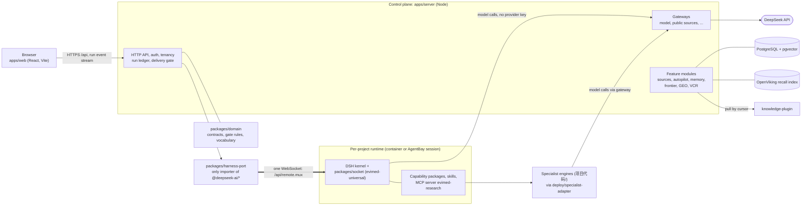

# EviMed Science

**An AI-native research workbench for evidence-based medicine.**

[](LICENSE)
[](OpenScience/package.json)

English | [简体中文](README.zh-CN.md)

EviMed Science (循证医学, evidence-based medicine) is a hosted, multi-tenant research
workbench for medical researchers. A researcher works in conversation; each project
runs in its own isolated runtime on the [DeepSeek Harness](https://www.npmjs.com/package/@deepseek-ai/dsh)
(DSH) agent kernel, with literature and source retrieval, statistics, specialist analysis
engines and report writing available as capability packages. What comes back is a set of
files in a project workspace, with every claim tied to a source that was preserved and
quoted, and a plain statement of what could not be verified.

Medical research is only useful if it can be checked. The platform is built around that:
provenance on every artifact, verbatim-quote verification for evidence claims, and a
delivery gate that reports its findings instead of hiding unfinished work. Output is
decision support for scientific work; it does not replace clinical diagnosis, treatment or
professional judgment, and important conclusions must be checked against the original
evidence.

The product is the hosted web application and nothing else. The desktop shell that an
earlier version had was deleted on 2026-09-04.

## What it does

- **Capability packages.** Each user-facing feature is a package under
  [`OpenScience/capabilities/`](OpenScience/capabilities): a `capability.yaml`, a `SKILL.md`,
  scripts and a contract validator, with real briefs in `OpenScience/evals/`. They cover
  clinical evidence synthesis and appraisal, meta-analysis, Mendelian randomization,
  drug-safety (pharmacovigilance) analysis, off-label use, drug selection and comprehensive
  drug evaluation, bibliometrics, research-topic selection, peer review, grant development,
  manuscript support, statistics, dataset scoping and NCBI GEO differential expression.
  Plain questions are answered directly; a named specialty or an explicit report request is
  routed to its package.
- **An evidence-quality gate that returns a verdict.** Claims are typed `direct` (a verbatim
  quote from one source), `synthesized` (a conclusion across several quoted sources) or
  `derived` (the analyst's own estimate, with its inputs and assumptions named). The delivery
  rules exist once, in `packages/domain`, and both the run and the control plane import them.
  A finished run is delivered with its findings attached and each claim marked as verified or
  not, rather than being withheld. Drug- and scenario-specific safety rules are data
  (`clinical-safety-rules.json`) that pharmacists can edit without touching code.
- **Memory with provenance.** Research notes and structured records live in PostgreSQL; the
  OpenViking recall index is derived from them and can be rebuilt. Validity, replacement,
  conflicts and source links are kept with each record, and a user statement is never
  confused with a model inference. Memory capsules export and import as signed, encrypted
  files. The knowledge base ingests uploaded and imported documents with a per-source
  coverage ledger.
- **Autonomous research (主动科研).** Agendas, budgeted episodes and morning digests, with
  stop rules from `@evimed/domain`. A learning loop distils reusable methods from finished
  work.
- **Frontier feed (前沿动态).** A knowledge-source plugin (`项目代码/knowledge-plugin`) pulls
  journals, regulators, trial registries and societies; the control plane screens, writes and
  number-checks each item, and builds events, a daily digest and items relevant to a
  researcher's projects.
- **循证 GEO.** Evidence-based communication for pharma: it measures how consumer AI engines
  answer the questions a pharma project cares about, and runs a stepwise programme whose AI
  steps are runs of four GEO capabilities. The proprietary method pack is not in this
  repository; without it the capabilities run on their own short methods.
- **虚拟临床研究 (virtual clinical research, code `vcr`).** A stepwise programme from protocol
  to study package. Every number comes from a deterministic R engine (`项目代码/vcr-engine`)
  and patient-level data stays in a data plane that no runtime mounts.
- **Long-running goals.** A researcher can hand a conversation a goal that runs across turns:
  [LoopX](https://github.com/loopx-project/loopx) is built into the runtime image, and its goal
  bar starts and pauses the goal while its driver continues it in the same session. Each
  automatic turn is the researcher's own work in the run ledger and the inbox.
- **Specialist engines.** Six Python agents under `项目代码/` (meta-analysis, Mendelian
  randomization, peer review, bibliometrics, topic selection, drug safety). Wherever statistics
  are involved they are computed in deterministic code; the model interprets and writes, and
  never computes.

The frontier feed, 循证 GEO and 虚拟临床研究 each sit behind an `OPEN_SCIENCE_*_ENABLED`
switch and are off by default.

## Architecture



- **The browser never reaches a kernel.** It talks to `apps/server`, which holds the single
  WebSocket to the project's DSH kernel and decodes the kernel's events into `@evimed/domain`'s
  `RunEvent`, so a kernel change is not a frontend change.
- **`packages/harness-port` is the anti-corruption layer** and the only package allowed to
  import `@deepseek-ai/*`. `packages/socket` is the `evimed-universal` composition that turns a
  bare kernel into the EviMed runtime.
- **The runtime holds no provider key.** Model calls go through the control plane's model
  gateway, which holds the credentials. Access is workspace-only by default.
- **Upstream pins live in one file**, [`OpenScience/deps-version.json`](OpenScience/deps-version.json); tests assert that every derived copy equals it.

## AI-native by design

1. **Place logic by capability class.** Schemas, file checks, verbatim quote matching, numbers
   and closed vocabularies are code. Intent, tone and prose quality are the model's. The model
   never does statistics, and regexes never do language.
2. **Contracts bind outputs, not inputs.** Deliverables are validated against decidable
   contracts; behavior is shaped in prompts and skills, not by keyword walls over what users
   may ask.
3. **A gate verdict is a return value.** It carries specific, repairable findings and never
   silently blocks or forces a wholesale regeneration.
4. **Native is the control.** DSH with DeepSeek and none of our plugins is the baseline; a
   plugin earns its place by measured improvement. Plain questions get zero-tool answers, and
   no length, section or keyword condition gates a reply.
5. **Priors live in context, not control flow.** Domain knowledge is editable text (skills,
   prompts, data files) that degrades gracefully, not `if` statements.
6. **Features are packages; incidents are eval cases.** A new capability ships with a contract
   validator and real briefs, and a failure becomes an evaluation case rather than a keyword.
7. **Build to delete.** Harness scaffolding is a depreciating asset. The durable parts are the
   contracts, gate rules, source catalog, specialist engines and eval corpora.

This repository is itself written for AI coding agents: [`AGENTS.md`](AGENTS.md) and
[`CLAUDE.md`](CLAUDE.md) are the instructions they follow here, and the long form of these
principles. See [CONTRIBUTING.md](CONTRIBUTING.md).

## Repository layout

Everything is an ordinary tracked directory; there are no Git submodules. There is no root
build; `cd` into the subtree you work on.

| Path | What it is |
|---|---|
| [`OpenScience/`](OpenScience) | The production system, a pnpm monorepo (`engines.node >= 22.22.0`, `pnpm@9.4.0`) |
| `OpenScience/apps/web` | React + TypeScript + Vite frontend (`@ai4s/web`) |
| `OpenScience/apps/server` | Plain-Node control plane (`@ai4s/server`): HTTP API, run ledger, gateways, feature modules |
| `OpenScience/packages/` | `domain`, `harness-port`, `socket`, `contracts`, `design-tokens`, `shared` |
| `OpenScience/capabilities/`, `capability-skills/` | Capability packages and their shared skill bodies |
| `OpenScience/runtime/` | The runtime's MCP servers and skill libraries |
| `OpenScience/deploy/` | Runtime image, Compose stacks, specialist adapter, Caddy and monitoring |
| `OpenScience/evals/` | Evaluation harnesses and briefs; separate from tests, they hit live models |
| [`项目代码/`](项目代码) | Python specialist engines, `vcr-engine` (R) and the `knowledge-plugin` service |
| [`接口文档/`](接口文档) | API specifications for shared capabilities (Chinese) |
| [`docs/`](docs) | Design specs, implementation plans and UI audits; see [docs/README.md](docs/README.md) |
| [`AGENTS.md`](AGENTS.md), [`CLAUDE.md`](CLAUDE.md) | Instructions for AI coding agents; the authoritative long-form project description |

## Quick start

Requirements: Node.js 22.22.0 or newer and pnpm 9.4.0 (see `OpenScience/package.json`). The
MCP, ops and eval tests use `python3`. Running a real conversation needs a DeepSeek API key;
keep it in a mode-600 file outside the tracked tree (`.evimed-local/secrets/deepseek.api-key`
at the repository root, which `.gitignore` excludes). Never commit keys or `.env` files.

```bash
cd OpenScience
pnpm install
pnpm dev                     # web frontend (Vite dev server)
pnpm dev:server              # control-plane HTTP API (apps/server)
pnpm configure:evimed-local  # creates the local signing secrets, reports what is missing
pnpm dev:evimed              # local wrapper: control plane with password login on port 8798
```

`pnpm dev:evimed` serves `apps/web/dist` when it has been built (`pnpm build`) and sets the
local-only opt-in that lets a runtime start on the host outside the container sandbox, so it
is for local use only. Hosted deployments keep the container boundary; see the deployment
guide below.

Checks (full detail in [CONTRIBUTING.md](CONTRIBUTING.md)):

```bash
pnpm lint            # web, server, domain, harness-port and socket
pnpm typecheck       # web; also typecheck:server, typecheck:domain, typecheck:port, typecheck:socket
pnpm test            # web unit tests (Vitest)
pnpm test:server     # server tests; PostgreSQL integration files run only when
                     # OPEN_SCIENCE_TEST_POSTGRES_URL is set
pnpm test:packages   # domain, harness-port, socket and upstream contract tests
pnpm test:mcp        # runtime MCP servers (Python unittest)
pnpm ci:web          # the full gate set CI runs
```

Deployment and operations are documented in
[`OpenScience/docs/WEB_DEPLOYMENT.md`](OpenScience/docs/WEB_DEPLOYMENT.md) (Docker Compose
stacks under `OpenScience/deploy/web/`; profiles `controlled-pilot` by default and
`individual-saas`), the
[operations runbook](OpenScience/docs/WEB_OPERATIONS_RUNBOOK.md) and the
[release and delivery checklist](OpenScience/docs/EVIMED_RELEASE_AND_DELIVERY_CHECKLIST.md).

## Documentation

| Read | For |
|---|---|
| [`AGENTS.md`](AGENTS.md) / [`CLAUDE.md`](CLAUDE.md) | The authoritative description of the repository, architecture and development principles |
| [`OpenScience/AGENTS.md`](OpenScience/AGENTS.md) | Rules for the `OpenScience/` subtree: guardrails, design system, safety defaults |
| [`OpenScience/README.md`](OpenScience/README.md) | The production system's own overview |
| [`OpenScience/docs/`](OpenScience/docs) | Product, technical design, deployment, operations, release |
| [`docs/README.md`](docs/README.md) | Index of specs, plans, UI audits and component READMEs |

## Contributing, security and conduct

- [CONTRIBUTING.md](CONTRIBUTING.md): setup, checks, language and commit conventions.
- [SECURITY.md](SECURITY.md): report vulnerabilities privately through GitHub.
- [CODE_OF_CONDUCT.md](CODE_OF_CONDUCT.md): Contributor Covenant 2.1.

## License

[MIT](LICENSE), Copyright (c) 2026 EviMed Science contributors.

`OpenScience/` keeps its original MIT notice in
[`OpenScience/LICENSE`](OpenScience/LICENSE) ("AI4S Workbench contributors"); that file is
unchanged. Third-party components keep their own licenses: the DSH packages, the LoopX plugin
(Apache-2.0) fetched at image build time, and the community skills under
`OpenScience/runtime/skills/community`, whose sources, pinned commits and licenses are
recorded in `sources.json` beside them. See
[`OpenScience/docs/WEB_PRIVACY_AND_COMPLIANCE.md`](OpenScience/docs/WEB_PRIVACY_AND_COMPLIANCE.md)
for the redistribution checklist of the hosted image.
[`NOTICE`](NOTICE) lists every third-party component, its license and where it lives.
