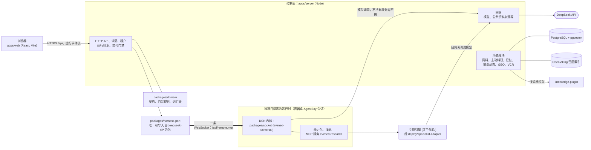

# EviMed Science

**面向循证医学的 AI 原生科研工作台。**

[](LICENSE)
[](OpenScience/package.json)

[English](README.md) | 简体中文

EviMed Science（循证医学，evidence-based medicine）是一套托管的多租户医学科研工作台。
研究者通过对话开展工作；每个项目运行在自己独立隔离的运行时里，内核是
[DeepSeek Harness](https://www.npmjs.com/package/@deepseek-ai/dsh)（DSH）智能体内核，
文献与资料检索、统计、专项分析引擎和报告撰写都以能力包的形式提供。交付给研究者的是项目工作区里的一组文件：
每一条结论都对应一份已留存并引用过的来源，哪些内容未能核实也会明确写出。

医学科研的结论只有能被核查才有价值，平台围绕这一点构建：每个工件都有溯源，证据结论做逐字引文核验，
交付门禁报告它的发现，而不是把未完成的工作藏起来。平台输出仅用于科研辅助，不替代临床诊断、治疗或专业判断；
重要结论必须回溯原始证据。

产品只有托管 Web 应用这一种形态。早期版本的桌面壳已于 2026-09-04 删除。

## 能做什么

- **能力包。** 面向用户的每项功能都是
  [`OpenScience/capabilities/`](OpenScience/capabilities) 下的一个包：`capability.yaml`、
  `SKILL.md`、脚本和契约校验器，并在 `OpenScience/evals/` 中配有真实任务书。覆盖临床证据综合与评价、
  Meta 分析、孟德尔随机化、药物安全（药物警戒）分析、超说明书用药、药品遴选与药品综合评价、文献计量、
  科研选题、论文审稿、基金申请撰写、论文写作支持、统计分析、数据集研究范围界定，以及 NCBI GEO 差异表达分析。
  普通问题直接回答；点名某个专项或明确要求出报告时，才路由到对应的能力包。
- **返回判定结果的证据质量门禁。** 结论分三类：`direct`（来自单一来源的逐字引文）、`synthesized`
  （跨多个已引用来源的综合结论）、`derived`（分析者自己的估算，须写明输入与假设）。交付规则只在
  `packages/domain` 里存在一份，运行侧和控制面都引用同一份。运行结束后，已写出的内容连同发现一并交付，
  每条结论标注是否已核验，而不是被扣下不交。具体药品和场景的安全规则以数据形式存放
  （`clinical-safety-rules.json`），药师无需改动代码即可编辑。
- **带出处的记忆。** 研究笔记和结构化记录存放在 PostgreSQL；OpenViking 召回索引由它们派生，可以重建。
  每条记录都保留有效期、替代、冲突和来源链接，用户的陈述不会与模型的推断混为一谈。记忆胶囊可导出、导入为
  带签名的加密文件。知识库接收上传和导入的文档，并为每份资料保留覆盖账本。
- **主动科研。** 议程、有预算的研究回合和晨间摘要，停止规则来自 `@evimed/domain`。学习回路从已完成的工作中
  提炼可复用的方法。
- **前沿动态。** 知识源插件（`项目代码/knowledge-plugin`）汇集期刊、监管机构、试验注册库和学会等来源；
  控制面对每条内容做筛选、撰写和数字核对，并生成事件、每日摘要以及与研究者项目相关的条目。
- **循证 GEO。** 面向药企的循证传播：测量消费级 AI 引擎如何回答药企项目关心的问题，并运行分步骤的方案，
  其中的 AI 步骤就是四个 GEO 能力的运行。专有方法包不在本仓库中；没有它时，这些能力按各自简短的方法运行。
- **虚拟临床研究（代码名 `vcr`）。** 从方案到研究资料包的分步骤方案。所有数字都来自确定性的 R 引擎
  （`项目代码/vcr-engine`），患者级数据留在任何运行时都不挂载的数据平面中。
- **长任务。** 研究者可以把一个跨多轮完成的目标交给对话：运行时镜像内置
  [LoopX](https://github.com/loopx-project/loopx)，目标栏负责启动和暂停，驱动器在同一会话里自动续跑。
  每一轮自动续跑在运行台账和收件箱里都算研究者自己的工作。
- **专项引擎。** `项目代码/` 下有六个 Python 智能体（Meta 分析、孟德尔随机化、论文审稿、文献计量、
  科研选题、药物安全）。凡涉及统计，都由确定性代码计算；模型负责解读和写作，从不参与计算。

前沿动态、循证 GEO 和虚拟临床研究各自由一个 `OPEN_SCIENCE_*_ENABLED` 开关控制，默认关闭。

## 架构



- **浏览器从不直接访问内核。** 它只与 `apps/server` 通信；`apps/server` 持有到该项目 DSH 内核的唯一一条
  WebSocket，并把内核事件解码为 `@evimed/domain` 的 `RunEvent`，因此内核变更不会变成前端变更。
- **`packages/harness-port` 是防腐层**，也是唯一允许导入 `@deepseek-ai/*` 的包。`packages/socket`
  是 `evimed-universal` 组合，把裸内核变成 EviMed 运行时。
- **运行时不持有服务商密钥。** 模型调用经控制面的模型网关转发，凭据由网关持有。默认只允许访问工作区。
- **上游版本钉在同一个文件里**：[`OpenScience/deps-version.json`](OpenScience/deps-version.json)，
  测试会断言所有派生副本与它一致。

## AI 原生的设计原则

1. **按能力类别安放逻辑。** 模式、文件检查、逐字引文匹配、数字和封闭词表交给代码；意图、语气和行文质量交给模型。
   模型从不做统计，正则也从不处理语言。
2. **契约约束输出，而非输入。** 交付物按可判定的契约校验；行为由提示词和技能塑造，而不是在用户可问的内容上设关键词墙。
3. **门禁判定是一个返回值。** 它携带具体、可修复的发现，从不静默拦截，也不强制整体重写。
4. **原生即对照组。** 不带我们任何插件的 DSH + DeepSeek 是基线；插件要靠可测量的提升才有立足之地。
   普通问题零工具直接回答，也没有基于篇幅、章节或关键词的整答放行条件。
5. **先验放在上下文里，而不是控制流里。** 领域知识是可编辑的文本（技能、提示词、数据文件），能平滑降级，而不是一堆 `if`。
6. **功能是包，事故是评测用例。** 新能力随契约校验器和真实任务书一同交付；一次失败变成一条评测用例，而不是一个关键词。
7. **为删除而建。** 脚手架是会折旧的资产。长期保留的是契约、门禁规则、来源目录、专项引擎和评测语料。

本仓库本身就是为 AI 编码智能体编写的：[`AGENTS.md`](AGENTS.md) 和 [`CLAUDE.md`](CLAUDE.md)
是它们在这里遵循的指令，也是上述原则的完整版本（均为英文）。参见 [CONTRIBUTING.md](CONTRIBUTING.md)（英文）。

## 仓库结构

所有目录都是普通的受版本控制目录，没有 Git 子模块。仓库根目录没有统一构建，请进入要修改的子树再操作。

| 路径 | 说明 |
|---|---|
| [`OpenScience/`](OpenScience) | 生产系统，pnpm monorepo（`engines.node >= 22.22.0`，`pnpm@9.4.0`） |
| `OpenScience/apps/web` | React + TypeScript + Vite 前端（`@ai4s/web`） |
| `OpenScience/apps/server` | 纯 Node 控制面（`@ai4s/server`）：HTTP API、运行账本、网关、功能模块 |
| `OpenScience/packages/` | `domain`、`harness-port`、`socket`、`contracts`、`design-tokens`、`shared` |
| `OpenScience/capabilities/`、`capability-skills/` | 能力包及其共享技能正文 |
| `OpenScience/runtime/` | 运行时的 MCP 服务和技能库 |
| `OpenScience/deploy/` | 运行时镜像、Compose 栈、专项适配器、Caddy 与监控 |
| `OpenScience/evals/` | 评测框架与任务书；它们独立于测试，会调用真实模型 |
| [`项目代码/`](项目代码) | Python 专项引擎、`vcr-engine`（R）和 `knowledge-plugin` 服务 |
| [`接口文档/`](接口文档) | 共享能力的接口规范（中文） |
| [`docs/`](docs) | 设计规格、实施计划和 UI 审查；索引见 [docs/README.md](docs/README.md) |
| [`AGENTS.md`](AGENTS.md)、[`CLAUDE.md`](CLAUDE.md) | 面向 AI 编码智能体的指令，也是权威的项目完整描述 |

## 快速开始

环境要求：Node.js 22.22.0 或更高版本，pnpm 9.4.0（见 `OpenScience/package.json`）。MCP、运维和评测测试使用
`python3`。要跑真实对话需要 DeepSeek API 密钥；请把它放在受版本控制目录之外、权限为 600 的文件里
（仓库根目录下的 `.evimed-local/secrets/deepseek.api-key`，`.gitignore` 已将其排除）。切勿提交密钥或 `.env` 文件。

```bash
cd OpenScience
pnpm install
pnpm dev                     # Web 前端（Vite 开发服务器）
pnpm dev:server              # 控制面 HTTP API（apps/server）
pnpm configure:evimed-local  # 生成本地签名密钥，并提示缺少什么
pnpm dev:evimed              # 本地封装：控制面 + 密码登录，端口 8798
```

`pnpm dev:evimed` 在 `apps/web/dist` 已构建（`pnpm build`）时会直接提供它，并设置仅限本地的开关，
允许运行时在宿主机上、容器沙箱之外启动，因此只用于本地。托管部署始终保持容器边界；见下文的部署指南。

检查命令（详见 [CONTRIBUTING.md](CONTRIBUTING.md)）：

```bash
pnpm lint            # web、server、domain、harness-port 和 socket
pnpm typecheck       # web；另有 typecheck:server、typecheck:domain、typecheck:port、typecheck:socket
pnpm test            # Web 单元测试（Vitest）
pnpm test:server     # 服务端测试；仅在设置 OPEN_SCIENCE_TEST_POSTGRES_URL 时
                     # 才运行 PostgreSQL 集成测试文件
pnpm test:packages   # domain、harness-port、socket 与上游契约测试
pnpm test:mcp        # 运行时 MCP 服务（Python unittest）
pnpm ci:web          # CI 运行的完整门禁
```

部署与运维文档：
[部署指南](OpenScience/docs/WEB_DEPLOYMENT.md)（英文；Docker Compose 栈位于 `OpenScience/deploy/web/`，
默认部署档位为 `controlled-pilot`，另有 `individual-saas`）、
[运维手册](OpenScience/docs/WEB_OPERATIONS_RUNBOOK.md)（英文）和
[发布与交付检查表](OpenScience/docs/EVIMED_RELEASE_AND_DELIVERY_CHECKLIST.md)（中文）。

## 文档

| 阅读 | 用途 |
|---|---|
| [`AGENTS.md`](AGENTS.md) / [`CLAUDE.md`](CLAUDE.md) | 仓库、架构与开发原则的权威描述 |
| [`OpenScience/AGENTS.md`](OpenScience/AGENTS.md) | `OpenScience/` 子树的规则：架构护栏、设计系统、安全默认值 |
| [`OpenScience/README.md`](OpenScience/README.md) | 生产系统自己的概述 |
| [`OpenScience/docs/`](OpenScience/docs) | 产品、技术设计、部署、运维、发布 |
| [`docs/README.md`](docs/README.md) | 规格、计划、UI 审查和各组件 README 的索引 |

## 贡献、安全与行为准则

- [CONTRIBUTING.md](CONTRIBUTING.md)：环境搭建、检查命令、语言与提交约定（英文）。
- [SECURITY.md](SECURITY.md)：通过 GitHub 私下报告安全漏洞（英文）。
- [CODE_OF_CONDUCT.md](CODE_OF_CONDUCT.md)：Contributor Covenant 2.1（英文）。

## 许可证

[MIT](LICENSE)，Copyright (c) 2026 EviMed Science contributors。

`OpenScience/` 保留其原始的 MIT 声明，见 [`OpenScience/LICENSE`](OpenScience/LICENSE)（“AI4S Workbench
contributors”），该文件未作改动。第三方组件保留各自的许可证：DSH 软件包、镜像构建时获取的 LoopX 插件
（Apache-2.0），以及 `OpenScience/runtime/skills/community` 下的社区技能；这些技能的来源、固定提交和许可证记录在
同目录的 `sources.json` 中。托管镜像再分发的核对清单见
[`OpenScience/docs/WEB_PRIVACY_AND_COMPLIANCE.md`](OpenScience/docs/WEB_PRIVACY_AND_COMPLIANCE.md)。
全部第三方组件、其许可证和所在位置列在 [`NOTICE`](NOTICE) 中。
