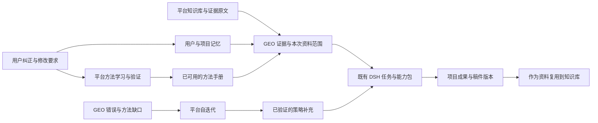

# 循证 GEO 完整迭代方案

版本：V3，2026-10-23，Asia/Shanghai。代码核对基线：`01e965e99a1118439557210b7ab28b9b7e7338a9`。

状态：执行中。首批测量/判定核心与相关数据、页面修复已实施并通过聚焦回归和独立审查；其余工作包继续实施。尚未推送、部署或执行真实消费者平台采样。本方案按用户本次要求以中文书写，替代最初英文 30 项清单及上一版中文方案。两版分别留档于 `outputs/audit/geo-review-20261023/todo-v1-superseded.md`、`outputs/audit/geo-review-20261023/iteration-v2-superseded.md`，不再作为并行执行清单。

## 一、这次迭代要解决什么

让用户在已有 EviMed 项目里，把产品资料、患者与医生问题、AI 回答、证据、稿件、渠道和监测真正连起来：看得懂问题，能直接做事，能找到产出，出现异常能恢复，下一次工作能利用已积累的资料和经验。

竞争目标有两条：参考 Profound 的对象分析、在上下文中执行任务、内容版本和线索建议；对照主要竞品清蓝 PureblueAI，补齐中文场景中从需求识别到诊断、内容、渠道与持续监测的实际操作。医学证据、药品适用范围和报告一致性必须成为可使用的能力，不能只成为宣传词或额外审批。

本轮明确的取舍：

1. 保留八步业务主线，重塑每一步的工作台，取消另一套并列的八项结果导航。
2. 不做效果保证、按效果收费、履约考核或 RaaS 模块。目标是帮助用户研究、生产和管理内容，同时观察 AI 表现。
3. 保留持续监测与时间对比；“复盘”成为总览/监测的筛选、对比和按需导出，不增加独立复盘模块。
4. 不增加“资产与上下文”一级菜单。资料、结论、问句、稿件、要求分别放到已有的证据、问题、内容、项目设置和全平台知识库中。
5. 按用户最新澄清，保留 DSH＋DeepSeek 原生对话修订：AI 写完后，用户可以在同一对话继续提出修改要求。下载后外部编辑也是可选方式，但不设为唯一方式；不建设 GEO 专用编辑器、第二个输入框或独立修改引擎。
6. 线索发现必须能展示影响、进入处理、看到任务和结果，不能只生成一条通知。
7. 中文意图和人群研究落实为“旅程/问题”中的具体操作和数据连接，不增加一个概念性研究模块，也不先训练一个新模型。
8. GEO 使用全平台知识库、记忆、方法学习和自迭代；补通断点、明确数据归属和验证真实执行，不另建一套引擎。
9. 下文“研发验证”指内部检查功能是否按约定工作，不是客户审批流程，也不是报告交付的新门槛。

## 二、竞品参考如何落在现有系统里

| 参考能力 | 对我们有价值的部分 | 本轮落点 |
|---|---|---|
| Profound Prompt Designer | 问句、主题、标签、范围与分析连接 | 第三步“问题”：原表导入、原题保护、分组、版本、测量范围 |
| Profound FactCheck | 从具体陈述回到原回答、依据和处理动作 | 第四步“诊断”：医学陈述核查及同一问题的处理工作台 |
| Profound Pages | 围绕一篇内容集中查看正文和表现 | 第六步“内容”：一篇稿件的版本、依据、发布位置、引用与待办 |
| Profound Aim / Suggestions | 从当前数据发起任务，建议带证据和作用对象 | 现有项目原生对话＋总览待办＋具体对象上的操作按钮 |
| Profound Context Manager | 事实资料与写作偏好分工 | 证据页选用共享知识库资料；项目设置保留表达要求；运行时共用上下文服务 |
| 清蓝 Mark | 诊断、内容、媒体规划和监测由同一助手连续处理 | 八步内保持同一项目、任务、产出和用户操作上下文 |
| 清蓝意图与渠道工作 | 从具体用户问题判断内容和渠道机会 | 旅程—问题—诊断—信源—内容之间的对象关联 |

官方参考：[Profound FactCheck](https://docs.tryprofound.com/answer-engine-insights/factcheck/about)、[Pages](https://docs.tryprofound.com/pages/about)、[Suggestions](https://docs.tryprofound.com/projects/suggestions-from-aim)、[Context Manager](https://docs.tryprofound.com/context-manager/knowledge-bases-and-brand-kits)、[清蓝 Mark](https://www.pureblueai.com/mkter)。这次依据公开文档核对功能形态，没有验证其收费后台及优化效果。清蓝的效果付费、高频监测和私有算法宣传不自动成为本产品要求。

## 三、导航与八步：保留主线，归并重复视图

### 3.1 推荐页面结构

全平台仍只有一个“循证 GEO”入口。入口先列项目，进入项目先看总览。

项目头部：项目名称、必要的产品范围、总览入口、对话入口、项目设置/导出。

项目内唯一业务导航：

`证据 → 旅程 → 问题 → 诊断 → 信源 → 内容 → 投放 → 监测`

- 八步始终可发现，每步显示实际完成、进行、等待或需处理状态。
- 当前查看的步骤与后台正在执行的任务分别表达，不能因为后台在写稿就把用户看的诊断标成内容页。
- 步骤是工作入口，不是强制闯关。用户可以直接导入题表做诊断，或直接修改已有稿件；后台只补齐必要上游。
- 项目对话是一种工作方式，不是第九步。进入对话仍保留项目和八步导航，使用一个原生输入框。
- 总览是整个项目的摘要，不属于第几步；不增加另一套“总览/可见度/准确性/问题/信源/行动/方案/依据”同级选择器。
- 细分视图只属于当前步骤，例如诊断下的可见度、准确性、回答明细；它们不会再次承担整个项目导航。

### 3.2 每一步具体放什么

| 步骤 | 用户看到的内容 | 主要操作 | 完成后留下什么 | 现有实现如何复用 |
|---|---|---|---|---|
| 证据 | 产品身份、剂型规格、适用范围、资料、结论库、药品价值 | 上传/选用知识库资料、整理证据、补充结论、查看原文 | 有来源与版本的产品资料和结论 | `EvidenceTab`、`ValueSection`、`geoCards`、`geoValue*`、共享知识库 |
| 旅程 | 已有患者/医生阶段、人群、决策、信息需求、就医节点 | 按资料整理旅程、补充某一阶段、修改描述、查看对应问题群 | 可编辑的阶段与人群记录及关联问句 | `JourneyTab`、现有 journey/personas/subtypes/careNodes |
| 问题 | 原始问句、客户分类、语义群、人群/阶段标签、来源、测量版本 | 导入、分类、去重提示、检查覆盖、补充真实问法、选定测量集 | 保留原题与编号的新题库版本 | `QuestionsTab`、`geoWrites`、问句集锁定和现有文件接入 |
| 诊断 | 当前轮次各平台表现、品牌/通用名、医学陈述核查、完整回答 | 开始本轮、筛选对比、打开错误、核对依据、生成处理任务 | 采样快照、判定、统计和明确的问题清单 | `VisibilityTab`、`AccuracyTab`、`GeoAnswerPage`、测量与判定服务 |
| 信源 | 引用网站与具体页面、缺口、渠道依据、实施方案、三档目标/投入 | 分析页面、补充来源、从选中问题生成方案、调整内容与渠道组合 | 关联问题群的实施方案及预算建议 | `SourcesTab`、`PlanTab/PlanStrategy`、`geoSpine`、strategy/targets |
| 内容 | 按问题群组织的任务与稿件，正文、依据、版本和已发布位置 | 写稿、改稿、转换受众版本、下载、准备投放 | 可编辑稿件、修订版本和引用链 | 现有文章表、`ActionsTab`中的内容能力、共享结果预览/修订 |
| 投放 | 拟投放/已提交/已发布等状态，自有链接、渠道、金额与异常 | 选择既有支持渠道、设预算、登记链接、撤单、查看核验 | 与具体稿件版本绑定的订单和发布记录 | `geoMarket*`、owned links、预算和对账能力 |
| 监测 | 监测对象与频率、轮次、时间范围对比、引用和内容变化 | 开/停监测、选日期和平台、比较同口径数据、处理新问题 | 历史趋势、变化记录、进入对应步骤的任务 | monitoring/rounds、现有调度、共享图表与通知 |

原“方案”归入信源步骤；需要写稿时直接引用该方案。原“行动”拆成对应步骤的操作与任务记录，统一任务进展在总览/AI 运行中查看，不再建立独立行动产品。原“依据”成为证据步骤。原“可见度”用于诊断读数及监测趋势，共用组件与数据选择，不重复计算。

### 3.3 历史地址与迁移

保留所有现有记录和 URL。`accuracy` 默认到诊断的准确性视图；`plan` 到信源的方案视图；`questions?view=journey` 到旅程；`actions` 根据稿件/订单/任务定位内容或投放；`visibility` 的最新诊断视图与趋势锚点分别映射到诊断或监测。参数、打开的记录和返回位置不能在重定向中丢失。

迁移的是导航与页面组合，不是重建 GEO 数据库或重跑全部项目。旧 API 不因页面改名而批量更名；必要筛选优先使用现有读接口的兼容扩展。

## 四、哪些对象保留在哪里，不从零建

| 用户要找的东西 | 用户入口 | 业务数据的归属 | 不另建什么 |
|---|---|---|---|
| 说明书、指南、论文、客户资料 | 证据页选择资料；全平台知识库管理原件 | 现有 source 记录、原文与共享资料权限 | GEO 私有知识库引擎 |
| 产品身份、证据结论、药品价值 | 证据 | `evimed_geo` 工作记录＋已有证据卡关联 | 第二套主张库和“品牌事实中心” |
| 原题、语义群、阶段、人群 | 旅程、问题 | 现有 journey/question sets | 独立“中文意图研究中心” |
| 原始回答、判定、统计 | 诊断、监测 | snapshots/facts/metrics/rounds | 另一套分析数据仓库 |
| 稿件、修订稿、PPT/Excel/报告 | 内容、项目成果/文件 | 原项目工作区、结果版本和运行记录 | GEO 文件系统与编辑器 |
| 输出格式、偏好、项目约定 | 项目设置和自然语言任务；必要时查看现有记忆 | 项目配置是当前任务权威；记忆帮助后续复用 | 可覆盖业务配置的“上下文数据库” |
| 方法经验与平台改进 | 在实际任务中生效；在现有方法/记忆/进化入口管理 | 平台学习、手册和自迭代记录 | GEO 自己的训练/调度平台 |

因此，“资产与上下文”作为内部设计术语有用，但不应让用户去一个陌生菜单寻找原本已经存在的资料、稿件和设置。

## 五、需要真正重塑或新增的核心能力

### 5.1 问句与人群研究：做成三项完整操作

这部分研发是打通现有字段、模型处理、版本保存与下游使用，不是训练专用模型或无限扩充题库。

**操作 A：导入并整理客户问句。**

- 入口：问题 → 导入问句。
- 输入：客户 Excel/CSV、当前产品范围。先展示列映射、原题数量、重复候选与计划调用量。
- 处理：确定性代码读取编号/文本并提示重复；模型根据原题含义补充意图、人群、阶段和测量池标签。客户原分类与平台补充标签分列保留，不改写原题。
- 输出：原题、原编号、原分组、建议标签和可逐项修改的预览；保存为题库版本。
- 继续：直接选择平台并启动这一版本的诊断。
- 异常：列识别不全就在映射界面修正；部分题无法分类保留原题，不替用户补造。不能因标题写160题而替换实际130题分母。

**操作 B：检查问句覆盖。**

- 入口：问题 → 检查覆盖，或旅程中的某一阶段。
- 输入：当前题库、已知人群/阶段、产品适用范围、已有证据。
- 处理：找出现有问题集中、明显重复、缺少必要问题的部分；每个“缺口”说明是何种决策需要及依据。不能为了填满矩阵发明人群或题目数量配额。
- 输出：具体建议，例如“该阶段已有用法问题，但缺少本项目资料所指出的特殊人群问题”，并列出建议问句及来源/推断性质。
- 继续：用户可编辑并加入题库，新版本用于以后的采样；旧版本与旧报告保留。
- 完成判定：新增问题能够进入后续诊断，并在对应问题群中找到回答和内容任务，不停留在一张覆盖热图上。

**操作 C：补充真实问法。**

- 入口：某个问题群 → 补充真实问法。
- 输入：语义群主题、受众及已有检索渠道。
- 处理：使用已接入的社交/公开来源检索；保留原文、来源和采集日期；去重后建议归入现有群。模型改写单独标为建议问法。
- 输出：可选择采用的问法清单及来源。
- 异常：渠道失败显示无法获取该来源，仍允许使用客户原题或明确标注的建议问法；不伪造“真实问法”。

研发边界：复用 `geo-insight`、现有 journey/questions/valueContext、`social_posts_search` 和问句版本体系。需要补的是入口、结构化返回、编辑/归入、版本和下游关联。人群可重叠，不推断互斥规模，更不把估计人群当真实患者数据。

### 5.2 诊断：一个发现从原回答到处理任务

保留可见度、医学准确性和完整回答的不同视图，但都属于诊断步骤，并使用相同选定轮次/题库/平台。

错误条目打开后应包含：原题、原回答中的具体句子、判定及适用条件、支持/矛盾的原文、相关被引页面、类似回答、已经采取的行动。复杂分析在主区域，简短预览才用抽屉。

用户可进行三类操作：核对/反馈判定、修改本项目结论或稿件、生成针对来源或问题群的处理任务。每个任务带当前对象和版本进入原生对话，不要求重新粘贴背景。

反馈不能只是把错误从列表隐藏：要保留原判定、反馈、处理状态及重新核查结果。临床条件不同的陈述不能仅因句子相似就合并。

### 5.3 信源与实施方案：把目标、内容和投入放回流程

触发路径是“诊断发现缺口 → 分析相关信源 → 生成/调整实施方案 → 内容与投放执行”。不增加独立测算模块。

方案围绕选中的问题群给出：

- 目前有哪些事实/表达缺口，依据是什么；
- 修改已有内容还是新增内容，各自产出什么；
- 面向患者、医生等对象的表达层次；
- 选择哪些已观察到相关性的渠道/页面，理由及不确定性；
- 建议先后顺序、时间和所需工作；
- 预算建议与已经设定的实际投放预算；
- 用户需要时提供目标档位与不同内容/渠道组合。

这里的目标是实施方向与规划值，不是效果保证。没有成本依据就明确金额未估，不产生精确 ROI。用户选定方案后，任务按问题群生成到内容步骤；实际付费金额仍在投放步骤设置和控制。诊断范围或资料变化时标记方案需要更新，不静默替换已经执行的版本。

清蓝的渠道规划值得参考，但本产品不复制按效果收费和履约模块；实际观察变化继续在总览/监测查看。

### 5.4 内容：用现有能力完成 AI 修订，不建设重型编辑器

首要入口：AI 生成稿件后，用户直接在当前原生对话继续说“把第二段写得更通俗”“补上这项研究”等修改要求。辅助入口：内容列表打开稿件后，以“继续在对话中处理”带入当前文件；只有共享预览已经支持选段时才复用选段，不单独开发一套 GEO 编辑工具栏。

1. 使用现有成果预览；将稿件 ID、版本、选段和用户要求交给本项目原生对话。
2. 平台冻结原稿输入。AI 使用已有文件/Office 技能进行针对性修订。
3. 产生新版本，给出修改摘要，保留原版本与来源；新稿回到原稿件的版本列表。
4. 用户在现有预览中查看、下载或继续修改；稿件的证据、问题群和渠道关联继续保留。
5. 若修改涉及医学结论、数值或适用条件，更新关联标记和核查结果；不只做文字润色。

这条底层能力并非空白：DSH 的文件操作和既有 Office 技能承担修改；`ResultRevisionService` 已有选段暂存、原生请求绑定、冻结输入、继承关系和原件保留。GEO 只补必要的文件/版本定位与结果关联。原生能修改文件，不代表业务记录和已发布内容天然同步，这一层薄适配仍要验证。

具体代码在 `OpenScience/apps/server/src/resultRevision.mjs`。目前该服务的绑定入口要求显式的选段引用和对应请求，不能据此声称任意一句自由对话已经自动进入完整版本链。实施时优先沿用共享成果捕获和修订路径，补齐“同一对话直接续改”的关联；不要为 GEO 再建一套修订服务，也不要要求每次改稿先选段或填写表单。当前稿件明确时直接处理；只有同时涉及多份文件且无法确定目标时，才让用户选择文件。

本轮先对实际支持的 Markdown/Word 稿件完成这条路径。只有 PDF 或外部不可编辑原件时，明确输出修订稿或要求可编辑原件，不承诺原地编辑任意二进制文件。在线多人协作编辑、独立富文本排版器和 Word 式修订系统不属于本轮范围。

已发布稿件的处理也要闭合：有渠道更新能力就保存更新记录；没有就保留修订稿和待人工更新状态，不能只改本地文件便声称线上内容已更新。

### 5.5 线索发现：用户看得到、处理得了、知道做完了

不新增“线索发现”一级模块。线索出现在项目总览的“需要处理”和对应步骤的提示中，重要事项进入现有消息中心。

| 线索 | 页面展示 | 操作 | 完成后用户看到 |
|---|---|---|---|
| 新出现的错误陈述 | 具体错误、平台、涉及问题群、相关依据 | 查看回答；生成纠错内容；反馈误判 | 任务产出和后续状态；复测仍有问题则保留未解决 |
| 所用资料发生更新/撤回 | 哪份资料变了，影响哪些结论/稿件 | 核对变化；更新受影响内容 | 新结论/稿件版本及已处理范围 |
| 新引用来源/首次引用 | 哪个页面被哪个平台引用，关联哪篇稿件 | 查看引用；补充来源分析 | 来源关系、原回答和关联分析 |
| 某群表现变化 | 指标变化、时间范围、样本是否可比 | 查看对应图表与回答；分析原因 | 分析结论和需要的后续任务，而不是保证归因 |
| 投放异常 | 具体稿件、订单、状态与可采取动作 | 查看、撤单或按现有权限处理 | 可追踪的最终状态；未知结果不会自动重复下单 |

状态至少分清：待处理、已发起任务、处理中、已完成、已忽略、失败待恢复。通知“已读”不等于问题“已解决”。

优先复用 errors、sourceChanges、actionChoices、runId、orderId 和通知幂等记录；没有对应关系的事件只补必要关联字段。去重用来源对象及版本；同一线索不每次轮询再通知。低重要性变化归并，未变化不打扰用户。

自动执行沿用项目已有权限与预算。可逆的分析/草稿任务可在已配置自动模式下继续；发送、付费或公开发布不能因为发现了线索便获得新权限。用户始终可在“AI 运行”看到任务和产出，不能只在后台日志里看到运行计数。

### 5.6 总览与监测：共享分析，不增加复盘模块

总览解决“当前整体情况和需要处理什么”；监测解决“测哪些问题、多久测一次，以及历史如何变化”。两处复用同一数据选择与图表组件。

必要筛选：时间范围、对比时间范围、平台、问句版本、语义群/标签、产品范围（项目存在多规格时）。必要选择：只看同口径数据，或按各自范围分别展示。

- 总览的所有图表和指标服从同一筛选范围。
- 用户点击变化点，能够打开那段时间的实际回答及相关事项。
- 支持把当前筛选视图按需导出摘要/报告；保留原有周报能力，不另建报告产品或自动生成大量无用复盘。
- 发生题库/平台/采样模式变化时说明不可直接比较，不画未经支持的改善箭头。
- 基础对比不要求证明因果或知道所有底层模型版本。现有净效计算保留兼容，但不作为主流程前置或交付要求。
- 客户要求每题每平台一次的基线，和另行配置的持续监测是不同轮次；持续监测不能悄悄增加一次诊断的样本量。

### 5.7 共享 AI 助手：只增加上下文连接

每个步骤和对象都可以“继续处理”，进入同一 GEO 项目的原生对话，并带入当前对象、资料范围、任务要求和版本。用户能看懂任务针对什么，不看到内部路径/网关/模型配置等实现说明。

对话期间仍能切回该步骤查看结果；完成后页面自动更新。全平台首页和新对话保持通用助手，不继承上一个 GEO 产品。任务结束写入现有项目成果、消息中心和运行记录，不要求用户到一个新建的 GEO Agent 中寻找文件。

### 5.8 可视化与分析维度：已有基础，但尚未建全

审查结论是：当前系统已经有相当多的图形组件，但“能画图”“分析维度完整”“各处读到同一批数据”是三件事。目前后两件尚未成立。此次核对主要依据代码和上一轮保留的页面走查材料，不代表这些图表已经用生产数据全部验证。

本轮重点参考 Profound 的统一筛选、交叉分析、来源分析和从图表进入具体回答的方式；清蓝公开资料主要支持诊断—内容—渠道—监测的连续工作方向。以下清单是结合 EviMed 数据与业务设计的方案，并非对竞品后台功能或算法效果的复刻声明。[Profound 分析说明](https://docs.tryprofound.com/answer-engine-insights/interpret)、[清蓝 Mark](https://www.pureblueai.com/mkter)。

#### 5.8.1 现有图表盘点与实际缺口

下列文件均位于 `OpenScience/apps/web/src/components/geo/`，服务文件位于 `OpenScience/apps/server/src/`。

| 业务区域 | 已有实现 | 尚未完整的部分 | 代码入口 |
|---|---|---|---|
| 总览 | 指标卡、变化值、小趋势、基线/当前/目标、待办和事件 | 任意时间范围与全页一致筛选、同口径区间比较 | `tabs/OverviewTab.tsx`、`geoOverviewModel.ts` |
| 可见度 | 总趋势、平台×指标热图、平台柱图、平台提及率小趋势、语义群×平台矩阵、题池分布、竞品排名 | 群×平台矩阵目前主要是提及数/回答数；其他指标的逐平台历史、客户原分类、问题级状态与多维交叉需补齐 | `tabs/VisibilityTab.tsx`、`tabs/VisibilityBlocks.tsx` |
| 医学准确性 | 严重度×平台、错误类型、回答构成、来源归因和错误列表 | 未判定/部分判定口径、完整筛选分页、医学主题/适用条件分析及问题状态历史 | `tabs/AccuracyTab.tsx`、`tabs/AccuracyCharts.tsx` |
| 信源 | 来源类型、前列来源集中度、域名列表、分平台引用与回答抽屉 | 具体 URL、历史变化、来源×群、来源所有权，以及图表和列表统一范围 | `tabs/SourcesTab.tsx` |
| 旅程/人群 | 阶段情绪曲线、阶段表、信息需求、就医节点、人群记录 | 人群/阶段与原题、已测回答、证据、内容的覆盖关联；情绪曲线需说明数据或推断依据 | `tabs/JourneyTab.tsx` |
| 证据与价值 | 范围、结论、来源条件、覆盖计数及观察记录 | 结论×适用条件×来源的覆盖视图、缺证与过期状态 | `tabs/ValueSection.tsx` |
| 方案/行动/投放 | 三档目标条、预算信息、试点/对照/净变化图、任务与订单状态 | 内容覆盖、真实发布过程、金额状态、引用与内容的关联 | `tabs/PlanStrategy.tsx`、`tabs/ActionsTab.tsx`、`spine/ActionsParts.tsx` |

三个影响方案的具体事实：

1. `geoService.mjs` 的 monitoring 分平台历史读取当前只选择提及指标。因此，已有多指标当前值不等于已经有逐平台的准确性、引用等完整趋势。
2. `VisibilityTab` 的平台/题池/群选择目前部分用于高亮或局部筛选，总趋势仍使用项目范围数据。应明确现有交互语义并改成所承诺的统一范围，不能只是新增几个筛选框。
3. `SourcesTab` 的类型和集中度图基于平台筛选后的集合，而列表又叠加来源类型、关系、搜索等条件。今后属于“全页范围”的条件必须共同生效；若某搜索仅作用于列表，就明确标成“搜索列表”。

#### 5.8.2 分析维度：哪些可以复用，哪些必须先有数据

| 维度 | 业务问题 | 复用基础及要补的字段/关联 | 使用边界 |
|---|---|---|---|
| 时间与轮次 | 最近怎样，和哪个时期比较 | 既有轮次/观察时间；补日期区间聚合、区间对比 | 采样时间与后续补算时间分开；题库改变不默认为同口径 |
| AI 平台与采样方式 | 哪个平台有问题 | engine、已记录的模式/版本、采样来源 | 用户界面、API、人工导入不混作同一种采样；未知版本如实保留 |
| 品牌/通用名/剂型/产品 | 哪个实体被提到、被混淆 | 项目产品范围、别名与原回答；补独立实体事实 | 品牌和通用名不能合并；多剂型没有可区分数据就不能强拆百分率 |
| 客户原分类 | 客户定义的各类问题表现如何 | 导入表原分类、编号；补稳定标签映射 | 保留原分类，不用 P1—P4 替代；多标签不按互斥类别相加 |
| 语义群、题池、原题 | 哪组问题、哪一道题出了问题 | 既有 cluster/pool/question/version | 题库版本变化需可回查；聚合不改写原题 |
| 旅程阶段、人群、决策 | 哪类需求缺问题、缺证据、缺内容 | journey/personas/subtypes/careNodes 与题、结论、稿件的关系 | 人群标签不等于实际带人设采样，更不等于真实患者占比 |
| 事实主题与适用条件 | 用法、安全性、特殊人群等哪里出错 | statements 的主题、判定、严重度及证据适用条件 | 按真实结构化结果聚合；未知不能补为正确 |
| 信源 | 哪些域名、页面和类型被引用 | 已保存的引用 URL、来源类型、平台、回答关系 | 检索到、访问过、被引用、支持某陈述分别计算 |
| 来源关系 | 自有/合作/竞品/其他来源怎样 | 项目确认的域名/URL 归属与有效时间 | 不能凭网页出现品牌名推断属于该品牌；未配置为未知 |
| 内容与渠道 | 哪组内容做了、发布在哪、是否出现引用 | articles、稿件版本、问题群、渠道、订单、owned links | 一稿多格式不算多篇，一篇多渠道按发布记录另计 |
| 预算与订单 | 花了多少，多少钱仍可用 | 已有预算、预留、结算、退款、订单状态 | 不把充值额、订单金额和已结算支出重复加总；不推算销售 ROI |
| 数据覆盖与性质 | 结果可否解释，哪里缺样本 | 计划数、返回、拒答、失败、已判定、方法版本 | 原始实测、模型推断、人工评估、规划目标可追查；展示按项目约定简化 |
| 地区/语言/实际人设等扩展 | 是否真的有地区或人设差异 | 仅在真实采样记录已经带相应上下文时启用 | 临床研究地区不是采样地区；中文问题也不自动证明中国某地用户表现 |

上述维度主要是对现有记录建立可查询关系，不要求先新建数据仓库。历史记录缺某字段时标记未知；只有能从原记录确定或按版本化方法重新判定时才回填，不因补图而重新付费采样全部项目。

#### 5.8.3 图表和分析视图目录

以下 28 项是分析能力目录，不是要求每页同时摆 28 张图。状态：**已有**＝已有相应图形形态但仍须修正口径；**部分**＝现有数据/视图只覆盖一部分；**新增聚合**＝优先用已保存记录补查询与展示；**补记录**＝须先补关联或状态历史。存在数据并不代表任意筛选已经可以使用。

**A. 总览、平台与问题分析。**

| ID | 要回答的问题与图形 | 维度/统计要求 | 当前状态与工作 | 点击后到哪里 |
|---|---|---|---|---|
| V01 | 当前处在什么水平：指标卡、基线/当前/目标条 | 按项目约定展示品牌提及、通用名出现、准确性等；目标单列 | 已有；修正未知与真实 0、口径、范围及对比 | 对应指标的回答集合 |
| V02 | 随时间怎样变化：趋势线与区间对比 | 选指标，按平台或群拆分；支持上期和自定义区间 | 部分；补非提及指标历史与统一聚合 | 点击点/区间打开当时的回答和事项 |
| V03 | 哪些地方变化最大：升降榜与小趋势 | 同口径群/平台的百分点或数量差，显示覆盖变化 | 新增聚合；样本改变不混为改善/恶化排名 | 对应群和两个区间的回答对照 |
| V04 | 平台之间差在哪里：横向柱图/哑铃图 | 品牌/通用名/准确性/引用按指标切换；各有自己的分母 | 部分；修正跨实体及跨平台选择 | 选中平台和指标的诊断 |
| V05 | 哪些群在哪个平台薄弱：群×平台热图/表 | 可切换约定指标，单元格保留有效观察数 | 部分；从目前提及数矩阵扩展，复用图表 | 群×平台下的原题和回答 |
| V06 | 客户原分类是否均衡：分类×平台矩阵/分组条 | 保留认知、选购等原分类，平台标签作为另一维 | 补记录＋聚合；依赖 N07 导入分类映射 | 原分类内的原题清单 |
| V07 | 每一道题究竟回答了什么：题×平台状态格 | 返回/拒答/未取得；选中后看提及与判定，不伪造稳定概率 | 新增聚合；依赖 N03/N04 | 完整原回答、采样时间、判定与引用 |
| V08 | 与约定竞品相比怎样：排名、对比条与趋势 | 固定竞品范围；默认比较提及，声量份额仅在约定时展示 | 部分；统一品牌范围/时间及实体事实 | 竞品被提到的原回答；解释各自分母 |
| V09 | 品牌被怎样描述：推荐状态分布与表 | 推荐、条件性推荐、合理不推荐、仅提及；有明确顺序才展示位置 | 补记录；先修 N02 的语义判断 | 具体表达、条件与原回答；不把不推荐一律当负面 |

V08 的声量份额仅表示选定回答和竞品集合内的相对提及份额，不是市场份额。V09 不默认增加模糊“好感总分”；若要增加情绪分析，必须另有可检查的文本标签与项目用途。正常安全提醒不作为负面口碑惩罚。

**B. 旅程、证据与医学判断。**

| ID | 要回答的问题与图形 | 维度/统计要求 | 当前状态与工作 | 点击后到哪里 |
|---|---|---|---|---|
| V10 | 哪类需求还没覆盖：阶段/人群×问题群矩阵 | 分开显示题目数、已测数、证据/内容是否已有 | 部分；补关联，依赖 N07 | 缺口对应原题/结论/稿件；可补问题或内容 |
| V11 | 这批数据取得多少、判定多少：覆盖条/状态表 | 平台×轮次/日期，区分返回、拒答、失败、待判定、部分判定 | 部分；统一采集与判断覆盖，修 R04/R08 | 缺失或未判定记录及可用恢复操作 |
| V12 | 准确性分布怎样：构成条与明细 | 正确、错误、无法判断、不适用；回答级和陈述级分开 | 部分；修 R02/R06，未判断不进入正确分子 | 对应回答/陈述及依据 |
| V13 | 错在什么地方、是否严重：类型/严重度×平台图 | 当前范围内的完整记录；相同错误跨回答的聚类规则可查 | 已有；修选择、分页、未知项和下钻 | 全量匹配错误，进入处理工作台 |
| V14 | 哪类医学条件最容易出错：主题×平台/条件热图 | 用法、适应范围、安全性等由既有主题与条件归类 | 新增聚合；不足的条件字段由 N08 补齐 | 具体错误、人群/剂型条件及证据 |
| V15 | 问题处理后怎样：新增/待处理/复现趋势与状态表 | 首次发现、处理动作、再次观察分开 | 补记录；当前错误数不能替代完整状态历史 | 问题的处理任务、稿件版本和后续观察 |
| V16 | 哪些结论有合适证据：结论×条件/来源覆盖表 | 已支持、矛盾、待核实、资料更新；等级用类别说明 | 部分；依赖 N08/N13 的结论和来源关系 | 原文、适用范围、失效原因和补充资料操作 |

旅程情绪曲线如果来自模型整理，必须标明推断性质和依据；没有数值依据时采用阶段描述，不显示仿佛测量得到的精确分值。人群可能重叠，不画总和为 100% 的人群饼图。证据等级不直接换成任意分数与流量指标相加。

**C. 信源、内容与执行。**

| ID | 要回答的问题与图形 | 维度/统计要求 | 当前状态与工作 | 点击后到哪里 |
|---|---|---|---|---|
| V17 | 引用集中在哪类信源：类型条、集中度图 | 明确按引用次数或被引用回答数；Top N 带其余合计 | 已有；全页范围一致，未知类型保留 | 相同范围的来源列表 |
| V18 | 哪个具体页面重要：域名/URL 排名与历史 | 域名和具体 URL 可切换；别名/跳转合并可追查原 URL | 部分；补页面级查询和历史 | 页面详情及所有相关引用回答 |
| V19 | 哪些群依赖哪些来源：来源×平台/群矩阵 | 可按类型收敛行数，再下钻到域名/URL | 新增聚合；复用引用—回答—原题关联 | 对应来源被引用的具体上下文 |
| V20 | 自有内容是否进入回答：来源关系构成/对比条 | 自有、合作、竞品、其他/未知；引用与品牌提及分开 | 补记录；域名/页面归属可核对、可修正 | 归属记录、发布稿件和引用位置 |
| V21 | 什么问题群值得优先处理：提及×自有来源引用散点/表 | 两轴同范围；点代表群，大小可用样本数，不能叫需求规模 | 新增聚合＋归属记录；没有自有来源配置不填 0 | 该群证据、来源、内容缺口，发起方案任务 |
| V22 | 引用是新增、持续还是不再观察到：时间格/变化表 | 首末观察时间、可观察轮次与实际出现轮次 | 新增聚合；补齐 URL 历史；无采样间隔标空 | 当时引用与近期回答；检查页面/内容变化 |
| V23 | 内容覆盖了哪些需求：群×受众/渠道矩阵和状态条 | 去重稿件数、版本、关联需求、发布位置分别计数 | 部分；依赖 N10/N11 的稳定关联 | 同一篇稿件的版本、对话修订和发布记录 |
| V24 | 投放执行到哪一步：状态条、订单表与发布时间线 | 同一稿件的多渠道记录分别展示；失败、撤销和未知结果可见 | 部分；依赖 N11 | 具体订单、已发布 URL 及当前可执行操作 |
| V25 | 预算怎样使用：金额构成与累计支出 | 已结算、预留、可用、退款分清；只在同币种/同预算范围汇总 | 部分；复用现有金额记录，核对不重计 | 金额对应的订单与结算记录 |
| V26 | 当前与规划差多远：基线/当前/三档目标条 | 目标配置有版本；成本区间来自实际方案，不冒充预测值 | 已有；统一展示与 N09 方案上下文 | 调整实施方案、内容组合和目标依据 |
| V27 | 变化时发生了什么：趋势图上的事件标记 | 发布、改稿、证据更新、题库/模式变更按时间关联 | 部分；补事件来源与对象链接 | 对应事件和前后回答；不自动下因果结论 |
| V28 | 怎样继续分析或交付：同范围表格/图表导出与对话解释 | 每个视图携带数据范围、指标与选中对象 | 部分；共用导出和原生对话，不增加 BI 编辑器 | 查看底稿、解释选中变化、生成相应内容任务 |

V15 的“已处理”表示动作完成，不代表 AI 已纠正；只有后续观察支持时才展示未再出现。V21 的优先级来自明确缺口、适用性、风险和工作量，不从气泡大小自动推导医学内容投放。V22 只陈述观察结果，样本不足不拟合“引用半衰期”。V24 用状态图，不把非互斥的稿件、渠道和订单强画成转化漏斗。

#### 5.8.4 一套筛选、聚合、下钻和导出规则

**分析范围。**项目内共享：日期/轮次、对比区间、平台、题库版本、语义群/客户标签、可区分的产品范围。时区默认 Asia/Shanghai，可在范围中明确；按观察发生时间筛选。多选项在同一维度默认“任一匹配”，不同维度取交集；存在多标签的题只计一次。详情返回保留范围，链接恢复同一视图。

**范围传播。**先由服务端在授权项目范围内确定记录集合，再做聚合和分页。图、表、指标卡、原回答下钻及导出共用这个集合；缓存键包含范围、数据修订和判定/指标版本，变更后正确失效。大集合采用稳定查询范围或服务端引用，不把全部回答 ID 塞进 URL。前端不能只筛第一页再报告为全量。当前运行与待办另标“当前状态”，不装作历史时点快照。

**统计。**按领域已有指标定义汇总分子/分母，不对百分率直接取平均；跨平台汇总要明确权重，采样频率差异不能悄悄变成平台权重。一次性诊断和持续监测分别选择，重复回包按已有身份去重。独立日期的率按实际集合重算，不能把每日分母相加后误称“独立问题数”。同口径对比使用共同问题与可比模式；若选择各自全量，显示范围差异并保留描述性比较。

**状态与精度。**真实 0、无数据、未判定、不适用和覆盖不足各自表示；不通过 `value || null` 丢掉 0。无数据时间段不填 0、不偷偷插值。一次题×平台结果以实际状态展示，群级按真实比例显示，不能从单次返回生成“稳定推荐概率”。变化率在前期为 0 时不显示无限增长；比例差默认说“百分点”。

**实测与规划。**实测、估计、人工评估和目标必须能区分来源，不在同一条未标注曲线上混画。客户可按约定只看一个当前评估值，并在方法说明处解释；不强迫每个单元格堆叠双列、样本数和技术日志。内部仍保留原始数据与计算方式。只有保存了真实观测与必要抽样结构，才考虑误差区间；不默认套用独立样本假设。

**源与内容。**引用次数、被引用回答数和唯一 URL 数是不同量，任何百分比要写明所用量。一个回答引用多个来源时，覆盖率不能强行相加为 100%。自有内容被引用也不等于内容被完整支持，更不证明用户转化。发表日期、采样日期、稿件修订日期不能互换。

**在图上继续对话。**用户选中一段趋势或单元格后，可以让 AI 解释、比较、拟定处理方案。现有原生对话接收视图范围、指标定义和数据引用；数值由确定性聚合返回，AI 负责解释与后续工作，不重新凭聊天内容估算图表数值。没有因果依据时给出待核查原因，并可进入来源/稿件检查。

**导出与可读性。**导出的是当前范围及所选图表/表格，文件记录数据截至时间和方法版本；图表、Excel 数值和正文一致。沿用项目报告模板，客户只要一张表就不附带整套仪表盘。使用共享图表和设计 token，颜色之外有文字/图例；键盘、手机和表格替代视图可用。很多平台/群时支持挑选或分面，Top N 明示截断和其余项；不靠数十条线证明“分析丰富”。

#### 5.8.5 放进八步，不新增可视化模块

| 页面 | 默认先展示 | 按需展开/进入详情 |
|---|---|---|
| 总览 | 核心指标、一个主趋势、主要变化、需要处理 | 当前范围的其他分析视图及摘要导出 |
| 证据 | 结论/适用范围覆盖、需核查/更新项 | 原文与条件矩阵 |
| 旅程 | 阶段/人群覆盖及相关问题 | 阶段描述、具体人群与证据关系 |
| 问题 | 原题/原分类表、题×平台状态 | 群×平台结果；未采样时只显示问题覆盖 |
| 诊断 | 平台对比、群×平台、准确性构成和重要错误 | 问题、陈述、竞品和医学条件分析 |
| 信源 | 来源构成、URL/域名排名、来源缺口 | 来源交叉分析、机会排序、引用变化与实施方案 |
| 内容 | 稿件列表、需求覆盖、待更新项 | 稿件版本、原生对话、关联发布与引用 |
| 投放 | 订单/发布状态、预算与异常 | 发布时间线、结算明细 |
| 监测 | 指标趋势、区间变化、采样覆盖 | 来源变化、问题复现与事件标记 |

各页优先展示 2—4 个与当前任务直接有关的分析区域，其余在明确的切换或详情中查看。无对应数据时展示原因和产生数据的操作，不展示随机示例图或空壳菜单。图表对话操作始终回到现有输入框。

本轮不默认建设通用拖拽 BI、国家/城市地图、用户搜索量排名、真实 query fan-out、站点机器人流量、访问转化及销售归因。它们只有在相应原始日志、供应商字段或用户授权的网站数据真实接入后才有意义。未来纳入时先补采集、归属、统计、展示和下钻的完整链，不能把我们生成的问句当作平台真实搜索请求。

#### 5.8.6 N06 的执行顺序与验证

1. **N06-a 统一范围。**在现有读接口上兼容增加必要范围，统一聚合/分页/缓存、日期语义、分母与数据版本。先使 V01/V02/V05/V11—V13/V17 同范围可核对。
2. **N06-b 改好已有图。**修正范围传播、0/未知、错误分类、平台历史、来源列表与图表一致性；诊断与监测复用，不维护两套计算。
3. **N06-c 补核心交叉分析。**V03/V04/V06—V10/V14/V16/V18/V19 按 N02/N07/N08 已落地的数据逐项开放；每项都有具体明细与操作。
4. **N06-d 连接内容执行。**随 N09—N12 完成 V15/V20—V27 的来源归属、稿件、预算、事件和后续观察；先有真实记录，再开放对应视图。
5. **N06-e 统一导出和对话。**V28 随每批完成，不能拖到最后才发现图表、报告和 AI 读的不是同一批记录。

纳入 N14 的内部验证案例：

- 切换一个平台/语义群/原分类后，卡片、图、表、点击明细和导出的记录集合一致；大于一页的数据也一致。
- 最新一轮之后补算旧轮，当前值仍来自正确轮次；历史数据更新可追查方法变化。
- 同一组包含真实 0、拒答、缺失、未判定和部分判定，分别正确显示；0 不消失，未知不变正确。
- 原题多标签、一稿多格式、一稿多渠道不会把题目数、稿件数或订单金额重复统计。
- 题库发生变化、平台模式不同、某日采样失败时，对比能解释差异且不画虚假的平滑改善。
- 导出图表与工作簿/正文数值一致；点击图表让 AI 分析时携带同一范围，不发生跨产品/跨项目读取。
- 对话修改稿件后，新版本出现在内容记录；旧图表和历史报告不会被新的写作措辞改成新的实测结果。

## 六、GEO 与知识库、记忆、学习、自迭代如何接入

### 6.1 当前核对结果：已有接线，不能视为全部已跑通

| 能力 | 当前代码证据 | 需要补强的部分 |
|---|---|---|
| 共享项目与运行 | `dispatchGeoRun` 在普通控制面项目内调用 `agentRuns` 和 DSH | 页面对象到运行、产出、取消/恢复的连接与可见性 |
| 知识库 | `prepareOwnedResearchContext` 调用资料选择上下文；`prepareResearchContext` 提供项目知识和个人资料库范围；运行可用 kb_search/kb_browse | 在证据步骤清楚选择/打开资料，保留来源版本、撤销和变更传播 |
| 记忆 | GEO 调度读取 `residentProfiles`，传入 `memoryContext`；native/legacy 使用各自现有路径 | 验证用户在 GEO 中给出的长期约定实际写入并在下一任务使用，避免过期记忆覆盖项目配置 |
| 方法学习 | `learningTriggers` 和 `isResearcherOwnedWork` 明确允许研究者发起的 GEO 工作参与；共享上下文会选择可用手册 | 纠正结果 → 提炼/评估 → 下次任务加载 → 输出改变的完整链路及可观察记录 |
| 平台自迭代 | GEO 调度器读取平台 `supplements`；已有 GEO 评估器和策略版本 | 修复线索入口、验证候选评估与受控发布，不能把接线或计数当成实际迭代 |
| 证据卡与知识更新 | `geoCards` 写入已有产品证据专区；`geoValueUpkeep` 读取来源变化和前沿条目，标记受影响发现 | 将变化明确关联到待处理项、内容修订和已处理状态 |

关键文件：

- `OpenScience/apps/server/src/server.mjs:5578`：GEO 运行调度与共享上下文。
- `OpenScience/apps/server/src/ownedResearchContext.mjs`：资料范围、账户手册、平台试用方法进入运行的共用入口。
- `OpenScience/apps/server/src/researchContext.mjs:288`：知识与记忆上下文。
- `OpenScience/apps/server/src/learningTriggers.mjs:77`：GEO 工作参与方法学习。
- `OpenScience/packages/domain/src/usagePurpose.mjs:199`：研究者所有的托管 GEO 工作识别。
- `OpenScience/apps/server/src/geoOrchestrator.mjs:1501`：平台 GEO 策略补充读取。
- `OpenScience/apps/server/src/geoCards.mjs`、`geoValueUpkeep.mjs`：证据卡与来源变更连接。

### 6.2 数据分工

图中的“成果作为资料复用”遵循已有保存/关联机制，不意味着每份自动生成内容立即成为事实权威。

- **知识库**保存文件、原文和来源。GEO 主张是对资料的解释，保留原文引用和适用范围。
- **项目配置**保存当前产品、问句集、平台、指标和预算，是当前任务的明确约定。
- **记忆**保存适合复用的用户/项目偏好，例如报告样式、术语习惯和重复确认的工作方式；不替代当前配置，也不把采样回包变成用户主张。
- **方法学习**提炼可复用做法，例如如何处理客户原题、避免剂型混淆；不将一份样本中的百分率学成通用事实。
- **自迭代**在现有平台规则内改进方法补充并验证。当前代码允许 GEO 发布的是四个能力的有限 `supplements`，不是任意修改统计公式、数据库或权限。

native 与 legacy 不应混成一条虚构路径。当前 native 逐轮提交只对有人参与的会话触发，平台自动运行的文字不直接当作用户记忆；托管 GEO 工作仍可经独立的方法学习链处理。这种区分应保留。

### 6.3 本轮新发现的实际断点

`geoMetricsJob.mjs:249` 用 `row.statements` 检查错误陈述，而 `GeoMeasureStore.roundFactRows` 实际返回 `row.facts.statements`。

本地最小复现：30 条含错误陈述的合法 facts 行，`communication.offer` 调用次数为 0。这说明该条“测量发现错误 → 自迭代线索”链路没有按实际返回形状触发；不代表所有学习路径都失败。证据保存在 `outputs/audit/geo-review-20261023/evidence/geo-evolution-integration-probe.json`。

修复后需要继续证明：一次真实形状事件只产生一条线索，候选任务能读取其来源，后续评估和下一任务策略使用可追踪。不能只改字段并宣布全平台自学习完成。

### 6.4 与并行知识库/记忆迭代的边界

已有 `2026-10-23-knowledge-memory-openviking-integration.md` 负责共享知识与记忆引擎、访问、生命周期和来源一致性。本方案不替代或修改那份计划。

- 共享底层负责：资料 ID/版本、权限、检索/浏览、删除与失效、native/legacy 正确分流。
- GEO 负责：选用哪些资料、作用于哪个产品/结论/稿件、变更后如何提示和修订、纠正如何形成有效学习信号。
- 共同验证一条业务链：资料进入知识库 → GEO 使用并引用 → 用户改稿/纠正 → 可用经验形成 → 下一次 GEO 任务实际采用 → 来源失效后停止把旧资料当当前依据。
- 原文解析成功、记忆记录存在、策略处于 active，分别都不足以证明这条链已经完成。

## 七、数据与算法要求

### 7.1 先关闭已证实的问题

此前 R01—R14、C01 全部保留；此次增加 R15（自迭代线索字段层级）。重点是：否定推荐识别、品牌/通用名边界、未知判断、长回答覆盖、分母/下钻一致、历史轮次选择、真实问法来源、默认对比可用性、刷新、权限、删除语义、分页和导航状态。

这些不是新增给客户的“质量验收功能”。它们是修正软件自身计算、展示和执行错误所需的研发工作。

### 7.2 本轮采用的统计和判定规则

1. 用户约定的原题、原编号和分类不被生成内容覆盖；一题在一个平台的一次返回是一个观察单元。
2. 成功回答、明确拒答、采集失败、未覆盖、判定未完成分别记录；不把缺失填成 0。
3. 提及、推荐、条件性推荐和合理不推荐分开；是否为推荐由语义判断，计数由代码完成。
4. 品牌、通用名/剂型和产品归属分开存事实；前台只展示用户约定的指标，不强行推出陌生 KPI。
5. 医学准确性分清评价单位和已核查范围；来源不足保留未知，不能作为正确或错误的默认值。
6. 指标、解释、图表和下钻共用同一数据选择；重复回包、被剔除平台、估算记录不偷偷进入分母。
7. 题库、平台、模式和时间范围影响可比性；不能因为同叫 DeepSeek 或同一语义群就认定完全可比。
8. 当前综合评估可以按项目需求形成一个显示值，但内部保留方法、实测/推断性质和依据；规划目标始终与当前值分开。
9. 客户报告不用每格堆叠分子分母和故障日志；在一处准确说明口径，保留可追查底稿。
10. 既有 GVI 可作辅助摘要；缺失维度、权重变化和严重风险独立表达，不把总分当药品质量或商业价值。
11. 不因为竞品宣传强化学习就研发新的 RL 系统；先让平台已有反馈、方法评估与策略发布真正使用 GEO 数据。
12. 统计方法、引用、记录哈希等可确定事项由代码处理；开放语言含义由模型处理并回验可核查部分，不扩充医学关键词墙。

## 八、完整用户路径

### 路径 A：拿来已有题表，只做诊断

选择产品/选用资料 → 导入原题并核对字段 → 选择平台和一次采样范围 → 查看进展与异常 → 按语义群看结果 → 点开回答与判定 → 导出约定格式。

不要求先生成完整患者旅程，不自动新增提问次数。渠道不可用时保留其他平台成果并明确缺失。

### 路径 B：从诊断中的一条错误到修订内容

打开错误 → 看原回答、依据和适用条件 → 查看关联稿件/来源 → 点击处理 → 原生对话执行 → 新稿/处理结果回到原条目 → 后续监测仍按原关联显示。

如果核查发现原判定错了，修正判定并留下历史，不强迫为了“纠错完成”写一篇无意义文章。

### 路径 C：用研究结果制定内容与渠道方案

从某个问题群/诊断缺口进入信源 → 查看引用页面和已有证据 → 形成可执行方案与预算建议 → 进入内容任务 → 投放或登记自有发布链接 → 总览/监测观察同一组问题。

不把效果目标变成履约承诺，也不把发布篇数当效果。

### 路径 D：资料变化驱动实际更新

平台发现某资料更新 → GEO 找到引用它的结论和稿件 → 总览/消息中心显示影响 → 用户核对或已授权任务处理 → 新版本回到内容 → 旧线索记录已处理范围。

不能只留一条“资料已更新”的消息，也不能自动把所有旧观点判断为错误。

### 路径 E：自然语言继续修改 AI 已生成稿件

AI生成稿件 → 用户在同一原生输入框继续说修改要求（或从稿件页带入文件）→ 原稿冻结 → DSH＋DeepSeek使用已有工具修订 → 新版本、修改摘要、引用与关联更新 → 原预览继续查看/下载。

若执行失败，原稿和已完成部分仍可用；重试绑定原任务版本，不能改到另一篇文章。

### 路径 F：查看一段时间的进展

总览/监测选择日期、对比区间、平台和题库 → 所有图表一致更新 → 点击变化查看实际回答/事项 → 必要时生成当前视图摘要。

没有独立复盘模块，没有默认创建新的报告任务，也不必证明因果后才允许看趋势。

## 九、实施工作包与范围

以下均未完成。每个功能包包含入口、读取/写入、任务执行、产出、异常与恢复，不能只上线一个空壳入口。

| ID | 优先级 | 工作包 | 主要复用位置 | 交付的完整能力 | 前置 |
|---|---|---|---|---|---|
| N01 | P0 | 项目与指标口径 | domain GEO 词汇/指标、project/value/strategy 元数据 | 原题、指标、采样、报告口径可保存和回查 | 无 |
| N02 | P0 | 提及、推荐与医学判定修复 | `geoParse`、`geoJudge`、`geoMetrics` | 正确处理否定、剂型、人群、未知及长回答 | N01 |
| N03 | P0 | 采样可用性与单次调用 | `geoProbeQueue/Gateway`、sanity、worker | 可追踪的一次采样、缺失/失败状态及受控恢复 | N01 |
| N04 | P0 | 数据选择与历史一致性 | measure store/job、coverage、service | 图表/分母/下钻一致；旧轮补算不覆盖最新；历史交付可复算 | N01–N03 |
| N05 | P1 | 八步工作台与兼容导航 | `GeoProjectPage`、`geoTabs`、PageShell/StepRail | 单一业务导航、原生对话连续、旧链接可用 | 原型可先行；数据依赖 N01 |
| N06 | P1 | 统一分析范围与图表体系 | Overview/Visibility/Accuracy/Sources、共享图表、metrics/service/cache | 完成5.8节的维度、聚合、图表、下钻和导出规格；先改现有图，再补缺口 | N04–N05；按图表依赖接入N07/N08/N09/N11 |
| N07 | P1 | 旅程与问句的三项操作 | Journey/Questions、geo-insight、social search | 原表整理、覆盖检查、真实问法补充到诊断的新版本 | N01、N03、N05 |
| N08 | P1 | 具体陈述核查与处理 | Accuracy/Answer、errors、spine | 原回答→依据→反馈/处理→结果，含全量可筛选分页 | N02、N04、N05 |
| N09 | P1 | 信源内实施方案与投入 | Sources、PlanStrategy、targets/strategy | 诊断问题→页面/渠道分析→方案→内容/投放 | N04、N07–N08 |
| N10 | P1 | 内容关联与原生对话修订 | articles/cards、DSH＋DeepSeek、ResultRevision、现有预览与Office技能 | 同一对话续改当前稿件，保留原件并关联新结果；无专用编辑器 | 现有共享成果能力、N05；医学/方案关联随 N08/N09 接入，不阻塞基本续改 |
| N11 | P1 | 投放链路补齐 | geoMarket、owned links、现有金额/状态记录 | 具体稿件版本→渠道→发布记录/异常→引用观察 | N09–N10 |
| N12 | P1 | 可感知线索与执行状态 | geoNotify、inbox、errors/sourceChanges/actions/run ledger | 发现→提示→处理→产出→完成/忽略/恢复 | N05、N08、N10；可按已支持事件分批 |
| N13 | P0/P1 | 平台知识、记忆、学习、自迭代接通 | shared context、learningTriggers、moduleEvolution、geoValueUpkeep | 资料和经验真正在后续GEO任务中被正确使用，修复R15 | 断点修复先行；整体依赖共享底层能力 |
| N14 | P1 | 报告一致性与内部验证 | geo-proposal、成果版本、Office技能、现有evals | 同一数据源生成可编辑交付；真实路径验证与回退资料 | 每批已纳入的工作包 |

### 9.1 分批实施

- **第一批：可信数据与共享接入底座。**N01—N04、N13 的已确认断点；同步做 N05 原型和数据/资料范围约定。先修现有功能，不等待界面重画才关闭错误。
- **第二批：八步工作体验和完整诊断。**N05—N08、N10 的原生对话修订、N06 的核心分析视图及 N14 的同范围导出。让导入、诊断、处理一条错误和对话续改真正连续可用。
- **第三批：方案、内容、投放和可见线索。**N09—N12、N13 的用户可感知连接、N14 的跨格式一致性。完成已有GEO业务链。
- **第四批：根据真实使用补强。**只对已证实有价值的渠道更新、复杂批处理、额外分析接入继续迭代；不预先建设效果履约、重型编辑器或新训练平台。

具体工期需在明确执行人员、生产访问和当前接口可用性后估算，不用未经核实的“几天完成全部”作为计划依据。

## 十、研发验证是什么，不是什么

这些检查由研发和自动化执行，目的是证明功能没有把用户的数据、医学含义或操作结果弄错，不增加给用户的审批动作。

| 检查 | 具体检验什么 | 不要求什么 |
|---|---|---|
| 产品与剂型匹配 | 生血宝合剂不混为颗粒，凝胶不混为乳膏，通用名不冒充品牌 | 客户重新审批每次匹配 |
| 证据适用性 | 原文针对的人群、规格、地区、版本没有被扩大或替换 | 所有资料完整才允许输出 |
| 医学错误识别 | 否定句不算推荐，无法判断不算正确，合理就医建议不当成错误 | 新增人工临床审核关卡 |
| 内容修订 | 只修改选中的版本，原稿保留，数字/引用未被无意改变 | 重建在线Office编辑器 |
| 图表与分析 | 相同范围的卡片、图、表、原回答及导出一致；0/缺失/未判定分清 | 要求用户配置 BI 或自己核对分母 |
| 报告一致性 | Excel/PPT/正文来自同一冻结数据，原题数与分类一致 | 客户购买“效果验收”服务 |
| 知识与学习接入 | 用户明确约定能被下次使用，资料失效能传播，GEO线索确实进入学习路径 | 将全部采样答案写成用户记忆 |

验证使用：六味地黄丸、速效救心丸、生血宝、精芙美松的实际合同与保留资料，加上上次审查的最小反例。一次诊断的10题样本按真实比例展示，不制造小数随机波动，也不假称多轮稳定概率。

前序审查中752项后端/领域、489项前端测试通过是既有基线，R15另有最小复现，不代表本方案已经实施。本次V3补充是代码、公开资料与方案核对及文档结构检查，没有新跑完整产品测试或验证生产端完整自学习链路。

上线前的共同要求：

- 所有可见主操作有真实响应、进展、结果或明确异常与下一步；不出现无后端能力的按钮。
- 重试不重复花钱/发稿，取消和暂停能到达后台；已经完成的材料保留。
- 普通用户、只读成员、跨项目/跨账户、手机和键盘路径都覆盖。
- 迁移前后的历史文件、引用和深链接仍可用。
- 代码测试、数据库往返、浏览器操作、运行镜像、生产切换和真实用户路径分别记录；不互相替代。

## 十一、旧30项清单如何处置

| 旧项 | 本版处理 |
|---|---|
| G01—G05 | 保留并具体化为 N01—N04；原始问法与单次采样纳入 N03/N07 |
| G06—G10 | 重塑为 N05/N06/N12；确定一条八步导航，取消抽象四区/六区扩张 |
| G11、G21 | 合并为 N07 的三个完整操作，不建设单独研究模块 |
| G12 | 纳入 N08，保留医学核查与全量分页 |
| G13 | 分散到证据/项目设置并接入 N13，不新增资产与上下文菜单 |
| G14、G18 | 纳入 N10，复用现有成果修订，不新增编辑器 |
| G15、G22、G23 | 纳入 N09，目标与投入从诊断/信源内触发，不单独建立测算产品 |
| G16、G17、G19 | 作为 N08—N12 内的动作、任务模板和既有调度接入，不另建任务/自动化平台 |
| G20 | 纳入 N11，保留当前有能力的投放及自有链接路径 |
| G24、G25 | 归入 N06 的时间筛选、比较和按需摘要；删除独立复盘和效果履约诉求 |
| G26、G27 | 纳入 N01/N14，保持客户简洁展示与内部可复算 |
| G28 | 纳入 N13，实际使用平台学习/进化能力 |
| G29 | 本轮只做与现有页面/引用链必要的可访问性；额外流量/转化接入按需求后置 |
| G30 | 改称内部研发验证，随每批功能执行，不成为用户可见模块或审批门槛 |

此前 R01—R14 与 C01 都有关闭位置：R01/C01→N01/N02；R02/R06/R08→N02/N08；R03/R04/R05→N04；R07→N03/N07；R09→N06；R10/R11/R13/R14→N05/N06；R12→N08。新增 R15→N13。

## 十二、边界与下一步

本版确定的方向是复用平台、重塑八步工作台、补齐有业务价值的对象操作和共享能力连接。既不把竞品的每个菜单都照搬，也不因担心变重而删除必要能力。

实施开始时，先核对基线是否变化，再把本版纳入的工作包细化到修改文件、数据库兼容和执行步骤。对共享知识库/记忆的修改遵循并行计划的责任边界；GEO只补本模块的消费、反馈、状态及证据关联。

交付判据是用户能完整完成上述路径，并在失败时保留工作、知道原因、能够恢复。新入口只有在它对应的实际能力完成后才开放。
