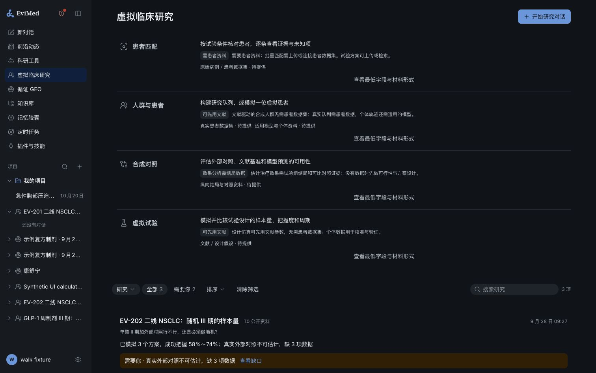
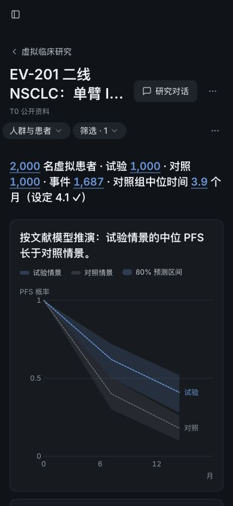

# PR 17 review remediation and local verification

## Scope and provenance

This record addresses the six review comments beginning at [the owner review](https://github.com/anonymous-temp/EviMed-Science/pull/17#issuecomment-6406085996), on reviewed head `fadbb3395`. Main `d757ca09e` was semantically merged as `78687911a` before remediation. The branch remains `codex/vcr-ai-native-reset-20261025`. This is a local validation and GitHub revision, not a deployment or production-data retirement.

The review's B1–B13 are grouped findings, not thirteen independent code edits. The five detailed comments contain 62 finding headings with overlaps. Their original order is indexed below. Grouped WEB14 subitems are covered explicitly.

## Product behavior retained

The entry remains a first-level virtual clinical research workspace with four task families: patient matching; populations and individual patients; comparators; and trial-design simulation. Conversation is the execution surface. Saved objects, exact versions, source material, data requirements and results remain inspectable. Operational recruitment, referrals, site CRM and outreach are removed; historical observations have an authorized read/export path.

A virtual cohort describes a population or collection. A virtual patient describes one generated record or one supported prediction. Neither establishes an individually validated digital twin. A model-predicted comparator is a descriptive benchmark; real external-control effect estimation still needs comparable observed exposure, outcomes, index time and covariates. Pre-enrollment records and post-exit routine care do not disclose hidden in-trial outcomes.

## Remediation crosswalk

### Attribution and continuation — comment 6406086640

| Finding | Change and verification target |
|---|---|
| ATTR01 | Terminal result observations are persisted from actual tool reads. Observed or disclosed results do not cause a second paid continuation. Final admission rechecks current human intent and origin consumption. |
| ATTR02 | Ordinary conversation task scopes stay hidden and do not change project classification, navigation or sidebar identity. Read-only public lookups create no study. |
| ATTR03 | Normal completion, lease reaping and cancel recovery all replay per-job finish hooks; one failing hook does not suppress another. |
| ATTR04 | Per-account fair claims, bounded retry attempts/age, explicit exhaustion and bounded reconciliation replace global head-of-line scans. |
| ATTR05 | Original human uploads/messages are admitted; assistant-generated library/wiki/frontier/link material is not an uploaded patient source. |
| ATTR06 | Authenticated human message candidates expose sequence and bounded previews, with cursor pagination and explicit prior-message selection. |
| ATTR07 | Canceled work never gets a prompt asking it to resume. Accepted stop intents invalidate reserved continuation sends. |
| ATTR08 | An originating capability version change no longer silently drops a valid saved result; continuation resolves current usable context. |
| ATTR09 | Automated continuation turns do not swallow the researcher's next learning signal. |
| ATTR10 | Verified invocation canonicalization handles null optional fields and Unicode outside the BMP. |
| ATTR11 | Invocation evidence is bounded to the current turn; older messages are paged rather than making long conversations unusable. |
| ATTR12 | Completion worker settings, indexes, fair bounded queries, retention and terminal exhaustion are explicit. Passive status reads do not refresh runtime idleness. |
| ATTR13 | Deleted task scopes yield an actionable closed status instead of generic gateway unavailable. |
| ATTR14 | Ordinary root has three compact VCR tools; registry/curve/pooling definitions activate only under verified VCR context. Disabled-account registration omits all VCR tools. Actual three-arm baseline is recorded separately below. |
| ATTR15 | Legacy studies resolve their own original conversation context without first requiring a study-page visit. |

### Recruitment retirement and evidence — comment 6406087343

| Finding | Change and verification target |
|---|---|
| RECRUIT01 | Archive payload is authenticated encrypted data. Withdrawal/account erasure creates monotonic tombstones; reseal excludes erased records and stale restore refuses. |
| RECRUIT02 | Historical follow-up episodes can be read and exported by current authorized users. Runtime receives only a browser capability descriptor without source/cloud-authorized patient content. |
| RECRUIT03 | Before physical retirement, withdrawal still closes historical referral rows; history-only patients are recognized by the real withdrawal API. |
| RECRUIT04 | Archive/restore use canonical UTC/date/interval output and preserve exact PostgreSQL numeric JSON bytes. |
| RECRUIT05 | Explicit restore, idempotent re-retire, constraint-compatible member replay and named SQLSTATE diagnostics; archive readback no longer deadlocks its capture transaction. |
| RECRUIT06 | Legacy site/recruiter grants are labeled retired and can be revoked singly or together; no new retired grants can be added. |
| RECRUIT07 | Evidence has an independently anchored trial identity. Registry+article duplicate reports count once; one article can report multiple separately identified trials. Missing identity is not poolable. |
| RECRUIT08 | Derived inputs require exact numeric spans; compound/case-sensitive units cannot be shortened; quoted marginal statistics do not verify a correlation matrix. Derived-only input verification cannot become a direct-value assumption. |
| RECRUIT09 | Removed unused operations, fixtures, calculator/form components and stale recruitment promises. Preserved only research matching, scientific schedules, historical observations and abstract accrual assumptions. |
| RECRUIT10 | Partial assessment persistence is a bounded retryable finish hook with terminal notification, not endless work each tick. |
| RECRUIT11 | Mean study duration and last-patient-in/target-events forecasts are separate named outputs; legacy accrual rows retain their original meaning and page home. |
| RECRUIT12 | Table-backed matching evidence parses/hashes once per authorized request, with no cross-request permission cache. |

### Scientific computation — comment 6406088061

| Finding | Change and verification target |
|---|---|
| SCI01 | Centered Cox baselines require source-bound centers including explicit zero; a zero is allowed when genuinely declared and verified. |
| SCI02 | Source coefficient scale is explicit. Positive HR/OR values are logged once; transformed centers carry their scale and are transformed before centering. |
| SCI03 | Pairing keys affect deterministic random streams even with an explicit seed; legacy method versions retain old behavior. |
| SCI04 | Parameter quantiles expand the user's truth grid as a Cartesian product rather than replacing it. |
| SCI05 | Normal-approximation sample-size basis and separate t-test power check are visible in result/detail/replay/package presentations. |
| SCI06 | TTE version 1.2 allocates integer arms consistently with plotted power and expected events; earlier versions retain historical rounding. |
| SCI07 | Two-parameter survival families require at least two events before convergence/estimability checks. |
| SCI08 | Method records name actual independent numerical references; fake gateway execution is no longer labeled an independent numerical oracle. |
| SCI09 | Mandatory locked flexsurv and numDeriv oracle checks every distribution's natural parameters, median, survival, AIC and delta uncertainty. |
| SCI10 | Both modeled outcomes are retained at each observed longitudinal visit. No post-dropout measurements are invented; people and visit-record counts stay distinct. |
| SCI11 | Optional signing is supported only through verifier-origin hash verification. Raw/forged receipts cannot claim that proof; all fit/reconstruction/read paths share it. |

### Interaction and layout — comment 6406088767

| Finding | Change and verification target |
|---|---|
| WEB01–02 | Hidden conversation scopes no longer appear as English-titled studies or hijack the general sidebar/project identity. |
| WEB03 | Home starters choose the general assistant explicitly, even after GEO; no study creation is required. |
| WEB04 | Removed retired recruitment wording in matching, tiers, offers and notices. |
| WEB05 | Historical results name the method, localize actual timestamps, render readable configuration and link back to the originating research conversation. |
| WEB06 | Object actions carry a validated exact reference separately from human draft prose. Normal edits preserve that selection; cancel/navigation/explicit clearing remove it. No raw identifiers are inserted into the composer. |
| WEB07 | Unreachable calculators, study brief, rail and related self-only tests were deleted. Useful saved results remain readable. |
| WEB08 | Saved model/parameter library has a page with provenance, limits and conversation actions; actual production-CSS pointer checks cover the stretched-row overlay. |
| WEB09 | Cohort/individual selection lives in the shared frame band, including its compact filter menu. |
| WEB10 | Retained accrual forecasts and probability curves have a separate section beside simulated mean study duration. |
| WEB11 | Requirements distinguish literature-only work, original patient material, authorized connected datasets, longitudinal outcomes and applicable model/individual inputs. Details open to show minimum fields and accepted forms. |
| WEB12 | Retired membership is readable and removable from the real dialog. |
| WEB13 | Written remote drafts and scoped legacy local drafts are offered back. Restoring never overwrites a nonempty native draft; explicit discard requires unchanged original bytes. |
| WEB14a | Failed/pending results have one conversation-based continuation action; no direct programme POST. |
| WEB14b | Legacy /patients links redirect to the canonical population workspace with individual selection and preserved patient query. |
| WEB14c | Prediction limitations use codes and Chinese vocabulary, not exact English sentence matching. |
| WEB14d | Removed unused site/next/workflow/dot/busy fields and branches. |
| WEB14e | Unavailable matching explains the next user action in research language. |

### Controller and CI — comment 6406089436

| Finding | Change and verification target |
|---|---|
| CTRL01 | Main was merged with native-memory/trace semantics preserved. |
| CTRL02 | SIDER is an independent failing job so an external outage no longer prevents code tests. Verified raw bytes can be cached; every reuse checks size and SHA256. Shared skill vocabulary was regenerated. |
| CTRL03 | Compact root definitions and actual baseline: see ATTR14 and the verification section. |
| CTRL04 | All five changed capability versions were bumped and generated manifests/Chinese descriptions refreshed. |
| CTRL05 | One shared operating contract is linked by all five skills; the two shipping trees are byte-identical and tested. |
| CTRL06 | Chinese real-user routing cases include short patient requests, follow-ups and explicit specialist commands. Bound-session precedence stays covered by dispatch tests. |
| CTRL07 | E05 now executes every declared method, including both new model handlers. |
| CTRL08 | Homepage controls now sit immediately before their list. Browser checks cover requirements, saved models, cohort/individual switching, narrow width and GEO-to-general entry. |
| CTRL09 | Dead tab/helper/calculator code is removed; the standalone walk now verifies exact saved-history jobs instead of the retired calculator. |
| CTRL10 | Method validation reference expectations include N53; domain records, specialist copy, skill package digests, tool graphs and walk tables are synchronized. |

## Independent review findings caught during remediation

Independent reviewers reproduced additional issues rather than only rereading passing tests: stale admission between reservation and send; failed notice retry; single-connection lock inversion; accepted cancellation before send; source-less historical patients absent from withdrawal lookup; erasure of a site author leaving a cross-owner foreign key; archive advisory counts poisoning re-retire; stretched model rows intercepting actions; user edits dropping exact object context; date-only values shifted by timezones; minus-sign and exponent clipping; trial registry/key aliasing; numeric scan-prefix clipping; and patient-context falling through to a public registry read.

These are tracked with focused behavioral regressions. Frozen backend concurrency re-review passed 147/147 with zero skips; the complementary PostgreSQL audit found no remaining blocker. Encrypted archive tests use an isolated local production-shaped schema, never production.

## Local verification record

The first complete local pass is preserved rather than rewritten as a success:

- Web: 422 files, 5,135 tests; 5,132 pass / 3 fail. Two stale continuation assertions were corrected; an unchanged frontier test passed 50/50 in isolation. The final full rerun passed 5,135/5,135 below.
- Server without PostgreSQL URL: 11,170 tests; 8,518 pass / 23 fail / 2,629 skip. Failures included newly exposed integration drift, stale generated artifacts and macOS-specific infrastructure limitations. Corrected failures and the final rerun are recorded separately.
- Locked Linux numerical suite: 226/229. N06b/f still asserted old total rounding; N52k lost singleton parameter names in flexsurv's exponential output. Only these test adapters were corrected, preserving independent references and tolerances. Independent locked rerun of N06b/f, N52k and N53e/f passed 5/5; the complete final rerun passed 229/229 below.
- Real model classifier: 82/82 cases, one sample per case, no classifier failures. This measures routing, not task completion or scientific validity.
- MCP: 1,002 research tests completed with two environment-dependent skips; 13 memory tests passed.
- Evidence/date independent checks: 21/21 including real PostgreSQL; Shanghai and Los Angeles date tests each 4/4.
- Retirement security review: 16/16 and the three adversarial archive/erase/restore scenarios pass.
- Shared skills/generated-reference checks: 87/87; method/contract sync follow-up 10/10.
- UI walk/composition/history tests: 148/148; real Chromium targeted checks 3/3. Built-in browser manually verified local synthetic data at desktop and 390 px, with no horizontal page overflow. This mock-runtime fixture cannot establish a live AI turn.

### Built-in browser screenshots

These images show invented local UI fixtures, not real patients or a validated model run.

### Final checkpoints

- Final full web run: **422 files / 5,135 tests passed**. Subsequently regenerated server view fixtures exposed three stale test assertions; the affected two files passed **67/67**, and the final TrialTab run passed **39/39**. No new full-web batch was started after the owner requested closure.
- Domain/port/socket/contracts: **2,049 passed / 14 environment-dependent skipped / 0 failed** (2,063 tests across four suites).
- Final full server attempt: **8,532 passed / 13 failed / 2,637 skipped** (11,182 total). Two failures concerned the new stop-intent export classification and a completion-metric fixture; their targeted follow-ups passed **23/23** and **4/4** respectively. The other failure counts are inherited macOS/fixture constraints: Linux `/proc`, Bash 3.2 behavior, case-insensitive filenames, backup mutation instrumentation and the absent PDF renderer dependency. Control runs on archived main reproduce these classes; the archive-only control additionally lacks some root Dockerfile inputs. This is not a clean full-server gate.
- VCR PostgreSQL attempt: **461 passed / 13 failed / 16 skipped** (490 total). The 13 failures were a missing new-route case, changed source-standing label, obsolete `next` assertions, the Start test adapter failing to invoke `beforePrompt`, and stale saved-view fixtures. Targeted corrections passed: CS45 with all current roles and JSON/CSV permissions; evidence standing **2/2**; Start/lifecycle **42/42**; golden view generation and independent no-write readback **7/7** each. The 16 real-engine seam checks still lack a host `VCR_R_LIBS`/service environment; the separate locked R numerical suite is not a substitute for that HTTP/database seam.
- Independent final reviews: backend **147/147** plus additional integration checks; evidence/date and subsequent lexical rechecks; encrypted retirement **16/16**; PostgreSQL cross-controller/one-client/savepoint/retention/isolation audit; canonical TypeScript and ESLint. All confirmed in-scope code findings were closed at review freeze.
- Generated artifacts and source credential audit passed. Local browser fixture account deletion returned **HTTP 200**; its owned server and database were removed. No production data operation or deployment occurred.
- Locked R final full result: **229/229 passed**, including E05 (42 handler jobs / all 34 declared methods), the independent flexsurv/numDeriv checks and legacy replay cases. The 158-package library and R 4.3.3 were verified; the final container exited successfully. [Complete numerical evidence and source-file identities](2026-10-26-vcr-pr17-review-assets/numerical-evidence.json). This verifies numerical implementation, not clinical model validity.
- Three-arm selected general-task results: [sanitized comparison](2026-10-26-vcr-pr17-review-assets/general-tasks-bounded-default-off.md) and [machine-readable results](2026-10-26-vcr-pr17-review-assets/general-tasks-bounded-default-off.json). Execution success: A **6/6**, B **5/6**, C **5/6** general tasks; deterministic/artifact pass: A **5/6**, B **4/6**, C **3/6**. One medical control passed in B and C. All 20 temporary accounts were deleted through the API (HTTP 200). B/C actual default-off first-request catalogues matched exactly (46 tools / 38,528 schema characters / no VCR tools). This does **not** establish overall quality noninferiority: C's Word output lacked a required heading style, all arms exceeded G13's retrieval-call ceiling, and B/C hit the five-minute G16 test budget. No follow-up model runs were added at the owner's stop boundary.

### Remaining gaps at the owner's requested handoff boundary

1. **New main synchronization.** This revision was built and reviewed on merged main `d757ca09e`. A final fetch found main at `f85d37bbe`, **381 additional commits** beyond that shared baseline. PR #17 is still reported conflicting. The owner asked to finish current tests and hand off remaining gaps, so this round does not merge/retest that new work or claim merge readiness.
2. **Enabled VCR real-model acceptance.** The actual A/B/C selected general-task batch uses the default VCR-off configuration. It measures general behavior and the disabled-account catalogue, not an enabled-VCR three-arm comparison. Compact entry definitions and lazy activation are covered by code/transport/PG tests, but an enabled live native-chat matching → result → continuation journey and a full 29-case comparison remain unperformed in this remediation round.
3. **General-task quality and complete platform gate.** The unresolved G02 heading-style check, G13 retrieval-call budget and G16 bounded-report completion need separate diagnosis/repeated evaluation; no causal regression or superiority is inferred from one stochastic sample.  No final clean monorepo/server/engine-service integration gate is claimed. The exact full attempts and focused follow-ups above remain distinct. No extra broad rerun was launched after the owner's closure instruction.
4. **External dataset / remote CI.** Cold-cache SIDER retrieval still times out at its official HTTPS endpoint locally. CI now isolates that required failing dataset check from the code suites and revalidates cached bytes, but does not hide outages. The new pushed revision's GitHub checks must be assessed on that revision separately.
5. **Production and customer validation.** No deployment, production recruitment-data retirement, real patient-data acceptance, target-population calibration or regulatory qualification has been performed. These were outside this local handoff, and simulated or source-bound output must not be labeled clinical validation.

## Closure of the remaining gaps (2026-10-26, second review round)

The reviewer of `fadbb3395` re-checked this revision against the thirteen blocking items of the review and closed the gaps
above as follows. The rule applied: finish what code and existing regression checks can establish, and rule on the rest
from evidence already on record rather than open new experiments.

**Blocking items, verified in code.** Conversation task scopes are listed nowhere and carry a Chinese name (B3); a result
the originating turn already read gets no paid continuation (B4); finish hooks run per hook for every terminal path (B5);
the outbox and hook replay are bounded, backed off, partitioned per account and configured in `config.mjs` (B6); patient
sources check the path-derived origin and earlier human messages are selectable (B7); centered Cox centers, coefficient
scale and trial identity are bound (B8); the retirement archive is encrypted, re-sealable after erasure, rendered in UTC and
restorable (B9); home starters open the general assistant (B11); historical follow-up has an authorized read and export (B12);
the ordinary root carries three compact VCR tools of 4,453 schema characters in all (13,404 before), the other three only
under verified VCR context (B13). Two items were not finished and are fixed in this round:

- B10: the T0 matching hint still promised 「转诊和随访」, and the accrual fields and the historical accrual timeline read
  「招募」; they now read 「逐个核对患者」 and 「入组」.
- A stop pressed in the kernel's window was refused when its stop intent could not be written (the remediation made
  `recordStop` throw). A stop is never held back by its record now (review F4, principle 19); the failure is audited.

**Gap 1, main synchronization — done.** Main `f85d37bbe` (381 commits) and then `9614de895` (the integration release's walk and
GEO page fixes) are merged. The twenty-plus conflicts and their resolutions are in the two merge commits; the semantic ones
are the native prompt path (main's signed attendance receipt and GEO plan envelope beside this branch's per-session prompt
admission and VCR selection envelope; the admitted prompt goes through main's context-policy-guarded `send`) and the walk
(GEO views take main's `rail` workflow, VCR views keep `objects`). `evals/acceptance-ledger.json` now counts six vcr-matching
briefs, the one failure the pushed `3e0894c47` showed in CI.

**Gap 2, enabled-VCR live acceptance — not run, by decision.** The two native probes on record (matching in ordinary
conversation; a cold calculation with its same-conversation continuation) already exercised the live path, the paths changed
since are covered by unit, transport and PostgreSQL tests, and the catalogue cost the 29-case comparison was meant to expose
is a deterministic number (B13 above). A new three-arm model campaign would not change a decision. The release walk and the
first real use after deployment are where the live behaviour is next observed.

**Gap 3, general-task quality — not attributable to this branch; closed.** With VCR off the B and C first requests carried a
byte-identical catalogue (46 tools, 38,528 characters); G13 exceeded its retrieval budget in all three arms and G16 hit the
five-minute test budget in B and C alike; G02's heading style differs in one stochastic sample. None of the three points at
code this branch changed, so no repeated sampling is added.

**Gap 4, CI.** The public dataset is its own job and fails only on the external SIDER outage. Main itself carries a stale
`WEB_DOCKERFILE_SHA256` (`ab52b59d4` changed `deploy/web/Dockerfile` without re-pinning the reviewed recipe), which fails
`release-full-build.test.mjs` (13) and `evolutionDevelopmentPackaging.test.mjs` (1) on main and on this branch alike, and on
this branch's CI it stopped the web job before durable product state, billing, extension boundaries and the frontend ran. The
change it missed only copies `packages/contracts/openviking/compile-scope-proof.json` into the final stage and is already live,
so the pin is re-recorded here for the current Dockerfile.

**Gap 5, production and customer validation** stays outside this change: nothing was deployed and no production data was
touched.

**Residual risk to watch after deployment.** The per-session prompt admission holds one PostgreSQL client (the control
plane's pool has 10 by default) from admission until the kernel acknowledges the prompt — normally well under a second, at
most `runtimePromptAdmissionTimeoutMs` (30 s). A kernel that stops acknowledging while several conversations send at once
could hold several clients. `runtimePromptAdmissionStatus` counts attempts, queueing and timeouts; if timeouts appear, release
the client before the wire wait.

**Local verification on Linux after both merges** (`f48680a92` and the fixes on it): all five typechecks, lint, eleven
generated-artifact checks, the source-secret and hosted-compliance audits; web **5,553/5,553**; domain, port, socket and
contracts **2,121 passed, 14 environment skips, 0 failed** (after the first merge); ops **310** with one failure that passes
with a private `TMPDIR`; server **9,093 passed / 14 failed** of 12,401 (the 14 are main's stale Dockerfile pin above, 22/22 after the re-pin; the
rest need PostgreSQL and skip without it). PostgreSQL product-state and the engine seam are left to CI, which
runs them on the pushed revision.

## Limits

Source anchoring proves literal provenance, not clinical applicability. A custom unregistered trial name cannot automatically establish global independence from all differently named reports; that remains a reviewable source assertion. No customer patient dataset, hidden in-trial outcome, clinical model calibration, production migration, regulator acceptance or production deployment was used or established here. SIDER remains a pinned external dependency: an unavailable cold cache remains a failing dataset check rather than synthetic success.
