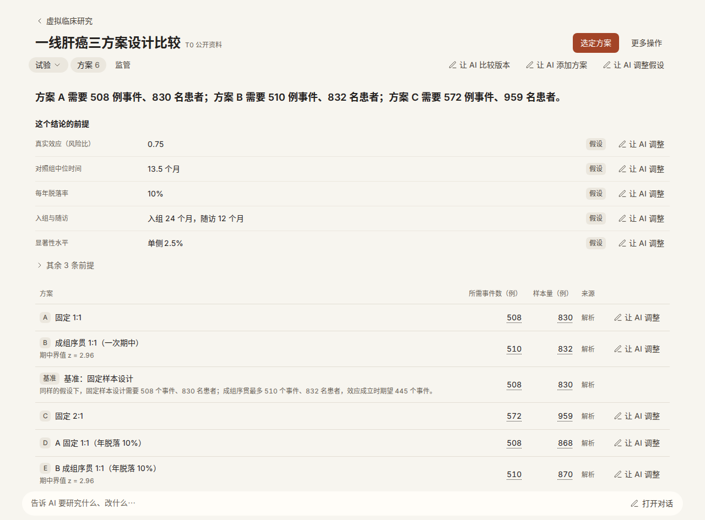
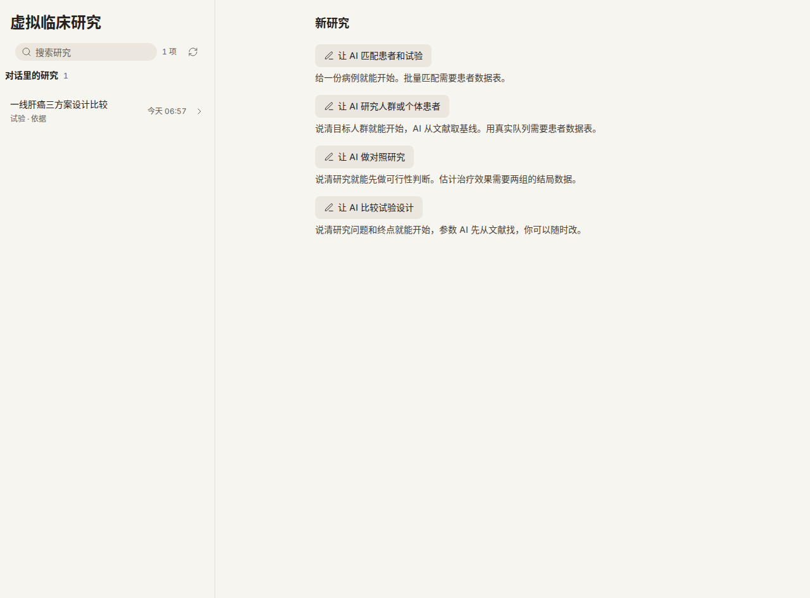
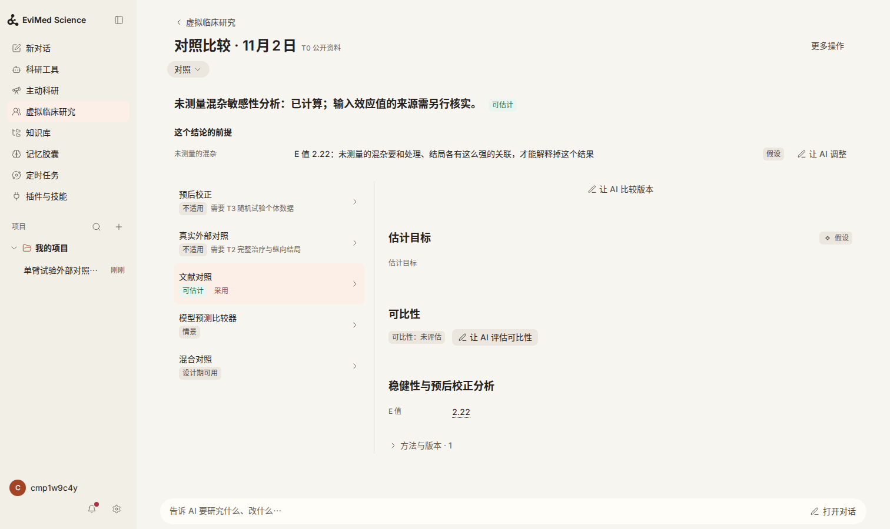
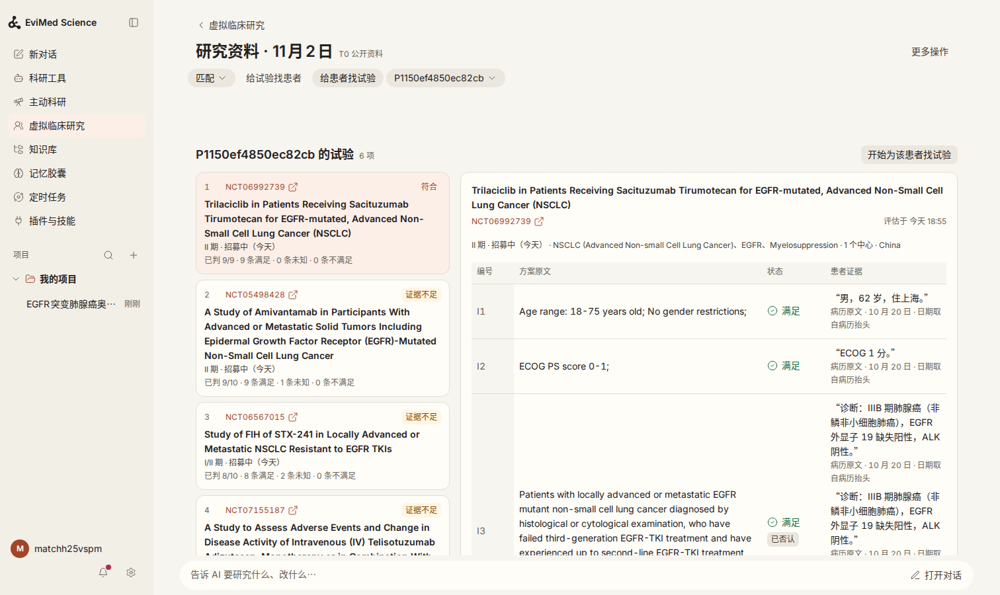
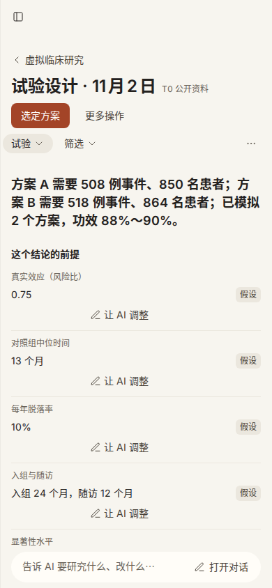

# 虚拟临床研究整改：真实对话验收

日期 2026-11-01。验收的代码是整改分支 `codex/vcr-remediation-20261101`。没有部署，只在开发机上跑。最后一次测试的提交是 `9dc60dfce`；更早跑的对话用的是当时的提交，每修一处只重测受影响的那段。

## 结论

**整条路能走通了，但模型不总走这条路。**

- 做设计比较、匹配患者时，模型进了模块：引擎出数，回复末尾给一个能点的链接，点开落在对的研究、对的页签，结果页有“这个结论的前提”，一句“脱落率再保守一点”能算出新版本，旧结果还在。
- 这次跑对话前，这条路其实走不到底。真实对话查出 9 个问题，其中 1 个能让整个服务卡死，都在这次修了（见“修了什么”）。这些问题单元测试都没发现。
- **还没解决：**“按这张表生成合成人群”和“这个试验要多少人”，模型多半自己写脚本算，不进模块。这两句话是最常见的说法。数字来自实际运行的脚本，不是模型编的，但没有研究页、没有版本、没有前提块。要改得动技能目录或系统提示，这和“不增加根对话文字”的规定冲突，需要您决定（见“需要您决定”）。

花费 4.47 元（上限 60 元）。其中 1 段探针对话的账本随账号删除了，约 0.03 元是估的。

## 这次怎么测的

真的：控制面、DeepSeek Harness 内核 0.2.1-rc.5（和 `deps-version.json` 的版本一致）、研究工具服务、各个网关、统计引擎（R 4.3.3 本地服务）、数据库、经模型网关调用的 `deepseek-v4-flash`，以及真实的 ClinicalTrials.gov、PubMed 和网页搜索。消息都由浏览器打进原生输入框，账号是一次性的，用完都通过产品自己的删除功能删了。病例和基线表都是我编的合成数据。

和线上不一样的地方：

- 内核直接跑在开发机上，没有容器。它的 Python 没有 numpy，模型会花几步找环境，工具调用数比线上偏多。
- 记忆引擎、LoopX、学习回路都关了，模型每次都从零开始。
- 没配 ChiCTR 的检索接口，所以中国登记库查不到。
- 引擎给了 2 个核。

“工具调用”指模型调用工具的次数。“被拒”指工具因字段不对退回的调用，每次都说明了哪里不对。

## 修了什么

| 提交 | 真实对话里发生了什么 | 现在 |
|---|---|---|
| `ac6dcfae5` | 模型在一步里发起两个计算，**整个服务永久卡死**，所有账号的请求都不再返回。计算任务占着项目的数据库行，等进程内的存储锁；另一个请求占着存储锁，等那一行。数据库看不到进程内的等待，所以不会解开，后续请求排队直到连接池耗尽 | 改了计算任务的锁模式；测试验证过旧写法确实复现这个问题 |
| `11364d276` | “先检查再计算”这个动作在真实对话里一律被拒，理由是“没有当前调用”，模型转去用别的工具。工具说明也没提设计比较和人群该来这里 | 校验通过；两段说明都改写了，没有变长 |
| `4d275d1ff` | 对话第一步调研究工具被拒：运行记录约 9 秒后才写入，工具调用 2 到 3 秒就发出。模型得到“请不用研究数据继续”，就真的放弃了 | 调用等运行记录写入，最多 20 秒（`OPEN_SCIENCE_VCR_RUN_ADOPTION_WAIT_MS`） |
| `762bed1d4` | 字段不全的拒绝，下一步提示却写着“不用研究数据继续”，和拒绝理由矛盾，模型照后者走了 | 这类拒绝现在提示模型照理由改 |
| `893d15073` | 设计或人群的参数写全了，引擎仍要求先单独写一个研究对象 | 在对话里直接算，平台用这份参数建对象 |
| `2249fc242` | 生存终点的结果页只显示事件数，不显示人数；成组序贯和固定设计显示同一个数；改脱落率后页面上没有任何数字变化 | 显示人数和序贯设计自己的最大值 |
| `cd7de665a` | 匹配的链接点开，落在“给试验找患者”这一侧：空页面，还要求“说明研究问题”，结果其实在另一侧 | 只有患者、没有方案的研究，直接打开这位患者的试验 |
| `686001282` | 模型看到文献人群要把数字绑定到原文，手上只有一张粘贴的表，就放弃引擎 | 工具答复告诉它：粘贴的表走情景人群，并说明数字未经原文核对 |
| `9dc60dfce` | 任务比这一轮对话算得久时，回复说“算完通知你”，但结果永远回不到原对话，通知里写着“原对话不可用” | 能回来了，已实测 |

## 六段对话

一段对话没走通并修了代码之后，我只重测了这一段。下面写的是重测后的最终结果。表里“问了几件事”按模型一次问的问题数算。

| 对话 | 进模块了吗 | 工具调用 / 被拒 | 问了几件事 | 回复末尾的链接 |
|---|---|---|---|---|
| 1 匹配 | 进了 | 35 / 1（另有 2 条事实被拒） | 0 | 1 个，正确 |
| 2 生成人群 | 跑了 4 次，都没用引擎算出来（第 2 次试过，被拒后放弃） | 28–52 / 0–2 | 0 | 无 |
| 3 单臂能否外部对照（没给数据） | 只读了状态，合理 | 4 / 0 | 回答后问 3 件 | 无（没有结果，应当没有） |
| 4 比较三个方案（原话） | 没进，理解成三种治疗方案 | 15 / 0 | 0 | 无 |
| 4 比较三个设计方案（改了一个词） | 进了 | 64 / 14 | 0 | 1 个，正确 |
| 5 要多少人 | 没进 | 18 / 0 | 一次问 2 件 | 无 |
| 6 虚拟试验可能吗 | 只读了状态，合理 | 4 / 0 | 回答后问 4 件 | 无 |

### 1 匹配：“这位患者能入哪些试验？”

没问问题就开始了：存病例、抽事实（每条带原文）、查三个登记库、读 6 份登记记录、把 4 个试验的入排条件写进去、读回排名。

- **工具结果：** ClinicalTrials.gov 查到了，中文检索式返回 HTTP 400，被标为“部分失败”。欧盟库没命中。ChiCTR 未接入，CDE 和 ICTRP 不在范围内。
- **模型的用法：** 回复里的“已判 / 适用”（8/10、7/10、10/15、8/13）和读回的排名逐条一致。它写明了查过哪些库、截至哪天、“没有排除不等于符合”，结尾说明不是推荐。
- **回答了问题吗：** 回答了。列了 4 项，每项写清还缺什么；另列了判断不适合的，并给出原因。
- **瑕疵：** 回复里混进了一个登记库的内部编号（`#277488`），还有一句“平台把入排条件固定下来的判定结果”，有点后台味。

### 2 人群：“按这篇论文的基线生成 500 人的合成人群”

跑了 4 次，每次都是修完代码后重测，不是为了碰运气。4 次都是模型自己写脚本。第 2 次试过引擎，被拒后放弃。第 3 次读了字段说明，因为要绑定原文而放弃，这才有了 `686001282`。第 4 次没碰引擎。

- **数字：** 都来自实际运行的脚本，和基线表对得上。
- **假设：** 相关系数写明是自己按“临床常识”设的，没有隐瞒。
- **缺的：** 没有研究页、没有版本、没有前提块，首页也查不到。

**另测了一段点名模块的：** 话里说“用虚拟临床研究模块的引擎”。这回 5 次调用就算完了，0 次被拒。链接落在“人群与患者”页，前提块写着“假设相互独立”和“参数按给定值固定”。任务算完后原对话自动续了一轮，给出对照结果。可见引擎这条路是通的，问题在模型选不选它。这段的瑕疵是回复里出现了内部编号（`pop_…`）。

### 3 对照：“这个单臂研究能用外部对照吗？”

没给数据，所以没开研究，是合理的。回答讲清了前提条件、偏倚和处理、证据分层、锚定与非锚定的区别。引用的 2025 年第 54 号指导原则来自当次的网页搜索结果。结尾问了 3 件事，超过“一次问一件”的要求。

**另测了一段点名模块的：** 给了两个汇总率。35 次调用，4 次被拒。结论是“只能当固定基准，不能当外部对照估疗效差”，并列出还缺什么，这和方案的判断逻辑相符。但部分数字走的是另一个计算工具和模型自己的脚本，链接落到了“试验”页，**所以对照页签的入口没验证到**。

### 4 设计

**原话“比较三个方案”：** 模型理解成三种治疗方案，在回复第一句说明了这个理解，然后查文献对比。对这句话而言这不算错，是歧义，但没走到模块。

**改成“比较三个设计方案”：**

- **走法：** 先查文献取对照组中位生存，再为 3 个方案（固定 1:1、成组序贯、固定 2:1）写研究对象，交给引擎计算。
- **问题：** 0 次提问。
- **工具结果：** 830 / 832 / 959 人，508 / 510 / 572 个事件，和数据库读回一致。
- **假设：** 全写了，包括年脱落 5%。
- **建议：** 一句话，带上了约束条件。
- **被拒：** 14 次，主要是字段名不对（来源类型、证据类型）和不会写设计参数。这是“少走弯路”那部分还没做到位的地方。
- **算术：** 模型在引擎数字上做了几处加减（比如“多 129 例”）。我抽查过，对得上。

**后续一句“脱落率再保守一点”：**

- **回原对话：** 从结果页点“每年脱落率”旁的“让 AI 调整”，确实回到同一段对话（核对过会话编号），输入框里预填了草稿。
- **算新版本：** 发送后模型取 10%，算出 868 / 870 / 1002 人，并说明事件数不变、人数涨约 4.5%。
- **旧结果：** 数据库里 3 个新方案对象、7 份结果全在，页面列出 6 行方案。
- **前提块：** 打开 5 条，脱落率显示 10%，其余 3 条折叠。

**首页和侧边栏：** 研究列在“对话里的研究”下，副标题是页签名。侧边栏只有对话，没有研究。项目仍只有“我的项目”，它和研究之间没有多出别的项目。

**瑕疵：**

- 名字用的是模型写的定义标题，不是第一句话。只有没写定义的研究才用第一句话（人群那段就是）。
- 对照组中位生存明明来自文献，来源标签却是“假设”。模型尝试绑定证据被拒后放弃了。
- 设计网格的仿真没跑完：方案 C 整行和方案 B 的零效应格没算出来。模型如实说了，页面显示“—”。

### 5 不明确：“帮我算一下这个试验要多少人”

- **提问：** 一次问了 2 件（终点类型、效应量）。卡片样式清楚。
- **之后：** 模型载入了通用的 `statistical-power` 技能，自己写 R。给出 331 个事件、528 人，假设写得清楚。没进模块。

这段还暴露了另一个问题：第一次跑时用的账号里有前几段对话的文件，模型把别的对话留下的设计文件当成了“这个试验”，一句没问，调用了 53 次工具。同一项目的不同对话共用工作目录，这是现状。

### 6 不明确：“这个药和安慰剂比，有没有可能做虚拟试验”

修完抢跑问题后，模型只读了研究状态，直接回答：分三种“虚拟”讲清证据地位，说明安慰剂组为什么难重建。结尾问了 3 件事，又加问了 1 个用途问题。没有数字，也没有编数字。

修之前的那次对比很清楚：第一步被拒，模型认定模块不可用，转去用通用计算工具。

## 和原生对照比（不含模块）

同样的内核和模型，关掉所有 EviMed 插件和研究工具，保留通用技能和文献、试验、网页搜索工具。每段只跑一次，下面只说方向，**不构成“显著更好”的证据**。

| 任务 | 用对方法了吗 | 数字来自哪里 | 假设 | 方向 |
|---|---|---|---|---|
| 匹配 | 都查了登记库并读了记录 | 模块：逐条存证后读回。原生：模型读完自己归纳“基本吻合” | 模块标出“已判 n/m”和未知项；原生只写限制条件 | 模块可追溯、可复查；原生的文字更好读，还把入排条件按耐药机制讲透了 |
| 人群 | 一样，都自己写脚本 | 都是脚本 | 都写明相关性是假设的 | 没有差别（模块没用上） |
| 对照（没数据） | 都给框架 | 都不计算 | 都写明 | 差别不大；原生读的资料更多 |
| 方案（原话） | 都理解成治疗方案 | 都来自文献 | 都写明 | 没有差别 |
| 设计方案 | 模块：引擎公式。原生：自写脚本 | 模块来自引擎；原生来自脚本 | 模块逐项列出，含脱落；原生的回复里没提脱落 | 模块数字可追溯、能改一句出新版本。但**原生挑的三个方案更有意义**（优效、非劣效、共同主要终点），还提醒索拉非尼已不是标准对照；模块那三个偏机械 |
| 要多少人 | 都先问 | 模块那段算了（也是脚本）；原生没算，因为我的回答没给数字 | 不可比 | 我两边回答不同，不算数 |
| 虚拟试验 | 都按种类回答 | 都没有数字 | 都写明 | 没有差别 |

原生那边自然没有结果页、版本、前提块和链接，也没有“调整”。这些是模块实实在在多出来的东西，但要模型走进来才有。

## 还没解决的

1. **模型不选模块（最大的问题）。** 生成人群和“要多少人”都被它当成写脚本的任务。“要多少人”这句，目录里的通用技能先接住了。
2. **一次问太多。** 不明确的两段问了 2 到 4 件。字段说明里写了“一次一件”，但模型提问时还没读到那里。
3. **字段被拒多。** 设计那段 14 次，匹配那段一次写入 19 处字段不对。不影响结果，但费步骤。
4. **对话共用工作目录。** 新对话会读别的对话留下的文件，还可能当成当前任务的。
5. **没做进这次修复的：** 对照任务的计算对象（`evalue`）仍要求先写对象；证据绑定收不下文献数字，所以来源只能标“假设”；回复里偶尔出现内部编号。

## 这次不能证明的

- **成功率。** 每段只跑一次，通过一次不是比率。模型选不选模块本身有随机性：人群那段 4 次里只有 1 次真的尝试过启动引擎。
- **线上表现。** 没走容器和线上配置，也没有 ChiCTR。
- **临床正确性。** 匹配结论、效应假设都没有经过专家审核。
- **真人感受。** 我是照着脚本操作的。
- **对照页签的入口。** 没有哪段对话把结果写到那里。
- **知识库的项目选择。** 账号只有一个项目，页面没有出现选择控件，这一点靠单元测试保证，不是亲眼确认的。
- **手机和窄屏。** 只看了 1512 宽的桌面截图：没有横向溢出，也没有后台字样。
- **第一次的“页面崩溃”。** 在等问题卡片时浏览器页面崩过两次。我当时给它限了 512 MB 内存，去掉限制后没再崩，但我没有去查根因，算不算产品问题不确定。

## 需要您决定

要不要让通用场景也指向模块？比如在 `statistical-power` 技能的描述或正文里加一句“临床试验的样本量和设计比较走虚拟临床研究”，或者把这句放进根对话说明。

- **加：** 这两句最常见的话大概率能进模块，有页面、有版本。代价是打破“虚拟临床研究的文字只放在自己的技能和工具答复里”这条规定，每次会话多带一点文字。
- **不加：** 保持现状。用户明确提到模块时才走（这次实测是通的），其余情况由模型自己写脚本。数字仍是算出来的，但没有页面。

我的建议是只加在 `statistical-power` 的正文里，不动根对话说明：只有模型载入这个技能时才读到，不增加每次会话的负担。我没有动，因为这超出了现行规定。

## 截图

设计比较的结果页，含后续调整后的新旧方案：

模块首页：

---

# 2026-11-02 接入验收：模型进模块、一次一问、对话间文件

日期 2026-11-02。代码是 `int/1102`（不推送、不部署），验收的是终版提交 `0a8a8995e`，内容和现在分支顶端 `c71cc6b98` 相同（后者只是把一次无效的尝试撤回了）。同样是真内核、真模型、真浏览器，只在开发机上跑；脚本在 `/home/coder/evimed-wt/vcrfix-handoff/live-1102/`，每段对话的原始记录、截图和统计在 `/tmp/vflive-results/1102/`（`stats.json`、`summary.txt`）。

## 结论

**您 11 月 1 日留下的最大一个缺口补上了：「按这张表生成合成人群」和「这个试验要多少人」现在进模块。**

| | 改动前（11 月 2 日同一台机器，基线树） | 终版 |
|---|---|---|
| 「按这篇论文的基线生成 500 人的合成人群」进模块 / 引擎出数 / 回复里有链接 | 5 次：3 / 3 / 3 | 5 次：5 / 5 / 5 |
| 「帮我算一下这个试验要多少人」（含一次回答）进模块 / 引擎出数 / 回复里有链接 | 5 次：1 / 1 / 1 | 5 次：5 / 4 / 4 |
| 「比较三个设计方案」被拒的调用 / 工具调用 | 14 / 64（11 月 1 日 1 次） | 3 次：0、0、1 / 39、70、74 |
| 匹配：写入被拒的条目 | 19 行 + 2 条事实（11 月 1 日 1 次） | 4 次：0 |
| 一次问几件（「要多少人」第一轮） | 基线平均 2.4（5、2、1、2、2） | 平均 1.4（1、3、1、1、1） |
| 不该进模块的对话（小鼠、问卷、A/B、写作、机制） | — | 13 次，进模块 0 次，没有多出来的延迟 |

- **没有在根对话文字里加一行关于虚拟临床研究的话。** 前三项改动（说明、`statistical-power`、`open-domain-answer`）单独就把两句话带进了模块，您说的「(a)–(c) 够不到才加」的条件没有触发。
- **一次一问**：根对话的追问段落改成「只问最能改变下一步的那一个，其余写明假设往下做」。「这个药和安慰剂比」一句的提问卡片从 2 题、3 题变成没有卡片、回复末尾 1 个问句；「要多少人」和「单臂能否用外部对照」看不出差别（前者基线平均 2.4，C 树 1.7，终版 1.4，下降发生在这条改动之前）。
- **对话间文件**：新对话第一步现在会被告知项目里已有哪些旧文件。**它没有让模型改成先问。** 5 次里 5 次仍读了旧设计文件、按它算，但 5 次都在回复里说了「我按工作区里那份设计算的」，1 次先问了；不加这一句的对照 3 次读了 3 次、说了 0 次、问了 0 次，工具调用多 50% 以上（平均 31 → 20）。这是个半成品，见「没解决」。
- **设计数字**：三个设计方案的事件数、例数、成组序贯边界、单臂功效、E 值都用独立计算核对过，差别不超过 2 例（凑整）。MaxCombo 方案和各个模拟功效没法独立核对（没有装对应的包），这一点我没有核。
- **临床对不对我不能说**，这里只核了算术和平台的行为。

## 改了什么

| 提交 | 内容 |
|---|---|
| `e6c0f0772` | 前两个流留下的生成表重新生成（manifest、skill-packages） |
| `961f57b4b`（1a） | `vcr-protocol`、`vcr-analysis`、`vcr-matching` 的说明写成人说的话（人类试验的样本量、把握度、事件数，比较设计，按基线表生成人群，外部对照，患者匹配试验，以及「结果页保留版本和前提，一句话改前提」）；`vcr_simulate` 的一行说明（根对话每次请求都带的那一行）同样改写，343 → 401 字，长度测试的上限改为 420 |
| `fec42a605`（1b） | `statistical-power` 的目录说明在前 400 字内说「人类临床试验的样本量、功效、事件数、设计比较，在有 `mcp__evimed__vcr_simulate` 时用它，不在这里」，正文顶部有一节讲怎么走；保持动物、实验室、问卷、A/B 的用途；摘要 digest 按 `digest-repins.jsonl` 重新登记 |
| `6d274e1b3` / `1f8416ae3`（1c） | `open-domain-answer` 那句「汇总数字的样本量可以用 research_calculate」改成：有 `vcr_simulate` 时人类试验的样本量等归它，其余汇总计算仍用 `research_calculate`（第二个提交把它写成以工具存在为条件，模块关着时没有悬空指向） |
| `0a8a8995e`（1d） | 人群类和患者集类的 `shape` 答复末尾加一行：生成的行可以用 `vcr_read what generated_records` 读回，每次最多 50 行 |
| `20ce567d9`（2） | 根对话「追问」段：一次只问一个问题，其余写假设；回答末尾想问的也一样。系统提示 3,925 字（上限 4,500） |
| `3f1dc7f3c`（3） | 运行策略在人在场的根对话第一步列出工作区里已有的普通文件（最多 12 个名字，深 3 层、读 400 项、1.5 秒；读不了某个目录是一条诊断，不丢步骤），并说它们不属于这次请求，除非用户点名或说接着做，拿不准就问。空目录、自动/定时/程序化回合、子代理、之后的步骤都不说；这条消息点名的文件不列。「什么算普通文件」的封闭名单从服务端搬到 `@evimed/domain`，两边读同一份；新标签进了 `PLATFORM_CONTEXT_TAGS` |
| `1da1c98b2` → `c71cc6b98` | 试过一行：设计第一次计算的答复里说「文献来的数要把论文存成证据才不显示成假设」。3 次里 0 次照做，已撤回（见「没解决」） |

**一处事实和您的说明不同**：三个 VCR 技能**不在**模型的技能目录里，`vcr_write` 的说明里写着 "none is in the skill catalogue"，我也在真实请求里看了：目录里有 `statistical-power`，没有任何 `vcr-*`。所以「改目录里 vcr 技能的描述」没有可改的地方；我把说明改在了模型真正每次都读到的位置（`vcr_simulate` 那一行），技能自己的 frontmatter 也同步改了（版本 1.4.5、1.8.2、1.6.2），以便人或计划读到时一致。

## 怎么测的

真的：控制面、DSH 内核 0.2.1-rc.5、研究工具服务、各网关、R 4.3.3 的统计引擎（库 `/home/coder/R/vcr-4.3`，核对过锁文件）、自己的一次性 PostgreSQL、经模型网关的 `deepseek-v4-flash`、真实的 ClinicalTrials.gov、PubMed 和网页搜索。消息由浏览器打进内核自己的输入框；每次一个一次性账号（通过产品注册，用完通过产品删除，数据库里一行不剩）。病例和基线表都是编的。

跟线上不同、也跟 11 月 1 日那次不同的地方：

- 内核直接跑在开发机上，没有容器，没有 Landlock 的完整强制；记忆、LoopX、学习回路关着。
- **这台机器内存很紧**（与别的会话共用，交换区几乎满）。浏览器渲染进程被系统杀过两次，所以驱动脚本改成：页面一直开着（关了页面，内核的「向用户提问」工具会答 "no user-questions answerer accepted the request"，我最早的一版就这样量歪了，那几次全部作废重跑），页面丢了就重开。
- 一次提问卡片的回答：每道题选模型推荐的第一个（人类试验的终点类题选「生存/时间事件」），具体数字作为下一条消息发出（「HR 0.7，对照组中位 OS 12 个月，α 0.05，把握度 90%」）。
- 每个阶段是一个提交，快照后重新装进内核的配置（`snapshot.sh <提交>`、`seed.sh`），所以阶段之间只差那一个提交。基线（`e6c0f0772` 当时的树）的前 4 次人群对话是第一版驱动、页面开着跑的，其中 2 次的驱动在内存紧张时失联，对话本身跑完，记录事后收回。

## 「进模块」按阶段

每格是「进模块 / 引擎出数 / 回复里有结果页链接」。

| 阶段 | 提交 | 生成人群 | 要多少人 |
|---|---|---|---|
| 基线 | `e6c0f0772` | 5 次：3 / 3 / 3 | 5 次：1 / 1 / 1 |
| A 说明改写 | `961f57b4b` | 3 次：1 / 1 / 1 | 3 次：2 / 2 / 0 |
| B + `statistical-power` | `fec42a605` | 3 次：3 / 2 / 3 | 2 次：2 / 2 / 2（另 1 次卡在提问卡片，没有结果，不计） |
| C + `open-domain-answer` | `6d274e1b3` | 3 次：3 / 2 / 3 | 3 次：3 / 3 / 3 |
| 终版 D | `0a8a8995e` | 5 次：5 / 5 / 5 | 5 次：5 / 4 / 4 |

**每格最多 5 次，分不出各阶段的单独贡献**，但「要多少人」有一条能在记录里直接看到的线：基线的 5 次、A 的 3 次，**每一次都先 `skill` 加载了 `statistical-power`**（其中 4 次随后用 `research_calculate` 或自己的脚本算，1 次又转进了模块；A 里 2 次转进了模块）；B、C、D 的 11 次，**一次都没有加载它**，其中 10 次直接用了 `vcr_simulate`（另 1 次卡在提问卡片）。这正是 1b 想改的那一步：目录里那一行不再把人类试验的问题接走。生成人群在 C 已经 3/3，1d（行可以读回）是 D 才有的，所以 D 的 5/5 里 1d 的份额分不开。

人群那一句，没进模块的 4 次里有 3 次在推理里说了同一个理由：**不知道引擎的行能不能交给人当一个文件**（「how do I get the rows out as a CSV? Risky and heavy」），另 1 次把 `generate_patients` 当成只给试验用的。1d 针对的是前一个。终版 5 次都交了文件，其中引擎的行是 `generated_records` 读回来写成的 CSV。

## 其他行

| 句子（样本数） | 进模块 | 被拒 / 工具调用 | 一次问几件 | 备注 |
|---|---|---|---|---|
| 「比较三个设计方案」（3） | 3 / 3，回复里有链接 3 / 3 | 0、0、1 / 39、70、74 | 0、0、1 | 11 月 1 日 1 次是 14 / 64。三个方案分别是固定设计、成组序贯、MaxCombo 或 2:1，前提都在回复里列了；**对照组中位生存取自文献，页面上仍标「假设」，3 / 3** |
| 患者匹配（11 月 1 日的病例，2） | 2 / 2 | 写入被拒 0 条 / 34、41 | 0 | 回复里没有内部编号（4 次都没有）；第 2 次、以及带抬头的两次各有 1 次 `vcr_read` 被拒（第 1 次没有），我没有细查原因 |
| 患者匹配，病历带抬头日期（2） | 2 / 2 | 写入被拒 0 条 / 46、49 | 0 | 第 2 次的匹配页上真的有「病历原文 · 10 月 20 日 · 日期取自病历抬头」（截图 `1102-matching-page.png`）；第 1 次我访问了错的页面（它最后一条消息里没有链接，前一条里有），页面文字没验到 |
| 「这个单臂研究能用外部对照吗？」（3） | 0 / 3，都只读了研究状态 | 0 / 28、5、15 | 1、0、0 | 没有数据，合理；回答是知识性的 |
| 「这个药和安慰剂比，有没有可能做虚拟试验」（3） | 0 / 3 | 0、1、0 / 5、6、6 | 0、1、1（都是回复末尾的 1 个问句，没有提问卡片） | 没有这一段的树上是 0、2、3，其中 2 次是提问卡片（2 题、3 题） |
| 小鼠每组几只 / 问卷样本量 / 网站 A/B（各 3） | 0 / 9，没有一次 VCR 调用 | 0 / 10、12、15；9、8、7；10、15、12 | 0、0、0；0、1、0；0、0、0 | 走通用的计算脚本，模型自己没有被推向模块 |
| 写一段周报开头；二甲双胍作用机制（各 2） | 0 / 4 | 0 / 0 次工具调用 | 0 | 回复 9–13 秒；改动前的树上 10–18 秒，没有多出来的延迟。系统提示 +43 字 |
| 模块整个关掉的树（2） | 工具少了 4 个，没有悬空指向 | 0 / 40、38 | 1 | 照样问一个问题、算出 331 个事件，只是走了自己的脚本 |

「一次问几件」按第一轮的卡片题数加回复末尾的问号数算，是粗数；一个已知的偏差：卡片问 1 题后又在回复里列出一张 7 项的「请把参数发我」清单，只数到 2 个问号，合计算 3（要多少人第 2 次）。

## 对话间文件

做法：同一个账号，第一个对话「把下面的试验设计写成 design.json 和 design-notes.md，只写文件」；第二个新对话问「帮我算一下这个试验要多少人」。

| | 终版（5） | 没有这一块的树（3） |
|---|---|---|
| 模型看到了这一块 | 5 / 5 | 0 / 3（没有） |
| 读了旧文件 | 5 / 5 | 3 / 3 |
| 回复里说「我按 design.json / 工作区里那份设计算的」 | 5 / 5 | 0 / 3 |
| 先问「这里的『这个试验』是指……那份设计吗？」再算 | 1 / 5 | 0 / 3 |
| 第一轮工具调用 | 15、17、18、26、26，平均 20 | 18、22、54，平均 31（有一次 54 次、18 次碰旧文件） |

正控制「接着上次那个设计文件，把脱落率改成 10%」2 次都找到了文件、改对了（工具调用 10、15）。

**判断**：这一块让模型把「用了旧文件」说出来，并少绕弯，但 5 次里只有 1 次先问。原因不难猜：用户说「这个试验」，同一个项目里刚好有一份设计，把它当成指的那个本来就是个说得过去的读法；而同一个根对话里的另一条（一次一问，「把假设写明往下做」）正好给了它不问的理由。这两条您的决定互相拉扯，我没有再加规则去改它。如果您要的是「先问」，它需要更硬的一条（或者让平台告诉模型这些文件是哪个对话写的），那是另一个决定。

## 第 5 项：修复之后的几处，亲眼看到的

- **研究的名字**：D、E 和对照三批留下了数据库记录的 33 个研究里，31 个是「种类 · 日期」（「试验设计 · 11月2日」「虚拟人群 · 11月2日」「对照比较 · 11月2日」「研究资料 · 11月2日」），2 个是模型自己写的短标题；没有一个是人说的那句话。其中一个标题是「EGFR 19del 肺癌奥希替尼进展后找试验」，写了诊断和药，没有标识号，按这条规则是允许的，但您可能想知道。
- **零效应复核**：专门跑了一个「用模拟评估 HR 0.75 的两臂设计」：平台在备择模拟完成后 45 秒自己排了一个 HR=1 的 `simulation_null`，结果并进同一个设计，一类错误率 0.0254（名义水平 0.025，在蒙特卡洛误差内一致）。**「比较三个设计方案」里的模拟没有看到这个复核**（4 次模拟都是模型自己发的，其中有一次 HR 0.75、固定设计，没有 `type_one_error`）；我没有查清为什么，是个待查项。
- **对照页签的入口**：「用虚拟临床研究模块看：单臂 60 人 45%，历史对照 200 人 25%……顺便算 E 值」2 次，模型都写了对照结果，回复末尾的链接直接落在对照页签（`1102-comparator-tab.png`）。E 值独立核对：RR 1.80 → 3.000，置信下限 1.245 → 1.797，RR 1.432 → 2.218，和引擎一致。**发现一个不一致**：第 1 次页面顶部的结论是「E 值 2.22」（最后写入的那次敏感性分析），而回复说的是 3.0，读者会对不上；页面应取回复说的那个还是最新的，是个取舍，我没有改。
- **390 宽**：终版这一批里模块首页、设计结果页、对照页签、匹配页共 10 次访问，`scrollWidth` 都等于 390，没有横向溢出；截图我看了，字能读、按钮能点（`1102-home-390.png`、`1102-result-390.png`、`1102-comparator-390.png`、`1102-matching-390.png`）。两处观察：匹配页把患者叫做「P1150ef4850ec82cb」（病例的化名键，不是回复里的内部编号，但页面上读起来像编号）；时间显示「今天 18:37」是浏览器本地时间。

## 设计数字的独立核对

参数取自第 3 次设计对话的三个方案（HR 0.75，对照中位 12.3 个月，单侧 α 0.025，把握度 90%，入组 24 个月、最短随访 12 个月，年脱落 5%）。独立计算：Schoenfeld 闭式、指数生存加均匀入组的事件概率、R 的 `gsDesign`（sfLDOF）和 `rpact`（asOF；库里有，没有另装）。

| | 引擎 | 独立 | 差 |
|---|---|---|---|
| 固定 1:1 事件数 / 例数 | 508 / 790 | 507.84→508 / 789（rpact 788.5） | 0 / 1 |
| 固定 2:1 事件数 / 例数 | 572 / 911 | 571.32→572 / 912（rpact 910） | 0 / 1 |
| 成组序贯，3 次分析（50/75/100%）边界 | 2.963、2.359、2.014 | gsDesign 和 rpact 同为 2.963、2.359、2.014 | 0 |
| 同上，各次累计 α | 0.002、0.01、0.025 | 0.0015、0.0096、0.025 | 引擎凑整 |
| 同上，最大事件数 / 最大例数 | 518 / 804 | 518（gsDesign 膨胀 1.0183）/ 517.13、802.9（rpact） | 0 / 1 |
| 另两次对话的固定设计（对照中位 13、脱落 10%；中位 12、入组 18 个月） | 508 / 850；508 / 828；2:1 572 / 956 | 508 / 849；508 / 827；2:1 572 / 957 | 0 / 1 |
| 单臂 n=60，基准 25% 对 45%，精确二项 | 功效 0.879（α 0.025）、一类错误 0.015；0.925（α 0.05） | 0.8790、0.0154；0.9242 | 0 |
| 一个模拟对话（850 例）的功效 | 0.9209 | 由模拟事件数 554 按 Schoenfeld 算 0.923 | 在蒙特卡洛误差内 |

没核：MaxCombo 方案、延迟分离的模拟功效、人群生成的分布（模型报的是抽样误差内，我没有独立重抽）。

## 工具结果对不对、模型用得对不对、答没答到问题

| 行 | 工具结果 | 模型的用法 | 回答 |
|---|---|---|---|
| 要多少人 | 对：331 事件和闭式一致，例数一致 | 问 1 题（多数），先 `shape` 再校验再计算再读回；入组/随访写成假设；4 / 5 给了链接 | 答了：事件数、例数、敏感性 |
| 生成人群 | 引擎的行和基线表在抽样误差内（模型自报 \|z\|≤1.96，我没有重抽） | 读回 `generated_records` 写成文件，核对哈希；相关性、截断、偏态是假设，写明了 | 答了，附文件和链接（5 / 5） |
| 设计比较 | 对（见上表） | 0–1 次字段被拒；前提都列了；**文献来的中位生存仍标假设** | 答了：三方案对照表加建议 |
| 匹配 | 登记检索是 ClinicalTrials.gov 和欧盟 CTIS，ChiCTR 没接，回复里说了；写入 0 条被拒；日期取自抬头时页面标明 | 先存病例、抽事实、读候选试验、写条件、读回排名；回复里的判定从读回抄 | 答了：排名、已判条数、还缺什么 |
| 外部对照（给了汇总数） | 对（E 值、功效） | 进了对照页签；还写了一个独立的功效 | 答了：只能当固定基准，不能当对照；页面首句和回复首句数字不同 |
| 外部对照/虚拟试验（没数据） | 不涉及 | 只读状态，不进模块，合理 | 答了知识性回答，问 0–1 题 |

## 没解决

1. **文献来的前提仍显示「假设」**（设计 3 / 3，加上撤回的那一行后又 3 / 3）：这些对话把论文的数字直接写进场景，从不写证据条目和假设卡，所以页面没有可引的来源。路径存在（上一流做了），但要写两次，对话没有理由去写；一行答复提示改不了它（试过，撤回）。真要改，需要在场景里能直接带来源，那是个产品决定。
2. **对话间文件**：见上，模型会说，但不先问。
3. **生成的人群没有给人的文件**：模型读回 50 行一页去拼一个 CSV，是个迂回；3 / 4 的离开模块以此为由。1d 只是告诉它能读，不是给它一个导出。
4. 对照页签的顶部结论取最新一次写入，不一定是回复说的那个。
5. 「比较三个设计方案」里的模拟没看到零效应复核（专门的模拟对话里有）。
6. 「要多少人」进了模块的 5 次里有 1 次，回复里没有结果页链接（其余各行 100%）。

（第 1、2、3、4 项在本节之后的「收尾：四个遗留问题」里处理了，数字在那里。）

## 这次不能证明的

- **成功率和各阶段的单独贡献**：每格最多 5 次，换一批账号会不一样；基线和终版的差在方向上清楚，但每一阶段的份额分不开。
- **线上表现**：没有容器，没有记忆和学习回路，没有 ChiCTR；内核的 Python 没有 numpy，模型有时先花几步找环境。
- **临床正确性**：匹配结论、效应假设、设计方案的取舍都没有专家看过。
- **工具失败时的行为**：这次没有注入失败。
- **「一次问几件」**：按卡片题数加问号数粗算，且卡片是我替人选的答案。

## 花费

人民币约 29 元（上限 60）：账本记下的 21.7 元（2,519 次模型调用），另有基线的 5 次人群对话和作废重跑、几次探针的约 7 元是估的（账号删除后账本一并消失，当时还没有在删除前读取）。

## 收尾：四个遗留问题（int/1102 最后一批）

前面「没解决」里的四项，这一批各做了一遍。提交：`8be5bab4d`（A 的主体、D）、`aa38ab8b8`（B、C）、`cf911eecd`、`435b2c9eb`、`d14abc5e9`（A 在线上暴露的三处缺口）。同样是真实 DSH 0.2.1-rc.5 加 deepseek-v4-flash，结果在 `/tmp/vflive-results/1102-last/`。

**读者先看这几句**

- **文献来的前提**：现在一次调用就能带来源，平台自己写证据和卡，结果页写「文献」并注明论文。最后一版代码上，「比较三个设计方案」3 次里 **3 次**把对照组中位数标成文献、注明论文（PMID 34902530 两次、34914889 一次）。但这个数字不能读成「做对了 3 / 3」：同一句话在前面几版代码上是 1 / 3、0 / 3、1 / 3，中间每一版都是线上才暴露一个缺口（见 A），而且模型这几次读了论文、有一次没读，一直在变。没有读论文、自己取整数（12、13、14 个月）并在回复里说「是计划假设」的那些次，页面写「假设」是对的。
- **对话间文件**：改过一句话之后，5 次里 **5 次先问**（原来 1 / 5），问之前没有一次打开旧文件；点名「接着上次那个设计文件」的正控制 2 / 2 照样找到文件、改对；不相关的请求（写周报开头）2 / 2 没有问、没有碰旧文件。
- **对照页签的顶部结论**：回复里的链接现在带上它说的那个对照，页面跟着链接走，没带时仍是最新的。线上 2 / 2 链接带了、页面选中的就是它；「两个对照」的原情形只在测试里。
- **生成人群的文件**：页面上早就有（R10 起），叫「下载记录」，现在叫「下载 CSV」，补了测试；真实患者的队列没有这个按钮。线上取回 500 行、44,466 字节。

### A. 论文里的数还显示「假设」

做法：`vcr_simulate` 的 `start`、`validate`，以及 `vcr_write` 的试验方案（`trial_scenario`）和假设（`assumption`），在场景旁边可以带一个很小的列表 `sources`，每项三个字：场景里的字段路径（如 `truth.controlMedian`）、PMID 或 DOI、论文里印出这个数的原句。平台用写证据条目和写假设卡的同一套写入代码，把证据和卡替模型写好，并在作业里记下「这个数取自哪张卡」。引文核对、「未核对」标记和页面的「文献」标签都是原有的那一套。

- 路径写错、原句里没有这个数、存储没应答：只有这一条前提仍是假设，答复里按字段说原因（`number_not_in_sentence`、`field_not_supported`……），作业照常排队。`validate` 只读形状、不写任何东西。同一条来源再带一次是同一张卡，不重复写。
- 不做合并，不另给「已核对」；模拟出来的值不会进卡。
- 按对象 id 启动的设计，以前不记「取自哪张卡」，页面标不出文献；现在和程序自己排的作业一样记。结果页只在卡仍是作业当时取的那个数时才用它。
- 后来的启动不用再带：场景里的数与这项研究里一张「取自论文」的卡逐位相等（同一个参数、同一个时间单位）时，就记为取自那张卡；自己取的数、差一位的数都不算。什么也不写。
- 没有改 `vcr_simulate` 的一行说明（仍是 401 字，上限 420）：参数里 `sources` 的一句说明和 `shape` 答复里的一行已经够模型用上了（见下）。人群类场景没有加：人群页的前提行不挂卡。

**线上暴露的三处缺口**（都是在真实内核上才看到的，集成测试都绿过）：
1. 一次有 6 个 `start` 带了 `sources`，**全被拒**，答复 `vcr_invocation_unavailable`。平台要把模型的调用和内核记录的原调用逐键核对，核对用的键名单里没有 `sources`；集成测试把这一步替掉了。已补，并加了回归测试（去掉那个键测试就红）。
2. 《柳叶刀》系的小数点印成「15·2 个月」，被当成 15 和 2 两个数，句子里「没有 15.2」。介于两个数字之间的 `·` 现在读作小数点。
3. 带了一次论文、之后又启动三个设计时没有再带，页面显示的是最后一个设计，写「假设」。就是上面「逐位相等」那条。

**实测**（提示「一线不可切除肝细胞癌的 III 期试验，对照索拉非尼，OS 终点，帮我比较三个设计方案」；每格 3 次，数的是结果页头条设计的对照组中位数那一行）：

| 提交 | 里面有什么 | 读作文献 | 其余 |
|---|---|---|---|
| `8be5bab4d` | 第一版 | 1 / 3 | 样本 1、3 取 13、14 个月，回复写「计划假设」；样本 2 用 `trial_scenario` 的 `sources` 带了 PMID 34902530（IMbrave150 的索拉非尼组 13.4 个月），平台读到过这篇摘要，核对通过 |
| 同上，另加 3 次 | | 0 / 3 | 一次没有排出任何作业；一次取 13 个月、没说出处；一次在 6 个 `start` 里带了 `sources`，全被拒（缺口 1） |
| `cf911eecd` | 修了缺口 1 | 0 / 3 | 一次带了两个来源，第一个记下了（未核对），第二个因为「15·2」没通过（缺口 2），头条设计恰好是第二个；其余两次取整数 |
| `435b2c9eb` | 修了缺口 2 | 1 / 3 | 样本 1 带了论文并核对通过（PMID 29433850，REFLECT）；样本 2 在第一个设计上带了论文，之后三个设计没带，头条是最后一个（缺口 3）；样本 3 取整数 |
| `d14abc5e9` | 修了缺口 3（终版） | **3 / 3** | 三次都读了论文并把论文的数写进了场景；头条设计的对照组中位数写「文献，引自 PMID …」 |

另有两次**点名论文**的探针（「查一下 HIMALAYA 里索拉非尼组的中位总生存期，把它作为对照组中位 OS，帮我算……」，提交 `cf911eecd`）：2 / 2，带了 `sources`、核对通过，页面「13.8 个月 · 文献 · 引自 PMID 38319892」，这一条走的是 `vcr_simulate` 的 `start`，证明修好之后线上这条路是通的。

没有做「功能关掉」的对照：上一轮同一句话在没有这个功能的树上是 0 / 6、0 / 3。

### D. 对话间文件：先问，不先读

只改了一句话（`packages/socket/src/earlierFiles.mjs`，没有加任何代码上的拦截，读文件照样可以）。原来写的是「它们不属于这次请求，除非用户点了名……觉得用户可能指的是其中某一份，就问一句」；现在写的是「这次的请求没有点到其中任何一份时，不要打开它们，也不要当作这次的材料；觉得用户可能指的是其中某一份，先问清楚再动手，不要替用户猜」。

做法同上一轮：同一账号，第一个对话写 `design.json` 和 `design-notes.md`，第二个新对话问「帮我算一下这个试验要多少人」。提交 `8be5bab4d`。

| | 新句子（5） | 上一轮的句子（5） |
|---|---|---|
| 模型看到了这一块 | 5 / 5 | 5 / 5 |
| 先问（提问卡片）再算 | **5 / 5** | 1 / 5 |
| 问之前打开了旧文件 | 0 / 5（1 次先 `ls` 了目录，随后问） | — |
| 回复里说用了哪份旧文件 | 4 / 5 | 5 / 5 |
| 第一轮工具调用（平均） | 26、12、13、9、10（14.0） | 26、18、15、17、26（20.4） |
| 碰到旧文件的调用 | 10、4、3、4、3 | 3、2、3、2、4 |

读法：5 次都先问了「你说的『这个试验』是指工作目录里那份 design.json 吗」，卡片的第一个选项是「是，用上次的」，我的驱动照例选了推荐项，于是之后才读文件；「碰到旧文件的调用」多了几次就是这个来的（读、再读笔记、再核对），不是问之前读的。一个真人说「不是，另一个试验」时它会按这句走，这一格我没有测。

- **正控制**「接着上次那个设计文件，把脱落率改成 10%」2 次：都找到了文件、把 `design.json` 和笔记里的 5% 改成了 10%（工具调用 14、13；第 2 次先问了一个「哪份文件」的卡片）。
- **不相关的请求**「帮我写一段周报的开头，主题是本周完成了五场用户访谈」2 次（工作目录里同样有旧文件，也看到了这一块）：都没有问、没有碰旧文件，各 1 次工具调用（读一个技能），直接写。
- 没有得到「问了还是不问的另一种说法比较少读文件」的比较，因为第一句话就过了一半：按任务说的，保留这句。

### B. 对照页签的顶部结论跟着回复里的那个

原因是页签取这项研究里**最新写的**对照，回复里的链接不说是哪一个（上一轮：回复说 E 值 3.0，页面 2.22）。现在对照任务的结果入口带上它说的那个对照：`…/comparator?object=<对照的编号>`，只有对照页签读这个参数，别的页签不读。链条上的四处各接了这一个可选的编号：服务端的入口（启动答复里是这次任务归在哪个对照下，查询答复里取作业记录的那个）、内核框架里点链接的壳（原来一个查询参数都不认，现在只认对照页签后面的 `?object=<编号>`，别的都还是普通外链）、桥的 `open-vcr-result` 消息和主框架；页签按它向服务端要，服务端在这项研究的对照里找到就以它为主，找不到或没有就还是最新的。

- 测试：入口（`vcrResultEntry`）、页签（`vcrComparatorPage`：两个对照，3.0 的旧、2.22 的新，带名字取旧的，不带取新的，带一个研究里没有的取新的）、壳和桥（`runtimeUiShell`、`runtimeUiBridge`，其他页签带查询、编号带 `/` 或超长都当外链或丢弃）、主框架（`RuntimeUiFrame`）、对照页签的请求（`ComparatorTab`）。
- 线上：「用虚拟临床研究模块看一下：单臂 60 人 45%，历史对照 200 人 25%……顺便算 E 值」2 次，回复里的链接都带了 `?object=cmp_…`，按这个链接读页签，选中的就是它说的那个对照（E 值 3，置信限 1.8）。这 2 次模型只写了一个 E 值，**「两个对照、旧的在回复里」的情形线上没有再现，只在测试里**。

### C. 生成的人群的文件

先说发现：**人群页本来就有**这个文件（R10 起：`GET …/records/<结果>.csv`，页签的 `download` 字段，按钮在页面框架的操作槽里）。上一轮读到的是「模型读回 50 行一页去拼一个 CSV」，那是对话里的做法，不是页面缺什么。线上查了一遍：「按这篇论文的基线生成 500 人的合成人群」1 次，人群页的 `download` 是 `records/res_….csv`、500 行，按钮走的路径取回 44,466 字节，前几行是「# 合成数据，不是真实患者。生成方法：…」的说明，后面是表头和数据。

改了三处：
1. 按钮的字从「下载记录」改成「下载 CSV」（和患者页一致；仍是普通操作，不是草稿）。
2. 补了测试（`vcrPopulationDownload`）：情景、论文基线、经验合成的队列给下载，**真实患者的队列任何情况下都不给**，没有结果或没有保留表的也不给；下载的是页面上显示的那一版（页签和下载都取最新的人群）。门槛是原来的：记录路由要求能读这项研究，真实患者的行由路由按生成方法拒绝（`vcr_records_not_synthetic`）。
3. `vcr_simulate` 在生成类场景的 `shape` 答复里，原来只说「`generated_records` 一次最多读 50 行」，现在先说「结果页有『下载 CSV』，整张表；要给人文件就给回复里的页面链接」，读回行留给自己用。

**没做到的**：这次线上的那一次人群对话里，模型仍然自己写了脚本和 README、最后给了页面链接，回复里没提到页面上的按钮。一次样本，只能说明这句提示不够直接，没有说明它没用。

### 没验到的

- 网页没有重新构建，所以「下载 CSV」的字和对照页签随链接换头条，我只在 vitest 里看到（`PopulationTab`、`ComparatorTab`、`RuntimeUiFrame` 通过），线上驱动读的是同一批接口，不是页面。
- 整套服务端、网页测试没有跑（只跑了相关文件：服务端 452 个用例，451 通过，1 个是已知的稀疏检出缺引擎 R 源文件而读不到；harness-port 439 个，429 通过、0 失败，其余是原来就跳过的；socket 365；网页 4 个文件 201；Python vcr 平台 86）；`tsc` 在服务端、网页、socket、harness-port 都通过，eslint 在改过的文件上 0 警告，`check:skill-packages`、`check:capabilities`、`check:tool-graph`、`check:skill-digests`、`check:skill-vocabulary`、`check:composition-references`、`check:kernel-defaults`、`check:pin-inventory` 全部通过。
- 「以文献为准」只保证这个数在那篇论文的那句话里印着；那句话说的是哪一组、哪个终点，仍是模型读的（有一次样本把非劣效界值 1.08 当成「风险比」挂到了论文上，数字确实印在那句话里）。页面上写的是「引自 PMID …」，读者可以自己点开核。
- 来源里的 DOI 没有线上测过（只有 PMID）；论文全文（不止摘要）里的数，只有 `open_access_fulltext` 取回过全文才核得到。

## 这一批的花费

人民币约 8.5 元（上限 25）：账本记下的 8.52 元（1,306 次模型调用）。每次都在账号删除前读了账本；用到的临时账号 29 个，全部通过产品自己的「删除账号」删除（返回 200），没有固定账号。

## 截图

对照页签，从回复末尾的链接进入：

匹配页，证据列写明「日期取自病历抬头」：

390 宽：设计结果页和模块首页：

 
