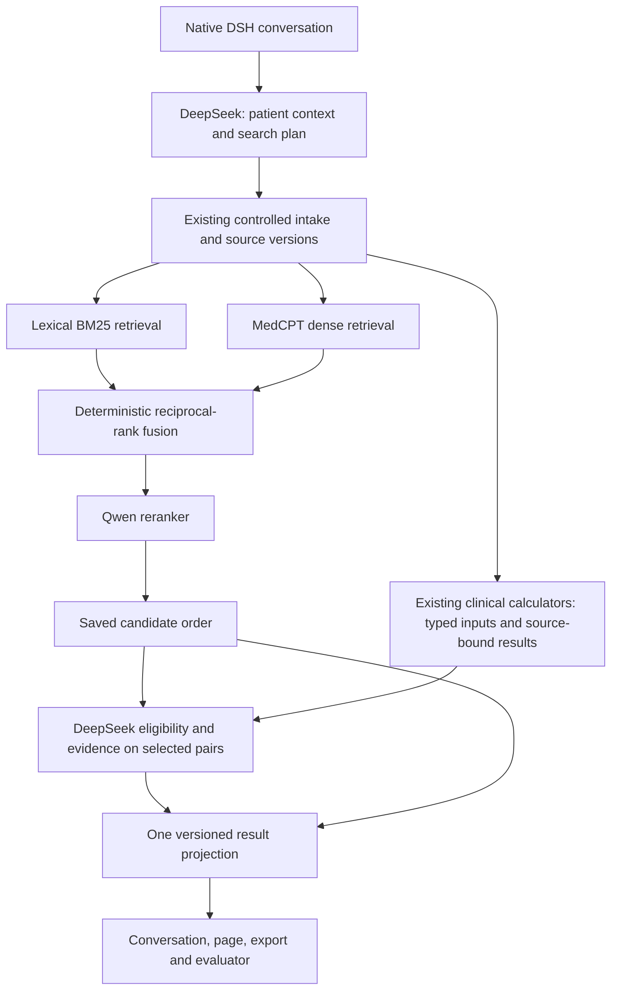

# Patient Matching V2: Mature Retrieval, Shared Calculations and Bounded Acceptance

> **Architecture superseded:** [V3 — independently released professional plugin for DSH + DeepSeek](2026-11-05-vcr-matching-plugin-v3.md) is the current proposal. It replaces V2's required MedCPT addition and application-bound execution design with current provider profiles and a native plugin/host-port boundary. V2's calculation-contract diagnosis and bounded acceptance requirements remain applicable.

**Status:** Researched implementation proposal, 2026-11-05, Asia/Shanghai. Source inspected at `d5f690b15`; no product implementation or model benchmark was run for this revision.

**Owner direction:** Prefer established retrieval/ranking components and repair calculation/integration contracts before attributing failures to model capability. Avoid repetitive experiments whose answers cannot change the implementation. Keep English SIGIR; translated SIGIR remains retired.

**Supersedes:** The execution strategy and experiment matrix in [V1](2026-11-05-vcr-matching-next-phase.md). V1's raw observations and [derived statistics](2026-11-05-vcr-matching-next-phase-assets/reanalysis.json) remain evidence. This document is the current execution plan, including Jev as a concrete alternative ranking provider.

## 1. Revised judgment

TREC Clinical Trials is principally **retrieval and ranking**: a patient description or questionnaire is the query, a frozen trial collection supplies documents, and the output is an ordered trial list. Eligibility determines relevance labels, but TREC does not test the entire EviMed product's intake, saved cohorts, follow-up, authorization or conversation behavior. Its low score does not demonstrate that patient matching is technologically out of reach.

Mature implementations already cover lexical retrieval, biomedical semantic retrieval, rank fusion, cross-encoder reranking, LLM listwise reranking and official metric calculation. The next phase is therefore an integration/remediation release with a short acceptance campaign, not an open-ended research programme.

Three conclusions govern execution:

1. **Fix exact defects directly.** Incorrect depth labels, averaging mismatches, stale snapshots, low-fit-to-ineligible conversion and absent calculation wiring need implementation plus focused regression checks. They do not need paid model experiments to establish whether they are defects.
2. **Give ranking one owner.** A mature ranker produces relevance order. DeepSeek supplies eligibility, clinical interpretation and evidence. Its independent per-trial fit must not silently replace the ranking order. A single versioned projection defines the product's final order and labels.
3. **Use one main route and at most one challenger.** Main route: existing BM25/RRF + Qwen reranking + DSH/DeepSeek. Adopt MedCPT as the selected dense-recall addition through a narrow provider adapter. Jev is the only ranking challenger considered in this release; do not simultaneously search across Jev versions, RankLLM prompts, fusion weights and model families.

The observed 2023 decline from 0.4753 incoming-order nDCG@10 to 0.3663 final order remains real for the saved run. Fixing measurement may change some reported comparisons, but there is no evidence yet that arithmetic alone will erase that decline. Conversely, the decline is not evidence that DeepSeek cannot interpret eligibility: ranking objective and result composition are also involved.

## 2. What the research establishes

Only primary repositories, provider documentation and TREC participant papers were used for technical recommendations. Checked 2026-11-05. Each source is linked where used; repository functionality is not a promise of an EviMed score.

| Existing solution | Verified capability | Decision for EviMed |
|---|---|---|
| [TrialGPT retrieval](https://github.com/ncbi-nlp/TrialGPT/blob/1b3242cd50c153a9c324661d4a0bd94fc68a4226/trialgpt_retrieval/hybrid_fusion_retrieval.py) | BM25 and MedCPT retrieval with reciprocal-rank fusion | Reuse its method and input/index conventions. Start with its documented k=20 and equal retriever weights, not a weight search |
| [MedCPT](https://github.com/ncbi/MedCPT) | Published query/article encoders, cross-encoder and Faiss retrieval example | Selected biomedical dense retriever; encode our trial snapshot, never use PubMed article vectors as trial vectors |
| [Pyserini](https://github.com/castorini/pyserini) | Reproducible sparse/dense/hybrid retrieval; Python 3.12/Java 21 dependencies | Available reference implementation; retain current FTS5 initially rather than migrate lexical infrastructure and ranking simultaneously |
| [Qwen reranking API](https://help.aliyun.com/en/model-studio/rerank) | Document ranking, task instruction and bounded top-N output | Main ranker, reusing the existing adapter and gateway. Supply clinical-trial ranking instructions and balanced document sections |
| [TREC 2023 submissions](https://pages.nist.gov/trec-browser/trec32/trials/runs/) | Actual BM25+GPT systems and a dense/sparse → cross-encoder → GPT shortlist cascade | Confirms this is an established architecture. A participant's score is not a promised score after replacing its model with DeepSeek |
| [RankLLM](https://github.com/castorini/rank_llm) | Reusable listwise/pointwise reranking infrastructure and hosted-provider integrations | Retain as a future adapter option. Do not add a second new challenger this cycle; DeepSeek-through-our-gateway compatibility still needs an adapter |
| [TypeSafe Score](https://docs.typesafe.ai/primitives/score) | Typed ordinal score over 2–10 described levels | Jev can implement a ranking provider using its existing EviMed client; it is not a trial search index or a proven clinical classifier |
| [trec_eval](https://github.com/usnistgov/trec_eval), [ir_measures](https://github.com/terrierteam/ir_measures) | Established IR metrics; explicit measure/provider contracts | Use a pinned official backend as authority and one adapter for reporting. Stop maintaining independent formula implementations across campaigns |

Qwen's API page specifies 500 documents, 4,000 tokens per document and 120,000 request tokens for `qwen3-rerank`, with query tokens counted per document. Its separate model overview presents a different 30,000-token context figure. Therefore pin the actual region/model/API contract and retain conservative limits until one small boundary smoke confirms the deployed endpoint. This is an interface check, not a model-quality experiment. Do not silently migrate endpoint or model alias because documentation lists a newer offering. [API limits](https://help.aliyun.com/en/model-studio/rerank), [model overview](https://help.aliyun.com/zh/model-studio/qwen3-rerank).

### Existing local evidence already narrows the choices

The [2026-11-02 comparison](../../../OpenScience/evals/vcr-model-comparison/README.md) processed 165 TREC topics, of which 162 had qrels, using the **same BM25 top-ten candidate set** for each arm:

| Component | Pooled global-qrel nDCG@10 | Interpretation |
|---|---:|---|
| BM25 incoming order | 0.4517 | Existing control |
| Qwen default instruction | 0.4740 | Improved order |
| Qwen clinical instruction | 0.4760 | Small additional change, not grounds for prompt searching |
| Jev 1.13 | 0.5058 | Positive evidence for a ranking role |
| Jev 1.14 | 0.5068 | No established gain over 1.13; no version tournament needed |

This is a component study, not the newer 133-topic/top-100 end-to-end run. Reordering a fixed ten cannot improve P@10 or Recall@10. The recorded serial Jev request sums cannot be presented as concurrent production latency. Under the same strict missingness policy, criterion agreement was Flash 57.59%, Jev 1.13 53.88%, Jev 1.14 52.69%. Retain DeepSeek for criterion interpretation; use Jev where evidence supports it, in ranking. [Saved aggregates](../../../OpenScience/evals/vcr-model-comparison/results/2026-11-02-summary.json).

The current pin is `typesafe.review.model = jev-1.13.0`. Official documentation now lists 1.14 as well; its availability alone does not justify a pin change. Jev's confidence summarizes its output distribution and is not a calibrated clinical correctness probability. [Models](https://docs.typesafe.ai/models), [confidence](https://docs.typesafe.ai/confidence).

## 3. Selected DSH + DeepSeek implementation

**Delivery order:** First repair the current FTS5/RRF/Qwen path and its result projection. Then attach the selected MedCPT dense provider to that same path. An unavailable dense index leaves an explicitly lexical run; it must not be reported as hybrid and must not stop ordinary matching.

### 3.1 Intake and query planning

DSH remains the conversation orchestrator; DeepSeek interprets the request, identifies the patient, resolves supplied files and writes a search plan. Existing `patient_context`, `vcr_read`, `vcr_simulate`, source access and job completion remain the user path. No new agent kernel, second composer or benchmark-only runtime is introduced.

Keep the principal condition, stage, prior treatments, biomarkers and explicit constraints in the source-bound context. Use English search phrases for English registries and biomedical encoders when the original note is Chinese; retain the original text for interpretation. Do not infer a negative clinical finding from an empty field or treat a registry outage as no eligible trials.

### 3.2 Retrieval: one established hybrid

Retain `vcrTrialCorpus.mjs` as the snapshot and record identity authority. Add a MedCPT provider that reads the same immutable public trial collection and returns ids/similarities. Use the published encoders and Faiss, pinned through `deps-version.json`; no model download or dynamic code installation during a turn.

Index trial title/conditions/summary and bounded eligibility sections using the encoder's documented token limit. Do not silently encode only the beginning of a long trial. A manifest records section coverage, model/tokenizer revision, source hash and index revision. The query encoder receives short clinical query units, not an entire longitudinal note truncated to its first tokens.

Start from fixed upstream fusion defaults. For query j and retriever r, accumulate reciprocal ranks with the existing query-priority decay; merge by registry id, then apply the existing source/constraint policy and the named cap. Similarity scales are not summed directly. Keep keyword rank decay distinct from the sparse/dense retriever weights.

Use initial depths already compatible with the product: fused candidates up to 500, saved reranked shortlist up to 100, detailed eligibility on the first 20 unless the user requested more. These are operational defaults, not newly optimized hyperparameters. Save each stage's **actual** length and ids. Deeper recall is absent if only 100 candidates were ever read.

A dense trial index is a public-document resource, not patient memory. Do not repurpose an account's OpenViking memory index. One 768-dimensional float32 vector for 451,538 trials is approximately 1.29 GiB before index/model overhead; section vectors multiply that estimate. Build the index offline and select a serving resource envelope before deployment. No unmeasured shared-host capacity claim.

### 3.3 Ranking: retain the ranker's result

Reuse `rerankCandidates()` and the Qwen adapter. Replace the current arbitrary 1,500-character head card with a token-bounded representation containing title, target condition, inclusion, exclusion, relevant arm and explicit age/sex metadata. Allocate space to both inclusion and exclusion; record any omitted text. Keep source sections intact when they fit.

The reranker owns `retrievalRank`. Its task is patient-to-trial relevance, with no automatic rule that a low relevance score means clinical ineligibility. DeepSeek's eligibility output enriches a pair; an optional recommendation score is retained as an explanation, not used as a second implicit sort.

The product's `finalRank` is computed once by a shared projection. Preserve the current product policy of grouping explicit, source-backed exclusions after non-excluded candidates, then keep the rerank order within a group. Store the policy version and both orders. The evaluator scores **the actual finalRank as the product result** and may show retrievalRank as a named diagnostic. It never quietly substitutes the higher-scoring order. TREC gives grade-1 exclusions partial relevance credit; explain any resulting metric trade-off instead of relabelling excluded patients as eligible.

If this grouping promotes an unjudged candidate onto the requested first page, keep it explicitly pending and let the same resumable job assess the next saved ranked candidates as needed. Stop at the saved candidate scope, cancellation or existing resource budget; do not perform a new search or repeatedly reassess finished pairs just to fill a page. Preserve the completed subset and state exactly how much remains. The first-20 default is a starting batch, not permission to claim that all 100 candidates have passed eligibility.

For **trial-to-patients**, assess the entire requested roster through existing resumable batches. The 500/100/20 discovery defaults do not truncate this direction. Pagination is a view, not a computation cap. A patient with pending eligibility remains pending even when a relevance rank exists.

### 3.4 Clinical interpretation and calculation

Keep the model's eligibility decision, explicit incompatibilities, missing information, evidence ids and recommendation priority as distinct fields. No eligibility conclusion is derived solely from `fit < 20`. Preserve the current visible four labels and version old results rather than destructively replacing them.

The repository already contains `clinical_scores.py`, `clinical_score_kit.py`, formula/points registries, units and dates. The matching job's direct chat call cannot invoke them, and `capabilities/vcr-matching/capability.yaml` does not admit `clinical_score`. Fix this wiring instead of building a new calculator or asking the model to calculate.

Concrete boundary:

1. For attended conversations, admit the existing `clinical_score` tool to matching and bind its result to the same patient/source revision. A returned number is used only with its typed inputs, version and source links.
2. For bulk jobs, add a bounded calculation-preparation step to the existing matching worker. It invokes the **same bundled pure Python library**, through a fixed allowlisted helper in the existing controlled intake/runtime execution boundary; no arbitrary shell, arbitrary formula, host-network access or new general executor.
3. Store/cache calculations by patient source digest, calculator id/version and normalized inputs. Every trial can reuse the same supported calculation. Pass the result into the existing judgment call.
4. Extraction of the intended clinical meaning remains with DeepSeek. Code validates numeric types, units, dates and source references, computes the requested known formula, and reports missing operands. Decline only an unsupported calculation; continue the remaining matching work with its limitation.

`research_calculate` currently exposes aggregate research methods, not a patient-level clinical-score bridge. Do not send patient operands through that aggregate gateway merely because its name sounds suitable. The R-first `vcr-engine` is also not required for ranking metrics or these existing pure-Python clinical formulas.

## 4. Jev route: a replacement ranking adapter

The alternative is `same retrieval → Jev ranking → same DeepSeek eligibility → same result projection`. Do not routinely pay for Qwen, Jev and DeepSeek all ranking the same list sequentially.

Implement `VcrJevRerank` behind the existing rerank result shape: ids, order, scores, provider/model, completion state and fallback reasons. Reuse `callJev()` in `jevModel.mjs`, pooled `jevTransport.mjs`, model identity checks and the reserve/settle usage ledger. The experimental Python client's direct provider calls are not the production integration.

Use one frozen ordinal relevance rubric through TypeSafe `Score`, then deterministic sorting, retaining incoming rank for ties. Do not mix raw Jev, Qwen and DeepSeek scores or multiply score by confidence. Jev score expresses an ordinal assessment; it is neither the eligibility verdict nor an exact clinical measurement. A provider failure preserves incoming order and records fallback; no fabricated successful score.

Keep the existing 1.13 pin for the first integration. Use bounded concurrency through the existing transport; do not copy the old experiment's ten serial requests into production. Model/version, source grants and provider destination remain explicit. This revision plans a deployable alternative under the owner's latest request; it does not activate Jev or authorize a deployment.

One public development-set comparison decides whether the Jev adapter replaces Qwen for the selected candidate release. Compare the same candidates, representations and final projection. No repeat of the already answered 1.13-versus-1.14 question and no new real-note transmission merely to choose a ranker. If the comparison cannot establish a useful gain, retain Qwen and stop the challenger work.

## 5. One calculation contract, with named evaluation profiles

Unifying the calculation contract does not mean forcing different official benchmarks to use the same definition. It means **one implementation of each defined quantity**, an explicit profile selecting it, and one generated report fed by those outputs.

| Profile | Calculation authority | Required distinctions |
|---|---|---|
| `trialgpt-judged-pool` | Pinned upstream TrialGPT evaluator | Linear graded nDCG; normalized graded P@10; eligible MRR/MAP; per-cohort and cohort-macro means |
| `trec-full-corpus` | Pinned `trec_eval` backend, wrapped by one adapter | Full-qrel ideal; official graded nDCG; eligible P@10 with relevance threshold 2; unjudged is zero gain; fixed expected-topic set |
| `nih-target-recovery` | Pinned upstream target evaluator | Case micro and institute macro both present; narrowed pool and omitted targets retained |
| `n2c2-official` | Pinned official Track 1 scorer | Fixed reading (c), companion reading (b), native unknown rate, micro/macro F1 and all expected patients |
| `clinical-product-output` | Shared versioned domain projection | Eligibility, relevance order, exclusion evidence, pending work, calculation inputs and source versions; no benchmark label enters serving |

Add a small `evaluation_contract.json` in the existing board harness. Each profile binds gain mapping, binary threshold, denominator, cutoff, expected manifest, unjudged policy, missing-output policy, scorer identity and aggregation. A result carries this identity, actual stage/depth and source/output digests. Metrics differing in any of these fields cannot be compared without naming the difference.

Keep `score_e.py` and historical scorer entrypoints as adapters to preserve scripts, but route official TREC computations through one backend. Reuse `ir_measures` only if its pinned provider reproduces the required profile; do not silently change metric implementation via automatic provider selection. Clinical metrics do not need the R engine.

Implement the report as a rendering of one normalized result artifact. English SIGIR must have its own row; three-cohort averages must name their cohorts. Both NIH averages remain visible. The report never substitutes condensed judged-only scores for official scores, and it never labels a 100-item final list as observed first-stage recall at depth 500.

### Small exact examples settle arithmetic without model calls

Use a small golden fixture set once, then run it only when its contract/backend changes:

- A ten-position list with grades `[2,1,0,0,0,0,0,0,0,0]` has graded P@10 **0.15** and eligible P@10 **0.10**. If those are all positive qrels, its nDCG@10 is **1**. This immediately exposes accidental metric substitution.
- One institute with 1/1 target hits and another with 0/9 has micro recall **0.10**, institute macro **0.50**. This exposes the NIH averaging error without any inference.
- A run that asked for two scorable topics but saved only one cannot claim 100% completion. Keep the missing topic in the manifest-based accounting and apply the declared scoring policy; do not omit it by iterating only available outputs.
- A retrieval stage that returns 100 documents can expose recall of those returned documents, but cannot claim a separate measured 500-document retrieval stage. Carry requested and actual depth separately.
- An exclusion, a low recommendation score and a missing prerequisite are distinct inputs to the projection. No scalar threshold can convert one into another.

The local cached n2c2 study already shows why this matters: the same historical answers reported reading-C F1 0.8809 but replayed as 0.8546 under a different evaluator revision; 8/14 producer hashes differed. That is evidence for version binding, not evidence that a model suddenly became worse. No new experiment is necessary to establish this failure class. [Recorded replay](../../../OpenScience/evals/vcr-model-comparison/results/2026-11-02-summary.json).

## 6. Other problems: direct engineering repairs versus remaining model uncertainty

| Problem | Current evidence | V2 action | Sufficient verification |
|---|---|---|---|
| Independent scores overwrite a useful incoming order | E 2023 loses 0.1090 nDCG; current reader calls `rankJudgments()` over fit | Ranker owns relevance; shared projection owns the final clinical view | Saved-output replay, then one selected-candidate evaluation |
| Eligibility converted from preference | Current pure-function fit-10/all-clauses-met reproduction | Separate typed eligibility and recommendation; preserve historical versions | Positive and counterexample contract fixtures; no model sweep |
| Clinical arithmetic exists but matching cannot use it | Calculator registry exists; matching job is a direct model call; skill admission lacks the tool | Add attended access and bounded bulk calculation preparation using the same library | Worked examples plus one real job reaching the tool/library |
| Evidence id is mistaken for evidence correctness | Addressing succeeds but semantic accuracy is unmeasured | Preserve subject/time/unit/arm with evidence; reject only invalid exact references; interpretation stays with the model | A compact set of negation, wrong-person, stale-date and alternative-arm cases |
| Missingness policy hides unread input | Broad silent-exclusion guidance; 96/98 strict favourable errors are gold unknown | Explicit source coverage and a short distinction between not stated, pending, and not read | Existing error-family cases once; inspect remaining failures rather than retune the whole board |
| Sparse questionnaires treated as complete clinical notes | 2023 task differs from 2021/22; prompt assumes what a well-documented note would mention | Pass source type and field coverage as context; no year-specific rules | One paired full/partial input example per distinct failure mechanism |
| Batch roster answer not saved | Real conversation answered 20 people but did not invoke matching | Correct tool entry and persistence linkage | Replay that real scenario once after the change |
| Rejudgment/partial results differ by surface | Historical failures and later fixes; directional sorting is still separate code | One source-version-aware projection for reply/page/export, direction named in the policy | State transition fixtures plus one cancel/resume journey |
| Chinese query reaches an English registry untranslated | Reproduced in 5/10 inspected zero-result requests | Registry-language-aware query construction with source error/empty distinction | One real corrected search; retain all 115 requests in coverage denominator |
| Long records lose the relevant tail | Bounded card/head, long-input limits and cut-off responses | Section-aware bounded text and explicit truncation; smaller affected-batch retry | A tail-exclusion and multi-arm fixture; no blanket repeated long-record campaign |
| Mixed model/provider/config generations | Prompt-only pin does not bind reader/sort policy | Producer digest includes source, calculation, ranking and projection identity | Old/new mixed-version fixture and cache invalidation check |
| CI snapshot stale | Actual CI guidance snapshot mismatch | Regenerate from its source; retain the existing assertion | Focused snapshot test, then final CI once |
| Historical security findings may reappear | Earlier fixes have focused evidence, not complete final-head proof | Retain existing access, revocation, deletion and resource-bounds checks | Affected existing suites; no fresh broad penetration programme for each ranking edit |

**Residual model quality remains real.** Once exact operands, record completeness, ranking semantics and scoring profiles are correct, DeepSeek can still misinterpret disease stage, line of therapy, temporal relations or a clause. Label those failures honestly. Do not claim every discrepancy is a calculator defect; equally, do not call an integration mismatch a model limitation.

Definition cards, terminology packs and additional judges are added only when a concrete unresolved error requires them. The existing mixed definition-card result does not justify another open-ended ablation programme. No new SNOMED/MedDRA procurement or custom ranking-model training is needed for this release.

## 7. Concrete implementation packages

All new filenames below are proposed, not existing capabilities. Keep ordinary package boundaries, typed contracts, English source/comments, current UI conventions and the single DSH kernel. Only `harness-port` may import upstream DSH packages; these ranking/calculation adapters need no new kernel import.

### P0 — Calculation and report contract

**Modify:** `OpenScience/evals/vcr-matching-boards/{score.py,score_e.py,score_f.py,README.md}` and the older `OpenScience/evals/vcr-platform-comparison/score_trec.py` adapter. **Create:** `evaluation_contract.json` and `metric_backend.py` inside `vcr-matching-boards`. Reuse the upstream scorer binaries, not copied metric formulas.

- [ ] Define the five profiles in section 5 and normalize saved outputs once.
- [ ] Connect the TREC profile to the pinned backend, align its per-topic output to the expected manifest, and render reports from that artifact.
- [ ] Add the exact fixtures above to existing scorer tests; re-score cached results without new model calls.
- [ ] Preserve historical numbers with their old profile; publish corrected readings as a new version rather than overwriting evidence.

**Done:** Every headline can be traced to a profile, source list and denominator. Unavailable raw retrieval logs remain explicitly unavailable; recovering them gets one bounded inventory pass, not repeated attempts that hold up implementation.

### P1 — Shared eligibility/ranking result projection

**Modify:** `OpenScience/packages/domain/src/vcrTrialJudgment.mjs`, `OpenScience/apps/server/src/{vcrMatchJudge.mjs,vcrMatchJudgmentStore.mjs,vcrMatchResults.mjs}`, matching web/API adapters and the board exporter. **Create if needed:** `OpenScience/packages/domain/src/vcrMatchProjection.mjs` for the shared pure projection.

- [ ] Preserve reranker order and producer identity in the saved search/judgment linkage.
- [ ] Add explicit eligibility and recommendation semantics to new judgments, with a versioned legacy adapter.
- [ ] Generate `retrievalRank`, `finalRank`, eligibility, evidence/coverage marks, progress and outstanding work once under a named projection version. Readers can paginate/filter, but cannot independently reinterpret scores or silently reorder.
- [ ] Keep protocol-to-patients ordering direction-specific inside that same policy implementation. Do not force a discovery shortlist cap onto a requested roster.
- [ ] Update `OpenScience/DESIGN.md` and `OpenScience/docs/FRONTEND_DESIGN_SYSTEM.md` alongside any visible label/order change.

**Done:** The same saved projection produces the same answer, page, export and scored product order. Low preference is not an exclusion. Pending eligibility is not presented as confirmed.

### P2 — Complete the mature retrieval/ranking path

**Modify:** `OpenScience/apps/server/src/{vcrCandidateSearch.mjs,vcrTrialCorpus.mjs,vcrCandidateRerank.mjs,vcrEvidence.mjs,vcrComposition.mjs}`, `OpenScience/deps-version.json`, the existing deployment composition and retrieval fixtures. **Create:** a narrow `vcrDenseRetriever.mjs` adapter and an offline index-build command under `OpenScience/scripts/`, with immutable source/model/index manifests.

- [ ] Correct query language and section-aware Qwen cards on the existing path; preserve the current API endpoint unless its actual contract requires a change.
- [ ] Build the MedCPT trial index offline with the published encoder implementation and source-bound chunks. No custom embedding model, ranking training or new application database.
- [ ] Fuse lexical and semantic lists using the pinned upstream defaults; retain stage records and explicit fallback when an index or provider is unavailable.
- [ ] Keep Qwen rank as the main relevance order. Do not add an automatic listwise-model pass on top.

**Done:** One declared retrieval composition returns a bounded, saved list. The selected dense provider is either actually present with an index identity or explicitly absent; “hybrid” is never a label for lexical-only behavior.

### P3 — Wire clinical calculations through the existing execution boundary

**Modify:** `OpenScience/capabilities/vcr-matching/capability.yaml` and generated skill/tool admission consumers; `OpenScience/apps/server/src/{vcrMatchJudge.mjs,vcrDataPlane.mjs,vcrIntakeController.mjs,runtimeControllerClient.mjs,runtimeControllerServer.mjs}`; the existing intake image build and controller protocol checks. Reuse `OpenScience/runtime/mcp/evimed-research/clinical_score*.py` as one packaged source.

- [ ] Admit the existing `clinical_score` tool for attended matching.
- [ ] Add one fixed `calculate` operation beside the existing controller's `extract/digitize/materials/convert` operations. Its JSON schema accepts only allowlisted calculator ids, versions, typed operands and source references; it invokes the bundled calculator, never executable text.
- [ ] Let the matching worker perform bounded calculation preparation, reuse results across that patient's trials and save source-bound calculation receipts. Bind access again at execution and readback, including revocation during work.
- [ ] Use the same library in MCP and bulk mode through packaging/imports or a digest-checked build copy. Do not translate clinical formulas into a second JavaScript or R implementation.
- [ ] Update the controller protocol and runtime image together. Missing service support is an explicit unsupported calculation for that deployment, not an invented answer or failed whole matching job.

**Done:** A real matching job reaches the calculator and the model uses its recorded value; worked examples establish the deterministic result. Infrastructure is reused; this adds no second general-purpose executor.

### P4 — Jev adapter, only if selected for this release

**Modify:** ranking provider composition, source-destination access checks and existing metering/configuration. **Create:** `OpenScience/apps/server/src/vcrJevRerank.mjs`, using `callJev()` and the same provider result contract as Qwen.

- [ ] Port the already-measured ordinal rubric from the component harness; keep it separate from clinical eligibility.
- [ ] Reuse the current Jev pin and bounded transport, with exact id mapping, stable ties, cancellation and explicit incoming-order fallback.
- [ ] Compare Qwen and Jev once on the same frozen public development candidates. If selected, replace the ranking provider in the candidate configuration; keep DeepSeek's clinical role unchanged.

**Done:** One provider is selected, with actual latency/cost/error observations and no claim that the old top-ten component score predicts a new full-corpus result.

### P5 — Product acceptance and release evidence

**Modify only when necessary:** existing scenario runner, matching integration tests and incident expectations. Fix the known guidance snapshot through `OpenScience/evals/harness-adaptation/tools/snapshot_guidance.mjs`.

- [ ] Replay the two known outstanding real scenarios: protocol plus roster and registry-language correction. Include actual PDF/scan conversion and one follow-up/cancel-resume path in the same acceptance pack.
- [ ] Verify all 17 incident expectations check the final verdict, not only fit. Add one positive/negative pair for each newly fixed mechanism; repeat only a stochastic failing case or a changed mechanism.
- [ ] Run the selected candidate on English SIGIR and the fixed TREC topic manifest once, retaining dev/test labels and all missing outcomes. Reuse valid caches. Run C/F once only if the clinical-judgment path changed; skip their paid rerun for a retrieval-only edit.
- [ ] Run affected engineering suites, then required full checks/CI at the final revision. Record remaining hosted-image and deployment checks separately.

**Done:** Implementation, local verification, pushed revision, CI, main integration and runtime acceptance each have their own status. This planning task does not perform deployment or data retirement.

## 8. Minimum useful validation and explicit stopping rules

| Layer | Run | Repeat only when |
|---|---|---|
| Exact calculations/contracts | One golden fixture pass and cached-output rescore | Formula, profile, projection or backend changes |
| Provider integration | One small real request plus relevant transport/identity/fallback checks | Endpoint, pin or adapter changes, or a concrete failure |
| Ranking choice | At most two arms: Qwen default and pinned Jev, once on the fixed public development set | A defect invalidated that comparison; no repeat to obtain a nicer mean |
| Final product | One acceptance pack and one selected-candidate benchmark run | A new fix affects a failed scenario/cohort; rerun the affected portion |

Use the existing TREC development split (10 topics each in 2021/22 and 9 scorable 2023 development topics) for the one optional provider comparison, with the same candidate ids and text per arm. The already-inspected 133 test topics remain regression evidence. Do not turn statistical significance, additional disease stratification, fresh expert annotation or a new holdout into a prerequisite for fixing known code defects. New generalization claims would need new evidence later; delivery of honest current results does not.

For the final result, compute paired deltas and their uncertainty once from saved outputs. Do not rerun model inference for each confidence interval. Retain per-year results so a pooled mean cannot conceal another 2023 regression. A numeric regression triggers inspection of the affected stage and already-saved cases, not automatic full-board repetition.

Keep the 2-minute P50 target for 20-candidate full completion. Measure first useful result separately. Instrument stages during the acceptance run; do not pre-plan a concurrency 8/12/16 grid. Change concurrency once only if timings identify queuing or serial calls as the bottleneck; remeasure affected cases and preserve provider/error/fairness limits.

The campaign's CNY 3,000 cap is not renewed. Read current settled/reserved usage before any paid execution, preserve off-peak/balance rules, and avoid paid calls during this planning revision. Existing paid inputs and answers are reused when their source/producer identities match.

## 9. What changed from V1

| V1 | V2 |
|---|---|
| Nine work packages dominated by attribution and multiple experiments | Six bounded implementation packages with established defaults |
| Several alternative retrieval/ranking changes left open | Existing BM25/Qwen main path; MedCPT selected dense addition; Jev the sole optional ranking challenger |
| Representation and score semantics deferred to experimentation | Explicit eligibility/recommendation separation and shared projection are decided requirements |
| Calculator access described as a general improvement | Concrete existing-library reuse through MCP admission and one controller calculation operation |
| Repeated prompt, depth, concurrency and repeatability comparisons | One choice comparison and one final acceptance; targeted repeats only |
| Possible missing raw logs could hold up causal attribution | One bounded recovery pass; retain uncertainty and proceed with directly evidenced fixes |
| Stage scores and official scores described in several places | One profile contract and generated report with exact denominators |

Suggested implementation order is P0 → P1 → P2/P3 → optional P4 → P5. P1's corrected existing route can be reviewed while the public dense index builds. If P4 is not selected, P5 proceeds with Qwen. No task needs a new study form, manual approval ceremony or unrelated recruitment workflow.

## 10. Evidence boundaries and final deliverables

Deliver: the corrected production path; one versioned result/projection contract; one metric profile registry and normalized report; existing tests plus the necessary class regressions; and a short acceptance receipt naming the exact revision, actual provider, actual index, failures and remaining release stage.

The accepted evidence remains English SIGIR nDCG@10 0.6509, the saved TREC stage changes, C's error decomposition, F's policy-sensitive F1 and NIH's micro/macro distinction from V1. No new model score is claimed here. Mature algorithms establish feasible construction choices; they do not certify a particular future score. Some errors are integration/calculation problems already demonstrated in code; remaining clinical interpretation errors must still be reported as such.

Research sources linked above were read on 2026-11-05. Primary evidence includes the TREC 2023 run descriptions, pinned TrialGPT fusion implementation, MedCPT and Pyserini repositories, official Qwen and TypeSafe contracts, RankLLM, trec_eval and ir_measures. No third-party Jev tutorial or model-marketing page is used as a technical authority.
