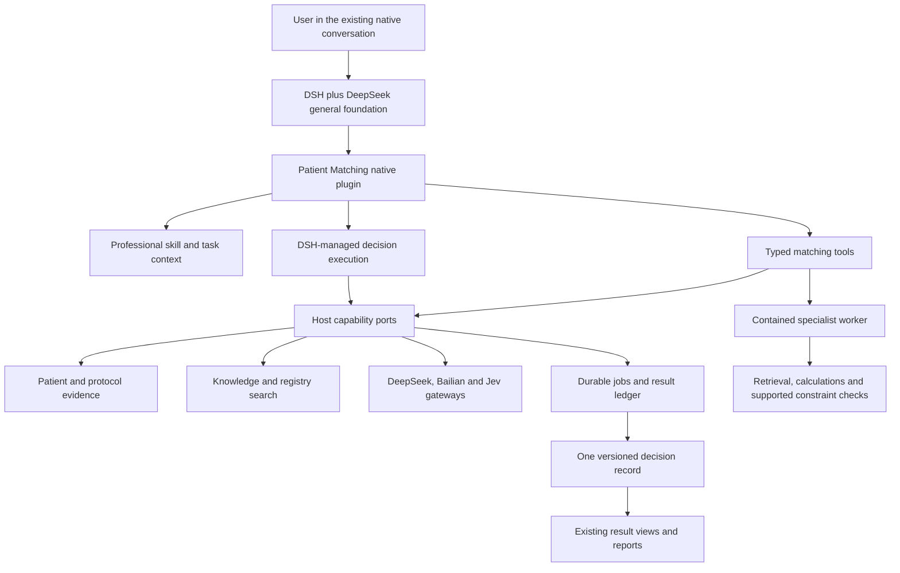

# Patient Matching V3: An Independently Released Professional Plugin for DSH + DeepSeek

**Status:** Approved implementation, 2026-11-05, Asia/Shanghai. Approved for implementation. Baseline application source: `d5f690b15`. Implementation, verification and release states are tracked below; publication and deployment remain separate.

**Supersedes:** The architecture and component-selection decisions in [V2](2026-11-05-vcr-matching-next-phase-v2.md). Keep [V1's result diagnosis](2026-11-05-vcr-matching-next-phase.md) and its original score evidence. V2's measurement-contract corrections and bounded verification discipline remain requirements, expressed below as part of the plugin.

**Owner objective:** DSH + DeepSeek is the general execution foundation. Intelligent patient/trial matching becomes a separately installable, testable and releasable professional plugin, connecting retrieval, knowledge, clinical assessment, calculations, specialist algorithms and reports. Select capabilities available as of November 2026 rather than defining the system around an older retrieval stack.

## 1. Architecture decision

Build one first-party **Patient Matching plugin release** consisting of a native DSH bundle, a contained specialist worker, versioned algorithms/skills and report resources, and a compatibility manifest. The host supplies identity, source access, models, knowledge, durable jobs, artifacts and presentation through stable ports.

The professional agent runs on the **existing DSH kernel and DeepSeek model gateway**. The worker provides bounded retrieval, indexing, exact computation and durable batch operations; it does not introduce another autonomous agent loop. Complex clinical decisions use DSH-managed, tool-capable execution, replacing the present tool-less batch judgment path progressively.

The default modern composition is:

- **DeepSeek V4.1 Flash:** native conversation, clinical interpretation, evidence planning, criterion assessment and report synthesis; use reasoning effort according to complexity.
- **Qwen3.7 text embedding and rerank:** multilingual trial/knowledge retrieval and criterion-aware candidate ranking through the host's Bailian adapters.
- **Jev 1.14 typed decisions:** bounded ordinal prioritization and evidence/conflict triage where useful; it supplies advisory typed signals, not clinical truth or exact arithmetic.
- **Deterministic computation:** the existing clinical-score library plus typed numeric, unit, date and bounded Boolean evaluation. A solver may evaluate supported logical fragments; no executable model-generated program is admitted.
- **DSH tools and host resources:** source-preserving document intake, knowledge-base retrieval, registry records, calculations, stored results, office export and delivery.

Older lexical retrieval remains a cheap exact-name/code branch and a declared fallback. MedCPT is no longer a required new dependency. The architecture is organized around clinical tasks, evidence and versioned provider capabilities, not an algorithm's publication year or a fixed BM25/MedCPT cascade.

### Options considered

| Option | Benefit | Limitation | Decision |
|---|---|---|---|
| Skill/MCP wrapper around current VCR code | Small change | Server coupling, hidden model calls and release dependencies remain | Migration bridge only |
| Native DSH bundle + contained worker + stable host ports | Independent professional release with native execution and host protection | Requires an initial host adapter and explicit compatibility contracts | **Selected** |
| Separate matching-agent platform | Full isolation | Duplicates DSH sessions, scheduling, tools, model handling and delivery | Rejected |

Independent release means a compatible plugin version can be installed or rolled back without rebuilding the general platform. It does **not** mean an arbitrary bundle can import code into the control plane, bypass host permissions, or run against a host lacking the required port version. The initial host adapter is real implementation work.

## 2. Requirements and existing functional flow

The scope remains patient/trial assessment. Contact, referral, site CRM, consent/enrolment management and operational recruitment forecasting remain outside it.

| User task | Existing entry and behavior | V3 requirement |
|---|---|---|
| Find trials for one patient | Native conversation → `patient_context` → saved search → `match_judge` → `candidate_trials` | One identity and source revision, relevant trials, eligibility reasons, unresolved facts and saved results |
| Screen a roster against a protocol | Save protocol text/version → import records → judge the roster → matching table | Every requested person accounted for; progress, cancellation, continuation and full export; discovery top-K must not truncate the roster |
| Match a specified patient/trial pair | Read record/clauses → judgment | Skip corpus retrieval when the trial is already specified; use missing evidence/knowledge/calculation tools only when relevant |
| Add a new lab, treatment or document | Same `subjectKey`, new source version, rejudgment | Recompute affected decisions and dependencies, retain historical results, explain what changed |
| Ask why or what would change the result | Current criteria/evidence reader | Source-linked explanations, assumptions, decisive conditions and concrete missing facts; hypothetical changes never rewrite the record |
| Ask for a report | Current saved-result read; CSV/JSON; broader VCR export infrastructure | Evidence-backed patient or cohort report, CSV/JSON, optional DOCX/PDF from the same saved result |
| Update a registry/protocol | Registry/source versions and stale marks | Invalidate affected candidate/criterion/calculation caches; show old useful results with their actual revision |
| Pause, disable or uninstall plugin | Existing jobs and extension generation machinery are separate | Stop new plugin work, handle existing jobs explicitly, preserve records and general conversations |

### Code paths inspected

- Runtime skill: `OpenScience/capability-skills/vcr-matching/SKILL.md`; capability tool admission: `OpenScience/capabilities/vcr-matching/capability.yaml`.
- Entry, composition and execution: `vcrGateway.mjs`, `vcrComposition.mjs`, `vcrOrchestrator.mjs`, `vcrWorker.mjs`, `vcrMatchJudge.mjs` under `OpenScience/apps/server/src/`.
- Retrieval/knowledge: `vcrEvidence.mjs`, `vcrTrialCorpus.mjs`, `vcrCandidateRerank.mjs`, `vcrKnowledge.mjs`, registry clients and OpenViking/source gateways.
- Results: `vcrMatchJudgmentStore.mjs`, `vcrMatchResults.mjs`, the `MatchingTab`, `PatientTrials`, `MatchingPeople`, `JudgedPair` and export components.
- Installation: `packages/socket/package.json` and plugin rows; `packages/harness-port`; `extensionHostedIntegration.mjs`, `extensionGenerationService.mjs` and `extensionDeployment.mjs`.

### Current architectural gaps, not merely score gaps

1. Matching is distributed across a large VCR composition and has no independent release unit.
2. `vcrComposition.mjs` configures candidate reranking from **memory rerank** settings. A memory model change can therefore alter matching behavior unintentionally.
3. Batch judgment directly calls a model without DSH's tool loop; knowledge, clinical calculators and evidence retrieval available to the conversation are not automatically available inside that job.
4. A single `fit` mixes eligibility and recommendation; readers then reinterpret/sort it. The benchmark can measure a different path from the user's final view.
5. Definitions, registry text, longitudinal patient evidence and computed values do not form a shared versioned evidence context.
6. Skill packages and preflight copies are generated with the platform bundle, while clinical logic and UI are compiled into other components. Merely renaming the skill does not make them independently installable.
7. Report generation is not a first-class matching output backed by the same decision record.

## 3. Research translated into design

Sources were checked on 2026-11-05. These are design inputs, not a combined leaderboard or a guarantee of performance with our models.

| Work | Evidence read | Design adopted | Boundary |
|---|---|---|---|
| [TrialGPT 2.0, October 2026 revision](https://arxiv.org/html/2609.01202v2) | Methods, local matching policies and evaluation protocol | Explicit task objective; eligibility distinct from recommendation; version the entire configuration | Its benchmarks and clinical workflows have different denominators; no transfer of its scores to EviMed |
| [SatIR, April 2026](https://arxiv.org/html/2604.08849v1) | Constraint representation, missingness and retrieval methodology | Trial structure and retrieval intent matter; preserve atomic conditions and arm relationships | Its principal evaluation uses a new relevance/eligibility protocol and model judging; not directly comparable to official TREC. Do not adopt its broad salience assumptions as universal clinical defaults |
| [VERDICT, September 2026](https://arxiv.org/html/2609.03366v1) | Typed conditions, evidence/policy representation, solver and rationale artifacts | Separate source facts, assumptions, decisions and pivotal conditions; exact operations get exact execution | Its formal parser and policy choices can be wrong. No mandatory full-text-to-SMT compilation or production delivery veto |
| [Reasoning-guided retrieval, AACR 2026](https://www.tempus.com/publications/reasoning-guided-retrieval-improves-oncology-trial-eligibility-matching-from-clinical-notes/) | Author's methods/results abstract | Adaptive evidence retrieval for dispersed, difficult eligibility evidence | Conference abstract; benefit was task-dependent, with little gain for simple biomarker extraction. Do not impose an eight-search loop on every pair |
| [TrialMatchAI preprint](https://arxiv.org/pdf/2505.08508), [2026 journal publication](https://doi.org/10.1038/s41467-026-70509-w) | Full preprint's architecture; journal metadata/abstract | Modular normalization, source-preserving clinical representation and replaceable components | Journal full text could not be retrieved in this session; the preprint is not silently treated as the final version. Do not inherit its older backbone choices |

The resulting architecture is our synthesis: **native tool-capable reasoning + modern retrieval/ranking + source-grounded clinical representations + exact calculation + one durable result and report contract**. It does not copy a complete external agent framework into DSH.

## 4. Actual provider discovery and selected roles

All three existing credential files were located through the prior provider configuration. Authenticated **read-only catalog requests** succeeded; no patient text, inference request or paid benchmark was sent. Sanitized evidence: [provider-discovery.json](2026-11-05-vcr-matching-plugin-v3-assets/provider-discovery.json).

| Provider | Live discovery | Current design role | Still to verify at installation |
|---|---|---|---|
| DeepSeek | `deepseek-flash` identified as V4.1 Flash; `deepseek-v4-pro`; both advertise 1M context | Flash is the only reasoning model; V4-Pro is excluded by the owner | Exact served revision, model-gateway behavior, native tool/thinking compatibility and bounded resource configuration |
| Bailian | Catalog returned 183 models including Qwen3.7 embedding, embedding-flash and rerank | Qwen3.7 embedding/rerank are the new target retrieval profile; flash embedding is an optional indexing-cost profile | Region/endpoint inference access, dimensions, request limits and one small synthetic response contract |
| TypeSafe | `/v1/models` returned `jev-latest` and `jev-preview`; official docs map them to 1.14 | Pin `jev-1.14.0` in the proposed profile for typed triage/priority; existing 1.13 remains the tested rollback profile | An actual served 1.14 response and the selected rubric; catalog aliases alone do not certify inference |

Official sources: [DeepSeek model discovery](https://api-docs.deepseek.com/api/list-models/), [models/version mapping](https://api-docs.deepseek.com/quick_start/pricing/), [thinking/tool calling](https://api-docs.deepseek.com/guides/thinking_mode/); [Qwen3.7 embedding](https://help.aliyun.com/en/model-studio/qwen3-7-text-embedding), [Qwen3.7 rerank](https://help.aliyun.com/en/model-studio/qwen3-7-text-rerank); [Jev models](https://docs.typesafe.ai/models), [typed Score](https://docs.typesafe.ai/primitives/score), [confidence](https://docs.typesafe.ai/confidence).

A model catalog entry is not clinical validation or proof of capacity. Model limits are provider maxima, not intended patient-context size. The plugin pins its own model-profile revision and cannot alter host-wide memory embedding/reranking configuration. Qwen3.7 vectors must never be queried against an index built with a different embedding profile or dimension.

### Roles do not require every provider on every case

- Simple pair with adequate evidence: Flash plus exact tools if needed; no mandatory Jev review or second reasoning model.
- Large candidate set: Qwen3.7 retrieval/rerank; Jev may supply a small typed clinical-priority signal for the shortlist, through the same ranking contract.
- Ambiguous criterion or conflicting evidence: one focused evidence retrieval, needed computation, then Flash high-reasoning resolution. Flash remains the only model; there is no Pro escalation.
- Report: native DSH/DeepSeek and existing office tools, reading saved decisions rather than deciding eligibility again.

## 5. Plugin boundary and deliverable layout

The following names describe proposed artifacts, not packages already published:

```text
@evimed/dsh-patient-matching          Native DSH bundle, skills, typed tools, view resources
@evimed/patient-matching-core        Contracts, clinical context/decision policies, pure projection
evimed-patient-matching-worker       Contained worker image: retrieval, indexing, calculators, batch adapters
patient-matching.release.json        Exact compatible artifact set and resource/model profiles
```

The release contains algorithm adapters and professional knowledge **schemas/templates**, not customer data, credentials, a complete licensed terminology corpus or a mutable clinical database. Public trial indexes and tenant knowledge resources are separately versioned resources referenced by the release/run.



### Native registration

Use the existing DSH `package.json` bundle/patch form and Cordis `name/inject/Config/apply` shape. The bundle registers a short skill catalogue entry, the scoped tools and report/view resources. It is mounted beside the existing `evimed-universal` composition, not as a competing preset or replacement persona.

All DSH imports and lifecycle seams go through `@evimed/harness-port`. The initial compatibility target is the repository's actual `0.2.1-rc.5` pin; pin bumps are separate adoption work. The plugin declares the tested host-port ABI and kernel compatibility, rather than asserting it works on any future DSH version.

General conversation remains general. Matching tools/context become relevant to a verified task request or explicit `/patient-match` entry. Installing the plugin does not inject a clinical workflow into every conversation, require a study form, or make unrelated tasks depend on a medical service.

### Host capability ports

| Port | Responsibility retained by host | Plugin responsibility |
|---|---|---|
| `IdentityPort` | Actor, tenant/project, original conversation, current grants | Carry immutable invocation references; never select another tenant or invent authority |
| `PatientDataPort` | Intake, originals, source versions, access/revocation, scoped passages | Patient timeline, targeted evidence requests and derived clinical context |
| `KnowledgePort` | Existing KB/OpenViking resources, guideline/evidence gateways and source reads | Criterion-specific queries and definition/evidence cards |
| `RegistryPort` | Registry access, preserved records, source policies | Trial normalization, candidate discovery, index refresh and arm structure |
| `IndexPort` | Scoped index storage, resource limits and immutable generation selection | Embedding/chunk profile, index construction and candidate queries |
| `ModelPort` | Provider keys, model access, metering, rate/resource limits | Versioned model profiles and narrow request/response adapters |
| `ExecutionPort` | DSH session/managed activation, cancellation and continuation | Professional decision skill and bounded batch task description |
| `JobPort` | Durable leases, retries, completion and accounting | Serializable work units and algorithm checkpoints |
| `ResultPort` | Tenant-owned persistence, artifact access and historical retention | Decision schema, projection, reports and evidence dependencies |
| `ExtensionPort` | Admitted artifacts, immutable generations and safe activation | Exact package/worker/resource manifests and compatibility checks |

Ports are checked operations, not arbitrary SQL, filesystem, Docker or HTTP access. The worker has no provider key and never imports downloaded code into `apps/server`. Existing VCR records remain readable through adapters; the plugin does not take ownership of unrelated population, comparator or trial-simulation features.

## 6. Integrated clinical algorithm flow

These are composable operations selected by task need. A specified pair skips discovery; a simple explicit criterion skips additional knowledge calls; reporting reads saved decisions. They are not a mandatory eight-stage conversation ceremony.

### 6.1 Task and clinical context

DeepSeek resolves the requested direction, target condition/objective, available patient/protocol sources, geography/status preferences and requested output. A general conversation gets the smallest owned matching scope; it is not rebound to a specialist programme or forced to invent endpoints/PICO.

Build a source-bound clinical context with diagnosis/subtype, stage/grade, treatment lines, biomarkers, therapies, key measurements, dates and longitudinal relationships. Keep each item's original source and distinguish stated, clinically inferred, computed, conflicting and unavailable values. The host's patient key and record identity never come from model-generated names.

The context is a useful partial representation, not a compulsory universal form. Missing fields are retained only when they matter to the current matching task. It is stored in the patient data plane, not in general conversational memory.

PDFs and images first use the existing authorized parsing/conversion path. A targeted image read by a supported multimodal profile can assist an unreadable fragment when its source destination is permitted; it does not replace the preserved original or manufacture a lab value. Parser/model uncertainty is carried into the clinical context.

### 6.2 Trial representation and knowledge preparation

Preserve complete registry/protocol text, source date, hash, cohort/arm and criterion spans. DeepSeek produces a reusable `TrialProfile` with the trial's purpose, disease/subtype, therapy line, biomarkers and a criterion relationship graph. Cache it by trial source digest and parser/profile version.

The graph retains AND/OR, alternatives, temporal conditions and arm boundaries. A leaf can remain a semantic clinical condition; it does not have to compile to a numerical rule. Typed numeric/date/Boolean leaves are eligible for exact execution only when their operands and scope are supported.

Use the existing KB and evidence gateways for a definition that changes interpretation: diagnostic standards, staging/scale definitions, drug/biomarker aliases or the meaning of a protocol term. A `DefinitionCard` contains the concept, scope, version/date, original source reference and relevant passage. A card is interpretive context; it cannot silently replace the trial's own criterion.

Reusable trial definitions and source-indexed knowledge are distinct from patient facts. A guideline or a similar patient's case cannot become evidence that the current patient has a condition. No patient record is added to a shared public trial index or a global learned-method memory.

### 6.3 Modern discovery and ranking

Use Qwen3.7 embeddings over source-preserving sections of the public/authorized trial corpus, with a plugin-owned `EmbeddingProfile`. Existing exact-name/code lookup and live registry queries provide additional candidate channels. Fuse candidate identities, retain channel/rank provenance and rerank with Qwen3.7 using the clinical objective and full relevant criterion sections.

The trial index is a separate resource behind `RegistryPort`/`IndexPort`, using the existing supported storage infrastructure. Do not change OpenViking's global embedding model to serve one plugin. If the host engine cannot expose collection-specific embedding profiles, implement the plugin's scoped index through the existing pgvector service rather than pretending that account-memory vectors are compatible. A profile change builds a new index generation and atomically selects it; running tasks retain the old generation.

Live registry discovery remains available while an index is being built, with honest coverage. A corpus index is not a claim that recruitment status is current. Explicit structured constraints and the user's requested filters are applied with source/version awareness; a lack of text or an unresolved clinical condition is not silently treated as exclusion.

Jev's optional `clinical-priority` adapter receives one patient's scoped context and a bounded trial shortlist. It returns ordinal dimensions under a fixed rubric, such as disease/line compatibility and adequacy of evidence for the requested task. These signals can prioritize what to assess next. Raw Jev confidence is not a probability of eligibility, and scores from different providers are not added as if calibrated on one scale.

The release profile declares which component owns relevance order and how explicit exclusions affect the final clinical view. The default preserves semantic rank within clinically displayed groups. An objective-specific priority profile is an explicit task policy, not a hidden TREC-specific sort. Store retrieval, clinical-priority and final orders separately; score the actual final product order as such.

### 6.4 Reasoning-guided evidence retrieval

For a decision-driving criterion with incomplete or conflicting support, the DSH-managed clinical agent issues a focused `EvidenceNeed`: patient, concept/criterion, time window, arm, and what would settle the question. `PatientDataPort` retrieves only that person's authorized source passages; `KnowledgePort` separately retrieves definitions.

Start from the available source context. Allow at most two additional evidence rounds per unresolved pair in the initial release, within the existing time/token budget. Stop earlier if the needed evidence was found, the source is unavailable or the next search cannot change the decision. This is a resource default, not a compulsory quota. Simple extraction performs no extra rounds.

Examples of useful requests are a prior treatment date, a molecular pathology passage, or whether an apparently conflicting lab value belongs to a later record. The agent receives evidence with source ids and dates, not a generic concatenation of the highest-similarity chunks. The result says whether the source was read, absent, truncated or inaccessible so that “not recorded” cannot hide “not searched”.

### 6.5 Clinical grading and exact computations

Clinical grading has two different operations:

- **Semantic grading:** DeepSeek interprets diagnosis/subtype, performance status, stage, treatment line and other clinical categories against the available definition and evidence. It returns the grade, supporting passages, unresolved alternatives and definition version. A convincing narrative alone does not create a measured value.
- **Exact calculation:** existing clinical-score functions compute supported scales, numeric conversions and date intervals from typed, source-linked operands. They return values, units, formula/version and missing operands. This covers existing eGFR/scale/date capabilities without copying formulas into prompts.

Bind both through one `ClinicalAssessment` contract. Cache calculations by source digest, normalized operands, calculator id and version, and grading by source/definition/model-profile identity. A missing input prevents only that calculation; the supported remainder remains deliverable.

Supported numerical and Boolean criterion fragments may be evaluated by a fixed expression schema or a pinned solver adapter. No raw Python, SQL or SMT-LIB generated by a model is executed. Unformalized leaves stay in the semantic assessment. Do not restore the retired all-clause rule-compilation pipeline or require a full formal proof to deliver a matching result.

### 6.6 Eligibility decision and explanations

The clinical agent combines original criterion meaning, evidence, clinical grading, exact calculations and explicit missingness policy. Save eligibility, recommendation priority, evidence coverage and uncertainty separately. Retain the product's four visible verdicts; a low recommendation score alone is never an exclusion.

The decision record identifies decisive incompatibilities, unresolved prerequisites, assumptions and supported next evidence requests. A concise counterfactual explanation can identify which unresolved fact could change the result. It is an explanation of the decision dependency, not permission to alter the medical record or a fabricated patient observation.

Jev may flag a contradictory or weakly supported decision for one focused re-read. It does not run a mandatory second-model approval over every answer and cannot veto all research. Where disagreement remains, preserve the supported findings and show the uncertainty. Code checks identities, arithmetic, source references and schema; it does not perform open-language clinical judgment with regex.

### 6.7 Follow-up and incremental reassessment

A source update creates a new clinical context revision. The dependency ledger links source facts → grades/calculations → criteria → pair decisions → report sections. Recompute the affected descendants. If dependency coverage is incomplete, explicitly rejudge that affected pair rather than assuming a precise incremental update; do not restart every patient and every trial.

Each rerun retains the earlier decision and a compact reason for change. A failed refresh does not make the old decision current. Registry/protocol changes use the same mechanism. User corrections are stored as corrections with source/actor identity, not silently promoted into original clinical observations.

### 6.8 Report and delivery

Reports read a stored `MatchingResult` revision. The native agent creates the explanation and the existing office/citation tools produce requested files. It must not invent a fresh eligibility assessment during report writing.

Patient report: task scope and source dates; prioritized trials; eligibility and key reasons; unresolved/assumed items; evidence links; relevant calculations; source coverage and changes since the previous version. Cohort report: all requested people accounted for; included/excluded/uncertain/pending counts; criterion summaries; failures and remaining work; full authorized export. A compact answer is enough when no file is requested.

Numbers, ordering, counts and clinical labels come from the same result artifact for the page, conversation, CSV/JSON and DOCX/PDF. A writing/rendering failure preserves the useful structured result and other completed artifacts. Existing professional evidence checks attach findings; this plugin adds no whole-package clinical delivery veto.

## 7. Tools, state and contracts

### Small, explicit professional tool surface

Proposed tool names are not currently registered. Existing `vcr_*` calls remain compatible aliases into this implementation during migration, not a second implementation.

| Tool | Single responsibility | Key result |
|---|---|---|
| `match_context` | Resolve/import/update the owned patient or protocol context | Stable ids, source/context revisions, coverage and conversion job |
| `match_discover` | Discover and save a candidate list for a declared objective | Search id, stage lists, index/model profile and source coverage |
| `match_evidence` | Retrieve scoped patient evidence or separately typed knowledge evidence | Source-linked passages, source class, dates and read limitations |
| `match_compute` | Execute a supported clinical formula or typed constraint fragment | Typed result, inputs, formula/version and missing inputs |
| `match_assess` | Start the requested pair/roster assessment through native execution | Job id, selected scope and durable progress |
| `match_job` | Read, cancel or continue an existing assessment job | State, completed/pending/failed counts and safe recovery action |
| `match_results` | Read a stored result/history | Versioned decision projection and change summary |
| `match_correct` | Record an authorized correction to a saved assessment | Correction revision, affected decisions and reassessment scope |
| `match_report` | Render requested outputs from a saved result version | Authorized artifact ids and delivery state |

An operation is admitted from the verified actor/project/session context. A model-provided `subjectKey`, source id or job id never grants access by itself. Each response has status, a short summary, typed data, artifacts and a relevant next action; large records are addressed resources, not repeated prompt dumps.

Generate tool names, schemas and inventory rows from the plugin manifest through the host adapter. Do not maintain separate handwritten tool catalogues in the runtime, server, skill and evaluation harness.

### Canonical objects

| Object | Essential fields |
|---|---|
| `MatchingTask` | Task id/direction/objective, actor scope, root conversation, selected patient/protocol versions, plugin generation, budgets |
| `ClinicalContext` | Subject and source revisions, observations with time/experiencer/negation/uncertainty, grading/computation references, coverage |
| `TrialProfile` | Registry/protocol identity and digest, original text references, arms, criteria graph, interpretation-profile version |
| `EvidenceBundle` | Patient passages and knowledge passages in separate collections; source ids, spans, dates, source versions and access state |
| `EvidenceNeed` | Owned patient/criterion, concept, time/arm scope, unresolved question and bounded retrieval budget |
| `DefinitionCard` | Concept, applicable scope, version/date, original source and relevant passage |
| `ClinicalAssessment` | Semantic grade or exact computed value, source support, definition/formula version and unresolved alternatives |
| `ComputationReceipt` | Calculator id/version, source-bound operands/units, result, exact check status, missing inputs and cache identity |
| `PairDecision` | Subject/trial/arm, clinical eligibility, recommendation priority, criterion decisions, evidence/assumptions, unresolved facts, producer identity |
| `MatchingResult` | Task/result revision, complete selected scope, stage orders and final order, all outcome counts, partial/failure state and report references |
| `PluginRelease` | Package/image/resource digests, host ABI, tested DSH pin, schemas, model/algorithm profiles, evaluation profile and migration compatibility |

A bare numeric fit is never a sufficient decision record. Missing, pending, failed, unsupported and clinically uncertain are distinct. Data-plane and scientific source provenance remain available where useful; private account keys, backend paths and internal operation codes do not appear in ordinary report prose.

### Durable execution and bounded native agents

The ordinary native agent initiates a task and can continue its conversation. The host job ledger leases bounded work to the plugin. Clinical reasoning enters an existing DSH-managed execution through `ExecutionPort`; when the root turn is active it may be a managed child, and later work uses the platform's existing managed-run/continuation route tied to the original task. No handcrafted chat-completions loop is added to the worker.

Use one native decision activation per bounded batch/task segment, not one separately initialized agent per criterion. The deterministic queue manages checkpoints, retries and source access; the native agent manages evidence/knowledge/calculation tool use inside its bounded segment. Cancellation reaches both. Persist results before emitting the completion notice so a natural-language answer cannot substitute for saved work.

Keep provider calls metered through host gateways. Jev and embedding/rerank requests are typed algorithm calls, not additional agents. Do not duplicate retries in DSH, the gateway and worker without one recorded retry owner. Resume completed pairs/calculations from the same source/profile generation; recompute only invalidated or unfinished work.

## 8. Independent installation, verification, publishing and rollback

### Release identity

One generated release manifest binds the following; it contains no operator credentials or customer workspace paths:

| Field | Meaning |
|---|---|
| Plugin id/version | Proposed `patient-matching`, semantic release version |
| Runtime bundle coordinate/integrity | Exact npm coordinate and package integrity |
| Worker image digest | Immutable contained worker image, never a moving tag as authority |
| Host ABI | Initially proposed `patient-matching.host.v1`, with required port methods/capabilities |
| DSH compatibility | Tested kernel version from `deps-version.json` plus supported seam manifest |
| Schema/projection versions | Context, evidence, calculation, decision, result and report compatibility |
| Skill/algorithm/model profiles | Exact digests, provider/model ids, effort choices and resource limits |
| Resource requirements | Trial-index profile, knowledge/source capabilities and optional tools |
| Verification receipt | Package, native runtime, real workflow and benchmark evidence for that exact artifact set |
| Upgrade policy | Additive migrations, old-version readers and supported rollback generation |

The new source layout is proposed as `OpenScience/packages/patient-matching-plugin/`, `OpenScience/packages/patient-matching-core/` and `OpenScience/deploy/patient-matching/`. Shared clinical calculations remain one source package/build input. The host adapter lives at the existing VCR/extension boundary, not in every server route.

### Install flow

1. Resolve the exact first-party release and artifacts through the existing extension installation/preparation service.
2. Prepare the DSH bundle and worker in the existing bounded disposable preparation environment. Do not write into a live kernel installation or install packages during a matching turn.
3. Check the host ABI, supported DSH seam, schema compatibility and required providers/resources. An absent optional knowledge source or dense index is a declared degraded capability; a missing required execution port makes this plugin version unavailable, not the whole platform.
4. Bind connection references to host-held credentials and permitted source destinations. A package does not ship, discover or request the provider key inside the runtime.
5. Activate an immutable plugin generation at the safe runtime boundary. Existing tasks retain their bundle, worker, model profile and index generation.
6. Run the bounded installation smoke and expose the matching entry/tools through the existing discovery surface. Store effective version and actual activation status.

Reuse `extensionGenerationService`, `extensionPreparationWorker`, `extensionGenerationWorker` and admitted `managed-native`/`isolated-tool` mechanisms. The matching bundle is first-party managed native code; the computation worker is contained code. Current extension machinery does not already provide every matching host port or worker-generation binding: those are the initial host-adapter deliverables.

### What can release independently after the host adapter

- Compatible skills, prompts, model profiles, worker algorithms, report templates, supported knowledge adapters and the plugin's own bounded tool implementations.
- New indexes and source revisions under a compatible index contract, selected by explicit generation and used consistently by each task.
- The package's own contract/unit/integration tests and one release evidence bundle.

New host permissions, a new native seam, an incompatible result schema or a new host UI capability still require a host upgrade. UI independence uses versioned data/view contracts and existing approved renderers; it does not mean downloading arbitrary JavaScript into the main SaaS page. Existing `MatchingTab` components initially become consumers of the plugin projection. A standalone DSH developer host can use native result/artifact presentation instead.

### Disable, uninstall and rollback

Disabling removes new matching activations and tools from the selected generation. General DSH conversation, documents, search and other VCR functions continue. Existing jobs are explicitly allowed to finish on their recorded generation or canceled through the normal task action; they are never silently moved to new code.

Uninstall removes package selection and reclaimable code/resources, not patient originals, result history or shared knowledge. Authorized historical reports remain readable through host result/artifact readers. Deletion/withdrawal follows the existing data-plane lifecycle.

Rollback selects the last compatible immutable generation for new work. Preserve additive schema readers and the worker images needed by active jobs; do not roll back patient data or overwrite old conclusions. A destructive migration is not part of this plugin extraction.

### Independent developer verification

Ship a reference host adapter for public/synthetic fixtures, a real pinned DSH runtime and a host-side model proxy. It exercises install, tools, one patient task, one protocol task, report, disable and rollback without deploying the full SaaS. Its results are **reference-host compatibility**, not production clinical-data acceptance. The full SaaS adapter separately proves tenant/source permissions, job continuity and actual UI/readback.

No new signing service, mandatory human adjudication step or package self-declared “qualified” flag is required to finish clinical work. Existing artifact integrity and admission checks remain; qualification describes observed compatibility and cannot hide an otherwise admitted optional extension solely because a label became stale.

## 9. Result and evaluation contracts remain unified

The plugin owns one decision/projection implementation. The host renders it, exports it and sends its saved order to the evaluator. The evaluator does not ask a model to recompute eligibility or choose the best-looking of several orders.

Keep named metric profiles from V2: TrialGPT judged-pair ranking, TREC full-corpus retrieval, NIH target recovery, n2c2 official mapping and clinical product behavior. A single adapter binds each profile to its official scorer, expected-input manifest and aggregation. This preserves legitimate metric differences while preventing accidental mixing of P@10 definitions, case/institute averaging, observed depths or mapping policies.

The full run identity includes plugin generation, host ABI, model/effort profile, algorithm and skill digests, source/knowledge/index revisions, calculation version and final projection version. Provider aliases are accompanied by actual served metadata where available; a silent provider replacement is not an unchanged experiment.

English SIGIR remains a separate row and a development/regression set. Translated SIGIR remains historical only. TREC reports actual retrieval/final order, coverage, failed/missing topics and per-year results. A condensed judged-only score is auxiliary. Previously inspected test data do not become a fresh holdout by changing the plugin name.

## 10. Bounded verification, not an experiment programme

The owner's request to avoid repetitive tests still applies. There is one release campaign with four complementary parts:

| Part | What it proves | Initial scope |
|---|---|---|
| Package and exact contracts | Stable identities, typed calculation, source/version binding, projection equality and protocol compatibility | Existing focused tests plus one positive/counterexample for each changed failure class |
| Native install/on/off/rollback | Plugin actually mounts on DSH and the general assistant remains usable | Reference host; two ordinary tasks and two matching tasks with plugin-on/off behavior recorded |
| Real product workflows | Saved results, useful tools, follow-up identity, partial recovery and permissions | Single patient; protocol + roster; follow-up; knowledge/calculation use; authorized document conversion; one cancellation/revocation journey |
| Frozen benchmark and report | End-to-end result at one exact selected release | English SIGIR and TREC once, retaining stage/profile distinctions; C/F replay only when judgment/clinical grading changed |

The three successful catalog probes in this design are not inference qualification. At implementation, use one tiny public/synthetic smoke per newly selected provider profile before the release run. Do not run a broad model search, repeated Jev-version comparison or a concurrency grid merely to confirm availability.

Cache valid outputs at the source/profile generation. Repeated work is justified by an actual failure, changed dependency or invalidated measurement, and reruns only the affected part. Compute intervals from saved outputs without new inference. Capture latency spans during the real workflow pack; preserve the two-minute P50 goal for the fixed 20-candidate scenario and report any gap, rather than introducing unlimited optimization loops.

Existing authorization, patient isolation, source erasure, budgets and engineering CI remain required. A failed calculation, optional provider or knowledge source preserves useful results with its precise limitation. A module disabled or degraded must leave the generic DSH baseline functioning.

## 11. Migration plan and concrete ownership

### M0 — Establish contracts and the first host adapter

- Create the proposed plugin/core package skeletons, release-manifest schema and host-port interfaces. Do not move all VCR code at once.
- Implement host adapters for the existing data plane, registry/KB gateways, model gateway, usage ledger, jobs and artifact/result stores.
- Introduce a plugin-owned matching model profile. Stop reading `memoryRerankModel` and `memoryRerankApiBase` as matching configuration.
- Bind `vcr_read`/`vcr_write`/`vcr_simulate` compatibility calls to the new core through `vcrComposition.mjs`; preserve public client shapes and historical records.

**Acceptance:** One public fixture traverses the real host port boundary; current clients retain read/write compatibility; the native general assistant works with matching disabled.

### M1 — Extract matching execution and native tools

- Package the professional skill and scoped tool definitions in `packages/patient-matching-plugin`; register them through `harness-port` and the existing socket/extension composition.
- Extract matching orchestration/projection from `vcrMatchJudge`, `vcrMatchResults` and related modules into the core, retaining adapters until all consumers switch.
- Replace the tool-less clinical batch call path with `ExecutionPort` DSH-managed decision execution. Reuse durable job leases and result persistence; do not create a second conversation or per-criterion agent.
- Keep the current import/data-plane/permissions implementation in the host. Source-text reads and revocation are checked at the same boundary on every path.

**Acceptance:** A native task can invoke evidence and calculation tools and persist the same result returned by the UI/API. A cancellation reaches the agent and its work units.

### M2 — Install the current retrieval and model profiles

- Add Qwen3.7 embedding/rerank adapters through `ModelPort`, with account-region configuration, exact request limits and a separately generated trial index.
- Add the Jev 1.14 typed-priority/triage adapter through the existing `callJev` transport and ledger. Keep the observed 1.13 profile as rollback evidence; do not label 1.14 clinically better merely because it is newer.
- Keep source-specific live search and exact-identifier fallback. Make index/model/knowledge revisions visible in operator receipts, not ordinary UI machinery.
- Freeze one balanced default algorithm profile; skip optional Jev work when adequate evidence and ranking are already available.

**Acceptance:** Provider contracts work on a tiny synthetic request; one owned source snapshot is indexed and queried by a matching embedding profile; fallback and resource limits are visible.

### M3 — Connect evidence, clinical grading and calculation

- Implement `ClinicalContext`, `TrialProfile`, `EvidenceBundle` and `ClinicalAssessment` using existing source references and supported terminology.
- Package the current clinical-score library once for both native tools and the contained worker. Replace V2's proposed matching-specific controller calculation expansion with this worker/host-compute adapter where the existing contained execution interface suffices; extend a host ABI only for a demonstrated missing operation.
- Add bounded evidence-need retrieval and exact typed computations. Preserve ambiguous semantic criteria for model interpretation instead of requiring a full symbolic compiler.
- Track source-to-decision dependencies for targeted follow-up and registry changes.

**Acceptance:** A realistic public case requiring a definition, longitudinal passage and calculation completes through the same native decision path; the answer cites saved evidence and values. Simple cases do not acquire compulsory extra calls.

### M4 — Results, reports and independent lifecycle

- Make existing matching pages and exporters consume the one `MatchingResult` projection; keep patient-to-trial and protocol-to-patients policies explicit.
- Add result-based report templates and reuse native office/present/citation capabilities. Report-writing never changes the saved clinical verdict.
- Connect the release's runtime bundle, worker image and resources to existing generation preparation/activation. Support safe update, disable, uninstall and rollback; retain old-task worker generations until no longer needed.
- Add the reference host and independent release verification command. The command names the actual bundle/image/ABI tested and preserves the evidence pack.

**Acceptance:** Install a plugin release, complete and export a matching task, update or roll back at a safe boundary, and read the original result unchanged. General tasks continue when the plugin is disabled.

### M5 — One candidate validation and release decision

- Run the bounded campaign in section 10 at one selected release; correct only observed failures and rerun affected cases.
- Generate the unified score/report artifact, including English SIGIR, per-year TREC, source/knowledge coverage, clinical error classes and actual workflow timing.
- Commit/push, CI, package publication, host-adapter integration, candidate validation and deployment remain separate observable states. This task produces the architecture proposal and discovery evidence only.

## 12. V2 decisions replaced and retained

| Topic | V2 | V3 |
|---|---|---|
| Product boundary | Improve a matching module inside VCR | Independently versioned DSH professional plugin with host ports |
| Main retrieval addition | MedCPT as the required dense component | Current Qwen3.7 embedding/rerank profile; lexical branch retained for exact lookup/fallback |
| Clinical execution | Server job plus calculation bridge | Native DSH-managed tool-capable decisions, with contained algorithm/calculation worker |
| Jev | Optional replacement reranker, pinned 1.13 | Current 1.14 typed priority/triage profile, 1.13 as tested rollback; not mandatory per case |
| Knowledge | Useful supporting retrieval | Criterion-specific evidence/definition contract integrated with clinical assessment |
| Clinical grading | Part of judgment | Explicit semantic grading plus exact calculation, both source/version bound |
| Reports | Saved-result export | A professional result-based report capability with shared projection |
| Deployment | Application-oriented edits | Composite plugin release, one initial host ABI, independent compatible updates |
| Verification | Bounded campaign | Retained; adds install/on/off/rollback and native tool-path proof without a model tournament |

Retained findings: low fit is not ineligibility; missingness is not a universal binary default; calculations and evidence addressing are not clinical entailment; official metric profiles differ; frozen historical scores remain historical. None of the new architecture claims that the existing TREC gap has already been closed.

## 13. Design completion and limitations

This proposal includes the functional workflows, current backend coupling, paper-derived design choices, authenticated provider-catalog discovery, target algorithm composition, native execution contract, professional tool surface, data/report schemas, independent package lifecycle and migration/acceptance sequence.

The current code is **not yet** an independently installable matching plugin. The host ABI, contained worker, modern provider request adapters, native batch-decision integration and independent publication process remain to be implemented and verified. Catalog visibility does not prove inference permission, latency, clinical performance or a particular endpoint's request limits. Paper results are not interchangeable with EviMed's official benchmark profiles.

The new documents contain no source credentials or private configuration locations. Original benchmark score files are unchanged. No inference, model benchmark, package publication, database migration or deployment was performed while writing this architecture.
