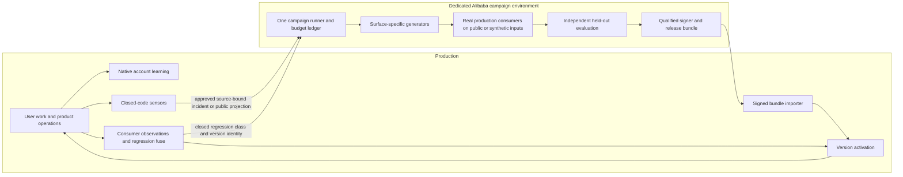

# Evidence-first RSI: native online learning and offline platform campaigns

**Status: Final design baseline, version 2.1.**

Date: 2026-10-26, Asia/Shanghai. This version supersedes the earlier Harness2-first draft at this path. The path is retained for existing links. Final design is not an implementation, integration-test or deployment receipt.

The owner selected the architecture by **who a change affects**: single-account learning stays native and online; experiments that change the platform move together to a dedicated Alibaba Cloud environment; production retains sensors, controlled activation and regression protection. Policies, skills and isolated tools may activate automatically after machine validation. Repository code, templates and plugin changes use the existing tests and release process. No new routine human-approval step is introduced.

The owner also selected: separately preregistered efficiency and targeted-repair objectives; an explicit, paid opt-in for any future task-time adaptation; Harness2 as a bounded offline research arm; monthly campaigns plus incident-class, model/kernel-pin and capability-change triggers. The named production search-pause operation was separately authorized.

## 1. Final decisions

1. **Move the entire platform experiment core offline**, including existing EviMed experiments, not only Harness2. Proposal, scouting, self-research, tool construction, smoke tests, confirmation, selection, engine-review preparation belong to one offline campaign system.
2. **Keep individual learning and ordinary product operations online.** Native memory extraction/merge/recall, personal-method learning, capsules, existing sharing and official-pack mounting retain their current semantics and effective times.
3. **Keep the existing shared-practices admission chain online as an explicit exception.** Its private inputs exist only in production. Preserve its five-stage checks and current unavailable/skipped semantics; add periodic regression of admitted public method content offline. Do not move source-account facts or its private corroboration evidence to the lab.
4. **Keep production thin for platform evolution:** operational sensors and an authorized incident projection; deterministic bundle admission and version activation; consumer-version observations and regression fuses. No production candidate search or experimental confirmation worker remains after cutover.
5. **Do not preselect Harness2 or GEPA.** First make the offline measurement and supply path trustworthy. Choose a generator for the actual mutable surface only after a bounded comparison. Harness2 is a task-adaptation method, not a ready-made cross-task release selector.
6. **Do not train model weights or install a second production kernel.** DSH stays the execution kernel, LoopX the long-task continuation driver, OpenViking the native memory engine, and EviMed the online identity, billing and publication authority.
7. **Do not turn experiment rejection into a user-delivery veto.** Existing usable files, research, account methods and historical results remain available under their existing verification and retention rules.

## 2. Evidence baseline and corrections

The inspected production source was `dc459da4952603791871721654197ecb2ee1b16f`. Its health endpoint still reported `evimed-dc459da49526-1` at 17:08 Beijing on October 26. Earlier same-day operational captures remain dated snapshots, not fresh continuous monitoring.

The 15:07 retained ledger showed healthy workers but zero candidate verdicts, active module policies and confirmation/audit/prospective tasks. There were 28 development tasks. About 95.9% of the preceding seven days' actual evolution spend was scouting. Those observations motivate moving experiments away from scarce production capacity. They do not identify one exclusive cause of zero promotions, prove no historical records were deleted, or establish that new code deployed that afternoon had already failed.

Checkout claims are scoped by location. This chat's checkout was `23c84044a` on `codex/scheduled-tasks-correction-20261025`; its local `main` was `01e965e99`. The supplied review inspected `f85d37bbe`, which it reports contains the serving revision. These are different checkouts. Implementation must verify the current authoritative release/main ancestry and use that release tree; neither an old local branch nor a remembered production tag is the implementation baseline.

Upstream Harness2 was rechecked at `1cfe254e8d25b15f37048c3730134686abe60335` (October 14), version 0.1.0. The inspected history had three commits, no release, nine closed PRs with none merged, and no repository GitHub Actions workflow observed. That is evidence of limited observed maintenance, not proof that no external CI exists. Some reported problems are unmerged PRs, not maintainer-confirmed issues.

The review's main correction is accepted: the earlier design prematurely made Harness2 the target engine. It does not address the observed confirmation supply, inference, execution-path and task-recovery bottlenecks. Current EviMed does not already implement PPC, so adding it would introduce a new research method, not simply replace an existing PPC implementation.

The following exact claims are qualified:

- Current RRSI calibration has a pooled bootstrap fallback when aggregate-repeat SD is zero; it does not simply fall to EviMed's 2% floor. Its baseline-null calibration still does not establish the paired candidate-effect contract required here.
- Harness2's paper describes Best-of-k in Appendix C. EviMed still needs its own matched-total-budget comparison; this design does not claim that the paper contains no Best-of-k discussion.
- The review's power percentages and historical CNY estimates are scenario/prior-run evidence. Its referenced simulation files were not available in this checkout, so those numbers are not reported as newly reproduced platform measurements.
- An exact claim that ten of thirteen upstream modules must be changed is not established. A maintained experimental fork may be necessary; the actual patch surface must be measured before any production commitment.
- A t interval or bootstrap is not automatically reliable for small, sparse or skewed samples. Non-inferiority can require more evidence than detecting a larger quality gain.

## 3. Ownership by impact

| Mechanism | Location | Boundary |
|---|---|---|
| OpenViking extraction, consolidation, recall, preference observations | Online, native | Preserve account scope and existing conditions/timing; no monthly delay |
| Corrections/adoption -> methods -> replay/consolidation -> session mounting/use/retirement | Online, native | Only eligible researcher work; internal experiments and self-reflection remain ineligible |
| Capsules, sharing, personal packs and official starter-pack mounting | Online | Preserve existing ownership, trust, undo and mounting semantics |
| Shared practices contributed from account methods | Online admission plus offline periodic regression | Preserve the existing five-stage chain; no raw contributor evidence export |
| Knowledge-page compilation, frontier ingestion/editing, evidence maintenance, retraction/invalidation, recommendation serving | Online product operations | Executing an existing policy is not an experiment changing that policy |
| Scouting, self-research, proposals, build, smoke, confirmation, selection, campaign judgments and engine-PR preparation | Offline campaign environment | Public/synthetic inputs; separate capacity and experimental cost ledger |
| Changes to memory templates, never-kept rules, follow-up judge examples, distillation prompts, persona/guidance, capability skills and curated official-pack source | Offline evaluation plus tested release | Their effect is platform-wide even though the unchanged mechanisms run online |
| Closed-code observations, incidents, lineage and VCR missing-method events | Online sensors | Export approved public/synthetic or minimum authorized incident projections |
| Bundle admission, policy/skill/tool activation, consumer witness, regression fuse and rollback | Online thin layer | Deterministic trusted-artifact checks and bounded serving observations |

The shared-practices path is deliberately distinguished from changing the mechanism that produces it. Existing admissible user-contributed method content may still enter that pack online. Changing its promotion rules, model prompts, privacy checks, default pack source or executable behavior is platform engineering and remains offline plus release. This migration neither silently adds probation to that existing path nor bypasses its gates.

The present five-stage chain includes code field/privacy checks, generality/classification, a harm check with explicit skip/unavailability behavior, author establishment or corroboration, and independent re-check. A stage being present is not a claim that all five always ran successfully; preserve that distinction in the records.

Shared inside the product does not automatically mean exportable to an external lab provider. Periodic offline regression uses public/synthetic fixtures and only method-content projections already authorized for that export class. Contributor facts and private corroboration stay online. If a contributed entry is not exportable, test the shared mechanism on public analogues and retain the entry's existing online controls; do not create a new per-entry human approval ceremony or forward it to Claude by assumption.

## 4. Target architecture

Online native learning remains an active system, not part of the thin platform-experiment layer. It can use its existing authorized models and tenant data in production. The offline lab has no tenant database credentials, no production volume mounts, no production workload-token signing secret, and no direct access to user transcripts, patient records, source files or embeddings. The owner-authorized incident export below is the explicit bounded exception; it does not grant a lab database or runtime connection.

The offline runner uses the same frozen release tree, DSH image, socket composition, capability/tool versions and actual consumer implementations as the target serving environment. Temporary lab accounts and synthetic workspaces are created in the lab's isolated control-plane instance. They do not occupy production runtime slots or use production account wallets.

The offline controller may reuse the product ledger and runtime orchestration implementation in an isolated instance. There is one platform experiment core, moved and refactored into a shared non-serving package if necessary, rather than a second competing online experiment system. File checkpoints are artifacts bound to that campaign, not a second authority over jobs or costs.

## 5. Production sensors and the export boundary

Retain signals from actual operational outcomes: source omissions, classifier/runtime failures, GEO misconceptions with their existing private assessment/outbox, planner fallback, verified corrections, source withdrawal and VCR missing-method events. Add the missing VCR producer to the existing adapter; do not create an unrelated client API.

The online private record retains account/project authority. The owner withdrew the previous five-account-only export rule. A single observed incident is eligible: the production-side approved model may read the affected retained conversation and derive the minimum diagnostic, reproduction, expected behavior and actual behavior, with exact source anchors. Normal successful conversations are not export candidates. Source project rights, clinical egress rights, retained transcript digest and the deployment agreement are checked before extraction and before export. No new per-incident human approval is introduced.

The deployment-owned outbox binds authorization ID, source run/revision and actual incident stream ID. Its immutable OSS object digest is required in every incident-derived campaign manifest. Deletion, replacement, transcript pruning or authorization withdrawal publishes a generation-2 tombstone that dominates any delayed generation-1 upload. The lab requires the actual generation-1 bytes and exact source/authorization/digest binding and rechecks withdrawal before consumption and signing; absence is never permission. Quotes remain authorized data, not public data. Credentials, unrelated histories and raw workspace/clinical datasets are excluded.

Closed operational codes/counts and public or synthetic reproductions remain useful inputs, without a mandatory five-account floor. The existing five-stage shared-practices promotion chain is a different mechanism and is retained. The lab cannot request or retrieve arbitrary underlying private records. Production writes only the incident OSS channel; the lab reads it. The lab writes only the bundle channel; production polls it. Separate identities and buckets enforce that direction; application checks do not substitute for live IAM/network verification.

## 6. Alibaba campaign environment

**Destination:** a dedicated, already-authorized Alibaba Cloud compute instance or isolated experimental host in the owner's account. Do not run campaigns on the shared Tencent production host or the space-constrained development checkout. Selecting Alibaba is a design decision, not evidence that an instance has been provisioned.

Before a campaign can be admitted, its host registration must resolve an actual instance ID, access identity, storage and resource limits, isolated network, retention policy and authorized cost ceiling. If no suitable registered instance exists, admission reports `campaign_host_unavailable`; it does not buy an unbounded cloud instance or run on production as a fallback. Provisioning details are implementation inputs, not an unresolved architectural choice.

The lab has its own accounts, jobs, artifacts and currency budget ledger. Runtime concurrency starts at one heavy campaign execution. Additional concurrency requires measured host capacity and an explicit campaign allocation. A busy slot waits with a lease/retry time; it never becomes a dead rollout scored as a method failure.

Solver/consumer parity and improver choice are separate:

- The execution/evaluation arm uses the target production solver/provider/runtime identities.
- Initial improvers are DeepSeek Flash and Qwen 3.8 Max. Claude is not configured in this baseline. Its identity, permissions and costs are recorded. Changing improver is an experimental factor, not evidence of benefit from the optimizer alone.
- Provider credentials are lab-owned gateway credentials. No production key is copied into the lab, candidate tree or generated script. Do not install an unnecessary credential-bearing upstream proxy extra.

### Campaign cadence

Run one scheduled monthly campaign, proposed operational schedule: the first day of the month at 02:00 Asia/Shanghai. Event-triggered campaigns are queued for a new confirmed incident class, a model/provider/kernel/socket pin change affecting evaluation, or a new capability/changed consumer implementation. These are product-runner schedules to implement, not Codex-chat reminders created by this document.

Coalesce duplicate triggers by incident class plus target fingerprint. Allow one active campaign for that identity and record pending triggers. An urgent deterministic regression is handled by the online fuse immediately; it need not wait for the monthly campaign. The lab can run autonomously within its authorized budget without a new approval per candidate.

Monthly scheduling does not modify the experiment policy. Remove the legacy meta-policy optimization entry from serving; do not introduce a dormant meta engine or a twenty-decisions readiness loop. Reports, resource maintenance and incident triage remain ordinary operations.

## 7. One offline campaign, multiple appropriate generators

A campaign freezes its target environment and task scope, admits a bounded opportunity, runs development and negative controls, selects a candidate on development evidence, freezes it, confirms it independently, and emits either a signed release bundle or a reproducible non-promotion decision.

| Mutable surface | Actual consumer | Candidate generation |
|---|---|---|
| Frontier selection threshold | Cached screen scores plus actual selection function | Deterministic sweep over a labeled development set; no additional model calls after scores/labels exist |
| Frontier screen/edit instructions | Actual FrontierEditor control-plane calls | Existing proposer initially; GEPA considered offline after measurement repair |
| Autopilot planner instructions | Actual AutopilotPlanner decision call | Existing proposer or qualified textual optimizer |
| GEO supplements | Actual capability brief assembly and DSH run | Existing proposer; optional Harness2/PPC research arm on development tasks |
| General guidance/capability method text | Actual DSH consumer | Existing method pipeline; optional offline PPC candidate generation |
| Isolated executable tool | Disposable executor and callable schema | Existing build/reference/hidden-test pipeline |
| Personal account method | Existing account-scoped mount path | Existing online native learning, unchanged |
| Runtime, plugins, templates, evaluator or engine source | Tested release tree | Offline engineering proposal -> tests -> release |

A threshold sweep is free of new solver calls only after its score and reference-label dataset exists. Dataset preparation, labels, upstream screening and confirmation still have costs. Optimize precision/recall or registered utility on the correct target distribution; do not select and confirm on the same labels.

### Harness2 qualification boundary

Harness2 stays under `OpenScience/evals/harness-adaptation/`, pinned as an experimental dependency. It is not placed in `runtime/`, shipped in the production agent image, or made a required service. RRSI is the closer conceptual shape for cross-task version selection, but that does not authorize copying its statistical calibration or installing it instead.

Harness2 task-time success and cross-task release are separate experiments. Its task-specific DOM edits are not automatically reusable policy candidates. A proposed reusable fragment must be stripped of task-specific answers, scope-labeled, frozen and tested on independent tasks before it can enter the platform release lane. No batch disguised as one task is claimed to reproduce the upstream method unchanged.

The initial research comparison uses actual DSH GEO/general-task consumers, not frontier single-call editing disguised as a DSH harness. It compares the incumbent, a matched-budget retry/best-of-n control with the baseline in its pool, the existing proposer, and applicable GEPA/PPC arms. Not every optimizer must run on every surface. The same solver, task inputs, evaluator, selection procedure and budget ceiling are used; a stronger improver is a separately reported factor.

Run one explicit mode with k=1 and execution width one initially. Do not inherit the upstream default that runs both modes. Before any paid run, qualify failure propagation, actual currency attribution, input/channel-aware resume identity, grading-evidence isolation, baseline inclusion and fixed-component separation. A dependency or slot failure must remain infrastructure failure; it cannot silently become a successful inherited-harness candidate.

Maintain an explicit experimental patch manifest: upstream pin, changed files, reason, test, limitation and deletion/upstream-replacement condition. Do not promise a thin adapter before the prototype demonstrates its actual maintenance surface. Do not import open PR changes merely because their issue numbers describe a desired fix.

### Research stop rule

Before the comparison, register task family, held-out set, sample target, all-in budget, latency ceiling and the primary comparison. Harness2 remains eligible for further investment only if the preregistered held-out comparison has a calibrated positive lower bound against the matched-budget control, meets all critical checks, and stays below a 1.5x **actual all-in cost** ceiling relative to that control. Both arms still receive the same maximum spending budget; the ratio is an additional stop ceiling, not permission to use a larger budget without reporting it.

A confidence interval overlapping zero, a cost ceiling violation, unresolved accounting/contamination/failure semantics, or unaffordable completed confirmation means stop the arm after its registered horizon and retain the evidence. Do not repeatedly rerun until it wins. No winner is a valid campaign result. A winner qualifies a specific task family/surface only, not global adoption of the framework.

## 8. Evaluation repair in the offline runner

Moving code does not repair it. The following requirements are acceptance conditions on the new offline execution path:

- **F1:** replace the per-item-difference noise band with the registered paired-group decision contract below. Reject the known 83.3%-to-zero cheap candidate through the full coordinator.
- **F2:** reconcile campaign/mission and execution state. Every nonterminal record has runnable work, a named wait event/deadline or a concrete retry time. Terminal failure releases allocation; it does not leave an invisible ready task occupying a weekly slot.
- **F3:** execute the component actually changed. Screening changes run screening; threshold changes run real selection; editing changes run editing.
- **F4:** bind cached evidence to input/source, baseline, candidate, consumer/evaluator, fixture and model/runtime versions. Separate completed negative evidence from interruption or temporary unavailability.
- **F5:** retire the meta-policy execution path. Historical prefix replay cannot certify a branch. A future meta experiment requires a separately designed and qualified implementation.
- **F6:** add the VCR missing-method producer online as a sensor, respecting the originally reserved integration boundary and patient-data exclusion.
- **F7:** GEO supplements are evaluated through the actual production brief assembly, capability and DSH execution. The one-off model proxy is not a promotion evaluator.
- **F8:** score genuine frontier abstention/refusal behavior where the component supports it. Do not force an abstention case whose score is hard-coded to zero in both arms. Applicability is specified per endpoint.
- **F9:** retain individual dimensions, counts, denominators and meaningful continuous measures. Keep genuinely categorical outcomes binary. Smoothing a composite cannot hide a critical numeric, quotation or safety failure.

Each evaluated unit records the **effective consumer revision**, observed from the executed consumer, plus its input and output hashes. Copying the proposed revision into a receipt is not consumption proof. A no-op and a deliberately broken component must produce the expected distinct results before that evaluator can qualify a real candidate.

Ordinary online product checks remain: a retracted source must still invalidate a card; a tool call must still enforce admission; an artifact must still be readable. Those serving duties are not experimental confirmation and are not removed with the experiment worker.

## 9. Confirmation supply and experiment economics

Independent groups are defined by source/study/task family identity. Original questions, equivalent variants and repeated generations stay within their group. Source aliases cannot turn one study into multiple independent observations.

Use three explicit strata:

1. Public source groups sealed from this optimization process. They are not claimed to be absent from model pretraining.
2. Generated nonclinical tasks with independent executable truth and withheld parameter ranges, including controlled numeric/unit/denominator/quotation perturbations. Never invent medical truth.
3. Later-public or registered prospective evidence for the longer-term audit. It is valuable but not the sole admission route for ordinary confirmation.

Equivalent variants are a registered stratified coverage sample, initially at least 30% of groups where invariance is meaningful, rather than a requirement that every source carry one. Cover each critical transformation; increase coverage where needed. The percentage is an operational initial design, not a statistical guarantee. Abstention is likewise endpoint-specific. Variant weights are fixed before evaluation.

Record added qualified groups/day, available sealed inventory, consumed/exposed groups, missing strata, estimated MDE, target power and expected total cost. Revealed confirmation groups cannot be relabeled unseen for a repaired candidate. Audit results may inform a later campaign only after the affected pool is retired/refreshed under its exposure contract.

The initial objective is non-inferiority plus cost reduction, **not a relaxed correctness requirement**. A narrow non-inferiority margin may need more groups than a large-gain test. If adequate supply is unaffordable, choose a lower-cost/precisely verifiable surface or record inconclusive; do not widen the margin to obtain a promotion.

For example, 30 groups with an average 1.3 forms/group and three first answers in each arm require 234 solver executions before grading. A full DSH session and a single control-plane model call have different cost and duration distributions. No universal CNY/unit assumption is used.

Campaign admission uses measured or explicitly estimated stage costs, complete stage counts, remaining lab budget and maximum date. Include data preparation, proposer, probes, composition, selector, reflection, evaluator, retries and cloud compute. Preserve failure costs. The original production CNY100/day, CNY10/run and reserved shares are dated configuration evidence, not the lab's automatically authorized allowance. The owner fixed the ceilings at CNY 1,000 per campaign and CNY 30,000 per Asia/Shanghai calendar month. Reserve before spend, retain unknown outcomes, settle retries and failures, and check outstanding reservations at both reserve and dispatch. Resource bindings remain empty by owner choice.

Scouting has an absolute campaign ceiling and a declared stop condition. Unused experiment funds do not automatically enlarge that ceiling. Prefer evaluating already actionable opportunities. The observed 95.9% scouting share does not itself prove a cap breach: the existing `budgetRoom` already constrains the scout share, and very low spending elsewhere can produce that proportion below the cap.

## 10. Fixed-horizon statistical contract

The implemented decision procedure is `rsi-paired-source-v4` (RFC8785 SHA256 registration identity), a **calibrated approximate procedure within a declared task/evaluator scope**, not a distribution-free guarantee. A0 does not simultaneously introduce group-sequential or anytime-valid promotion tests.

This procedure governs empirical quality/cost claims for stochastic policies. An isolated tool with an independently specified deterministic contract retains its absolute-reference, hidden-case, schema and execution checks; those establish only the tested/declared functional scope and are not relabeled as a statistical generalization guarantee. A new capability without a comparable incumbent cannot invent a zero-score baseline to pass NI. Its capability-admission claim and evidence must be separately typed and qualified under the existing tool pipeline.

### Registration

Before viewing candidate confirmation outcomes, freeze one task family, source-group definition, equal group weights, candidate/incumbent hashes, consumer/evaluator versions, serving inference settings, time window, repetitions, endpoint, critical slices, non-inferiority margin, cost threshold, target G, maximum cost/date and diagnostic rules.

Register repeat count, bounded score type and margin per task family from acceptable loss, pilot variance and cost. Stochastic consumers require repeated independent first answers, interleaved in time; no repetition receives scoring feedback. An independently qualified deterministic consumer may execute once, while retaining sampling uncertainty across independent source groups. Finite-corpus exact replay is a diagnostic scope and cannot authorize a population policy. Average original/equivalent/repeat outcomes within the source group using registered weights. Initial automatic decisions are single-family, equal-group comparisons; cross-family summaries are descriptive until their weighted inference procedure is qualified.

An efficiency claim requires overall quality non-inferiority plus at least 10% lower recurring serving cost. A targeted-repair claim requires superiority on its preregistered failure slice (lower confidence bound > 0), overall non-inferiority and candidate cost <= 1.1 times incumbent cost. Each claim receives its own error allocation before outcomes are seen. Family-specific margins are justified and frozen before confirmation; clinical-critical dimensions have no cost-compensable allowance. A margin is never widened after observing low power.

### Decision

Let d_g be the group mean candidate-minus-incumbent quality, and e_g the matched group mean candidate serving cost minus 0.9 times baseline cost. Allocate a module-quarter error budget of 0.05 over at most K preregistered confirmation candidates, alpha_i=0.05/K. K is fixed before that quarter's confirmations. Revised/retested candidates consume an allocation; failed or inconclusive tests do not refund it. This is a module-quarter scope, not a claim of a platform-wide 0.05 guarantee.

Use alpha_test=alpha_i/2 as conservative calibration headroom:

    L_quality = mean(d) - t(1-alpha_test, G-1) * sd(d) / sqrt(G)
    U_cost    = mean(e) + t(1-alpha_test, G-1) * sd(e) / sqrt(G)

Automatic acceptance requires L_quality > -m AND U_cost < 0 AND all critical/source/authority conditions passing, with complete costs and no unqualified missingness. The alpha/2 choice does not cure arbitrary distribution misspecification.

A registered group bootstrap is sensitivity analysis, not an alternative interval selected because it is more favorable. Sparse, degenerate/zero-variance, high-influence or incompatible missingness patterns outside the method's qualified scope produce inconclusive. Twenty groups permit diagnostics, not automatic qualification. The target G comes from pilot variance, power and calibration, not the old fixed 30/20 rule.

Reach the fixed target once, then make one positive decision. Safety failures may stop early. Budget/date expiry before the target is inconclusive. Do not peek at 30/60/90 groups and repeatedly apply the same fixed-sample threshold. A future group-sequential procedure is a separately versioned and qualified method.

A historical champion used as an additional floor must be rerun on the same new groups and compatible environment. An old maximum score on a different pool is not a valid paired comparator.

The all-required quality/cost/critical conditions have an intersection-union form. This does not remove multiplicity across candidates, optimizer arms, repeated looks or alternative `improved`/`cheaper` branches. The targeted-repair promotion channel has its own registered error budget; other quality gains remain descriptive. Complexity reduction alone is not an escape from NI and cost evidence.

### Qualification and failure treatment

Qualify the procedure before automatic promotion with numerical simulations and deterministic negative controls. Register 20,000 simulations per scenario, including NI boundary delta=-m, cost boundary E[e]=0, equal-cost/no-benefit cases, genuine equal-quality savings, severe cheap regressions, correlated variants/repeats, sparse errors, skewed costs and missingness. Report a binomial uncertainty bound; the one-sided 95% upper bound on false acceptance must be <=alpha_i for each declared null scenario. Validate on held-back calibration scenarios after tuning. This establishes empirical behavior for the specified scenarios only.

For a superiority test, quality A/A is a null. For NI, equal quality is an alternative: a genuinely cheaper equal-quality candidate should be eligible when evidence is sufficient. An exactly identical quality-and-cost A/A is a negative control for the joint efficiency rule, with acceptance near zero. Retain both controls; do not require genuinely cheaper A/A candidates to have promotion probability <=alpha. Calibration must target the correct quality and cost boundaries.

A solver's genuine failure to deliver may be a scored outcome if the endpoint specifies it. Evaluator outage, source unavailability, transport failure or uncertain paid completion is not automatically zero. Reconcile the original execution without buying a new favorable answer. Informative or asymmetric missingness prevents automatic acceptance; never discard difficult rows after observing them.

A newly introduced, reproducible critical quotation/numeric/unit/authority failure can conservatively reject publication. That is an operational guard, not proof that zero observed failures means zero population risk. Store the dimensions beside the verdict. No experimental verdict withholds an ordinary user's existing deliverable.

One-time optimization cost is reported separately from recurring serving cost and included in the campaign's all-in economics. Any payback projection uses actual observed eligible consumption and explicitly estimated future use; method counts do not substitute for adoption.

## 11. Signed campaign bundle and thin online importer

A hash proves byte identity, not who generated a judgment. The importer therefore requires a **signed, allowlisted campaign receipt**, not merely self-declared pass fields plus hashes.

The versioned bundle contains:

- bundle/campaign ID, schema, producer identity, timestamp, validity period and replay identity;
- target source/release and base policy/skill/tool generation;
- execution fingerprint: provider and observed solver identity, model-gateway configuration/attestation, kernel and runtime image digest, socket/capability/tool pins and affected consumer implementation hashes;
- separate improver and judge identities; an improver is provenance, not the serving solver identity to compare;
- candidate class/scope, content-addressed manifest, file digests, callable/dependency contracts and rollback reference;
- evaluator/statistical-procedure identities and qualification record, registered hypothesis, source-group/pool references, exposure labels, measurements/verdict and cost receipt;
- all required critical checks and exact execution/consumer witnesses;
- qualified campaign signer key ID and signature over canonical manifest bytes.

Use existing canonical JSON, content addressing and signature primitives where appropriate. Signing authority belongs to a trusted campaign finalizer after evaluation, not to the proposer, generated runtime or mutable harness. The evaluator and qualification allowlist change through the normal code/release process. A candidate cannot bring its own trusted evaluator or signer.

The importer performs only bounded deterministic work:

1. Authenticate the publisher and verify signature, manifest/hash/size/path/schema constraints.
2. Check expiry, replay protection, allowed candidate class and qualification/evaluator identity.
3. Require exact match to the **affected consumer dependency closure and baseline generation**. Hash the actual transitive code, declared data/configuration, solver/provider/kernel/socket/tool dependencies used by this surface. Full release and image identities remain provenance, not blanket compatibility keys. Unrelated CSS or another surface changing does not invalidate a campaign; unknown dynamic dependencies refuse. Revalidate after an affected dependency changes. The lab follows a frozen production release tree between campaigns, never changes it during confirmation.
4. Check all required acceptance fields against the registered decision policy and verify referenced immutable evidence identities.
5. Stage existing policy/skill/tool records, then activate with compare-and-swap/lease fencing against the still-current baseline.

An aliased model name is not proof of immutable model weights. Record the actual observable provider/model identity and its limits. If the required identity cannot be established, the bundle cannot claim full environment equivalence; it must be revalidated under a qualified, explicitly bounded model-identity contract. Do not label unknown identity equal merely because both strings are the same alias.

Reject generated plugins, hooks, root policy, permission changes, arbitrary packages and platform code on this import lane. Files are validated and stored without executing them in the web process. Executable tools use the existing isolated executor admission path.

This is a new controlled publication boundary, not a new user-facing API flow. Reuse current policy revision, immutable skill generation, tool admission and safe idle/next-run adoption. In-flight runs keep their recorded version. Repository SKILL/guidance/template changes continue through PR/tests/release, even if their contents are text.

## 12. Online activation and regression fuses

Offline held-out evidence supplies the benefit claim. Online observation verifies effective use and detects regressions; sparse traffic cannot prove the benefit anew and cannot guarantee detection of every regression.

Use version-pinned, stable exposure assignment with a retained incumbent cohort where feasible. The initial activation plan is 10% ->25% ->50% ->100% eligible exposure. Each expansion requires its registered minimum observed use, completed cost/error reporting and critical checks; time passing alone is not success. If too few eligible users/tasks exist, remain limited or roll back on expiry rather than declaring a completed canary. A full activation is not forced by the monthly campaign cadence.

The importer records separate milestones: admitted, staged, exposed, consumer-observed, broadly active and rolled back. A registry row without real consumer evidence is not a completed release.

Reuse actual product checks: frontier quantity/unit/source checks, GEO fact/safety dimensions with their current verification scope, autopilot fallback/failed-action rates, tool failures and consumer-version mismatches. Keep user/account-level native method demotion independent. A later source withdrawal invalidates the affected revision through its source lineage.

Critical deterministic regression, unauthorized behavior, corrupt bytes or incompatible generation causes immediate bounded rollback to the last compatible approved version. Less acute rate changes are evaluated on predeclared daily aggregates with stable exposure accounting and appropriate account/day dependence. A sequential detector may be used only after its assumptions, error budget and calibration have been registered; low traffic remains insufficient evidence, not green status. Online fuse detection is not a second optimization experiment and does not generate candidates.

Rollback changes future selection and preserves historical artifacts, data and receipts. Do not run destructive reversal of user results. If no compatible prior version exists, disable only that candidate's optional selection and preserve ordinary service.

The shared-practices five-stage publication path retains its current immediate-effective semantics and cross-account demotion, as explicitly retained by the owner. The above staged campaign rollout applies to offline campaign bundles; it does not silently impose a new probation system on that separate online path.

## 13. Personal learning and optional task-time adaptation

Keep existing LearningEvidence, method replay/consolidation and OpenViking native learning online. Preserve current correction/adoption evidence, applicability scope, effective time, undo and preference observations. Internal platform runs, laboratory probes and their self-authored reflection do **not** enter the personal-learning path.

A Harness2 reflection remains a lab artifact or a proposed public method candidate requiring offline cross-task confirmation. It is not a user correction, adoption or personal experience. An eligible future genuine user reaction may independently enter existing learning under its current rules; no exemption is added for the optimizer.

Optional task-time adaptation is a separately qualified, explicit paid mode, not a default interceptor or hidden rewrite step. It does not run as part of the public/synthetic campaign lab:

- The user explicitly enables it for the task/goal, with a visible upper cost bound and latency range, and can cancel it.
- Personal learning remains account scoped. The minimum authorized incident export is the explicit exception in section 5; it preserves purpose/provider/source authority and revocation, and grants no direct private-data access to the lab.
- The candidate pool includes the baseline. Deterministic artifact/source/quantity checks run before selection; newly invalid candidates cannot replace the baseline.
- An LLM's preference between surviving outputs is not proof of true superiority. If selection fails, evidence conflicts or a required check is unknown, retain baseline/alternatives with accurate labels and no unqualified improvement claim.
- The existing operator-only `evolutionRuns.dispatch` scope is not widened. Any later private-task adapter uses the user's existing authority, limits and isolated native execution path.
- The mode does not make a user wait for platform publication, and its artifacts do not train shared methods automatically.

This mode is allowed as a future product direction, not included in the immediate migration. Its qualification cannot be inferred from an offline public-task victory. Plain questions continue to receive ordinary answers without forced tools, planning or a second-model approval loop.

## 14. Experimental edit surface

Fixed identity, authorization, tenant boundaries, workload-token handling, budgets, networking, clinical framing and evaluation rules live **outside** the editable tree, injected/enforced by the unchanged socket/control plane. They are not merely editable files carrying a do-not-edit instruction.

The experimental DSH projection begins with bounded task/method fragments, skill text and guidance for already admitted tools. Its extra always-on budget is derived from the current prompt inventory, with an initial experimental ceiling of 4,000 characters for owned always-on content; it must not auto-append every skill name or expand the global persona. Skill detail stays lazily loaded. This ceiling is a declared experiment constraint, not a claim that every existing prompt is exactly 4,000 characters.

Set plugin and command-hook surfaces absent (`plugin_dir=None`, `hooks_file=None`) in the experimental adapter. Generated cordis/native code cannot be loaded even in a disposable probe that carries platform components and workload authority. Scripts are separate isolated-tool candidates, not unrestricted plugins. Custom subagent-definition editing stays disabled unless the supported DSH contract is independently demonstrated; existing native delegation remains available within its fixed limits.

DSH-specific imports remain confined to `packages/harness-port`. This restriction concerns `@deepseek-ai/*`; it does not require every unrelated upstream Python import to be placed in that Node package.

## 15. Migration and retirement

### Step 0 — Authorized temporary containment

Set `OPEN_SCIENCE_EVOLUTION_SEARCH_PAUSED=true` through the existing supported deployment procedure. Preserve the prior value and verify effective runtime state, source/image identity and readiness. Do not disable native learning, OpenViking, frontier/GEO operations, shared methods, installed tools or user workloads.

**This switch is not the final architecture.** Current `SEARCH_KINDS` covers scout/build/mission/mission-heavy/plan/meta/research admission. It does not necessarily stop already claimed work and does not cover all evaluate/audit/self-check/maintenance work. Inventory those kinds and their cost/side effects. Do not claim that a search pause alone leaves only sensors or stops every evolution-related charge.

Operational receipt, separate from future migration: the authorized flag change was applied on October 26 after a successful maintenance drain and verified again at 17:39 Beijing. Only the Web container was recreated from the same image; the effective environment diff contained only this flag. Release/source/image identities were unchanged, readiness was 30/30, learning remained enabled, and the maintenance lease was released. OpenViking, PostgreSQL, runtime-controller and the knowledge plugin were not restarted. No evolution job was running at the follow-up check; three existing evaluate jobs remained queued and are outside this pause. Evidence: `.evimed-local/audit/rsi-harness-final-20261026/pause-receipt.json`. This completes temporary containment only.

### Step 1 — Build the offline core and supply together

Extract/reuse the relevant consumer/evaluator/build modules under an offline entrypoint. Repair F1/F3/F7/F8 and the state/cache contracts there; do not spend effort building a new long-lived online experiment subsystem that will be retired. Develop confirmation supply and the statistical qualification in parallel. Use public/synthetic lab fixtures and separate accounts, budgets and runtime slots.

Before transfer, snapshot existing mission/job/dispatch IDs, paid-answer uncertainty, source/receipt hashes and terminal/wait states. Retire pending production experiment work with explicit migration reasons and fence old workers; do not replay it under fresh IDs or delete evidence to make the queue look empty. Once the lab can adopt a checkpoint, preserve its identity or classify it as historical evidence only. A minimum online drain/fence is still required even though the old state machine will not be repaired for future experiments.

### Step 2 — Bundle contract, importer and fuse

Implement the signed manifest, compatibility and baseline checks, staged activation, real consumer witnesses and rollback. Exercise invalid signer/hash, stale baseline, changed provider/kernel/consumer, expired or replayed bundles, partial import, restart during activation, concurrent publishers and rollback with no compatible predecessor. No new human approval is inserted into the qualified policy/skill/tool lane.

### Step 3 — Complete one real campaign

Start with a cheap, measurable surface: frontier threshold selection over frozen real screening scores and independent public labels is suitable for deterministic search; it is not a Harness2 showcase. Use an actual production-consumer evaluator. Complete candidate -> reproducible verdict -> signed import -> consumer use -> deliberate rollback. A rejected or inconclusive candidate is a valid measurement outcome, but does not satisfy the activation/rollback demonstration; use a separately identified benign controlled activation fixture for lifecycle proof without claiming quality benefit.

Only after measurement/recovery/supply acceptance may offline comparisons add GEPA or Harness2/PPC. Harness2 trials use DSH-native GEO or general-task families. Production packaging for a new generator is not built before that evidence, and a winning generator stays offline unless a separate opt-in product mode is later qualified.

### Step 4 — Complete cutover and remove the online experiment core

Disable all remaining production experiment claimers, not only SEARCH_KINDS. Retain/rehome only the sensor, public serving, importer, provenance invalidation, monitoring and rollback functions. Split mixed maintenance jobs by effect: serving safety and existing publication cleanup stay online; reference replay, scientific evaluation, pruning experiments and meta trials move offline.

Verify zero production experimental model calls/runtime admissions across a complete former heavy window and a triggered incident. Verify personal learning, native memory, shared-practices admission, feed/wiki/evidence maintenance, VCR signals, tools, activation and rollback still work. Then delete unreachable online experiment entrypoints and configuration, keeping one offline implementation and retained immutable historical records. Do not keep a dormant second experiment engine as a rollback switch.

The temporary search-pause setting is retired with the old experiment worker. Rollback of this migration restores a known tested service release if required; historical receipts remain readable and do not regain automatic execution authority.

## 16. Acceptance gates and stop conditions

| Gate | Required evidence |
|---|---|
| Online containment | Effective search-paused state, unchanged release/image, safe drain/restart receipt if needed, healthy native/product operations, explicit residual job list |
| Offline isolation | Registered Alibaba host, distinct accounts/budget/keys/storage, no production capacity consumption or tenant-data access |
| Measurement | Full-coordinator cheap-catastrophic-regression rejection, qualified inference, true consumer revision witness, correct abstention and dimensional metrics |
| Recovery | Every nonterminal job has an executable or named-wait state; cancel/restart/lease-loss retain paid identity and prevent duplicate activation |
| Supply | Per-family eligible group inventory, source/exposure provenance, MDE/power/cost feasibility and no favorable missing-data filtering |
| Publication | Signed qualified bundle, exact compatible target/base, idempotent staged import, real consumer use and rollback |
| Optimizer research | Preregistered same-budget comparison and stop rule; no automatic framework promotion from task-specific adoption |
| Retirement | No online experiment cost/admission during the observed window; required native/product duties preserved; old claimers removed |

If four weeks after the offline measurement milestone no valid reproducible decision can be produced, pause new scouting and diagnose supply/evaluation/recovery. That is a stop condition, not a promise that a good candidate must exist in four weeks. No decision does not justify weakening thresholds.

Meta-policy optimization is retired at cutover. There is no dormant engine and no monthly twenty-decision threshold. Any future implementation starts with a separately approved experimental design.

Online deterministic regressions roll back promptly. Sparse or unqualified online rate evidence holds exposure rather than proving safety. The lab remains responsible for benefit evidence.

## 17. Implementation ownership and artifact layout

The immediate plan does not add `runtime/harness2/` or install Harness2 in the production runtime.

- `OpenScience/evals/rsi-campaigns/`: campaign manifests, public/synthetic tasks, paired decisions, qualification reports and adapter tests; reuse applicable `general-tasks`, `method-quality`, `follow-up-judge` and memory-quality evaluation paths.
- `OpenScience/evals/harness-adaptation/`: optional pinned Harness2/PPC/GEPA research arms and explicit patch manifests. Their solver and improver adapters are experimental, not SaaS services.
- `OpenScience/deploy/rsi-campaign/`: dedicated lab image and runner deployment, only when its host and budget are registered.
- Existing `evolution*`/domain/evaluator modules: extract reusable pure logic and actual consumer adapters into one owned offline implementation; remove serving experiment composition after cutover.
- Existing sensor/outbox modules, including GEO and VCR: online signal production/export projection.
- Existing policy readers, `platformSkillSupply`, tool admission, runtime generation and provenance services: online import/activation/consumer witness/fuses.
- Existing LearningEvidence, native-memory and officialPromotion/officialPacks services: preserve online behavior and test it during migration.
- Repository SKILL/guidance/templates, plugins and platform source: ordinary reviewed/tested release artifacts.

Use the existing ledger/contract vocabulary where it fits; new manifest schema is a publication contract, not a competing user interaction. Exact implementation decomposition follows this final architecture, with no unrelated UI redesign or new client fields.

## 18. Operating evidence

Publish separate views for online native learning and offline platform experiments. The offline funnel is: eligible closed signal -> public reproduction -> supplied independent groups -> frozen candidate -> valid decision -> signed bundle -> import -> real consumer use -> retained benefit/rollback.

Required measures include supply/day and sealed inventory; MDE/power and complete cost; valid decisions/week/module; error causes and waiting ages; actual generator and judge costs; activation exposure/consumer coverage; independent audit regressions; and online rollback detections with their observable scope. Paper, method, mission and version counts are throughput, not the optimization objective.

A future optimization objective must use held-out task utility and cost with fixed task-family weighting and non-compensable critical conditions. Creating more revisions is not a benefit metric. Unknown measurements remain unknown.

## 19. Review disposition

| Review item | Final disposition |
|---|---|
| Harness2 task adaptation versus cross-task release | Accepted; no production preselection and no direct global publication of task-adopted harnesses |
| Repair the bottleneck before adding an engine | Accepted; repairs and supply occur in the offline core, online work is containment/import/fuse/sensors |
| Frontier/autopilot are not DSH harness tasks | Accepted; use actual control-plane consumers and surface-specific optimizers |
| Scalar threshold should not use LLM search | Accepted; deterministic development scan, independently confirmed |
| Baseline excluded and k=1 auto-adoption | Accepted; research/user opt-in selection includes baseline and qualified checks; no inferred true superiority |
| Small samples and candidate variance | Accepted; fixed-horizon paired groups, repeated first answers, power and calibration before promotion |
| Ten of thirteen modules must change | Qualified; do not assert an unproved exact count, track actual fork/patch surface |
| No maintenance/CI | Qualified to observed commit/PR/release/workflow evidence; no blanket claim about external infrastructure |
| Open issues/PRs prove unsafe results | Static mechanisms verified; reports are not all maintainer-confirmed or reproduced EviMed incidents |
| Parallelism versus one runtime slot | Accepted; lab capacity is separate, busy is a wait, one execution initially, explicit mode |
| Historical cost multiplier | Treated as a scenario; require measured all-in costs and independently authorized lab budget |
| Fixed safety content in editable tree | Corrected; fixed content is outside the tree; no generated plugin/hooks, including probes |
| GEO proxy / frontier abstention / score granularity | Accepted as F7/F8 and a measurement design correction for F9 |
| Reflection entering personal learning | Removed; internal/lab self-reflection remains ineligible |
| Low-throughput meta loop | Retired; no dormant optimization or automatic readiness counter |
| Opt-in data/cost/latency | Explicit future mode, account-native providers/data, disclosed cap/latency and cancellation |
| RRSI identical aggregate scores imply 2% floor | Corrected: inspected RRSI has a pooled bootstrap fallback and no EviMed 2% floor |
| Paper has no Best-of-k at all | Corrected: Appendix C describes it; local matched-budget evidence is still required |
| A/A acceptance must always be <=alpha | Corrected by hypothesis: NI with true savings is a positive alternative, not a null |
| IUT resolves all multiplicity | Qualified: it does not cover multiple candidates, alternate claims or repeated looks |
| Main already contains serving source | Recorded by checkout; this chat and the supplied review inspected different refs |
| Move only Harness2 versus all experiments | Superseded by owner direction: all platform experimental work moves together |
| Hash-only bundle admission | Strengthened to authenticated signed receipt, trusted evaluator, freshness, baseline binding and replay protection |
| Online low traffic proves regression protection | Limited: can detect some regressions; cannot prove benefit or guarantee detection of every harm |

## 20. Sources and completion boundary

Primary technical sources:

- [Harness2 pinned repository](https://github.com/google-research/harness2/tree/1cfe254e8d25b15f37048c3730134686abe60335), especially core spec/substrate, recursion, schedule, selection, ledger, library and resume identity.
- [Harness2 paper](https://arxiv.org/html/2610.14224v1): task-level recursion and the improvement library; no automatic global version promotion.
- [Harness2 issue 109](https://github.com/google-research/harness2/issues/109), [PR127](https://github.com/google-research/harness2/pull/127), [PR118](https://github.com/google-research/harness2/pull/118), [PR76](https://github.com/google-research/harness2/pull/76), [PR48](https://github.com/google-research/harness2/pull/48), [issue94](https://github.com/google-research/harness2/issues/94): checked open at review time; separate community reports from static source findings.
- [RRSI calibration](https://raw.githubusercontent.com/google-research/rrsi/main/rrsi/calibrate.py): a different baseline-null calibration target; not a drop-in paired-effect test.
- [Miller: Adding Error Bars to Evals](https://arxiv.org/abs/2411.00640), [Bowyer et al.](https://arxiv.org/abs/2503.01747), [SAVI](https://arxiv.org/abs/2210.01948v2): experimental design, small-sample limitations and the limits of anytime-valid inference.
- [GEPA documentation](https://gepa-ai.github.io/gepa/guides/): textual-component optimization with task-specific feedback; still subject to independent confirmation.

Local retained evidence is under `.evimed-local/audit/rsl-20261026/`, `rsi-harness-20261026/` and `rsi-harness-final-20261026/`. The supplied review is preserved privately with SHA-256 `be4d2454b9966a0fb708cb06bd24f38dbd1ec5c25c1bd589aafb265649ee833c`; the superseded design is retained there as dated evidence. No raw tenant content is needed for this specification.

Finalization covers the architecture, boundaries, measurement contract, migration order and acceptance conditions. Apart from the separately authorized search-pause operation and its receipt, this work does not implement the lab, purchase compute, execute paid campaigns, install upstream packages, change personal learning or deploy new product code. Any completed operational action is reported from its own receipt, not inferred from this document.

## 20. Implementation and evidence status (October 26, no deployment)

The implementation branch is `codex/rsi-offline-campaigns`, based on `9614de895`. Production composes `createEvolutionServing`, not the experimental engine. Account learning and ordinary module workers retain their online ownership. Historical queued experimental jobs are quarantined by owner and job kind with their payload, attempts, result and cost references retained; a live lease is never stolen. Legacy source removal follows the measured deployment/window retirement gate in section 15, not a claim from local tests.

Implemented components are under `apps/server/src/rsi*.mjs`, `packages/domain/src/rsiCampaign.mjs`, `evals/rsi-campaigns/` and `deploy/rsi-campaign/`. They include finite budget accounting, resource preflight, content-addressed signed bundles, independent evaluator receipts, live trust revocation, affected dependency closure, private incident outbox/withdrawal, directional OSS adapters, phased activation, real frontier selection witnesses and compatible rollback. The trusted finalizer reruns the registered statistics and binds its inputs to the actual runner checkpoint and confirmation opening time. KMS/OSS dependencies are installed in the lab image, with online public verification and production-only transport credentials.

The first executable campaign surface is frontier selection. The runner invokes the production mapper and `frontierMixSelect`, freezes one development winner and confirms only it against the incumbent. A real synthetic runner-to-finalizer test and PostgreSQL importer-to-shadow-to-global-to-rollback test exercise that path. Mathematical qualification runs 20,000 simulations per scenario for each of two seeds; it does not qualify real task labels, the frontier population or an LLM evaluator. Historical 248-row gold remains exposed calibration material, with its unverifiable raw-rater kappa claim documented by the inventory.

**Open qualification gates are explicit:** Alibaba host/network/IAM/KMS bindings, a fresh independently calibrated label supply, a real frontier campaign, paid DSH/control-plane consumer adapters and per-surface skill/tool activation qualification, and a full production night-window retirement observation. Unsupported surfaces refuse instead of importing an unmeasured implementation. Harness2/GEPA research admission remains downstream of those measurement/supply gates. These are not reported as deployed, empirically beneficial or operationally accepted by local tests. The owner requested code commit/push only; no deployment is included in this implementation handoff.
