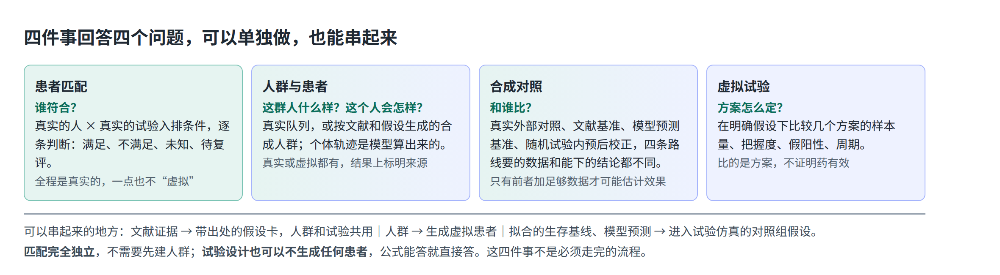
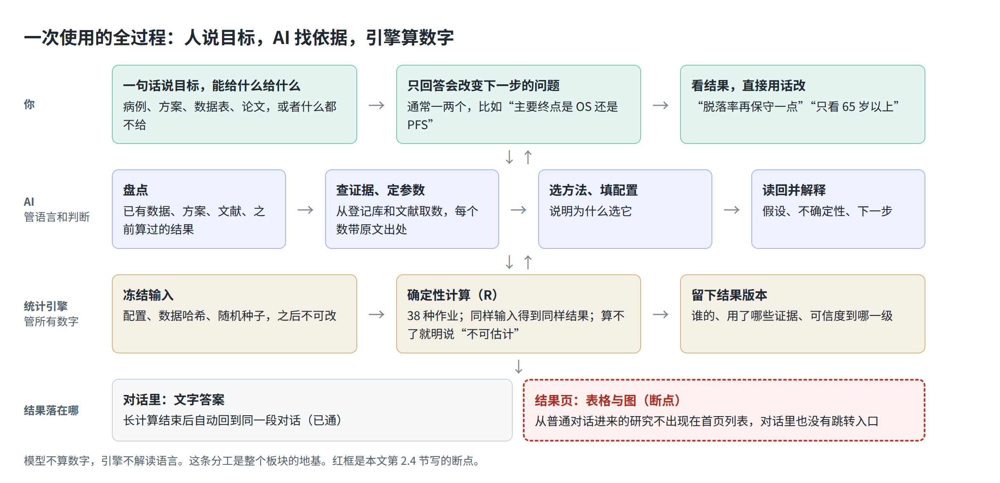

# 虚拟临床研究：产品定位、使用逻辑、算法流程、价值与壁垒

2026-11-01 · 依据 `github/main` 77ba0a436 的代码和文档，外部情况查到当日。本文只做梳理，未改产品代码。

**怎么读**：想快速看懂，读第 0 节和两张图。第 3 节回答“参数为什么复杂”，第 7 节是接下来要改什么。

---

## 0. 一页说清

**一句话定位**：在开真实试验之前和之外，把一个临床研究问题变成有出处、可复算的答案。用户说目标，AI 找证据、定参数、调工具，统计引擎算数字。

**它回答四个问题：**

| 问题 | 模块里的名字 | 典型一句话 |
|---|---|---|
| 谁符合？ | 患者匹配 | “这位患者能入哪些试验？” |
| 这群人什么样，这个人会怎样？ | 人群与患者 | “按这篇论文的基线生成 500 人的合成人群” |
| 和谁比？ | 合成对照 | “我的单臂研究能不能用外部对照？” |
| 方案怎么定？ | 虚拟试验 | “比较这三个方案的样本量和把握度” |

**它不是**：招募系统、药效预测器、监管替代品、统计计算器。

**核心价值**：过去要统计师反复沟通的方案论证，变成一次对话；每个假设都有出处；没有患者数据也能开始；算不了就明说算不了。

**核心壁垒**：今天的壁垒是可信度工程，包括证据到结果的完整血缘、引擎内建的诚实语义、方法验证资产和患者数据不进模型。方法数量和对话界面都不算壁垒。最大的缺口是没有专有历史数据，没有经过验证的临床模型。

**你没看懂，主要不是你的问题。** 我查下来有五个原因（第 2.4 节、第 3 节）：

1. 名字叫“虚拟”，但四件事里患者匹配全是真实的人，人群也可以是真实队列。
2. 用户能碰到三套名词：4 个任务、6 个结果页、4 个首页视图。首页和研究页的选项还不一样。
3. **流程中间是断的**。从首页点“开始”，会跳到通用对话；算出的结果存进隐藏的“对话研究”，不进首页列表。首页却写着“选一项任务开始后，研究会列在这里”。
4. 首页的“数据要求”把统计字段念给用户听，和“AI 先查证据，别让人填表”的设计相反。
5. 引擎有 799 个配置字段，这个复杂度没有消失，转给了模型。模型常要多次调用才能填对。

---

## 1. 产品定位

### 1.1 目标用户

**按研究者优先来定位**：做临床研究的医生、中小 biotech 的临床开发和医学人员、需要提效的统计师。这与 EviMed 面向个人的云端智能体定位一致。

海外同类多数卖给药企的临床开发团队，常常搭配专家服务。Unlearn 的 TrialPioneer 就明确面向药企和 biotech 的临床开发团队。研究者通常没有统计师随叫随到，这些产品也不是为他们做的，这是我们能占的位置。

国内的需求信号是：齐鲁医院有“数字孪生虚拟临床试验”采购意向，预算 262.5 万元，内容包括虚拟人群建模和疗效虚拟预测。这只是意向，未见正式招标。

### 1.2 不是什么

| 不是 | 为什么要说清 |
|---|---|
| 招募或运营系统 | 2026-10-25 已裁掉。匹配到“证据充分的判断”为止，不联系患者、不转诊、不管中心 |
| 药效预测器 | 虚拟试验里的疗效是用户或文献给的**假设**，用来检验方案，不是 AI 发现的疗效 |
| 监管替代品 | 没有查到任何监管机构认证过合成对照、虚拟队列或计算机模拟的疗效试验。FDA 外部对照指南至今仍是草案 |
| 数字孪生 | 生成一条记录不等于孪生。模型预测也不能替代同期对照 |
| 统计计算器 | 方法是 AI 的工具，用户不必挑方法、填表单。想指定方法也可以直接说 |

### 1.3 五个名词，一句话分清

| 名词 | 是什么 | 常见误解 |
|---|---|---|
| 队列 | 一群人的定义和名单，可以真实、派生或合成 | “合成”不等于和原始数据无关。用真实数据合成的人群仍受原数据权限约束 |
| 虚拟患者（合成个体） | 生成的一个成员，背后没有真人 | 不是某位真实患者的副本 |
| 真实患者的模型预测 | 把真人基线代入已有模型，得到预后估计 | 模型来自别的人群，未经本地校准就不能当准确预测 |
| 合成对照 | 比较里“对照”这个角色，来源有四种（见第 4 节） | 文献曲线和模型预测都只是基准，不能据此估计治疗效果 |
| 虚拟试验 | 在假设下模拟一个方案的表现 | 比的是设计好坏，不证明药有效 |

---

## 2. 使用逻辑

### 2.1 一次使用怎么走

这条链路写在 AI 的工作规则里（`capabilities/vcr-protocol/references/operating-contract.md`）。关键有两点：先查证据再问人；不问软件参数，只问研究事实。

### 2.2 四个例子

下面是说明用的例子，不是实际运行记录。

| 你说 | AI 和引擎做什么 | 你拿到什么 | 你至少要给 |
|---|---|---|---|
| “这位肺癌患者能入哪些试验？”，附病历 | 查登记库，把入排条件结构化；从病历取事实并带原文；代码逐条判定 | 候选试验，每条标满足、不满足、未知或待复评，附原文和缺什么 | 病例 |
| “按这篇论文的基线生成 500 人” | 核对基线表的每个数；引擎按分布生成 | 合成人群、分布和覆盖情况，每条记录标“合成” | 论文或一个疾病方向 |
| “这个单臂研究能用外部对照吗？” | 先判断要的是基准还是效果估计；有数据就算权重和平衡性，没有就给基准和方案建议 | 可比性诊断、效果估计或“不可估计”的原因 | 只做规划可不给数据；估计效果要两组个体数据 |
| “OS 终点，比较三个方案” | 从先例和文献取对照组中位生存、效应、脱落率，引擎先用公式算再用仿真复核 | 方案对比表、敏感性分析、一句建议及其理由 | 研究问题和终点 |

### 2.3 数据要求：四档

T0–T2 由系统按实际冻结的数据判断，不听人或模型自述；T3 是例外，“是否随机”从数据列看不出来，要由研究负责人在符合 T2 的数据上声明（`vcrVocabulary.mjs`）。

| 档位 | 你有什么 | 能做什么 | 不能声称什么 |
|---|---|---|---|
| T0 公开资料 | 什么都没有，只用登记库和文献 | 单人找试验（要病例）、文献人群、方案仿真、文献基准 | 真实效果、和你的患者相似 |
| T1 基线资料 | 授权的患者基线表 | 真实队列、批量匹配 | 结局和疗效 |
| T2 治疗与纵向结局 | 治疗和随访结局 | 真实外部对照、用真实结局分布做仿真 | 替代随机试验 |
| T3 随机试验个体数据 | 试验个体数据 | 用预后信息校正随机试验的分析 | 超出原试验人群的结论 |

上传文件本身不等于数据就绪。文件要先映射字段、冻结成快照，才能进入计算。

### 2.4 现在实际走到哪一步断了

下面都从代码核实，没有在线上点过：

| 环节 | 现状 | 依据 |
|---|---|---|
| 首页点“开始” | 带着草稿跳到**默认项目的通用对话**，不在本模块内 | `useGeneralResearchDraft.ts` |
| 新建研究 | 前端已没有任何地方调用 `createVcrStudy` 或 `startVcrStudy` | `vcrClient.ts` 只有定义 |
| AI 第一次写入 | 建一个名为“对话研究”的隐藏研究，归属这段对话 | `vcrStore.mjs` 的 `taskContext` |
| 首页列表 | 只列 `scope='project'`，隐藏研究进不来 | `vcrStore.mjs` 的 `listStudies` |
| 首页空状态 | 写着“选一项任务开始后，研究会列在这里”，和上一行矛盾 | `VcrHomePage.tsx` |
| 六个结果页 | 前端没找到从普通对话跳转的入口，技能文档也没要求给链接；目前看到的路径只有作业完成时的站内通知和轻提示；患者匹配写入即判，连这些也没有 | `vcrNotify.mjs` |

结果就是：新用户从首页开始，能在对话里得到文字答案，但回到模块首页看不到这项研究，也很难打开表格和图。“调整、比较版本”这些动作在结果页上，同样够不到。

这是 10 月 25 日重置后的遗留问题：入口搬进了对话，结果页和列表还按旧的“先建研究”设计。

---

## 3. 输入参数：为什么复杂，应该多简单

### 3.1 其实有三层，只有最上面一层该给人看

| 层 | 规模 | 谁面对 |
|---|---|---|
| 研究事实 | 每项任务 1–3 件事 | **人** |
| 方法配置 | 单条路径通常几个到十几个字段 | **AI** |
| 引擎全量字段 | 34 个方法共 799 个字段，其中 386 个在特定条件下必填；最多的 `design.grid` 有 104 个 | 校验器 |

799 这个数吓人，但它是所有方法、所有分支的总和，单次任务只走其中一条。

### 3.2 算一个例子：两臂生存终点试验要填什么

我用当前校验器跑过，下面 6 个值就能通过：

| 引擎要的值 | 例子 | 该从哪来 | 要问人吗 |
|---|---|---|---|
| 设计类型 | 两臂固定样本 | 从一句话判断 | 否 |
| 终点类型 | 事件时间 | 从一句话判断 | 否 |
| 对照组中位生存 | 12 个月 | 先例和文献，带原文 | 文献冲突或找不到时才问 |
| 风险比 HR | 0.7 | 文献或目标效应，标为假设 | **这是研究判断，给依据后让人确认或改** |
| 入组时长 | 12 个月 | 同类试验 | 否，标为假设，可改 |
| 随访时长 | 12 个月 | 同类试验 | 否，标为假设，可改 |

其余都有默认值：单侧 α 0.025、把握度 0.9、1:1 分配、时间单位为月、年脱落率 0。

**这里有个要注意的点**：脱落率默认 0 是乐观假设，文献里能查到时不该用默认值。这类默认值应该显示在结果旁边，不能悄悄生效。

也就是说，这个例子里用户真正要拍板的只有一件事：想检验多大的效果。

### 3.3 参数的来源顺序

1. 用户给的数据或方案。
2. 已保全的登记记录和文献原文。平台逐字核对数值和单位。
3. 相近研究的证据，加宽范围，明确标为探索性假设。
4. 以上都没有，才问人，一次只问会改变下一步的一件事。

这个顺序已经写进规则（“一次只问一件事”还没有，整改方案会补），文献原文核对也已接入。

### 3.4 复杂度现在漏在哪

| 漏点 | 现状 | 应该是 |
|---|---|---|
| 首页“数据要求” | “设计需终点类型、效应与变异度、显著性水平、目标把握度、入组和随访假设，并保留参数来源” | “说清研究问题就能开始，参数 AI 先从文献找” |
| 真实数据接入 | 上传、字段映射、冻结分三步，用户要看懂字段映射 | AI 猜映射并给出结果，只问拿不准的列（这部分已部分具备） |
| 首页的“模型与参数”“人群定义” | 和“研究”并列，看起来像要先去配置 | 降级为结果旁的“依据”，或在对话里引用 |
| 交给模型后 | 10-29 的两次真实运行用了 28 和 47 次工具调用，其中有因字段写错被拒的情况；更早一次，单条入排条件用了 59 次 | 给每类任务一份最小模板，缺省项由代码补齐 |

外部也有类似信号：一篇单作者预印本（ClinAgent）在一个合成二期研究上测得，模型生成分析规格的推导准确率为 72.1%，样本很小。所以这部分不能只靠提示词，字段越少越好。

---

## 4. 算法流程

### 4.1 总原则

- **语言归模型，数字归引擎。** 模型理解意图、读文献、选方法、写解释。模型从不做统计。
- **规则是数据，不是代码。** 引擎里没有 `eval`，论文里的公式只能存成类型化系数，不会被执行。
- **失败也是结果。** “不可估计”由确定性规则判定，并列出缺什么。

### 4.2 从证据到结果的主线

| 步骤 | 做什么 | 关键约束 |
|---|---|---|
| 1. 证据保全 | 检索登记库（ClinicalTrials.gov、EU CTIS；ChiCTR 无公开接口，走适配器）和文献，保存原文与哈希 | 未接入药审中心登记平台，国内企业试验覆盖有限 |
| 2. 参数抽取 | 模型取值，平台逐字核对数值、单位和原文位置 | 图上的数走曲线数字化，模型不看图报数 |
| 3. 证据合并 | `evidence.pool` 合并成带预测区间的假设卡 | 置信区间和预测区间分开写 |
| 4. 冻结配置 | 校验字段，记录哈希和随机种子 | 字段错误直接拒绝并说明原因，不进队列 |
| 5. 计算 | R 引擎逐作业运行，无外网、不接触模型 | 只读作业点名的文件，并校验哈希 |
| 6. 结果标注 | 写入计数、值来源、结论状态、可信度上限 | 见 4.4 |
| 7. 修改 | 新配置生成新版本，旧结果保留 | 只有实际绑定的证据变化才让结果失效 |

### 4.3 四件事各用什么算法

**患者匹配**
- 模型把入排条件结构化，从病历摘录事实并带原文；纯语言条件由模型判断，必须引用。
- 代码用三值逻辑（Kleene）汇总。逐条状态为满足、不满足、未知、待复评；总判断为符合、不符合、证据不足、待复评。
- 关键规则是：未知不算排除，也不算满足。“58 岁女性”不能推出妊娠状态。

**人群与患者**
- 真实队列：`profile.snapshot` 看数据画像，`cohort.build` 按规则筛选，逐步给出分母。
- 合成人群：`population.scenario`（给定分布）、`population.literature`（论文基线表）、`population.synthpop`（从真实数据合成）、`population.quality`（质量评估）。
- 个体轨迹：`patients.continuous / binary / time_to_event / longitudinal`，纵向用线性混合模型。
- 模型来源目前可执行两条：`model.survival_fit`（总体生存基线，四种分布）和 `model.prognostic_apply`（已发表的线性、Logistic、Cox 方程）。
- 用用户纵向数据训练新的个体模型尚未实现。外部预测服务的接口已有（`forecast.*`），要部署时配置提供方。

**合成对照：先分路线，再选方法**

| 路线 | 数据 | 方法 | 能说什么 |
|---|---|---|---|
| 真实外部对照 | 两组个体数据 | 熵平衡、倾向评分加权、加权 Cox、RMST、AIPW、协变量集比较 | 有限制地估计效果 |
| 稳健性检查 | 同上 | E 值、阴性对照、临界点分析 | 结论能经受多大偏倚 |
| 文献基准 | 单侧个体数据加文献汇总，或重建的 KM 曲线 | MAIC、事件时间 MAIC、KM 重建 | 描述性比较 |
| 模型预测基准 | 目标基线加可执行模型 | `model.prognostic_apply` | 基准，不能识别疗效 |
| 借用与校正 | 历史数据或随机试验 | MAP 先验、预后校正、PROCOVA | 分别对应混合对照和随机试验校正 |

**虚拟试验**
- 先用公式算（`design.analytic`），再用仿真复核（`design.simulate`，并报告两者差多少个蒙特卡洛误差）。
- 多方案比较用 `design.grid`，考虑效应不确定性用 `design.assurance`，随机试验预后校正用 `design.procova`，入组时间用 `accrual.poisson_gamma`。
- 重复次数由目标精度推出：零假设不少于 2 万次，备择假设不少于 5 千次，上限 20 万次。

### 4.4 结果上的四层诚实标签

| 标签 | 取值 | 防止什么 |
|---|---|---|
| 计数（6 类） | 真实患者、事件、有效样本量、生成记录、先验有效样本量、重建伪个体 | 把模拟人数说成真实人数 |
| 值来源（9 类） | 观察、抽取、计算、插补、汇总、重建、预测、假设、合成 | 把假设当观察 |
| 结论状态（3 类） | 可估计、有限制地估计、不可估计 | 硬给一个数 |
| 预期用途（4 级） | 探索、研究设计支持、指定研究分析、申报准备 | 情景模型结果被当成申报依据 |

预期用途的上限由代码按模型等级算出：情景模型到探索，文献模型到研究设计支持，数据模型到指定研究分析，验证模型到申报准备。

### 4.5 引擎的工程保证

- 同样的种子，无论多少核，结果逐位一致；可中断、可续跑；取消时保留已完成的批次。
- 每个模拟数字都带蒙特卡洛标准误。
- 算法与成熟实现交叉核对，如 WeightIt、survRM2、metafor、rpact、gsDesign、RBesT、EmpiricalCalibration。
- 2026-10-29 全量 R 测试 236/236 通过，34 个声明方法都有数值断言。

---

## 5. 核心价值

### 5.1 对用户

| 用户 | 以前 | 现在 |
|---|---|---|
| 研究者 | 样本量要等统计师，假设靠经验 | 一句话得到有出处的方案对比 |
| biotech 临床开发 | 方案定稿前为几个假设来回数周 | 同一段对话里改假设、比版本 |
| 统计师 | 手工查先例、写脚本 | 把精力放在判断上，配置和结果都能复算 |
| 手上有患者或数据的医生 | 人工逐条看入排 | 逐条判断加原文，把“缺什么”列出来 |

### 5.2 五个差异点

1. **参数有出处。** 海外同行也朝这个方向走，TrialPioneer 同样强调输出挂在假设和证据上。
2. **零数据能开始。** 公开资料档就能做方案仿真和文献人群。
3. **算不了就说算不了。** 这比给出一个好看的数字更值钱。
4. **四件事共用一套对象和版本。** 证据、人群、模型和试验能接起来，不必来回导表。
5. **患者数据不进模型。** 个体数据在独立的数据平面，模型只看到聚合结果，或经授权的具体证据。

### 5.3 证据到哪一步了

| 已有证据 | 还没有证据 |
|---|---|
| 引擎数值：R 测试全过，ACTG175 的 KM 和 RMST 与独立参考值一致 | **用户真的更快更好**：没有真实用户的测量 |
| 代码路径：10-29 两次真实 DeepSeek + DSH 运行，上传到快照再到结果走通；人群 80 人，筛出 52 人 | **和原生对话比**：10-25 审查要求的对照评测没做 |
| “58 岁女性”不推断妊娠：线上 3 次全部正确（2026-11-01） | **匹配准确率**：12 例诊断只有 5/12 与专家标签一致，这不是总体估计，大样本评测还没做 |
| 外部：PowerGPT 随机评估，大模型接统计引擎后样本量正确率 94.1%，不用 AI 的人工对照（教科书、软件、搜索）55.4%；用时 4.0 对 9.3 分钟 | **临床有效性和监管接受度**：都没有 |

PowerGPT 是别人的研究，只能说明这个架构比人工方法好，它没有和裸模型比，也不能当成我们的成绩。

---

## 6. 核心壁垒

### 6.1 先说哪些不是壁垒

- **方法数量。** 这些方法主要基于开源 R 包，别人也能接。
- **对话界面和“AI 调工具”。** Nova 开源了 24 个可装进 Claude、ChatGPT、Codex 的技能；Cytel、Certara、Veristat 都在做同样的架构。
- **底层模型。** DeepSeek 大家都能用。

### 6.2 分层评估

| 壁垒 | 现状 | 判断 |
|---|---|---|
| 证据到结果的完整血缘（逐字核对、单位、版本、失效传播） | 已建成 | **已形成**。同行也讲可追溯，我们的优势在核对做到数字和单位这一层 |
| 引擎内建的诚实语义（计数分开、确定性不可估计、代码算的用途上限） | 已建成 | **已形成**。来自多轮真实事故，复制要时间 |
| 方法验证资产 | 34 个方法有数值用例和交叉核对 | **已形成**。国内 2026 年第 44 号指导原则要求申办者能拿到供应商的验证文件，这项资产可以直接用上 |
| 患者数据不进模型 | 数据平面已建成 | **已形成**。与国卫规划发〔2026〕6 号“原始数据不出域”的提法对得上 |
| 面向研究者的单人完整体验 | 流程还断着 | **潜在优势**。对手多数靠专家服务，先做通的人占位 |
| 中文和中国监管语境 | 懂指导原则，缺药审中心登记数据 | **部分形成** |
| 评测和纠错积累 | 有 TrialGPT、TREC 数据准备和纠错用例 | **起步** |
| 平台复利 | 知识包只有 3 个病种；带临床上下文的运行按规则不进入学习回路 | **很弱**，别把记忆和学习回路算进这个模块的壁垒 |
| 专有历史个体数据 | 没有。Medidata 有 3.8 万项试验、1200 万名患者（厂商口径） | **最大缺口** |
| 经验证的临床预测模型 | 没有。只有参考仿真器和可执行化的已发表方程 | **最大缺口** |
| 监管资格 | 没有。Unlearn 的 PROCOVA 有 EMA 2022 年资格意见 | **短期拿不到** |

### 6.3 结论

短期靠**可信度工程**和**研究者体验**竞争。这两点能让我们在“研究者自己做方案论证”这个位置站住。

长期要有**数据和模型**才算真壁垒。可走的路有两条：一是把已发表的预后模型批量做成可执行模型，成本最低；二是按条款申请 Project Data Sphere、Vivli、YODA 的历史试验数据，用来校准对照组模型。

### 6.4 同类对比

| 对手 | 强项 | 对我们的含义 |
|---|---|---|
| Unlearn（TrialPioneer + 预后校正） | 先例、历史数据、仿真一条链；有 EMA 资格意见 | 最接近的产品形态，但卖给药企 |
| Medidata（合成对照臂） | 历史试验数据 | 正面拼不了数据 |
| Nova jinkō | 机制模型，代理优先，技能开源 | 架构最接近；它走 QSP 机制模型，我们走统计 |
| Cytel、Berry | 设计软件和统计专家 | 面向专业统计师，门槛高 |
| EmulatRx（康奈尔，Nature Communications） | 五代理在电子病历上做目标试验模拟 | 学术原型，作者说明还需更广泛验证；思路可参考 |
| QuantHealth 等 | 主打试验成败预测（二手报道 2026-08 融资 4500 万美元） | 我们不做成败分，是定位差异 |
| 零氪、太美等国内公司 | 招募运营和临床运营系统 | 我们已退出招募，不正面竞争 |

---

## 7. 接下来该改什么

**这一节已被完整整改方案取代**：`2026-11-01-vcr-remediation-assets/reports/虚拟临床研究 论文流程 整改方案.md`。下面保留要点，第 1–3 条已按那份方案改正。

**P0：接通流程**

1. **让对话里的研究看得见。** 模块首页列出“对话研究”，用用户第一句话命名，只显示已有对象或结果的。要用独立字段，不能放宽现有列表查询，它同时被侧边栏和知识库读取，放宽会复现 PR #17 审查修掉的缺陷（研究占用通用项目）。同时修掉那句不成立的空状态文案。
2. **对话和结果页互通。** 计算完成的回复附结果页入口（内嵌页里普通链接不一定能点，要走外壳的跳转消息）；结果页“调整”回到同一段对话。
3. **入口改成四个示例。** 现在是“选任务 → 开始 → 跳走”。点示例只把草稿填进原生输入框，首页不加第二个输入框。任务不必先选，AI 自己判断。

**P1：减少参数**

4. **换首页文案，只说“最好给什么”：**

| 任务 | 建议文案 |
|---|---|
| 患者匹配 | 给一份病例就能开始。批量匹配需要患者数据表 |
| 人群与患者 | 说清目标人群就能开始，AI 从文献取基线。用真实队列需要患者数据表 |
| 合成对照 | 说清研究就能先做可行性判断。估计治疗效果需要两组的结局数据 |
| 虚拟试验 | 说清研究问题和终点就能开始，参数 AI 先从文献找，你可以随时改 |

5. **结果上方放一张假设卡。** 列出决定结论的几个数、来源和是否默认，一句话就能改。默认值必须显式显示，尤其是脱落率。
6. **按任务给模型最小模板。** 常见路径由代码补默认值，减少被拒和重试。
7. **收拢首页视图。** “参考试验、人群定义、模型与参数”退到“依据”或对话引用里，不和“研究”并列。

**P2：补证据和壁垒**

8. **改名。** “合成对照”这个词容易被当成 Medidata 那种真实历史数据对照臂，建议任务名改为“对照研究”。模块名“虚拟临床研究”保留，但对外要先讲四个问题。
9. **做小而必要的验证。** 四个任务各走一条真实对话，验收第 1–3 件事。匹配准确率按患者分组做一次未碰过的样本评测。其他大规模试验先不做。
10. **开始建模型库。** 选 2–3 个重点病种，把已发表预后模型做成可执行模型。

---

## 附：依据与出处

**代码与内部文档（`github/main` 77ba0a436）**
- 产品合同：`OpenScience/docs/PRD.md`（Current VCR product contract）、`OpenScience/docs/TECHNICAL_DESIGN.md` §5.6
- 重置方案与审查：`docs/superpowers/specs/2026-10-25-vcr-ai-native-product-reset.md`、`2026-10-25-vcr-ai-native-reset-review.md`（含更完整的竞品和监管笔记）
- 公开数据审计与修复：`docs/ui-ux-audit/2026-10-29-vcr-public-data-first-pass.md`、`2026-10-29-vcr-remediation-acceptance.md`
- 参数统计：`OpenScience/runtime/mcp/evimed-research/vcr_scenario_help.json`；最小配置用 `validateScenario` 实测
- 方法清单：`packages/domain/src/vcrEngineJob.mjs`（34 个）加 `vcrLongitudinal.mjs`（4 个 `forecast.*`），共 38 种作业
- 流程：`apps/web/src/components/vcr/useGeneralResearchDraft.ts`、`frameVcrOptions.ts`、`apps/web/src/app/virtual-research/VcrHomePage.tsx`、`apps/server/src/vcrStore.mjs`

**外部（2026-11-01 复查或 10-25 审查已核）**
- [Unlearn TrialPioneer 新闻稿](https://www.accessnewswire.com/newsroom/en/business-and-professional-services/unlearn-introduces-trialpioneer-an-ai-powered-workspace-to-stren-1130388)（厂商口径）
- [PowerGPT 随机评估](https://arxiv.org/abs/2509.12471)（预印本；对照组是人用教科书、软件和搜索，不用 AI）
- [ClinAgent 预印本](https://www.medrxiv.org/content/10.64898/2026.01.09.26343542.full.pdf)（单作者；未确认它与 Biology Methods and Protocols 上的同名论文是否同一研究）
- [EmulatRx，康奈尔新闻](https://news.cornell.edu/index%2Ephp/stories/2026/07/ai-research-team-could-streamline-clinical-trial-design)（只读了新闻和技术转让摘要，未读论文全文）
- [FDA 外部对照指南草案](https://www.fda.gov/media/164960/download)；[FDA 2026 年 6 月实质性证据草案](https://www.fda.gov/media/133660/download)仍援引它，未见定稿
- [EMA PROCOVA 资格意见](https://www.ema.europa.eu/documents/regulatory-procedural-guideline/qualification-opinion-prognostic-covariate-adjustment-procovatm_en.pdf)
- [Medidata 合成对照臂资料](https://www.medidata.com/wp-content/uploads/2026/08/Synthetic-Control-Arm-SCA-Fact-Sheet-June-2026_CN_compressed.pdf)（厂商口径）
- [Nova jinkō 技能仓库](https://github.com/novainsilico/jinko-skills)（本次搜索未返回新信息，沿用 10-25 核对结果）
- [QuantHealth 融资](https://aifunding.me/companies/quanthealth)（二手来源）
- [第一财经：齐鲁医院采购意向](https://www.yicai.com/news/103379116.html)；[虎嗅转载的健闻咨询报道](https://www.huxiu.com/article/4894168.html)

**未核实，正文没有采用**
- 上述报道称 2026 年 6 月“国家药监局等四部门联合发文鼓励虚拟患者（数字孪生）技术”，但没有给文件名和文号。我查到的同期四部门文件是《药物临床试验质量管理规范》（2026 年第 50 号）；10-25 审查读过原文，它对 AI 只有一句“应用新技术……应符合伦理、科学和相关法律法规要求”。这次官网页面返回 412，没能重读。对外材料不要引用这个说法，除非先找到原文。
- 同一报道里 PROCOVA 缩小对照组 23%、38% 的数字，以及国内市场“超 10 亿元”的估算，均为二手或记者估算，未引用。
