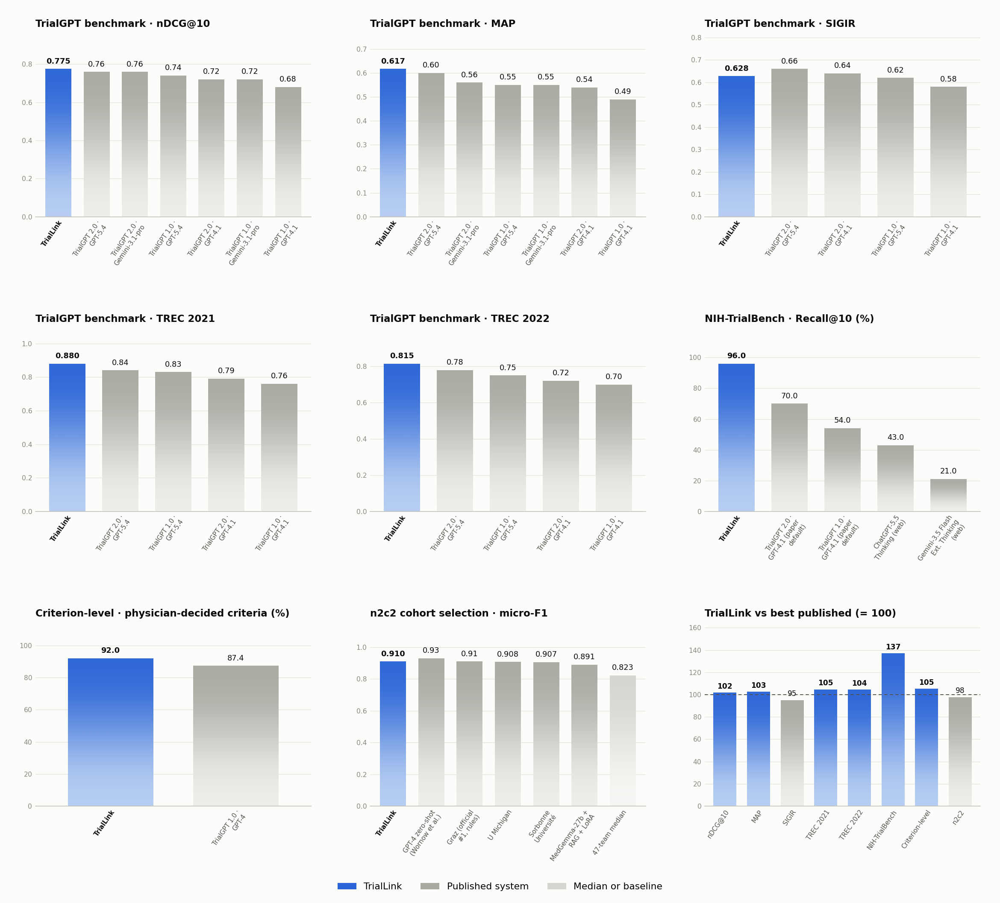
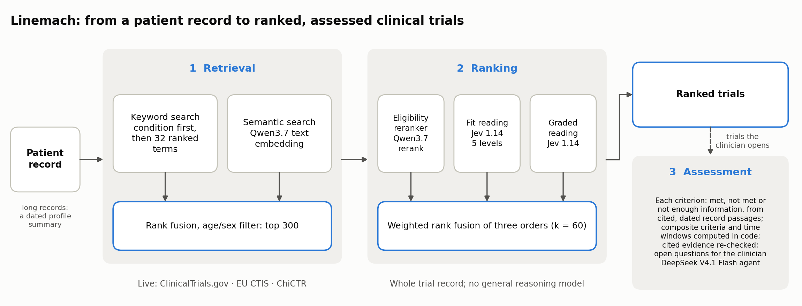

# TrialLink: benchmark results

**TrialLink `triallink-1` · November 2026**

TrialLink is a patient-to-trial matching system: one pipeline from a patient record to a ranked list of clinical trials, with a
criterion-by-criterion eligibility assessment of the trials a clinician opens. This report gives its results on the public benchmarks the
field reports on, one capability at a time, beside every published system with a comparable number.

## Where TrialLink stands

| Capability | Benchmark | TrialLink | Position among listed systems | Best published |
|---|---|---|---|---|
| Patient-to-trial ranking | TrialGPT benchmark: SIGIR + TREC 2021/2022, 183 patients | nDCG@10 **0.775**, MAP **0.617** | **1st of 7** on both | TrialGPT 2.0 · GPT-5.4: 0.76, 0.60 |
| — per cohort | TREC 2021 / TREC 2022 / SIGIR | 0.880 / 0.815 / 0.628 | **1st of 5** / **1st of 5** / 3rd of 5 | 0.84 / 0.78 / 0.66 |
| Target-trial retrieval | NIH-TrialBench, 126 vignettes | recall@10 **96.0%** | **1st of 5** | TrialGPT 2.0 · GPT-4.1: 70% |
| Criterion-level eligibility | TrialGPT annotations: the 722 criteria physicians decided | accuracy **92.0%** | **1st of 2** | TrialGPT 1.0 · GPT-4: 87.4% |
| Cohort selection | n2c2 cohort selection, official test | micro-F1 **0.910** | **2nd of 6** | GPT-4 zero-shot: 0.93 |

- TrialLink ranks first on the TrialGPT benchmark (nDCG@10 and MAP), on both TREC cohorts and on NIH-TrialBench. Its nDCG@10 interval
  on the TrialGPT benchmark (0.743–0.806) overlaps TrialGPT 2.0 with GPT-5.4 (0.76); published systems report point estimates only, so
  no paired test is possible. On the 105 patients held out from all development it scores nDCG@10 0.839.
- On the criteria the physicians decided, TrialLink is ahead of GPT-4 by 4.6 points (+0.3 to +9.1). Over all 1,015 criteria it agrees
  75.6% against GPT-4's 87.3%: on the 293 criteria labelled "not enough information", 255 labels are GPT-4's own answer, kept by
  annotators who labelled with GPT-4's predictions in view.
- On n2c2 cohort selection (official test, re-run after the fixes) TrialLink scores micro-F1 0.910, second after GPT-4
  zero-shot (0.93) and just above the challenge winner (0.9100). Two of 86 patients saved no decision because their evidence identifiers
  were miscopied; with short identifiers both now save, and counting them gives 0.918.
- No TrialLink component was trained or fine-tuned on any benchmark. Ranking costs about CNY 0.24 (USD 0.03) per patient for some 410
  candidate trials.

## 1. The system

TrialLink has three stages.

1. **Retrieval.** A keyword search over the patient's condition and up to 32 ranked English search terms written from the record,
   fused by reciprocal rank with a dense semantic search (Qwen3.7 text embedding, 1024 dimensions); trials are kept or dropped by the
   age and sex their registry record states; the first 300 go on. In the product the keyword search runs live against
   ClinicalTrials.gov, the EU CTIS and ChiCTR.
2. **Ranking.** Two complementary readings of each candidate's whole registry record: a relevance reranker (Qwen3.7 text rerank) and a
   five-level eligibility-fit scorer (Jev 1.14), whose orders are fused by reciprocal rank (k = 60). Ranking makes no call to a
   general reasoning model.
3. **Assessment.** For the trials a clinician selects, a DeepSeek V4.1 Flash agent judges each inclusion and exclusion criterion against
   cited passages of the record (met, not met, not enough information). The assessment explains the ranking; it does not reorder it.

## 2. Evaluation protocol

- **Same configuration for every system.** Each benchmark is run with its own task definition, the one its other systems were given:
  TrialGPT's criterion-level instructions for the TrialGPT annotations, and the n2c2 annotation guidelines (the notion of "now", and how
  an unmentioned criterion is labelled) for n2c2. TrialLink receives them as the study's assessment guide; the platform adds no labelling
  rule of its own.
- **Benchmarks and scorers.** The TrialGPT benchmark and NIH-TrialBench use TrialGPT 2.0's released data and official scripts
  (`eval_trialgpt_rankings_qrels.py`, `eval_nih_trialbench_target_recall_at10.py`); n2c2 uses the challenge's unchanged `track1_eval.py`.
- **Development and test data.** Ranking choices were made on 78 development patients (all 58 SIGIR patients and the first ten topics of
  each TREC year); the other 105 were read only after the design was fixed. NIH-TrialBench was used for testing only. The criterion-level
  assessment was developed on the TrialGPT annotations and on the n2c2 training split. The n2c2 official test was first run on
  2026-11-08 (micro-F1 0.894); the result above is a re-run after fixes to how long records are read and the move to the official
  guidelines, so the test set has been seen.
- **Uncertainty.** 95% intervals are percentile bootstraps over patients (10,000 resamples; 2,000 for n2c2).
- **Comparators.** Every comparator number is copied from the cited source, or computed from released predictions where stated. TrialGPT
  2.0 gives its results as bar charts; its values are read from the bar labels. TrialGPT 2.0 reports NIH-TrialBench only with its default
  backbone, GPT-4.1. The final panel of the figure divides TrialLink's score by the best published system in each panel.

## 3. Leaderboards by capability

Generated from [`leaderboard.json`](leaderboard.json). TrialLink and published systems are ranked (equal scores share a rank);
physicians and medians are listed beside them.

<!-- tables:start -->

#### TrialGPT benchmark · nDCG@10

SIGIR 2016 + TREC 2021/2022 · 183 patients · judged trials

| Rank | System | nDCG@10 | Source |
|---|---|---|---|
| 1 | **TrialLink** | **0.775 (0.743–0.806)** | this report |
| 2 | TrialGPT 2.0 · GPT-5.4 | 0.76 | TrialGPT 2.0, arXiv 2609.01202v2, Supp. Fig. 3c |
| 2 | TrialGPT 2.0 · Gemini-3.1-pro | 0.76 | TrialGPT 2.0, arXiv 2609.01202v2, Supp. Fig. 3 |
| 4 | TrialGPT 1.0 · GPT-5.4 | 0.74 | TrialGPT 2.0, arXiv 2609.01202v2, Supp. Fig. 3c |
| 5 | TrialGPT 2.0 · GPT-4.1 | 0.72 | TrialGPT 2.0, arXiv 2609.01202v2, Fig. 5d |
| 5 | TrialGPT 1.0 · Gemini-3.1-pro | 0.72 | TrialGPT 2.0, arXiv 2609.01202v2, Supp. Fig. 3 |
| 7 | TrialGPT 1.0 · GPT-4.1 | 0.68 | TrialGPT 2.0, arXiv 2609.01202v2, Fig. 5d |

#### TrialGPT benchmark · MAP

same 183 patients · graded MAP, official evaluator

| Rank | System | MAP | Source |
|---|---|---|---|
| 1 | **TrialLink** | **0.617 (0.588–0.645)** | this report |
| 2 | TrialGPT 2.0 · GPT-5.4 | 0.60 | TrialGPT 2.0, arXiv 2609.01202v2, Supp. Fig. 3c |
| 3 | TrialGPT 2.0 · Gemini-3.1-pro | 0.56 | TrialGPT 2.0, arXiv 2609.01202v2, Supp. Fig. 3 |
| 4 | TrialGPT 1.0 · GPT-5.4 | 0.55 | TrialGPT 2.0, arXiv 2609.01202v2, Supp. Fig. 3c |
| 4 | TrialGPT 1.0 · Gemini-3.1-pro | 0.55 | TrialGPT 2.0, arXiv 2609.01202v2, Supp. Fig. 3 |
| 6 | TrialGPT 2.0 · GPT-4.1 | 0.54 | TrialGPT 2.0, arXiv 2609.01202v2, Fig. 5d |
| 7 | TrialGPT 1.0 · GPT-4.1 | 0.49 | TrialGPT 2.0, arXiv 2609.01202v2, Fig. 5d |

#### TrialGPT benchmark · SIGIR

58 patients · judged trials · nDCG@10

| Rank | System | nDCG@10 | Source |
|---|---|---|---|
| 1 | TrialGPT 2.0 · GPT-5.4 | 0.66 | TrialGPT 2.0, arXiv 2609.01202v2, Supp. Fig. 3c |
| 2 | TrialGPT 2.0 · GPT-4.1 | 0.64 | TrialGPT 2.0, arXiv 2609.01202v2, Fig. 5d |
| 3 | **TrialLink** | **0.628 (0.567–0.686)** | this report |
| 4 | TrialGPT 1.0 · GPT-5.4 | 0.62 | TrialGPT 2.0, arXiv 2609.01202v2, Supp. Fig. 3c |
| 5 | TrialGPT 1.0 · GPT-4.1 | 0.58 | TrialGPT 2.0, arXiv 2609.01202v2, Fig. 5d |

#### TrialGPT benchmark · TREC 2021

75 patients · judged trials · nDCG@10

| Rank | System | nDCG@10 | Source |
|---|---|---|---|
| 1 | **TrialLink** | **0.880 (0.844–0.912)** | this report |
| 2 | TrialGPT 2.0 · GPT-5.4 | 0.84 | TrialGPT 2.0, arXiv 2609.01202v2, Supp. Fig. 3c |
| 3 | TrialGPT 1.0 · GPT-5.4 | 0.83 | TrialGPT 2.0, arXiv 2609.01202v2, Supp. Fig. 3c |
| 4 | TrialGPT 2.0 · GPT-4.1 | 0.79 | TrialGPT 2.0, arXiv 2609.01202v2, Fig. 5d |
| 5 | TrialGPT 1.0 · GPT-4.1 | 0.76 | TrialGPT 2.0, arXiv 2609.01202v2, Fig. 5d |

#### TrialGPT benchmark · TREC 2022

50 patients · judged trials · nDCG@10

| Rank | System | nDCG@10 | Source |
|---|---|---|---|
| 1 | **TrialLink** | **0.815 (0.747–0.877)** | this report |
| 2 | TrialGPT 2.0 · GPT-5.4 | 0.78 | TrialGPT 2.0, arXiv 2609.01202v2, Supp. Fig. 3c |
| 3 | TrialGPT 1.0 · GPT-5.4 | 0.75 | TrialGPT 2.0, arXiv 2609.01202v2, Supp. Fig. 3c |
| 4 | TrialGPT 2.0 · GPT-4.1 | 0.72 | TrialGPT 2.0, arXiv 2609.01202v2, Fig. 5d |
| 5 | TrialGPT 1.0 · GPT-4.1 | 0.70 | TrialGPT 2.0, arXiv 2609.01202v2, Fig. 5d |

#### NIH-TrialBench · Recall@10 (%)

126 vignettes · target trial in top 10 · % (institute macro)

| Rank | System | Recall@10 (%) | Source |
|---|---|---|---|
| 1 | **TrialLink** | **96.0** | this report |
| 2 | TrialGPT 2.0 · GPT-4.1 (paper default) | 70.0 | TrialGPT 2.0, arXiv 2609.01202v2, Fig. 5c |
| 3 | TrialGPT 1.0 · GPT-4.1 (paper default) | 54.0 | TrialGPT 2.0, arXiv 2609.01202v2, Fig. 5c |
| 4 | ChatGPT-5.5 Thinking (web) | 43.0 | TrialGPT 2.0, arXiv 2609.01202v2, Fig. 5c |
| 5 | Gemini-3.5 Flash Ext. Thinking (web) | 21.0 | TrialGPT 2.0, arXiv 2609.01202v2, Fig. 5c |

TrialGPT 2.0 reports NIH-TrialBench only with its default backbone, GPT-4.1 ("Unless otherwise specified, all main analyses used GPT-4.1"); its GPT-5.4 and Gemini runs cover the three public cohorts only. TrialLink over all 126 cases: 89.7% (84.1–94.4).

#### Criterion-level · physician-decided criteria (%)

TrialGPT annotations · the 722 of 1,015 criteria the physicians decided (included, not included, excluded, not excluded, not applicable) · accuracy % · every system given TrialGPT's own task definition

| Rank | System | Accuracy (%) | Source |
|---|---|---|---|
| 1 | **TrialLink** | **92.0 (89.1–94.4)** | this report |
| 2 | TrialGPT 1.0 · GPT-4 | 87.4 | TrialGPT released predictions (Jin et al., Nat Commun 2024), scored on the same rows |

Paired difference TrialLink − GPT-4: +4.6 points (+0.3 to +9.1, patient bootstrap). GPT-4 is scored from TrialGPT's released predictions on the same rows.

#### Criterion-level · all criteria (%)

TrialGPT annotations · 1,015 criteria · 53 patients · label agreement %

| Rank | System | Accuracy (%) | Source |
|---|---|---|---|
| – | Physician (highest) (physician) | 90.0 | Jin et al., Nat Commun 2024 |
| – | Physician (lowest) (physician) | 88.7 | Jin et al., Nat Commun 2024 |
| 1 | TrialGPT 1.0 · GPT-4 | 87.3 | Jin et al., Nat Commun 2024 |
| 2 | **TrialLink** | **75.6 (71.0–79.7)** | this report |

On the 293 criteria the gold labels "not enough information", 255 labels are GPT-4's own answer kept by the annotators, who labelled with GPT-4's predictions in view; GPT-4 matches 87.0% of those rows, TrialLink 35.2%. TrialLink was given TrialGPT's own task definition (which asks for as few "not enough information" answers as possible).

#### n2c2 cohort selection · micro-F1

official test · 86 patients × 13 criteria · micro-F1

| Rank | System | Micro-F1 | Source |
|---|---|---|---|
| 1 | GPT-4 zero-shot (Wornow et al.) | 0.93 | Wornow et al., arXiv 2402.05125, Table 1 |
| 2 | **TrialLink** | **0.910 (0.894–0.926)** | this report |
| 3 | Graz (official #1, rules) | 0.91 | Stubbs et al., JAMIA 2019, Table 2 |
| 4 | U Michigan | 0.908 | Stubbs et al., JAMIA 2019, Table 2 |
| 5 | Sorbonne Université | 0.907 | Stubbs et al., JAMIA 2019, Table 2 |
| 6 | MedGemma-27b + RAG + LoRA | 0.891 | Chen et al., arXiv 2604.05190, Table 3 |
| – | 47-team median (reference) | 0.823 | Stubbs et al., JAMIA 2019 |

Official evaluator (track1_eval.py), every system given the n2c2 annotation guidelines. An answer neither met nor not met is read as the guidelines label an unmentioned criterion: not met, except ENGLISH and MAKES-DECISIONS (met).

<!-- tables:end -->

## 4. Cost and speed

Measured on the ranking board (some 410 candidates per patient): Qwen3.7 rerank CNY 0.08 per patient, 2.6 s per 100 trials; Jev 1.14
scoring CNY 0.16 per patient, 0.25 s per trial with eight in flight. A product search ranks 300 candidates. The criterion-by-criterion
assessment of 20 trials for one patient takes a median of 79 s (90th percentile 117 s; five patients, measured end to
end on the production agent runtime), with the trials' criteria split across up to 12 concurrent Flash agents.

## 5. Reproduce

Evaluation code: `OpenScience/evals/vcr-matching-boards/` (runners, official scorers, and `native_replay.mjs` for the assessment stage on
the real agent kernel; `--guide-file` passes a benchmark's task definition). Benchmark data: the TrialGPT 2.0 repository (commit
`1c5f9eb`), the TrialGPT 1.0 repository (criterion annotations and instructions) and the n2c2 cohort selection data and guidelines.
Every number on this page is in [`leaderboard.json`](leaderboard.json); `make_figures.py` draws the figures and writes the tables.

## References

- TrialGPT 2.0. *Towards Responsible AI-Assisted Clinical Trial Matching: Practical Considerations, Multicenter Evaluation, and
  Real-World Deployment.* arXiv 2609.01202v2 (2026), Fig. 5c–d and Supplementary Fig. 3.
- Jin Q. et al. *Matching patients to clinical trials with large language models* (TrialGPT). Nature Communications 15, 9074 (2024).
- Stubbs A. et al. *Cohort selection for clinical trials: n2c2 2018 shared task track 1.* JAMIA 26(11), 2019, Table 2.
- Wornow M. et al. *Zero-shot clinical trial patient matching with LLMs.* arXiv 2402.05125, Table 1.
- Chen et al. arXiv 2604.05190, Table 3 (MedGemma-27b with retrieval and LoRA on n2c2 cohort selection).
