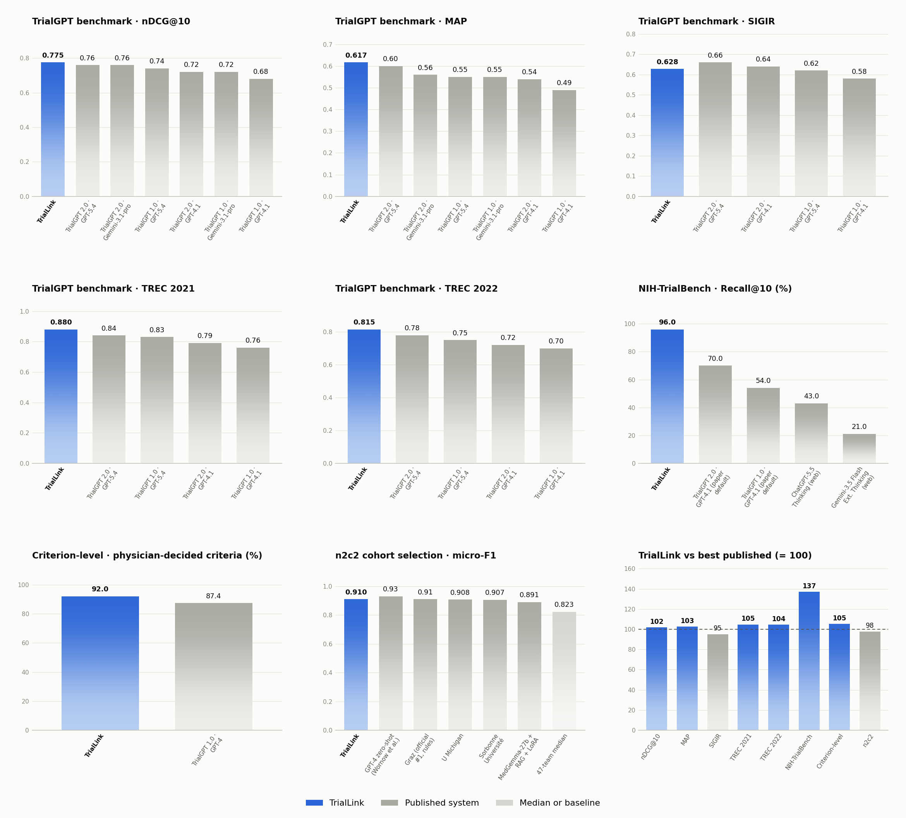
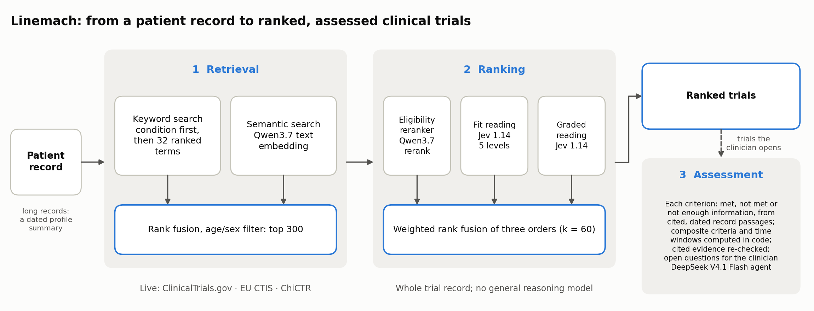

# Linemach 基准测试结果

**Linemach `triallink-3` · 2026 年 11 月**

Linemach 是一个患者–临床试验匹配系统：从一份病历出发，检索并排出合适的临床试验，再对医生打开的试验逐条判断入排标准。
本文按能力逐项给出它在领域通用公开基准上的成绩，并列出每个基准上有可比数字的全部已发表系统。

## Linemach 的位置

| 能力 | 基准 | Linemach | 在所列系统中的位置 | 所列最强对比系统 |
|---|---|---|---|---|
| 患者–试验排序 | SIGIR + TREC 2021/2022，183 位患者，全部已评判试验（TrialGPT 2.0 协议） | nDCG@10 **0.792**，P@10 **0.724**，MRR 0.849，MAP **0.637** | nDCG@10、P@10、MAP **第 1（共 7）**；MRR 与第一持平 | TrialGPT 2.0 · GPT-5.4：0.76、0.70、0.85、0.60 |
| — 检索候选上 | 同一批患者，TrialGPT 检索前 500 中已评判的试验（TrialGPT 1.0 协议） | nDCG@10 **0.796**，P@10 **0.720** | 两项均 **第 1（共 8）** | TrialGPT 1.0 · GPT-4：0.728、0.669 |
| — 分队列 | TREC 2021 / TREC 2022 / SIGIR | 0.890 / 0.824 / 0.663 | 三个队列均 **第 1（共 5）** | 0.84 / 0.78 / 0.66 |
| 目标试验检索 | NIH-TrialBench，126 个病例 | 前 10 召回 **95.9%** | **第 1（共 5）** | TrialGPT 2.0：70% |
| 逐条入排标准判断 | TrialGPT 标注集中医生给出明确结论的 722 条 | 一致率 **92.2%** | 系统中 **第 1（共 2）**；三位医生 89.0–93.1% | TrialGPT 1.0 · GPT-4：87.4% |
| 队列筛选 | n2c2 队列筛选官方测试集 | micro-F1 **0.919** | **第 1（共 14）** | 混合 NLP 系统（赛后）：0.911；挑战赛冠军（规则系统）0.910 |

- 在 TrialGPT 2.0 协议上，Linemach 在 nDCG@10、P@10、MAP 上排第一；MRR 为 0.849，对方为 0.85（读自柱状图标注），按两位小数持平。
  nDCG@10 置信区间（0.762–0.822）与 TrialGPT 2.0（GPT-5.4）的 0.76 有重叠；已发表系统只给点估计，无法做配对检验。在开发全程未使用的
  105 位患者上 nDCG@10 为 0.848；SIGIR 队列上为 0.663，对方为 0.66。
- 在 TrialGPT 1.0 协议上（只排其检索返回的候选），Linemach 领先该论文比较的全部 7 个系统——5 个生物医学编码器模型，以及使用
  GPT-3.5 和 GPT-4 的 TrialGPT——nDCG@10 至少高 0.06。
- 在医生给出明确结论的标准上，Linemach 比 GPT-4 高 4.8 个百分点（+0.3 至 +9.9），并落在制作这批标签的三位医生之间（89.0%、90.7%、
  93.1%，各自对照共识标签计）。按全部 1,015 条计，一致率 77.8%，GPT-4 为 87.3%：金标准标为"信息不足"的 293 条中，有 255 条就是
  GPT-4 自己的回答，被看着 GPT-4 预测做标注的标注员保留了下来。
- n2c2 队列筛选（官方测试集，最终代码一次跑完）：micro-F1 0.919，高于挑战赛全部参赛系统（冠军 0.910）、我们找到的最好赛后系统（0.911）
  和微调过的开源模型（带检索的 MedGemma-27b，0.891）。
- Linemach 的任何组件都没有在任何基准数据上训练或微调。排序成本约每位患者 0.38 元人民币（约 0.05 美元），每位患者约 410 个候选试验；
  逐条评估每位 n2c2 患者约 0.12 元。

## 1. 系统组成

Linemach 分三个阶段。

1. **检索**：用病情（检索最深，至多 200 个试验）和从病历中写出的至多 32 个按重要性排序的英文检索词（中文病历另加中文检索词）做关键词
   检索，与稠密语义检索（Qwen3.7 文本向量，1024 维）按倒数排名融合；按登记记录写明的年龄、性别筛选；保留前 300 个。长病历先由一次
   Flash 调用写成带日期的患者摘要（按病历缓存），用摘要代表患者。产品中关键词检索实时查询 ClinicalTrials.gov、欧盟 CTIS 和 ChiCTR。
2. **排序**：基于每个候选试验的完整登记记录得到三个排序——入组可能性重排（Qwen3.7 文本重排，读登记记录前 12,000 字符，半权重），
   以及 Jev 1.14 在同一次请求中给出的两种判读：五档资格匹配和五档分级判读（取其期望得分）——按加权倒数排名融合（k = 60）。排序环节
   不调用通用推理大模型。
3. **逐条评估**：对医生选中的试验，由 DeepSeek V4.1 Flash 智能体对照病历中引用的原文，逐条判断每项入选和排除标准（符合、不符合、
   信息不足）。它完整读最新的几份病历，并读按每条标准从较早病历中检索出的段落，每段都带病历日期和章节；还可以检索整份病历。组合
   条件的标准逐项回答、时间窗标准按日期回答，计数和日期计算由代码完成。仍无法判定的标准所缺的事实会汇总列给医生。评估用来解释排序，不改变排序。

## 2. 评测协议

- **所有系统同一配置**：每个基准都按它自己的任务定义运行，也就是其他系统拿到的那一份——TrialGPT 标注集用 TrialGPT 的逐条判断
  说明，n2c2 用官方标注指南（"现在"的定义、病历未提及的标准如何标注）。Linemach 把它们作为研究的评估指南读入，平台本身不加任何
  标注规则。
- **基准与评分脚本**：患者–试验排序各榜和 NIH-TrialBench 使用 TrialGPT 2.0 公开的数据和官方脚本（`eval_trialgpt_rankings_qrels.py`、
  `eval_nih_trialbench_target_recall_at10.py`）；n2c2 使用挑战赛原样的 `track1_eval.py`。
- **开发集与测试集**：排序设计只在 78 位开发患者上做出（全部 58 位 SIGIR 患者和每年 TREC 的前 10 个题目），其余 105 位患者在设计
  定稿后才读取；NIH-TrialBench 只用于测试。逐条评估环节在 TrialGPT 标注集和 n2c2 训练集上开发。逐条评估的设计取舍（包括去掉一道没有
  带来改进的核验步骤）在 Board C 和 n2c2 训练集的 40 位开发患者上做出。n2c2 官方测试集于 2026-11-08 首次运行（micro-F1 0.894），之后几轮
  又读过；上表结果是最终代码一次跑完的结果，因此是测试集已被看过之后的重跑。排序权重在开发患者（含 SIGIR）上选定。
- **不确定性**：95% 置信区间为按患者的百分位自助法（10,000 次；n2c2 为 2,000 次）。
- **对比系统**：所有对比数字均摘自所列来源，或注明由公开预测计算。TrialGPT 2.0 以柱状图给出结果，数值读自柱状图标注；它只用
  默认底座 GPT-4.1 报告了 NIH-TrialBench。图中最后一个子图是各子榜 Linemach 成绩除以该子榜已发表最好系统。
- **两种排序协议分开比较**：TrialGPT 2.0 对患者的全部已评判试验排序；TrialGPT 1.0 只排其检索前 500 中已评判的试验，并公开了这批
  候选。两者分成不同子图，都用同一官方评分脚本（其 nDCG@10 与分级 P@10 与 TrialGPT 1.0 给出的定义一致）；第二种协议下，Linemach
  对全部已评判试验的排序限定到 TrialGPT 1.0 的候选上。TrialMatchAI（Nat Commun 2026）在一个 TREC 年度的全部已评判试验中排序且只把
  "符合"计为相关，LLM-Match（2025）在这些配对上只报告 AUROC，都不在这两种口径上，因此不列入。
- **医生**：TrialGPT 1.0 公布了每位医生对照共识标签的混淆矩阵（按金标准标签的比例）。乘以公开的金标准条目数，即得每位医生在医生给出
  明确结论的标准上的一致率；同样的还原对 GPT-4 得到 87.7%（精确值 87.4%），对全部条目与论文给出的范围相差不超过 0.1 个百分点，
  因此医生数值约有 ±0.5 个百分点的误差。

## 3. 分能力榜单

由 [`leaderboard.json`](leaderboard.json) 生成。Linemach 与已发表系统参与排名（同分并列）；医生和中位数列在旁边，不参与排名。

<!-- tables:start -->

#### 患者–试验排序 · nDCG@10

SIGIR 2016 + TREC 2021/2022，183 位患者，对全部已评判试验排序（TrialGPT 2.0 协议与官方评分脚本）

| 排名 | 系统 | nDCG@10 | 来源 |
|---|---|---|---|
| 1 | **Linemach** | **0.792 (0.762–0.822)** | 本报告 |
| 2 | TrialGPT 2.0 · GPT-5.4 | 0.76 | TrialGPT 2.0, arXiv 2609.01202v2, Supp. Fig. 3c |
| 2 | TrialGPT 2.0 · Gemini-3.1-pro | 0.76 | TrialGPT 2.0, arXiv 2609.01202v2, Supp. Fig. 3 |
| 4 | TrialGPT 1.0 · GPT-5.4 | 0.74 | TrialGPT 2.0, arXiv 2609.01202v2, Supp. Fig. 3c |
| 5 | TrialGPT 2.0 · GPT-4.1 | 0.72 | TrialGPT 2.0, arXiv 2609.01202v2, Fig. 5d |
| 5 | TrialGPT 1.0 · Gemini-3.1-pro | 0.72 | TrialGPT 2.0, arXiv 2609.01202v2, Supp. Fig. 3 |
| 7 | TrialGPT 1.0 · GPT-4.1 | 0.68 | TrialGPT 2.0, arXiv 2609.01202v2, Fig. 5d |

#### 患者–试验排序 · P@10

同一批 183 位患者，分级 P@10（被排除或可能符合的试验计半分），官方评分脚本

| 排名 | 系统 | P@10 (graded) | 来源 |
|---|---|---|---|
| 1 | **Linemach** | **0.724 (0.692–0.756)** | 本报告 |
| 2 | TrialGPT 2.0 · GPT-5.4 | 0.70 | TrialGPT 2.0, arXiv 2609.01202v2, Supp. Fig. 3c |
| 3 | TrialGPT 2.0 · Gemini-3.1-pro | 0.69 | TrialGPT 2.0, arXiv 2609.01202v2, Supp. Fig. 3 |
| 4 | TrialGPT 1.0 · GPT-5.4 | 0.67 | TrialGPT 2.0, arXiv 2609.01202v2, Supp. Fig. 3c |
| 4 | TrialGPT 1.0 · Gemini-3.1-pro | 0.67 | TrialGPT 2.0, arXiv 2609.01202v2, Supp. Fig. 3 |
| 6 | TrialGPT 2.0 · GPT-4.1 | 0.66 | TrialGPT 2.0, arXiv 2609.01202v2, Fig. 5d |
| 7 | TrialGPT 1.0 · GPT-4.1 | 0.63 | TrialGPT 2.0, arXiv 2609.01202v2, Fig. 5d |

#### 患者–试验排序 · MRR

同一批 183 位患者，第一个符合试验的倒数排名，官方评分脚本

| 排名 | 系统 | MRR | 来源 |
|---|---|---|---|
| 1 | TrialGPT 2.0 · GPT-5.4 | 0.85 | TrialGPT 2.0, arXiv 2609.01202v2, Supp. Fig. 3c |
| 2 | **Linemach** | **0.849 (0.806–0.889)** | 本报告 |
| 3 | TrialGPT 2.0 · Gemini-3.1-pro | 0.84 | TrialGPT 2.0, arXiv 2609.01202v2, Supp. Fig. 3 |
| 3 | TrialGPT 1.0 · GPT-5.4 | 0.84 | TrialGPT 2.0, arXiv 2609.01202v2, Supp. Fig. 3c |
| 5 | TrialGPT 2.0 · GPT-4.1 | 0.80 | TrialGPT 2.0, arXiv 2609.01202v2, Fig. 5d |
| 6 | TrialGPT 1.0 · Gemini-3.1-pro | 0.78 | TrialGPT 2.0, arXiv 2609.01202v2, Supp. Fig. 3 |
| 7 | TrialGPT 1.0 · GPT-4.1 | 0.73 | TrialGPT 2.0, arXiv 2609.01202v2, Fig. 5d |

#### 患者–试验排序 · MAP

同一批 183 位患者，分级 MAP（官方评分脚本）

| 排名 | 系统 | MAP | 来源 |
|---|---|---|---|
| 1 | **Linemach** | **0.637 (0.608–0.666)** | 本报告 |
| 2 | TrialGPT 2.0 · GPT-5.4 | 0.60 | TrialGPT 2.0, arXiv 2609.01202v2, Supp. Fig. 3c |
| 3 | TrialGPT 2.0 · Gemini-3.1-pro | 0.56 | TrialGPT 2.0, arXiv 2609.01202v2, Supp. Fig. 3 |
| 4 | TrialGPT 1.0 · GPT-5.4 | 0.55 | TrialGPT 2.0, arXiv 2609.01202v2, Supp. Fig. 3c |
| 4 | TrialGPT 1.0 · Gemini-3.1-pro | 0.55 | TrialGPT 2.0, arXiv 2609.01202v2, Supp. Fig. 3 |
| 6 | TrialGPT 2.0 · GPT-4.1 | 0.54 | TrialGPT 2.0, arXiv 2609.01202v2, Fig. 5d |
| 7 | TrialGPT 1.0 · GPT-4.1 | 0.49 | TrialGPT 2.0, arXiv 2609.01202v2, Fig. 5d |

#### 患者–试验排序 · 检索前 500 · nDCG@10

SIGIR 2016 + TREC 2021/2022，183 位患者，只排 TrialGPT 检索前 500 中已评判的试验（TrialGPT 1.0 协议），三个队列取平均

| 排名 | 系统 | nDCG@10 | 来源 |
|---|---|---|---|
| 1 | **Linemach** | **0.796 (0.765–0.824)** | 本报告 |
| 2 | TrialGPT 1.0 · GPT-4 | 0.728 | Jin et al., Nat Commun 2024, Table 2 |
| 3 | TrialGPT 1.0 · GPT-3.5 | 0.54 | Jin et al., Nat Commun 2024, Table 2 |
| 4 | BioLinkBERT (NLI-trained) | 0.48 | Jin et al., Nat Commun 2024, Table 2 |
| 5 | PubMedBERT (NLI-trained) | 0.433 | Jin et al., Nat Commun 2024, Table 2 |
| 6 | SciFive (NLI-trained) | 0.427 | Jin et al., Nat Commun 2024, Table 2 |
| 7 | SapBERT (NLI-trained) | 0.415 | Jin et al., Nat Commun 2024, Table 2 |
| 8 | BioBERT (NLI-trained) | 0.409 | Jin et al., Nat Commun 2024, Table 2 |

与上方各面板使用同一官方评分脚本，只保留 TrialGPT 1.0 公开的候选（其 retrieved_trials.json：3,141 / 15,437 / 12,682 个已评判配对）；Linemach 对全部已评判试验的排序限定到这些候选上。脚本的 nDCG@10（线性增益）与 P@10（等级之和 / (2 × 10)）与 TrialGPT 1.0 给出的定义一致。五个编码器模型在自然语言推理数据上训练，未在这些队列上训练，与原文一致。TrialGPT 1.0 · GPT-4 取其特征组合，即论文的主配置（其最佳单一特征为 nDCG@10 0.7281、P@10 0.6724）。未放进这两张图：TrialMatchAI（Nat Commun 2026）在一个 TREC 年度的全部已评判试验中排序且只把"符合"计为相关，LLM-Match（2025）在这些配对上只报告 AUROC，度量不同。

#### 患者–试验排序 · 检索前 500 · P@10

SIGIR 2016 + TREC 2021/2022，183 位患者，只排 TrialGPT 检索前 500 中已评判的试验（TrialGPT 1.0 协议），三个队列取平均

| 排名 | 系统 | P@10 (graded) | 来源 |
|---|---|---|---|
| 1 | **Linemach** | **0.720 (0.688–0.752)** | 本报告 |
| 2 | TrialGPT 1.0 · GPT-4 | 0.669 | Jin et al., Nat Commun 2024, Table 2 |
| 3 | TrialGPT 1.0 · GPT-3.5 | 0.512 | Jin et al., Nat Commun 2024, Table 2 |
| 4 | BioLinkBERT (NLI-trained) | 0.428 | Jin et al., Nat Commun 2024, Table 2 |
| 5 | PubMedBERT (NLI-trained) | 0.387 | Jin et al., Nat Commun 2024, Table 2 |
| 6 | SciFive (NLI-trained) | 0.379 | Jin et al., Nat Commun 2024, Table 2 |
| 7 | BioBERT (NLI-trained) | 0.375 | Jin et al., Nat Commun 2024, Table 2 |
| 8 | SapBERT (NLI-trained) | 0.374 | Jin et al., Nat Commun 2024, Table 2 |

与上方各面板使用同一官方评分脚本，只保留 TrialGPT 1.0 公开的候选（其 retrieved_trials.json：3,141 / 15,437 / 12,682 个已评判配对）；Linemach 对全部已评判试验的排序限定到这些候选上。脚本的 nDCG@10（线性增益）与 P@10（等级之和 / (2 × 10)）与 TrialGPT 1.0 给出的定义一致。五个编码器模型在自然语言推理数据上训练，未在这些队列上训练，与原文一致。TrialGPT 1.0 · GPT-4 取其特征组合，即论文的主配置（其最佳单一特征为 nDCG@10 0.7281、P@10 0.6724）。未放进这两张图：TrialMatchAI（Nat Commun 2026）在一个 TREC 年度的全部已评判试验中排序且只把"符合"计为相关，LLM-Match（2025）在这些配对上只报告 AUROC，度量不同。

#### SIGIR 队列 · nDCG@10

58 位患者，对全部已评判试验排序，nDCG@10

| 排名 | 系统 | nDCG@10 | 来源 |
|---|---|---|---|
| 1 | **Linemach** | **0.663 (0.604–0.720)** | 本报告 |
| 2 | TrialGPT 2.0 · GPT-5.4 | 0.66 | TrialGPT 2.0, arXiv 2609.01202v2, Supp. Fig. 3c |
| 3 | TrialGPT 2.0 · GPT-4.1 | 0.64 | TrialGPT 2.0, arXiv 2609.01202v2, Fig. 5d |
| 4 | TrialGPT 1.0 · GPT-5.4 | 0.62 | TrialGPT 2.0, arXiv 2609.01202v2, Supp. Fig. 3c |
| 5 | TrialGPT 1.0 · GPT-4.1 | 0.58 | TrialGPT 2.0, arXiv 2609.01202v2, Fig. 5d |

#### TREC 2021 队列 · nDCG@10

75 位患者，对全部已评判试验排序，nDCG@10

| 排名 | 系统 | nDCG@10 | 来源 |
|---|---|---|---|
| 1 | **Linemach** | **0.890 (0.853–0.923)** | 本报告 |
| 2 | TrialGPT 2.0 · GPT-5.4 | 0.84 | TrialGPT 2.0, arXiv 2609.01202v2, Supp. Fig. 3c |
| 3 | TrialGPT 1.0 · GPT-5.4 | 0.83 | TrialGPT 2.0, arXiv 2609.01202v2, Supp. Fig. 3c |
| 4 | TrialGPT 2.0 · GPT-4.1 | 0.79 | TrialGPT 2.0, arXiv 2609.01202v2, Fig. 5d |
| 5 | TrialGPT 1.0 · GPT-4.1 | 0.76 | TrialGPT 2.0, arXiv 2609.01202v2, Fig. 5d |

#### TREC 2022 队列 · nDCG@10

50 位患者，对全部已评判试验排序，nDCG@10

| 排名 | 系统 | nDCG@10 | 来源 |
|---|---|---|---|
| 1 | **Linemach** | **0.824 (0.761–0.880)** | 本报告 |
| 2 | TrialGPT 2.0 · GPT-5.4 | 0.78 | TrialGPT 2.0, arXiv 2609.01202v2, Supp. Fig. 3c |
| 3 | TrialGPT 1.0 · GPT-5.4 | 0.75 | TrialGPT 2.0, arXiv 2609.01202v2, Supp. Fig. 3c |
| 4 | TrialGPT 2.0 · GPT-4.1 | 0.72 | TrialGPT 2.0, arXiv 2609.01202v2, Fig. 5d |
| 5 | TrialGPT 1.0 · GPT-4.1 | 0.70 | TrialGPT 2.0, arXiv 2609.01202v2, Fig. 5d |

#### NIH-TrialBench · 前 10 召回（%）

126 个病例，病例对应的试验进入前 10 的比例，按 11 个研究所宏平均（与 TrialGPT 2.0 口径一致）

| 排名 | 系统 | Recall@10 (%) | 来源 |
|---|---|---|---|
| 1 | **Linemach** | **95.9** | 本报告 |
| 2 | TrialGPT 2.0 | 70.0 | TrialGPT 2.0, arXiv 2609.01202v2, Fig. 5c |
| 3 | TrialGPT 1.0 | 54.0 | TrialGPT 2.0, arXiv 2609.01202v2, Fig. 5c |
| 4 | GPT-5.5 | 43.0 | TrialGPT 2.0, arXiv 2609.01202v2, Fig. 5c |
| 5 | Gemini 3.5 Flash | 21.0 | TrialGPT 2.0, arXiv 2609.01202v2, Fig. 5c |

TrialGPT 2.0 论文只用默认底座 GPT-4.1 报告了 NIH-TrialBench（原文："Unless otherwise specified, all main analyses used GPT-4.1"）；GPT-5.4 和 Gemini 只跑了三个公开队列。Linemach 按全部 126 例计算为 88.1%（81.7–93.7）。候选：在 1,373 个试验的 NIH 试验库上先做一次相关性重排，取前 300 个代替检索；Linemach 再按产品中的方式排序。

#### n2c2 队列筛选 · micro-F1

官方测试集，86 位患者 × 13 条标准，micro-F1

| 排名 | 系统 | Micro-F1 | 来源 |
|---|---|---|---|
| 1 | **Linemach** | **0.919 (0.905–0.934)** | 本报告 |
| 2 | Hybrid NLP, post-challenge | 0.911 | Vydiswaran et al., JAMIA 2019 (reimplemented system) |
| 3 | Rule-based (challenge #1) | 0.91 | Stubbs et al., JAMIA 2019, Table 2 |
| 4 | Hybrid NLP (MetaMap + cTAKES) | 0.908 | Stubbs et al., JAMIA 2019, Table 2 |
| 5 | Rules + semi-supervised | 0.907 | Stubbs et al., JAMIA 2019, Table 2 |
| 6 | Three-stage rule-based | 0.903 | Stubbs et al., JAMIA 2019, Table 2 |
| 7 | cTAKES + regex hybrid | 0.903 | Stubbs et al., JAMIA 2019, Table 2 |
| 8 | Rules + word2vec | 0.90 | Stubbs et al., JAMIA 2019, Table 2 |
| 9 | 280-rule system | 0.891 | Stubbs et al., JAMIA 2019, Table 2 |
| 10 | MedGemma-27b + RAG + LoRA | 0.891 | Chen et al., arXiv 2604.05190, Table 3 |
| 11 | Rules + CNN-highway-LSTM | 0.886 | Stubbs et al., JAMIA 2019, Table 2 |
| 12 | Trie rule processor | 0.884 | Stubbs et al., JAMIA 2019, Table 2 |
| 13 | Rules + SVM | 0.877 | Stubbs et al., JAMIA 2019, Table 2 |
| 14 | Llama-3.1-8b + LoRA | 0.867 | Chen et al., arXiv 2604.05190, Table 3 (full context) |
| – | 47-team median (参考线) | 0.823 | Stubbs et al., JAMIA 2019 |

官方评分脚本（track1_eval.py），Linemach 使用 n2c2 官方标注指南。既非"符合"也非"不符合"的回答，按指南对未提及标准的标注方式计：不符合，ENGLISH 和 MAKES-DECISIONS 两条计为符合。最终代码对全部 86 位患者一次跑完（测试集在之前几轮已读过，因此这是重跑结果，不是留出集结果）；macro-F1 0.825。挑战赛各系统和 LoRA 模型都在 n2c2 训练集上构建，Linemach 没有任何部件在其上训练。挑战赛系统按方法命名（Stubbs 等，表 2）；图中列出前七名，表格列出全部前十。

#### 逐条判断 · 医生给出明确结论的标准（%）

TrialGPT 标注集中医生给出明确结论的 722 条（共 1,015 条），一致率（%）；Linemach 使用 TrialGPT 自己的任务定义

| 排名 | 系统 | Accuracy (%) | 来源 |
|---|---|---|---|
| – | Physician A | 93.1 | Jin et al., Nat Commun 2024, Fig. 3c–d (the physician's per-label matrix weighted by the released gold counts, ±0.5 point) |
| 1 | **Linemach** | **92.2 (89.4–94.6)** | 本报告 |
| – | Physician C | 90.7 | Jin et al., Nat Commun 2024, Fig. 3c–d (the physician's per-label matrix weighted by the released gold counts, ±0.5 point) |
| – | Physician B | 89.0 | Jin et al., Nat Commun 2024, Fig. 3c–d (the physician's per-label matrix weighted by the released gold counts, ±0.5 point) |
| 2 | TrialGPT 1.0 · GPT-4 | 87.4 | TrialGPT released predictions (Jin et al., Nat Commun 2024), scored on the same rows |

配对差值 Linemach − GPT-4：+4.8 个百分点（+0.3 至 +9.9，按患者自助法）。GPT-4 的成绩由 TrialGPT 公开的预测在同一批条目上计算。每位医生在这批条目上的一致率，由 TrialGPT 1.0 论文中该医生的混淆矩阵（按金标准标签的比例，两位小数）乘以公开的金标准条目数还原；同样的还原对 GPT-4 得到 87.7%（精确值 87.4%），对全部条目得到 88.6–90.1%（论文为 88.7–90.0%）。

#### 逐条判断 · 全部标准（%）

TrialGPT 标注集，1,015 条标准，53 位患者，标签一致率（%）

| 排名 | 系统 | Accuracy (%) | 来源 |
|---|---|---|---|
| – | Physician (highest) | 90.0 | Jin et al., Nat Commun 2024 |
| – | Physician (lowest) | 88.7 | Jin et al., Nat Commun 2024 |
| 1 | TrialGPT 1.0 · GPT-4 | 87.3 | Jin et al., Nat Commun 2024 |
| 2 | **Linemach** | **77.8 (73.5–81.7)** | 本报告 |

金标准标为"信息不足"的 293 条中，有 255 条就是 GPT-4 自己的回答被标注员保留下来（标注员是看着 GPT-4 的预测做标注的）；在这些条目上 GPT-4 吻合 87.0%，Linemach 42.3%。Linemach 使用的是 TrialGPT 自己的任务定义（要求尽量少答"信息不足"）。

<!-- tables:end -->

## 4. 成本与速度

在排序基准上实测（每位患者约 410 个候选）：Qwen3.7 读完整登记记录做重排，每位患者约 0.17 元，每次请求每 100 个试验 9.0 秒，三个请求并行；
Jev 1.14（同一次请求给出匹配和分级两种判读）每位患者约 0.21 元，每次调用 265 毫秒（只问匹配时 262 毫秒），8 路并发。产品中一次检索排序 300 个
候选。逐条评估一位 n2c2 患者（13 条标准、多份病历）约读 19,500 个输入 token、约 0.12 元（86 位测试患者共 10.2 元）；改成纯文本提示后，输入
从约 86,000 个 token 降下来。对一位患者的 20 个试验逐条评估，中位耗时 120 秒（5 位 SIGIR 患者，固定版本内核，最慢 158 秒，12 个执行并行）；本轮之前为
79 秒——现在子智能体在把关键标准判为信息不足之前会先检索整份病历，每个执行约 3.7 次模型调用，之前约 2 次。

## 5. 复现

评测代码：`OpenScience/evals/vcr-matching-boards/`（运行器、官方评分脚本，以及在真实智能体内核上运行评估环节的 `native_replay.mjs`；
`--guide-file` 传入基准自己的任务定义）。基准数据：TrialGPT 2.0 代码库（提交 `1c5f9eb`）、TrialGPT 1.0 代码库（逐条标注与说明）、
n2c2 队列筛选数据与标注指南。本页全部数字见 [`leaderboard.json`](leaderboard.json)，`make_figures.py` 绘制图表并生成表格。

## 参考文献

见英文版 [README.md](README.md#references)。
