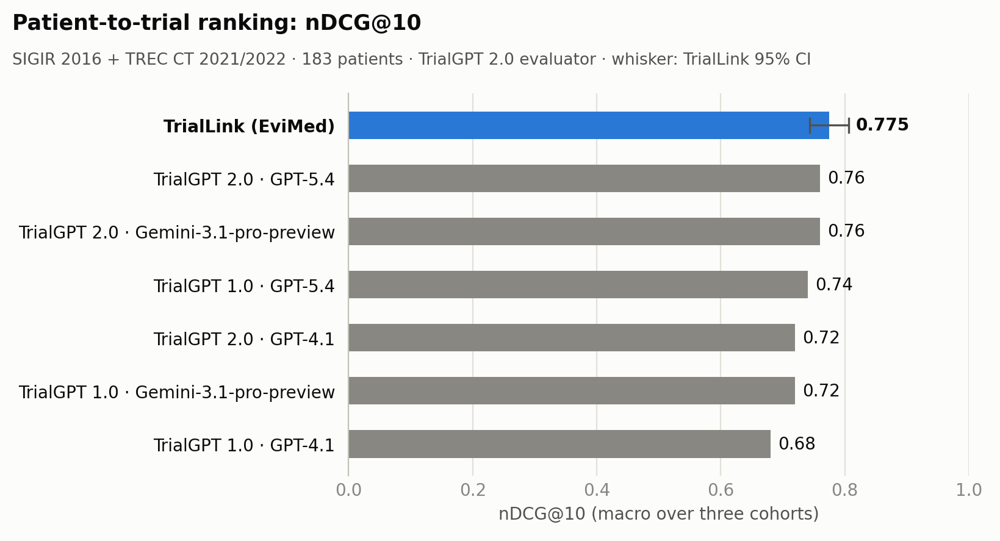
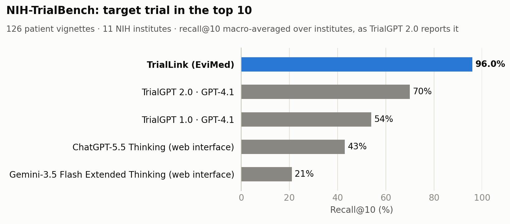

# TrialLink 基准测试结果

**EviMed · 2026 年 11 月 · TrialLink `triallink-1`**

TrialLink 是 EviMed 的患者–临床试验匹配系统：从一份病历出发，检索并排出合适的临床试验，再对医生打开的试验逐条判断入排标准。
本文给出它在领域通用的公开基准上的成绩，并列出每个基准上能找到可比数字的全部已发表系统。

## 核心结果

| 基准 | TrialLink | 已发表的最好对比系统 |
|---|---|---|
| 患者–试验排序：SIGIR 2016 + TREC CT 2021 + TREC CT 2022（183 位患者，TrialGPT 2.0 评测协议） | **nDCG@10 0.775**，P@10 0.710，MAP 0.617 | TrialGPT 2.0（GPT-5.4）：0.76、0.70、0.60 |
| — 其中开发全程未使用的 105 位留出患者 | **nDCG@10 0.839** | 未报告 |
| NIH-TrialBench：目标试验进入前 10（126 个病例，11 个 NIH 研究所） | **96.0%** | TrialGPT 2.0：70% |
| TREC CT 2022 全库检索（50 个题目，375,580 个试验） | nDCG@10 0.585；**P@10 0.526；RR 0.809** | 官方最好提交：0.613；0.508；0.726 |
| TREC CT 2021 全库检索（75 个题目） | nDCG@10 0.559 | 官方最好自动提交：0.712 |
| TREC CT 2023 全库检索（40 个题目中有评判的 37 个，451,538 个试验） | nDCG@10 0.504（下限，见 3.3） | 官方最好提交：0.738 |

- 在 TrialGPT 2.0 基准上，TrialLink 的 nDCG@10、P@10 和 MAP 是已报告结果中最高的。它的 nDCG@10 95% 置信区间（0.743–0.806）
  与 TrialGPT 2.0（GPT-5.4）的 0.76 有重叠；已发表系统只给点估计，无法做配对检验。
- TrialLink 的任何组件都没有在任何基准数据上训练或微调，所有模型按发布原样使用。
- 排序成本约每位患者 0.24 元人民币（约 0.03 美元），每位患者约 410 个候选试验。

## 1. 系统组成

TrialLink 分三个阶段。

1. **检索**：用病情和从病历中写出的至多 32 个按重要性排序的英文检索词做关键词检索，与稠密语义检索（Qwen3.7 文本向量，1024
   维）按倒数排名融合；按登记记录写明的年龄、性别筛选；保留前 300 个。产品中关键词检索实时查询 ClinicalTrials.gov、欧盟 CTIS
   和 ChiCTR。
2. **排序**：对每个候选试验的完整登记记录做两种互补的判读——相关性重排（Qwen3.7 文本重排）和五档资格匹配评分（Jev 1.14），
   两个排序按倒数排名融合（k = 60）。排序环节不调用通用推理大模型。
3. **逐条评估**：对医生选中的试验，由 DeepSeek V4.1 Flash 智能体对照病历中引用的原文，逐条判断每项入选和排除标准（符合、不符合、
   信息不足）。评估用来解释排序，不改变排序。

## 2. 评测协议

- **基准与评分脚本**：患者–试验排序和 NIH-TrialBench 使用 TrialGPT 2.0 公开的数据和官方评分脚本
  （`eval_trialgpt_rankings_qrels.py`、`eval_nih_trialbench_target_recall_at10.py`）。TREC CT 使用官方相关性判定和赛道指标，
  未被评判的试验按不相关计。
- **两种 P@10**：TrialGPT 2.0 基准的 P@10 是分级的（被排除或可能符合的试验计半分），沿用该论文定义；TREC CT 的 P@10 只计符合的
  试验，沿用赛道定义。两者不可直接比较。
- **开发集与留出集**：所有设计选择只在 78 位开发患者上做出（全部 58 位 SIGIR 患者，以及每年 TREC 的前 10 个题目）。排序基准的其余
  105 位患者在设计定稿前从未读取，单独报告。NIH-TrialBench 只用于测试。TREC CT 的检索选择只在每年前 10 个题目上做出。
- **不确定性**：95% 置信区间为按患者的百分位自助法（10,000 次重抽样，在各队列内抽样后取宏平均）。
- **对比系统**：所有对比数字均摘自所列来源。TrialGPT 2.0 论文以柱状图给出结果、没有数值表，数值读自柱状图标注（两位小数）。

## 3. 榜单

### 3.1 患者–试验排序（TrialGPT 2.0 协议）

183 位患者——SIGIR 2016（58）、TREC CT 2021（75）、TREC CT 2022（50）——共 75,061 个已评判的患者–试验对。每个系统对患者的全部
已评判试验排序；总分为三个队列平均值的平均。

| 排名 | 系统 | 机构 | 底座模型 | nDCG@10 | P@10（分级） | MRR | MAP |
|---|---|---|---|---|---|---|---|
| 1 | **TrialLink** | EviMed | TrialLink | **0.775**（0.743–0.806） | **0.710**（0.676–0.743） | 0.820（0.776–0.863） | **0.617**（0.588–0.645） |
| 2 | TrialGPT 2.0 | NCBI/NLM, NIH | GPT-5.4 | 0.76 | 0.70 | 0.85 | 0.60 |
| 2 | TrialGPT 2.0 | NCBI/NLM, NIH | Gemini-3.1-pro-preview | 0.76 | 0.69 | 0.84 | 0.56 |
| 4 | TrialGPT 1.0 | NCBI/NLM, NIH | GPT-5.4 | 0.74 | 0.67 | 0.84 | 0.55 |
| 5 | TrialGPT 2.0 | NCBI/NLM, NIH | GPT-4.1 | 0.72 | 0.66 | 0.80 | 0.54 |
| 5 | TrialGPT 1.0 | NCBI/NLM, NIH | Gemini-3.1-pro-preview | 0.72 | 0.67 | 0.78 | 0.55 |
| 7 | TrialGPT 1.0 | NCBI/NLM, NIH | GPT-4.1 | 0.68 | 0.63 | 0.73 | 0.49 |

按 nDCG@10 排名。TrialGPT 各行来源：arXiv 2609.01202v2 图 5d（GPT-4.1）与补充图 3（GPT-5.4、Gemini-3.1-pro-preview）；
TrialGPT 1.0 各行是该论文的重跑结果。

**分队列**（nDCG@10 / P@10）：

| 系统 | SIGIR 2016 | TREC CT 2021 | TREC CT 2022 |
|---|---|---|---|
| **TrialLink** | 0.628 / 0.466 | **0.880 / 0.865** | **0.815 / 0.797** |
| TrialGPT 2.0 · GPT-5.4 | **0.66 / 0.50** | 0.84 / 0.82 | 0.78 / 0.77 |
| TrialGPT 2.0 · GPT-4.1 | 0.64 / 0.48 | 0.79 / 0.78 | 0.72 / 0.72 |
| TrialGPT 1.0 · GPT-5.4 | 0.62 / 0.45 | 0.83 / 0.82 | 0.75 / 0.73 |
| TrialGPT 1.0 · GPT-4.1 | 0.58 / 0.42 | 0.76 / 0.77 | 0.70 / 0.71 |

TrialLink 在两个 TREC 队列上领先，在 SIGIR 上落后；SIGIR 的评分含义是"是否会转介"，而不是"是否符合"。

**留出患者**：在开发期间从未读取的 105 位患者上（TREC CT 2021 65 位、TREC CT 2022 40 位），TrialLink 的 nDCG@10 为 0.839
（0.794–0.880），P@10 0.823，MRR 0.907，MAP 0.671。

### 3.2 NIH-TrialBench：目标试验检索

126 个根据 NIH 试验撰写的病例，覆盖 11 个研究所；每个病例在自己的检索空间中排序，病例所对应的试验进入前 10 即为命中。召回率按
研究所宏平均，与 TrialGPT 2.0 的报告口径一致。

| 排名 | 系统 | 机构 | 前 10 召回（研究所宏平均） | 前 10 召回（全部 126 例） | MRR |
|---|---|---|---|---|---|
| 1 | **TrialLink** | EviMed | **96.0%** | 89.7%（84.1–94.4） | 0.604 |
| 2 | TrialGPT 2.0（GPT-4.1） | NCBI/NLM, NIH | 70% | – | – |
| 3 | TrialGPT 1.0（GPT-4.1） | NCBI/NLM, NIH | 54% | – | – |
| 4 | ChatGPT-5.5 Thinking 网页版 | OpenAI | 43% | – | – |
| 5 | Gemini-3.5 Flash Extended Thinking 网页版 | Google | 21% | – | – |

对比系统来源：arXiv 2609.01202v2 图 5c。

### 3.3 TREC 临床试验赛道：全库检索

赛道本身的任务：在冻结的 ClinicalTrials.gov 全量快照中，找出患者符合条件的试验。nDCG@10 的增益为 2（符合）、1（被排除）、0；
P@10 和倒数排名（RR）只计符合的试验。

**如何读 TrialLink 的 TREC 分数**：TREC 只评判了参赛提交检索到的试验。赛后构建的系统会找到没有任何提交检索到的试验，这些试验从未
被评判，按不相关计分。官方提交的前 10 都经过评判；TrialLink 前 10 中被评判过的比例为 60%（2021）、68%（2022）和 52%（2023），
所以它的官方分数是下限。

**2021**（75 个题目，375,580 个试验）

| 排名 | 系统 | 类别 | nDCG@10 | P@10 | RR |
|---|---|---|---|---|---|
| – | TDMINER | 官方提交，人工 | 0.715 | 0.576 | 0.834 |
| 1 | h2oloo monoT5（滑铁卢大学） | 官方，最好自动提交 | 0.712 | 0.593 | 0.816 |
| 2 | damoebrtog（阿里达摩院） | 官方 | 0.595 | 0.409 | 0.608 |
| 3 | **TrialLink** | 本报告 | **0.559**（0.491–0.624） | 0.488 | 0.741 |
| 4 | CSIROmed_inc（CSIRO） | 官方 | 0.532 | 0.317 | – |
| 5 | BM25+、实体与年龄性别过滤（Kusa 等） | 赛后 | 0.513 | 0.337 | 0.604 |
| 6 | ChatGPT 生成检索式 + RM3（Peikos 等） | 赛后 | 0.512 | 0.323 | 0.541 |
| 7 | 病历原文 BM25 | 基线 | 0.469 | 0.264 | 0.471 |
| – | 赛道中位数（自动提交） | 参考 | 0.304 | 0.161 | 0.294 |

**2022**（50 个题目，375,580 个试验）

| 排名 | 系统 | 类别 | nDCG@10 | P@10 | RR |
|---|---|---|---|---|---|
| 1 | GPT-4-turbo 对前 500 按资格重排（Jullien 等） | 赛后 | 0.693 | 0.718 | 0.769 |
| 2 | GPT-4 判读交叉编码器前 20（IELAB） | 赛后 | 0.659 | 0.568 | – |
| 3 | h2oloo frocchio_monot5_e（滑铁卢大学） | 官方，最好提交 | 0.613 | 0.508 | 0.726 |
| 4 | TCRR-Bio（Kusa 等） | 赛后 | 0.604 | 0.482 | 0.672 |
| 5 | **TrialLink** | 本报告 | **0.585**（0.508–0.660） | 0.526 | **0.809** |
| 6 | DoSSIER_5 | 官方，第二名队伍 | 0.556 | 0.456 | – |
| 7 | ChatGPT 生成检索式 + RM3（Peikos 等） | 赛后 | 0.509 | 0.372 | 0.623 |
| 8 | CSIROmed monobert500（CSIRO） | 官方 | 0.491 | 0.362 | – |
| – | 赛道中位数 | 参考 | 0.392 | 0.258 | 0.411 |

在官方提交中，TrialLink 的 nDCG@10 位于第一和第二名队伍之间，P@10 和 RR 高于官方最好提交；RR 是所列全部系统中最高的。

**2023**（40 个题目中有评判的 37 个，451,538 个试验）

| 排名 | 系统 | 类别 | nDCG@10 | P@10 | RR |
|---|---|---|---|---|---|
| 1 | CSIROmed qe_prr_ft（CSIRO） | 官方 | 0.738 | 0.527 | 0.667 |
| 2 | IELAB GPT-4 重排前 20 | 官方 | 0.736 | 0.511 | – |
| 3 | DoSSIER_3 | 官方 | 0.684 | 0.584 | 0.642 |
| 4 | IELAB CE_weighted | 官方 | 0.672 | 0.443 | – |
| 5 | CSIROmed BM25 基线 | 官方 | 0.619 | 0.330 | 0.563 |
| 6 | IELAB 稠密检索 | 官方 | 0.577 | 0.324 | – |
| 7 | **TrialLink** | 本报告 | **0.504**（0.433–0.573） | 0.451 | **0.778** |
| – | 赛道中位数 | 参考 | 0.648 | 0.394 | 0.538 |

2023 年受评判覆盖影响最大：TrialLink 前 10 中有一半试验从未被评判。它的 P@10 高于赛道中位数，RR 是所列系统中最高的。

## 4. 成本与速度

在排序基准上实测（每位患者约 410 个候选）：Qwen3.7 重排每位患者 0.08 元，每 100 个试验 2.6 秒；Jev 1.14 评分每位患者 0.16 元，
8 路并发时每个试验 0.25 秒。产品中一次检索排序 300 个候选。对一位患者的 20 个试验逐条判断入排标准，
中位耗时 81 秒（90% 分位 148 秒；5 位患者，在生产智能体运行环境中端到端实测），各试验的标准分给至多 12 个 Flash 智能体并行判断。

## 5. 复现

评测代码：`OpenScience/evals/vcr-matching-boards/`（运行器、评分器和榜单生成器）。基准数据和官方评分脚本：TrialGPT 2.0 代码库
（提交 `1c5f9eb`）和 TREC 临床试验赛道 2021–2023 的相关性判定。本页全部数字见 [`leaderboard.json`](leaderboard.json)，
`make_figures.py` 绘制本页图表。

## 参考文献

见英文版 [README.md](README.md#references)。
