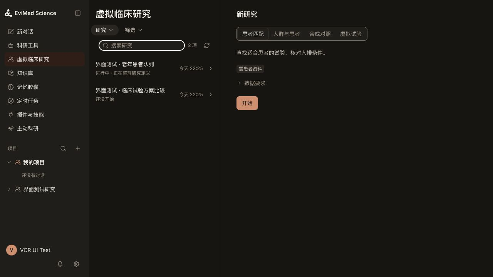

# VCR public-data remediation: implementation and acceptance

Date: 2026-10-29. Scope: the owner's requested repair of VCR-A01–A09 and the subsequent homepage-layout correction. Source baseline: 7165df939, fast-forwarded to a66e22f44 (progress documentation only). Delivery is source commit and GitHub push; no deployment, production migration, or production data deletion is part of this change.

This report follows the [initial diagnostic audit](2026-10-29-vcr-public-data-first-pass.md). That audit describes the old serving release and its failures; its statements that repairs were not yet implemented are historical. The verification below is local current-code evidence, not a claim about the serving release.

## Repairs and evidence

| Finding | Implemented behavior | Acceptance evidence |
|---|---|---|
| A01: people versus records | Version1.1 profile counts distinct complete subject identities on declared subject/long/event data. Unknown grain or incomplete identity stays unknown. Cohort building requires one complete unique row per person. Identifier columns are excluded from clinical distributions. Legacy1.0 results remain replayable. | Public PhysioNet80 baseline people;4,407HR observations from78 people; duplicate/missing identity counterexamples; synthetic/reconstructed counts remain separate. |
| A02: upload-to-result continuity | Authenticated original uploads receive immutable source receipts, independent of the knowledge base. Typed intake reuses import, mapping, confirmation and freeze, then binds the saved population and engine result. The current confirmed mapping hash is rechecked inside the snapshot transaction. Mapping is editable; prior snapshots retain their original mapping. | RealPG intake tests cover ownership, changed/withdrawn sources, concurrent remapping, exacthash/version binding and normal upload API. Actual DeepSeek+DSH public-data case saves80-person snapshot and52-person cohort through the realR service. |
| A03: absent evidence and applicability | Matching instructions distinguish applicability, observed facts and eligibility. Original CSV documents can be admitted for automated evaluations without pretending generated prompts are human evidence. Source-span fact verification and three-valued criteria remain authoritative. | Two synthetic cases, six source-bound facts, three criteria, two saved assessments: age58 does not establish pregnancy/menopause; the female pregnancy finding is unknown; the male criterion is not applicable. No missing mandatory fact is turned into eligibility. |
| A04: invented clinical dates | Newly saved facts require quoted calendar evidence when a date is supplied; undated source-supported facts remain admitted. Nested time intervals require stated bounds or explicit source-anchored duration arithmetic. Dataset year, upload time and undated age cannot become patient calendar facts. Existing historical schema remains readable. | Literal-date, invalid-calendar, year-only, metadata-shift and nested-interval counterexamples; real matching case retains unknown when an encounter anchor is absent. Instructions retain calendar-month windows instead of silently replacing them with182days. |
| A05: schema guessing writes | Scope-independent contract discovery gives supported write envelopes and the domain's actual nested criterion grammar, including applicability and time windows. Empty patient-set and probe decision writes cannot create scientific objects. Original-upload discovery is paginated and reports incomplete scans. | Exhaustive grammar/validator parity, no-write contract reads, realPG receipt and no-probe persistence checks. Live cases preceded the last grammar refinement and still contained refused syntax probes; no claim that final grammar eliminates all model retries. |
| A06: contradictory summaries | Sequential attrition carries its actual denominator, remaining count and unknown treatment. Mean/median ordering is shown as descriptive values, not a skewness or causal-bias conclusion. | Independent80→52→40 count tests; visible sequential denominators and included/excluded unknown cases; source counts cannot overwrite selected-result counts. |
| A07: silent time units | Versioned RMST, weighting, weightedCox, covariate-set and survivalMAIC paths use explicit or confirmed source units and refuse known conflicts. Owned reconstructed-curve calibration units reach derived comparator inputs. No implicit numerical conversion is performed. | ACTG175 local reference difference85.8338066119days; explicit/missing/conflicting/legacy unit cases; real curve resolver plusR MAIC conflict tests. Existing curve calibration metadata is provenance-bound, not newly represented as independently digest-attested historical calibration. |
| A08: evidence after shutdown | Exact-run authenticated history can read digest-verified persisted text and tool events without a live kernel. Root turn and child ownership are fixed to the capture. Injected context, credentials and private reasoning are omitted from the reader projection; missing scope or gaps remain explicit. | Real completion-hook/disk/HTTP integration, cross-account/session refusal and tamper refusal; both real-model cases read complete preserved evidence after stopping their runtime. |
| A09: misleading completion | Compact research progress separates saved definition, available input, computation status and actual result. Counts bind to exact source/result identities and method versions. Pending, failed, limited, stale and partial states remain distinct; useful existing files remain available. | Presenter/service tests include real execution input shape, subjectId-null profiles, cross-snapshot isolation and incomplete scans; rendered progress and attrition components checked inIAB at1280 and390px with no horizontal overflow. |
| Homepage correction | Replace the expanded feature introduction with a compact task selector alongside the research list. Narrow layouts switch views instead of stacking four introductions above the list. Only the selected task shows concise data requirements. Existing native drafts, results, history and access checks remain. | Authenticated localIAB:1280px split workspace;1024px and390px swap views with no horizontal overflow. One primary action; selected-only prerequisites; keyboard task selection; search survives returning from a preview; empty state contains no AI process narration. Tests cover retained rows after refresh errors. Screenshots use explicit UI fixtures, not clinical results. |

## Real model replay

Two bounded, sequential automated runs used the pinnedDSH kernel with DeepSeek, current local control-plane source, and the actual lockedR engine. Public PhysioNet rows and purpose-written synthetic matching cases contained no evaluator answer columns. ACTG records were not sent to a model.

- Cohort: normal authenticatedCSV upload→original receipt→confirmed mapping→frozen80-person snapshot→saved age>=65 population→real engine result52, excluded28, unknown0. The model's first compute call omitted idColumn and was refused; it corrected the request and the second job succeeded. Exact saved object/result records were read back. The model also incorrectly described the confirmed mapping as immutable. The final tool wording and shared instructions now distinguish an editable mapping from immutable snapshots; that wording refinement followed the run and was not followed by a third paid replay.
- Matching: normal authenticatedCSV upload→two original documents→six facts→one substantive protocol/three criteria→two saved assessments. The woman remains unknown on pregnancy and the undated six-monthMI window; the male pregnancy criterion has applicable=false. Source and judgment readbacks are preserved. The model initially approximated six months as182days and disclosed that approximation; these examples do not exercise a calendar-boundary decision. Final grammar and instruction refinements explicitly expose month windows and forbid silent conversion.
- Both ledger runs succeeded.28 and47 observable tool calls were retained, respectively. Both exact-run archived reads returned200, available=true andpartial=false after runtime stop. Both throwaway accounts were removed through the normal deletion API with200 responses before their isolated test database and runtimes were removed.

These are targeted acceptance cases with explicit corrective prompts, not a rerun of the1015-rowTrialGPT benchmark or an unbiased measurement of model improvement. The local harness ranDSH as a host process; production container filesystem isolation was not reproduced. It had access beyond the workspace that production does not mount. No claim of deployment-equivalent isolation follows from these runs. A separate local UI fixture account was also deleted normally with200 after browser acceptance; its seeded study state is explicitly illustrative.

## Verification ledger

Raw logs remain in ignored acceptance storage. This report, two bounded homepage screenshots, regression tests and source changes are committed; no patient datasets or full model transcripts are published.

- Authenticated archive/date/projection regression:14/14, including actual completion and persisted HTTP read.
- Real control-plane→HTTP engine→R seam and knowledge comparison:14/14, zero skips, locked Linux container and disposable localPostgreSQL.
- ServerVCR/archive/transcript sweep:1,657passed,0failed,16environment-dependent skips. Those skipped paths were subsequently exercised in configured environments:14real-engine seam/knowledge cases,21intake tests including the previously skipped raw-profile/RMST subcases, and1realDocker/PostgreSQL fence test all passed. Counts overlap and are not summed. Runtime UI policy:96passed plus1PostgreSQL-dependent skip in its standalone run; the PostgreSQL policy test passed in the earlier configured broad run. An initial shared-nativeHTTP timing failure under concurrent load passed isolated and in the full standalone policy rerun; no timeout or assertion was relaxed.
- FullR suite:236/236passed on frozen source, with all34declared methods exercised in numeric assertions. The first run exposed three outdated fixtures plus exact-field-access scanner findings; the final run includes the corrected fixtures and expanded observed-time unit regressions. Networking was disabled for this numerical run.
- FrontendVCR components and pages:55files/757tests passed. The added subject-grain enum has a Chinese label, preserves user-defined values and participates in exhaustive128choice coverage. Homepage composition retains exactly one primary action per current view.
- DomainVCR:248/248; PythonMCP:61/61. Server/domain/web typechecks and lint passed; capability manifests, skill packages, runtime inventory, scenario help and skill vocabulary synchronized/checked. Web production build passed with the existing large-chunk warning. Source credential audit passed.

## Limits and next evaluation

No clinical effectiveness, counterfactual treatment effect, generalization, regulatory acceptance or public leaderboard standing is established by these tests. The original12-caseTrialGPT diagnostic agreement remains5/12; do not substitute two hand-selected counterexamples as a new accuracy figure. Larger patient-grouped untouched evaluation remains the next scientific study. OriginalTREC historical corpora remain an acquisition gap; author-derived candidate pools are not full retrieval evaluation. ACTG source rights remain unresolved, so its rows stay local. Dataset inputs, gold, patient rows, credentials and full transcripts are not published.

Independent code review approved the final backend and homepage changes with no remaining blocker. Final source push is distinct from GitHubCI, merge and deployment. This task does not deploy.

## Evidence locations and design references

- Initial data and hosted diagnostics: `.evimed-local/acceptance/vcr-benchmark-20261029/`.
- Current local model replay: the `live-current/evidence/` subdirectory of that pack, including object/judgment readbacks, preserved tool events and cleanup receipts.
- Repair tests and numerical outputs: `.evimed-local/acceptance/vcr-fixes-20261029/`.
- Independent implementation review: `.planning/vcr-fixes-20261029/review.md` (local evidence).
- Homepage review uses the owner's screenshot and current code, the platform's `OpenScience/DESIGN.md`, and Impeccable's [Operate](https://github.com/pbakaus/impeccable/blob/main/skill/reference/operate.md), [Distill](https://github.com/pbakaus/impeccable/blob/main/skill/reference/distill.md), [Clarify](https://github.com/pbakaus/impeccable/blob/main/skill/reference/clarify.md) and [craft floor](https://github.com/pbakaus/impeccable/blob/main/skill/reference/craft-floor.md), read2026-10-29. No hook, engine or global design configuration was installed.

## Final homepage previews

Local authenticated UI fixture, final compiled frontend. These images verify layout and copy, not patient outcomes.

